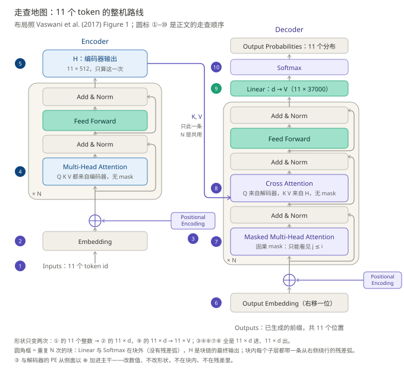
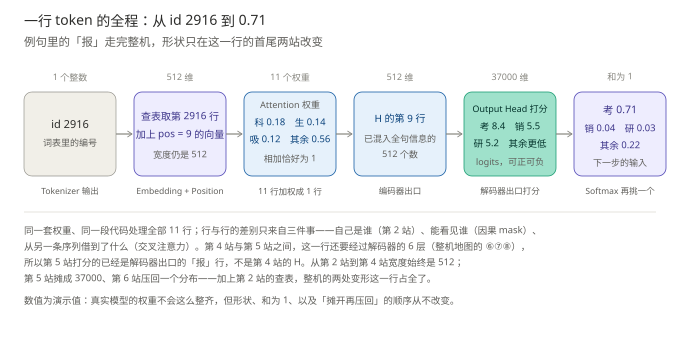
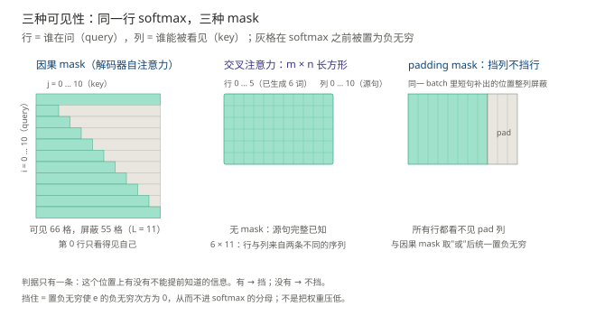
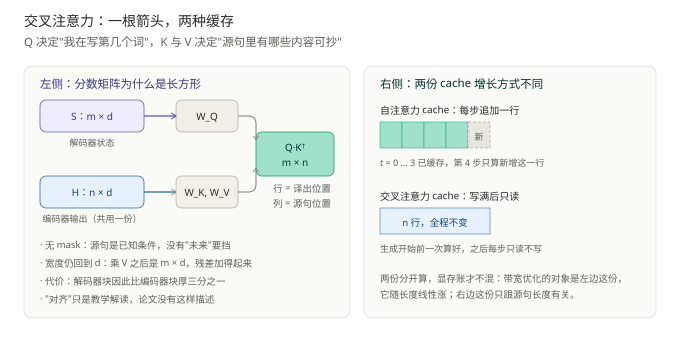
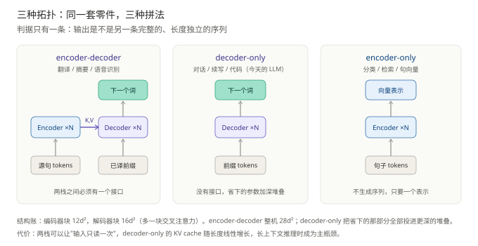

# Transformer 完整走一遍

> **一句话结论**：「科软 放 实习 吸引 学生 报考」这 11 个 token 进整机后，形状只变两次——入口把 11 个整数摊成 $11 \times d$ 的矩阵，出口把这个矩阵摊成 $11 \times V$ 的分数表；中间被 $N$ 层反复搬运加工，**宽度一步没变**。整机因此可以看成一根定宽 $d$ 的传送带：入口把文字翻成向量，出口把向量翻回文字。
>
> - **进门三步，各发一样东西**：Tokenizer 给编号、Embedding 给向量、位置编码给坐标——三样东西都不改变"一行一个位置"的布局，此刻 11 行互相还不知道对方的存在
> - **中段每层只有两个动作**：Attention 决定这一行从哪些行取信息，FFN 决定这一行自己加工多深；残差把原始行始终留在通道里，也让"变形只能发生在两端"成为结构必然
> - **出口摊开再挑一个**：输出头把每行摊成 $V$ 个分数，softmax 压成分布，解码规则从中选一个词拼回输入——这一步的输出就是下一步的输入，整机靠它闭环

**前置阅读**：全系列前六部分

**图 1**：走查地图，布局照 Vaswani et al. (2017) Figure 1，圆标 ①–⑩ 是本篇的走查顺序。看图要点：**圆角大框是重复 $N$ 次的块**，Linear 与 Softmax 留在框外；块内每个子层右侧有一条绕行的残差弧；$\oplus$ 之后直接进第一个注意力，中间没有 Add & Norm；两栈的 Positional Encoding 都是从侧面加进主干的另一股信号；两栈之间只有交叉注意力一根箭头。

例句仍是全系列基线：`科软 放 实习 吸引 学生 报考`，逐字切分 11 个 token（教学基线；cl100k_base 实测 13 个，中文优化词表 6–8 个）。整机形状按 $L = 11$、$d = 512$、$V = 37000$、$N = 6$（2017 年 base 配置）算，只为好算好验证；今天主流模型是 $d = 4096$ 量级、$N$ 数十层、$V$ 128k。

---

## 一、走查任务：让整机把这句话再说一遍

> 本节要回答的问题：走查用什么任务？走完全程，形状总共变过几次？

论文的整机是 encoder-decoder，天生为"读一条序列、写另一条序列"服务。为了让走查自始至终只用这一句例句，给整机派一个最简单的任务：**把这句话原样复述一遍**——编码器读 11 个 token，解码器逐个吐出同样的 11 个 token。选复述只有一个理由：源句位置 $i$ 和目标位置 $i$ 说的是同一个词，交叉注意力的行为一眼可查；真实翻译里这张对应表是错位、多对多的，**别把对角当规律**。

先立一份形状总账，走查时对号入座：

| 站点                  | 形状            | 变了什么                   |
| ------------------- | ------------- | ---------------------- |
| ① 切词                | 11 个整数        | 文本变编号                  |
| ②③ 查表 + 加位置         | $11 \times d$ | 编号变向量，此后宽度不再变          |
| ④ 编码器 × $N$         | $11 \times d$ | 每行混入全句信息               |
| ⑤ 编码器输出 $H$（3.4 定义） | $11 \times d$ | 只算一次                   |
| ⑥⑦⑧ 解码器 × $N$       | $11 \times d$ | 右移一位；看一半；借一次源句         |
| ⑨ 输出头               | $11 \times V$ | 第二次、也是最后一次变形           |
| ⑩ softmax + 解码      | 11 个分布 $\to$ 1 个词 | 训练出 11 个 loss，推理出 1 个词 |

为什么变形只能挤在两端？残差是逐元素加法 $x + f(x)$，要求 $f(x)$ 与 $x$ 同形——所以残差弧上的每个子层都必须 $d \to d$。能改变宽度的只有两处不在弧上的位置：进门处的嵌入查表（它发生在第一条残差弧出现之前），和最后一个 block 之后的输出头（后面再没有加法等着对齐）。交叉注意力看似第三处——它的 K/V 来自另一条序列——但这两块矩阵不进本栈的加法，只是被本栈的 Q 查询：行数允许和本栈不同（这是 4.2 里 $m \times n$ 的来历），宽度仍必须等于 $d$。**变形位置由残差拓扑决定，不是设计偏好。**

## 二、进门：三步，形状一次都不变

> 本节要回答的问题：11 个 token 怎么变成 11 行定宽的数？为什么这三步不改变形状？

### 2.1 ① 切词：11 个 token，11 个整数

Tokenizer（分词器）按学到的词表把句子切成编号（第 0 篇）。按逐字基线切分，每个字的 id 是（演示值）：

| 科    | 软    | 放    | 实    | 习    | 吸    | 引    | 学    | 生    | 报    | 考    |
| ---- | ---- | ---- | ---- | ---- | ---- | ---- | ---- | ---- | ---- | ---- |
| 4213 | 8127 | 3391 | 1204 | 1288 | 6610 | 6017 | 4452 | 4471 | 2916 | 2944 |

此刻信息量最少：每个 id 只是"词表里第几行"，还谈不上语义。

### 2.2 ② 查表：把编号换成 512 个数

Embedding（嵌入）表是一张 $37000 \times 512$ 的可学矩阵（第 1 篇），查表就是取第 4213 行——**没有乘法**。"科"的行向量前 4 个分量假设是 0.12、−0.35、0.08、0.51（演示值），其余 508 个同理；11 个 id 各取一行，摞成 $11 \times 512$。**两栈共用同一张嵌入表**——解码器在第 ⑥ 站查"科"得到的是同一行，两栈说的才是同一门语言。

### 2.3 ③ 加位置：给每一行盖时间戳

注意力本身对顺序是置换等变的（第 2 篇），位置必须从外部注入。位置编码是一张写死的表：

$$
\mathrm{PE}(pos, 2i) = \sin\left(\frac{pos}{10000^{2i/d}}\right), \qquad \mathrm{PE}(pos, 2i+1) = \cos\left(\frac{pos}{10000^{2i/d}}\right)
$$

代入 $d = 512$：pos = 0 的第 0、1 维是 $\sin 0 = 0$、$\cos 0 = 1$；pos = 1 的第 0、1 维是 $\sin 1 = 0.841$、$\cos 1 = 0.540$，第 2、3 维波长放大 $10000^{2/512} \approx 1.04$ 倍，角度缩到 0.965，得到 0.821、0.570。每一行拿到独一无二的坐标指纹。**用加法而不是拼接注入**：拼接会把主干撑宽，残差就得跟着配投影矩阵，恒等路径被破坏。

出门时 $X \in \mathbb{R}^{11 \times 512}$。此刻 11 行互不相识——每行只知道自己是谁（词义 + 位置），还不知道句子里还有谁。**把行与行连起来，是接下来 $N$ 层唯一的工作。**

## 三、编码器：11 行互相看 6 遍

> 本节要回答的问题：11 行各自独立的向量，靠哪三个动作变成"带上下文"的表示？

### 3.1 第一件事：算 11 × 11 的"该看谁"

$X$ 乘三个 $512 \times 512$ 矩阵得到 Q、K、V（各 $11 \times 512$），按 $h$ 个头拆开（base 配置 8 头、每头 $d_k = 64$），每头算 $\mathrm{softmax}\hspace{-0.1667em}\left(Q_h K_h^{\top} / \sqrt{64}\right)$，得 $11 \times 11$ 分数矩阵。

**"报"（第 9 行）softmax 后的 11 个权重（演示值，和恰好为 1）：**

| 科    | 软    | 放    | 实    | 习    | 吸    | 引    | 学    | 生    | 报    | 考    |
| ---- | ---- | ---- | ---- | ---- | ---- | ---- | ---- | ---- | ---- | ---- |
| 0.18 | 0.07 | 0.06 | 0.05 | 0.06 | 0.12 | 0.09 | 0.10 | 0.14 | 0.06 | 0.07 |

主语"科软"合计 0.25，宾语"学生"合计 0.24，谓语"吸引"合计 0.21——"报"最关心谁发出动作、谁承受动作，这正是第 3a 篇说的"按内容自己决定看谁"。然后 V 的 11 行按这组权重加权平均成一个 64 维向量：**输出是别的行的加权平均，不是任何一行的复制**。8 个头各拼一份 64 维，拼回 512，过 $W_O$，得到 $\Delta$。

### 3.2 第二件事：每一行自己加工

FFN（前馈网络）对每一行独立做 $512 \to 2048 \to 512$ 的两层变换（第 4 篇）。**逐行独立是刻意的分工**：如果 FFN 也跨行混合，它就和注意力变成同一种操作，堆深度失去意义——注意力跨行搬运，FFN 原地加工。参数上 FFN 占 $8d^2$，是注意力的两倍：块内三分之二的参数花在加工上。

### 3.3 第三件事：把原样留住

每个子层套一条残差弧：

$$
X \leftarrow \mathrm{LN}\left(X + \mathrm{Attn}(X)\right), \qquad X \leftarrow \mathrm{LN}\left(X + \mathrm{FFN}(X)\right)
$$

代算："报"行某一维经注意力后变成 0.43，加回原值 0.12 得 0.55，再过 LayerNorm（层归一化）缩放到合理范围（第 5 篇）。为什么要"加回"：恒等路径的导数恒为 1，梯度可以不衰减地直穿 $N$ 层——**这是整机敢堆 6 层乃至上百层的全部底气**。2017 年 LN 在子层出口（post-LN），今天主流挪到入口并换成 RMSNorm，整机层面只是"LN 站的位置变了"，细节已在第 5 篇。

### 3.4 六层之后：$H$ 到底是什么

"注意力 $\to$ 加 $\to$ FFN $\to$ 加"跑 $N = 6$ 遍（每遍参数独立）。先拆掉一个误解：**$H$ 不是一个新零件，也不是"第 6 层的输出"这种局部的东西**——它是"整条编码器栈跑完之后那块矩阵"的名字，相当于给"11 行 × 512 列的结果"起个名，好让后面的话有主语。

$$
H = \mathrm{Encoder}(X) \in \mathbb{R}^{11 \times 512}, \qquad H_{i,:} = \text{第 } i \text{ 个 token 的上下文向量}
$$

逐项读一遍：

- **形状 $11 \times 512$**：11 行对应输入的 11 个位置，列还是那 512 维。宽度没变，所以它和 $X$ 长得一模一样；
- **第 $i$ 行**：第 $i$ 个 token 走完 6 层后的那 512 个数。"报"的行里已经混进了"科软是主语、学生是宾语"这些从别的行搬来的信息——上下文被压进了这 512 个数；
- **字母 $H$**：hidden states（隐状态）的首字母，是文献和代码里对"模型内部某一层的表示矩阵"的通用叫法，用来和参数 $W$、输入 $X$ 区分。**注意边界**：论文正文并没有给编码器输出指定符号，只说 keys 和 values 来自编码器的输出；$H$ 是教学与工程里的通行写法，有的资料写 $Z$，有的代码叫 `enc_output` 或 `memory`（它确实是被反复查询的一份"记忆"）——**它们是同一个东西**，看到别的写法不必慌。

$X$ 与 $H$ 必须分清，这是全篇最容易马虎的地方——两者形状相同，含义完全不同：

|        | $X$（进门）              | $H$（出门）               |
| ------ | -------------------- | --------------------- |
| 怎么来的   | 查表 + 加位置，**逐行独立**算出来 | 6 层注意力跨行搬运 + FFN 原地加工 |
| 每行装什么  | 这个词是谁、它排第几           | 这个词在**这句话里**扮演什么      |
| 行与行    | 互不相识                 | 每行都见过全部 11 行          |
| 之后还会变吗 | —                    | **不会**，只被读、不被改        |

代算一列：2.2 里"科"这一行进门时第 3 维是 0.08，6 层之后同一列变成 $-0.31$（演示值）。这个数**不是某一层单独改的**，是 6 层各改一点、再由残差一路带过来的累积——所以 $H$ 里读不出"第几层干了什么"，它是一锅炖好的结果。同理，想知道 3.1 里那组 0.18 / 0.14 的权重，只能回到那一层重算；而且 6 层各有自己的一组权重，3.1 给的只是第 1 层的演示值。

**"只算一次"是这个名字的工程含义**：$X$ 进来、$H$ 出去，编码器的活就干完了；解码器每一步读的都是同一份 $H$，没有人再改它。第四节"K/V 可以提前算好、全程只读"能成立，前提正是这里的 $H$ 不再变。

**图 2**："报"这一行的全程。看图要点：第 2 站到第 4 站（编码器出口 $H$）宽度始终是 512；第 3 站的 11 个权重和恒为 1，它只决定"从哪些行取数"，不改这一行本身；第 4 站与第 5 站之间还要经过解码器 6 层（图 1 的 ⑥⑦⑧），第 5 站打分的对象已是解码器出口的"报"行；出口这处"摊开成 37000、压回一个分布"占掉了整机两处变形的第二处（第一处在第 2 站的查表）。

## 四、换栈：这根管道为什么长这样

> 本节要回答的问题：$H$ 交给解码器为什么走交叉注意力？为什么送的是 K/V？为什么只算一次？

### 4.1 管道必须存在：解码器手里没有源句

解码器的输入只有已经生成的目标前缀（`<bos> 科 软 …`）。它的自注意力无论怎么算，都只能在这几个已生成的位置之间来回看。要说明"这样不够"，复述任务反而会帮倒忙——解码器写出来的词恰好就是源句那些字，看起来它什么都知道了。换成翻译就一目了然：解码器手里只有译文的前几个词，作为任务的**源句**一个字也不在它的输入里。复述任务同理：它看到的是"自己写出来的词"，但"写出来的词该不该是这些词"，判定依据在源句里——源句不在输入里，写错了也没有任何机制能发现。

所以源句信息必须有一条通道送进解码器。剩下的问题只有两个：这条通道里送什么，送来的东西要算几次。

### 4.2 为什么 Q 来自解码器，K/V 来自编码器

注意力是一次查资料：Q 是问题，K 是索引，V 是内容。提问方是解码器——它的问题是"我写到这儿了，源句里有什么是我需要的"，所以 Q 必须来自解码器当前状态；被查的是源句，所以源句侧出 K 和 V。这个方向还有一条形状上的硬理由：$\mathrm{softmax}\left(QK^{\top}\right)$ 后的行数永远等于 Q 的行数，而输出要接回解码器的残差弧、每一行必须对应一个译文位置——Q 来自别处，形状就对不上。

于是交叉注意力成了全机唯一 Q/K/V 不同源的地方——这正是"cross"的含义。形状上，分数矩阵是 $m \times n$ 的**长方形**：本例复述任务恰好 $m = n = 11$；换成翻译任务（源句 11 词、译文 8 词），它就是 $8 \times 11$。行是译出的位置，列是源句的位置。

### 4.3 为什么送的是 $H$，而不是源句的原始嵌入

最省事的管道是直接把源句查表后的嵌入塞过去——但那是第 2 篇进门时的状态：每行只知道自己是谁，行与行互不相识。用这样的 K 当索引，解码器的 Q 只能做字面匹配——"报"能配上的只有长得像"报"的 K，配不出"谓语位置上的动词"这种上下文级对应。所以管道里送的必须是加工过的表示：每行的 K 都知道自己在句子里扮演什么。整机里唯一负责把源句加工成这种表示的，就是编码器——**K/V 来自编码器，本质是"索引和内容都得是理解过的，不能是生词表"**。

（把 $H$ 想成"被查询的记忆"≈ 是类比不是等价：它不是检索系统，而是软性、可微分的加权读取，每个译文位置读到的都是全句的混合。）

### 4.4 为什么只算一次：源句是全程不变的条件

生成 8 个译文词的全程，源句一个字都不会变。对不变的东西，最省的方案是算一次存起来：编码器一次双向注意力要花 $O(n^2 d)$ 的算力，每生成一个词都重跑一遍的话，生成 8 个词就要付 8 次；只算一遍，这份代价就摊到整个生成过程里。"被 $N$ 个解码器层共用"也顺理成章——底层学局部、顶层学抽象，解码器要的是"这句话是什么意思"的成品表示，不是逐层的中间过程；"解码器第 1 层对编码器第 1 层"这种逐层配对没有道理可讲。

"$H$ 不再变"还有一个工程后果：它的 K/V 可以在第一个词开写之前一次算好、全程只读；解码器自己的 K/V 却每步都在增长——两份缓存必须分开管（图 4 的右半）。

### 4.5 必然性与边界

在"两栈"前提下，K/V 来自编码器不是多种接法里挑的一种，而是同时满足三条硬约束的唯一解：**可见性**（源句要双向理解，必须先离线算好）、**因果**（编码器没见过目标句，任何生成步读它都不泄题）、**形状**（Q 只能来自解码器）。它显得奇怪，只因全机其他注意力里 Q/K/V 都同源。

但"必须有编码器"只在两栈前提下成立：decoder-only 把源句拼进同一条流、罩上因果 mask，照样能做翻译——今天的 LLM 就是这么做的，代价是源句也只能被因果地看，且失去"一次算好"的静态缓存。真正的选择题是第八节的三拓扑。

## 五、解码器：右移一位，看一半，再借一次

> 本节要回答的问题：解码器的输入从哪来？为什么只能看见一半？什么时候去借源句？

### 5.1 ⑥ 右移一位：把答案排成输入

解码器的输入不是空集，而是目标序列右移一位：`<bos> 科 软 放 实 习 吸 引 学 生 报`（11 个位置），第 $i$ 行读到第 $i$ 个词、负责预测第 $i+1$ 个。查同一张嵌入表、加同一套正弦位置——**"下一个词"这个任务，就这样写进了输入的对齐方式里**（第 6 篇 Teacher Forcing）。

### 5.2 ⑦ 因果 mask：每行只能看见自己和左边

解码器训练时 11 行一起喂进去，如果不挡，第 2 行预测"放"时就能看见第 3 行的"实"——训练偷看答案，推理时无答案可看。因果 mask 在 $11 \times 11$ 分数矩阵的右上三角填 $-\infty$：121 格中下三角含对角共 66 格可见、55 格屏蔽；第 0 行只看得见自己，softmax 权重恒为 1。

**换个角度看，mask 不是限制而是许可证**：有了它，任何一行的输出都只依赖过去，11 行才能同时前向而互不污染——训练的并行性是 mask 买来的。去掉 mask 换来的不是"更快"，而是"训练和推理不一致"。

**图 3**：三种可见性。看图要点：左图因果遮挡随行号增大而缩小；中图交叉注意力全可见；右图 padding 挡列——被挡位置对所有行不可见。

### 5.3 ⑧ 交叉注意力：同一行再借一次源句

经过 4.1 的分析，解码器块内还缺一块信息——来自编码器的源句表示。缺口由交叉注意力补上：Q 来自解码器当前状态，K/V 来自 $H$，全可见、无 mask。复述任务下，"报"这一行的 11 个权重里约 0.62 压在源句的"报"上，其余分散——对角亮是**复述任务特有的现象**；真实翻译里对应表错位、多对多，可视化里最亮的格子只说明"这一步主要在抄哪里"。

**图 4**：交叉注意力的形状与两份缓存。看图要点：左边 $m \times n$ 长方形；右边自注意力缓存每步追加一行，交叉注意力缓存一次写满、之后只读。

### 5.4 一个解码器块

因果自注意力、交叉注意力、FFN、三条残差弧——形状仍是 $11 \times 512$ 进、$11 \times 512$ 出。解码器块比编码器块贵三分之一（$16d^2$ 对 $12d^2$），贵的部分正是交叉注意力这块接口。

## 六、出口：512 个数怎么变成一个词

> 本节要回答的问题：最后一次变形发生在哪？训练和推理在这里怎么分岔？

### 6.1 ⑨ 输出头：一次性摊成 37000 个分数

final LayerNorm 之后仍是 $11 \times 512$。输出头是一个 $512 \times 37000$ 的矩阵（与嵌入表共享，第 6 篇），乘出 $11 \times 37000$ 的 logits——第二次变形，也是最后一次。取第 9 行（输入"报"）：考 8.4、销 5.5、研 5.2，其余更低。

softmax 把这一行压成分布：

$$
p(\text{考}) = \frac{e^{8.4}}{e^{8.4} + e^{5.5} + e^{5.2} + \cdots} = \frac{4447}{6263} = 0.710
$$

分母里"其余 36997 个词"合计贡献 1390，于是考 0.710、销 0.039、研 0.029、其余 0.222，和为 1。11 行各得一张这样的概率表。

### 6.2 ⑩ 挑一个：训练不用挑，推理必须挑

训练时不需要挑：11 行各有标准答案，这一行的交叉熵是 $-\ln 0.710 = 0.342$，11 个 loss 平均成一个数，反向传播沿原路返回。推理时必须挑：贪心取最大，temperature / top-k / top-p 按"抽签"挑（第 6 篇）——**分布是机器给的，选谁是由解码规则决定的**。挑中的词拼到输入末尾，回到第 ⑥ 站，整机闭环。

### 6.3 同一套权重，两种走法

训练：11 行一次前向、一次收齐 11 个 loss——合法的前提正是 5.2 的 mask。推理：第 $t+1$ 个词没生成之前，第 $t+2$ 行的输入不存在，只能串行 11 步；每步只算新来的 1 行，旧行的 K/V 全部缓存（KV cache，第 3b 篇），每步算力从 $O(t^2 d)$ 降到 $O(t d)$，代价是显存随长度线性涨。**训练贵在 $L^2$ 的完整注意力矩阵，推理贵在串行与显存带宽**——两者的优化方向不同，混着谈就会得出"一起加速"这种不存在的结论。

## 七、走完回看：只有三处能装错

> 本节要回答的问题：走完一遍，哪三个地方装错了既不报错、也不崩形状，只会悄悄出错？

| 接缝  | 判据                  | 装错的后果                  |
| --- | ------------------- | ---------------------- |
| 形状  | 宽度恒为 $d$，变形只能在残差弧之外 | 残差加不起来；或形状对上、语义错位      |
| 可见性 | 这个位置有没有不能提前知道的信息    | 训练 loss 漂亮，推理崩——最难查的一类 |
| 时间  | 输入来自语料还是自己的输出       | 拿训练的方式推理，输出全是重复或无意义    |

三条判据在走查里各出现过一次：形状是"为什么变形挤在两端"（第一节），可见性是"三类注意力要不要 mask"（图 3 的判据——源句已知所以编码器双向、译文未生成所以因果、源句是条件所以交叉全可见），时间是"训练并行、推理串行"（6.3）。**记住三句话，装机时就不需要背任何特例。**

## 八、同一句话，三种拼法

> 本节要回答的问题：这台机器有几种装法？判据是什么？

**图 5**：三种拓扑。看图要点：判断标准只有一条——输出是不是另一条完整、长度独立的序列。

把例句放回三种拼法里，走法各不相同。**encoder-decoder**：如本篇，11 行读进去、11 行写出来，两栈之间留接口——翻译、摘要、语音识别。**decoder-only**：把 11 个 token 直接排成一条流，删掉编码器和交叉注意力，因果 mask 保留，每个位置预测下一个——对话、续写、代码，今天说 LLM 基本指它。**encoder-only**：走到第 ⑤ 站就停，$H$ 交给分类头或相似度头，永远不进解码器——BERT 与检索模型。

代价差别在参数上：decoder-only 把省下的接口（$4d^2$ × $N$）全部投进更深的堆叠，且每个位置都同时是监督信号——训练信号密度是两栈的两倍。代价是丢掉"输入只读一次"的静态缓存，这正是长上下文推理里 KV cache 成为瓶颈的原因。

## 九、2017 到今天：每个零件换成更省的那一版

> 本节要回答的问题：走查的每一站，今天被换成了什么？为什么值得换？

| 站点         | 2017 原论文           | 今天主流             | 上一代卡在哪           |
| ---------- | ------------------ | ---------------- | ---------------- |
| 拓扑         | encoder-decoder    | decoder-only     | 跨栈接口在开放式生成里是纯开销  |
| 归一化（3.3）   | post-LN，LayerNorm  | pre-LN，RMSNorm   | warmup 依赖、中心化开销  |
| 位置（2.3）    | 正弦，加在嵌入上           | RoPE 旋转 Q/K      | 绝对坐标不可外推         |
| 注意力头（3.1）  | MHA                | GQA / MLA        | KV cache 带宽      |
| 注意力实现（3.1） | 显式 $L \times L$ 矩阵 | FlashAttention   | 显存读写             |
| 解码（6.2）    | beam search + 长度惩罚 | top-p 采样         | 开放生成里 beam 退化成重复 |
| FFN（3.2）   | ReLU，$4d$          | SwiGLU，约 $2.67d$ | 缺乘性交互            |

每一步的因果链都已在对应篇讲过；装配层面只需记住：**主干没变，变的是每一站"更省的那一版"**——定宽传送带、两次变形、三处接缝，一条都没动。

## 十、小结

| 站点             | 形状            | 一句话                       |
| -------------- | ------------- | ------------------------- |
| ① 切词           | 11 个整数        | 文本变编号，信息量最小的一刻            |
| ②③ 查表 + 加位置    | $11 \times d$ | 词义 + 坐标，行与行仍互不相识          |
| ④ 编码器 × $N$    | $11 \times d$ | 注意力搬运、FFN 加工、残差留住原样       |
| ⑤ 输出 $H$       | $11 \times d$ | 只算一次，被 $N$ 个解码器层共用        |
| ⑥⑦⑧ 解码器 × $N$  | $11 \times d$ | 右移一位、mask 买来并行、交叉注意力借源句   |
| ⑨ 输出头          | $11 \times V$ | 摊开成词表分数——最后一次变形           |
| ⑩ softmax + 解码 | 11 个分布 $\to$ 1 个词 | 训练收 11 个 loss，推理挑 1 个词再闭环 |

## 十一、面试易错点

| 面试考点                  | 常见答错                | 正确答法                                                            | 面试官在考什么                |
| --------------------- | ------------------- | --------------------------------------------------------------- | ---------------------- |
| 编码器和解码器的注意力有什么区别？     | "公式不一样，解码器多一个 mask" | 公式完全一样，差别只有 K/V 来源与 mask：编码器双向可见，解码器因果可见，交叉注意力 K/V 来自编码器且无 mask | 是否理解"注意力是一个算子，不是一个模块"  |
| 交叉注意力的 K/V 是每层各算一份吗？  | "第 1 层对第 1 层，逐层对齐"  | 编码器只跑一遍，最后一层输出被 $N$ 个解码器层共用，K/V 只算一次、全程缓存                       | 有没有真的读过结构图             |
| mask 把权重压小不就行了？       | "乘以 0.001 近似遮住"     | 必须在 softmax 之前置 $-\infty$，让这些位置不进分母；压小只是"看不见但还在分母里"             | 是否知道 softmax 的归一化会泄漏信息 |
| 训练和推理的差别是什么？          | "推理多了 KV cache"     | 根本差别是输入来源：训练喂真值可并行，推理喂自己的输出必须串行；KV cache 是这个差别的工程补救             | 能否把算法与工程分开讲            |
| 为什么中间层不能改变宽度？         | "惯例是 512"           | 残差是逐元素加法，要求进出同形；所以 FFN 的扩展收缩只能在子层内部，主干定宽                        | 是否理解残差对整机形状的约束         |
| 为什么现在都是 decoder-only？ | "因为更简单"             | 开放式生成里输出是输入的前缀，跨栈接口变成纯开销；省下的参数投进更深的堆叠，且每个位置都是监督信号               | 是否理解拓扑选择的判据            |

## 十二、引用论文

1. Vaswani, A., Shazeer, N., Parmar, N., et al. Attention Is All You Need. NeurIPS, 2017. arXiv:1706.03762. <https://arxiv.org/abs/1706.03762>
2. Bahdanau, D., Cho, K., Bengio, Y. Neural Machine Translation by Jointly Learning to Align and Translate. ICLR, 2015. arXiv:1409.0473. <https://arxiv.org/abs/1409.0473>
3. Devlin, J., Chang, M.-W., Lee, K., Toutanova, K. BERT: Pre-training of Deep Bidirectional Transformers for Language Understanding. NAACL, 2019. arXiv:1810.04805. <https://arxiv.org/abs/1810.04805>
4. Radford, A., Wu, J., Child, R., et al. Language Models are Unsupervised Multitask Learners. OpenAI technical report, 2019. <https://cdn.openai.com/better-language-models/language_models_are_unsupervised_multitask_learners.pdf>
5. Brown, T., Mann, B., Ryder, N., et al. Language Models are Few-Shot Learners. NeurIPS, 2020. arXiv:2005.14165. <https://arxiv.org/abs/2005.14165>
6. Su, J., Lu, Y., Pan, S., et al. RoFormer: Enhanced Transformer with Rotary Position Embedding. Neurocomputing, 2024. arXiv:2104.09864. <https://arxiv.org/abs/2104.09864>
7. Zhang, B., Sennrich, R. Root Mean Square Layer Normalization. NeurIPS, 2019. arXiv:1910.07467. <https://arxiv.org/abs/1910.07467>
8. Ainslie, J., Lee-Thorp, J., de Jong, Z., et al. GQA: Training Generalized Multi-Query Transformer Models from Multi-Head Checkpoints. EMNLP, 2023. arXiv:2305.13245. <https://arxiv.org/abs/2305.13245>
9. Dao, T., Fu, D. Y., Ermon, S., et al. FlashAttention: Fast and Memory-Efficient Exact Attention with IO-Awareness. NeurIPS, 2022. arXiv:2205.14135. <https://arxiv.org/abs/2205.14135>
10. Holtzman, A., Buys, J., Du, L., et al. The Curious Case of Neural Text Degeneration. ICLR, 2020. arXiv:1904.09751. <https://arxiv.org/abs/1904.09751>
11. Shazeer, N. Fast Transformer Decoding: One Write-Head is All You Need. arXiv, 2019. arXiv:1911.02150. <https://arxiv.org/abs/1911.02150>
