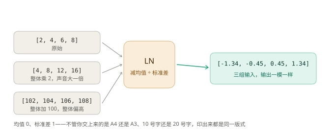
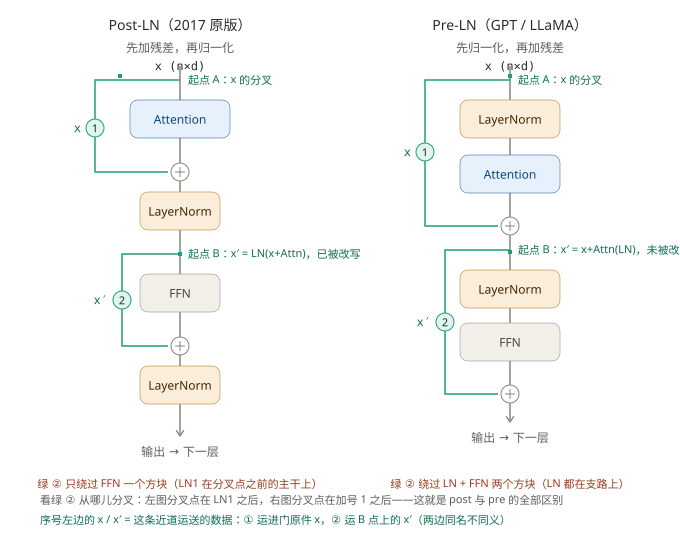
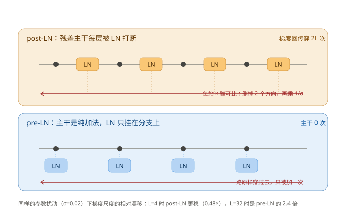
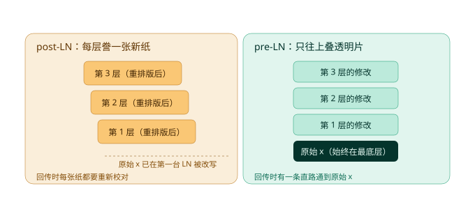
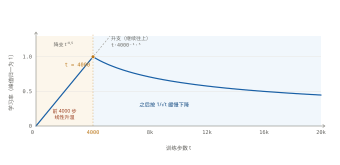

# Post-LN 与 Pre-LN：一个 Transformer Block 的两种排法

> 这份笔记只回答三个问题：
>
> 1. 两张架构图到底差在哪？
> 2. 只差一个 LN 的位置，为什么后果这么大？
> 3. 深层训练到底在怕什么，warmup 又在等什么？
>
> **答案在第 0 节，一页看完。** 第 1 节起是逐层解释，

---

## 前置：LN 是什么

后文所有比较都建立在一个前提上：**post 和 pre 用的是同一个模块 Layer Norm（层归一化），区别只在它站在 block 的哪一侧。**  LN ——它不是可选的调参技巧，而是一台"只认形状、不认大小"的机器；正因为它对绝对幅度完全免疫，把它放在残差流的左边还是右边，后果才会差这么远。

### 数学原理：

对每个 token 的 $d$ 维向量 $z$ 单独算：

$$
\mu=\frac1d\sum_{i=1}^d z_i,
\qquad
\sigma=\sqrt{\frac1d\sum_{i=1}^d (z_i-\mu)^2+\epsilon}
$$

$$
\operatorname{LN}(z)=\gamma\odot\frac{z-\mu}{\sigma}+\beta
$$

四个要点：

- **统计范围是"这一行"**：$\mu,\sigma$ 只在单个 token 的 $d$ 个特征里算，跟别的 token 无关、跟 batch 大小无关。这一点和 BatchNorm 正好相反（BN 跨样本统计，LN 跨特征统计），也是 Transformer 敢用 LN 的原因——序列长度可变、batch 又常常很小，BN 那套统计量根本稳不住。
- **输出被摆到固定刻度**：均值 $\beta$、标准差 $\gamma$。初始 $\gamma=1,\beta=0$ 时就是"均值 0、标准差 1"。
- **只有 $2d$ 个参数**（$\gamma$ 和 $\beta$ 各 $d$ 个），比它归一化的数据维度还少，几乎不增加模型容量。
- **形状不变**：$(n,d)\to(n,d)$。**正因为进出同形，它才能直接卡在残差流中间**——如果它会改形状，残差那个加号就加不起来了。

### 直观：音量旋钮

一句话：**LN 只保留"这一行里谁比谁高"，不保留"整体有多高"。**

拿 $[2,4,6,8]$ 走一遍：均值 $5$，标准差 $\sqrt5\approx2.24$，减掉均值再除以标准差得 $[-1.34,-0.45,0.45,1.34]$。整体乘 2、整体加 100，出来的结果一模一样：



> **说人话**：一个人唱歌，LN 不管他唱得多大声（原始数据），只把音量旋钮统一拧到同一档（归一化），然后让你听音准和节奏。所以"他刚唱得多响"这个信息，过完 LN 就彻底没了——不管他是用喊的还是用哼的。

### 为什么每个子层都离不开它

残差是加法：$x_{l+1}=x_l+\operatorname{FFN}(\cdots)$。加着加着，残差流的范数会一层层滚大；而 Attention 的 $QK^\top$、FFN 的输入都对幅度敏感——幅度一大，softmax 就饱和成一枝独秀，梯度随之死掉。LN 干的事就是在每个子层的入口（或出口）把幅度**重置**回标准刻度，让下一层永远拿到"音量正常"的输入。

这也是它和"调音量"这个比喻的差别所在：它不是把声音**放大**，而是把每层累积的增益**清零重来**。

### 三条性质，决定了后面全部结论

| 性质             | 数学                                                      | 反向时的后果                                        |
| -------------- | ------------------------------------------------------- | --------------------------------------------- |
| 平移不变           | $\operatorname{LN}(z+c\mathbf{1})=\operatorname{LN}(z)$ | "整体抬高"这个方向的梯度为 $0$                            |
| 缩放不变           | $\operatorname{LN}(cz)=\operatorname{LN}(z),\ c>0$      | "整体放大"这个方向的梯度为 $0$                            |
| 其余 $d-2$ 个方向被压 | 见第 6 节                                                  | 每穿一台 LN，就乘一个 $\frac1{\sigma}$，而 $\sigma$ 随权重变 |

前两行说明：**LN 在反向上不是"什么都不做"，而是"把大部分方向抹掉、剩下的乘一个缩放系数"。** 第三行就是全文的病根——一个 block 有两台 LN，24 层就是 48 个随训练漂移的系数（第 8 节整个都在算这笔账）。

### 所以"位置"才成了问题

同一台机器，放进 block 只有两个位置可选：

- **子层之后（post-LN）**：LN 卡在主路上，残差流每一段都被重新归一化 → 梯度回传必须穿过它，一台都绕不开。
- **子层之前（pre-LN）**：LN 只挂在送进子层的那条支路上，主干始终是纯加法 → 梯度有一条不穿 LN 的直路。

**模块一个不多、一个不少，参数一个不变，只是换了位置。** 后面第 2 节起，全部内容都是这一个位置差的后果（它在 block 里怎么被调用见第 2 节第 3 步，求导见第 6 节，那 48 个系数的账本见第 8 节）。

---

## 0. 结论（先看这一页）

**一句话**：**post-LN 是"干完活再排版"，pre-LN 是"排版一份副本去干活、成果直接叠回原件"。**

前者残差流每层被 LN 改写，梯度回传要穿过 24 台排版机，所以深了必须 warmup；后者残差流从头到尾只有加法，有一条通到底的直路，所以能堆到 80 层、120 层。



看图只抓一件事：**绿 ② 从哪儿分叉**——左图分叉在 LN1 出口，只绕过 FFN 一个方块；右图分叉在第一个加号出口，绕过 LN + FFN 两个方块。每个绿色序号左边的 `x` / `x′`，就是这条近道运的数据。

两种结构写成式子，只差一个括号的位置。下面**全部展开成对&#x20;**$x$**&#x20;的处理式子**：

$$
\begin{aligned}
\text{post-LN:}\quad
x''&=\operatorname{LN}\Bigl(\operatorname{LN}\bigl(x+\operatorname{Attn}(x)\bigr)+\operatorname{FFN}\bigl(\operatorname{LN}(x+\operatorname{Attn}(x))\bigr)\Bigr)\\[10pt]
\text{pre-LN:}\quad
x''&=x+\operatorname{Attn}\bigl(\operatorname{LN}(x)\bigr)+\operatorname{FFN}\Bigl(\operatorname{LN}\bigl(x+\operatorname{Attn}(\operatorname{LN}(x))\bigr)\Bigr)
\end{aligned}
$$

对照这两行，看两件事就够了：

- **post-LN 的 $x$ 是"被括进去"的**：先跟 $\operatorname{Attn}$ 的结果一起被第一台 LN 括住，第二台 LN 再把"它的输出 + FFN 的输出"整块括住——每深一层，$x$ 外面就多套一层壳。注意式子里 $\operatorname{LN}(x+\operatorname{Attn}(x))$ 出现了**两次**，那是同一份东西：一份交给加号，一份喂给 FFN。
- **pre-LN 的 $x$ 是"只被加"的**：$x$ 自己一次都没进 LN，它永远是加法的一端；进 LN 的是两份副本——$\operatorname{LN}(x)$ 送给 Attn，$\operatorname{LN}\bigl(x+\operatorname{Attn}(\operatorname{LN}(x))\bigr)$ 送给 FFN，算完都叠回 $x$ 身上。

> **post 的 LN 括号包住整个加法，pre 的 LN 括号只包住送进模块的那一份。** 一行公式，两种世界观。

差别最后落在六件事上：

|              | post-LN                    | pre-LN                 |
| ------------ | -------------------------- | ---------------------- |
| LN 站哪        | 每个子层**之后**（卡在主干上）          | 每个子层**之前**（只挂在支路上）     |
| 残差流          | 每层被改写两次，原始 $x$ 过第一个 LN 就没了 | 从头到尾只有加法，原始 $x$ 一直在最底层 |
| 每层 LN 数      | 2                          | 2（模型末尾再加 1 个 `ln_f`）   |
| 回传到第 1 层要穿几台 | $2L$ 台（24 层 = 48 台）        | **0 台**                |
| 深层训练         | 必须 warmup，12 层往后开始难        | 免 warmup，可堆 100 层      |
| 代表模型         | 2017 原版、BERT               | GPT-2/3、LLaMA          |

**那为什么反向就出问题？** 前向只差"排版顺序"，反向差的是"要不要穿过排版机"。对一层求导，$J_{\mathrm{LN}}$ 站哪儿一眼可见：

$$
\frac{\partial x''}{\partial x}=\underbrace{J_{\mathrm{LN}}\bigl(I+J_F\bigr)}_{\text{post：LN 在括号外，躲不掉}}
\qquad\text{vs}\qquad
\frac{\partial x''}{\partial x}=\underbrace{I+J_F\,J_{\mathrm{LN}}}_{\text{pre：LN 在括号里，可以绕}}
$$

- **post 躲不掉**：$J_{\mathrm{LN}}$ 在括号**外面**，沿哪条路径回传都得乘一个，$L$ 层就是连乘 $2L$ 个（24 层 = 48 个）；**pre 能绕**：那个 $I$ 是裸的，展成连乘时存在一条"全选 $I$"的路径，一台都不穿。
- **而每个 $J_{\mathrm{LN}}$ 都自带一个 $1/\sigma$**（$\sigma$ 是当层输出的标准差，由权重决定）：$J_{\mathrm{LN}}=\frac{1}{\sigma}\bigl(I-\frac1d\mathbf{11}^\top-\hat z\hat z^\top\bigr)$。48 个这样的数相乘，**权重一动，它们全体跟着动**。
- **所以病不是"梯度爆炸"，是"梯度尺度在漂"**：方向没坏，被乘的那个系数却一步步在变；Adam 的 $v$ 是上千步的滑动平均，追不上突变，实际步长忽大忽小——这就是必须 warmup 的病根（推导见第 6 节，机制见第 8 节）。

一句话：**post-LN 的梯度要穿过 48 台"系数随权重变"的缩放器，pre-LN 一台都不用穿。**

**模块清单一模一样，只挪了一个括号，代价就从"训不深"变成"要热身"。** 下面第 1 节起，把这张图从上到下走一遍，再解释那个"为什么"（第 8 节）。

---

## 1. 读图约定

| 符号                | 含义                                       |
| ----------------- | ---------------------------------------- |
| 圆角方块              | 一个模块（Attention / FFN / LayerNorm）        |
| 圆圈 $\oplus$       | 逐元素相加（不是拼接）                              |
| 绿色线               | 残差通路，俗称"抄近道"。**它运的是"这一子层的输入"，不是固定的 $x$** |
| 箭头                | 数据流向（前向）                                 |
| $x\ (n{\times}d)$ | $n$ 个 token，每个 $d$ 维                     |

全文举例统一用：$n=6$、$d=8$，句子是 `[科软, 放实习, 它, 吸引, 学生, 报考]`。整个 block 进出都是 $(6,8)$——**正因为形状不变，残差才加得起来**。

### 1.1 三个记号：$x$、$x'$、$x''$

只记一条：**绿线不是"$x$ 那根线"，它运的是"这一子层的输入"。**

所以一个 block 里有三个名字：进门时叫 $x$，第一个子层做完叫 $x'$，出 block 叫 $x''$。绿① 运 $x$，绿② 运 $x'$——图上每个绿色序号左边都标了它运的到底是哪一个。

$x'$ 具体怎么算，第 2、3 节逐步骤会写；两边同名不同义的对照在第 4 节。

---

## 2. Post-LN：先干活，再排版

按图从上往下走一遍。

### 第 0 步：$x\ (n{\times}d)$

六个同学的原始草稿，$6\times 8$ 的矩阵。谁也没跟谁交流过。

### 第 1 步：Attention

每个 token 用自己的 $Q$ 去找所有人的 $K$，算出权重，再对 $V$ 加权求和：

$$
Q=XW_q,\quad K=XW_k,\quad V=XW_v,\quad
A=\operatorname{softmax}\!\left(\frac{QK^\top}{\sqrt{d_k}}+M\right),\quad
O=AVW_O
$$

输出 $O$ 形状还是 $(6,8)$。**这一步管"交流"**：每个人把别人讲的内容按相关度收集过来。

### 第 2 步：$\oplus + x$（第一条绿线）

绿线从最顶上的 $x$ **原封不动**拉下来，和 $O$ 相加。此刻加号右边是干净的原始草稿——这是左图里唯一一段完全不过 LN 的直路。

> 为什么要加？一是防止深层之后原始信息被覆盖光；二是给梯度留一条不用穿过任何模块的回路。这一步在两种结构里是一样的。

### 第 3 步：LayerNorm（第一台）

处理的是"草稿 + 新收获"的**混合物**：减均值、除标准差，把整体音量压回标准刻度，再过可学习的 $\gamma,\beta$：

$$
\operatorname{LN}(z)=\gamma\odot\frac{z-\mu}{\sigma}+\beta,
\qquad \mu=\frac1d\sum_i z_i,\quad
\sigma=\sqrt{\frac1d\sum_i (z_i-\mu)^2}
$$

代价是：**原始草稿在这一步被重新排版了**，它不再是原来的字迹。记住这一点，第 8 节要算它的账。

### 第 4 步：FFN

每个 token 独立过两层 MLP，中间夹非线性：

$$
\operatorname{FFN}(h)=W_2\,\sigma_{\text{act}}(W_1h+b_1)+b_2,
\qquad d\to 4d\to d
$$

$(6,8)\to(6,32)\to(6,8)$。**这一步管"消化"**：token 之间零交流，各自把刚收集到的信息咀嚼一遍。

### 第 5 步：$\oplus$（第二条绿线）

FFN 的输出加回来的，是**第 3 步的输出**——看图，这条绿线是从第一台 LN 的**出口**引出来的，不是从 $x$。也就是说第二次相加时，加号右边那摞东西已经被排版过一次了。

用 1.1 的记法，第 3 步的输出就是 $x'$，所以这一步算的是

$$
x'+\operatorname{FFN}(x')
$$

> **最容易混的一点：一个 block 有两次残差，但它们相加的对象不是同一个变量。**
>
> 残差的定义是「**子层的输入 + 子层的输出**」，注意是"子层"，不是"整个 block"。所以：
>
> - Attention 子层的输入 = block 输入 $x$ → 加 $x$
> - FFN 子层的输入 = LN1 的输出 → 加 LN1 的输出
>
> 不用记特例，只记一句：**残差加的是"这一道工序的入口"，不是"公司大门"。**
>
> 主干在一个 block 里被更新 4 次，每次都在覆盖上一个值：

> | 步骤 | 操作                         | 此刻主干上是什么                                         |
> | -- | -------------------------- | ------------------------------------------------ |
> | 起点 | —                          | $x$                                              |
> | ①  | $+\operatorname{Attn}(x)$  | $x+\operatorname{Attn}(x)$                       |
> | ②  | $\operatorname{LN}(\cdot)$ | $x'=\operatorname{LN}(x+\operatorname{Attn}(x))$ |
> | ③  | $+\operatorname{FFN}(x')$  | $x'+\operatorname{FFN}(x')$                      |
> | ④  | $\operatorname{LN}(\cdot)$ | $x''$                                            |
>
> 对应到 PyTorch 官方实现，，但第 2 行之后它已经不是输入了：
>
> ```python
> x = x + self.self_attn(x, x, x)   # ① 加的是 block 输入
> x = self.norm1(x)                 # ② x 被覆盖，语义变了
> x = x + self.ffn(x)               # ③ 加的是 norm1 的输出
> x = self.norm2(x)                 # ④
> ```

### 第 6 步：LayerNorm（第二台）

再排一次版，出 block，交给下一层：

$$
x''=\operatorname{LN}\bigl(x'+\operatorname{FFN}(x')\bigr)
$$

**小结：一个 block 里 LN 出现 2 次，全都在主路上。如果模型有24 层就是 48 台，梯度回传一台都绕不开。**

---

## 3. Pre-LN：先排版，再干活

### 第 0 步：$x$

同样的六份草稿。

### 第 1 步：LayerNorm

先调音量。但看清楚：调的是**送进 Attention 的那份副本**，主干上的 $x$ 一根汗毛都没动：

$$
h=\operatorname{LN}(x),\qquad \text{主干上的 } x \text{ 不变}
$$

### 第 2 步：Attention

用调过音量的副本去开会：$\operatorname{Attn}(h)$。

### 第 3 步：$\oplus + x$

绿线从**最原始的 $x$** 直接拉下来：

$$
x' = x + \operatorname{Attn}\bigl(\operatorname{LN}(x)\bigr)
$$

相加结果 = 原始草稿 + 本层新收获。原始草稿到这一步还是原始的。

注意这里和 post-LN 的差别：**同样是 $x'$，pre-LN 的这个是"加号"算出来的，post-LN 的那个是"LN"算出来的。** 一个保住了 $x$，一个把 $x$ 重写掉了。

### 第 4 步：LayerNorm

再复制一份副本调音量，送进 FFN。主干同样没动。

### 第 5 步：FFN

消化副本，输出本层的"修改意见"。

### 第 6 步：$\oplus$

把修改意见加回去：

$$
x'' = x' + \operatorname{FFN}\bigl(\operatorname{LN}(x')\bigr)
$$

看图：这条绿线从第 3 步的输出引出——那是"原始 $x$ + 之前所有层的修改"，**从头到尾没被任何 LN 碰过**。

和 post-LN 一样列一张主干更新表，差别一眼可见：

| 步骤 | 操作                                           | 此刻主干上是什么                                         |
| -- | -------------------------------------------- | ------------------------------------------------ |
| 起点 | —                                            | $x$                                              |
| ①  | $+\operatorname{Attn}(\operatorname{LN}(x))$ | $x'=x+\operatorname{Attn}(\operatorname{LN}(x))$ |
| ②  | $+\operatorname{FFN}(\operatorname{LN}(x'))$ | $x''$                                            |

**post-LN 是"加、换、加、换"；pre-LN 是"加、加"，一次都没换。** 两个表摆在一起，就是这两种结构的全部区别。

---

## 4. 看图最容易漏掉的三个细节

### 4.1 绿线的起点不同

|                 | post-LN                                          | pre-LN                                             |
| --------------- | ------------------------------------------------ | -------------------------------------------------- |
| 第一条绿线起点         | 最顶上的 $x$（干净）                                     | 最顶上的 $x$（干净）                                       |
| 第二条绿线起点         | **第一台 LN 的出口**（已被改写）                             | **纯加法结果**（从未被改写）                                   |
| 第二条绿线运的是什么      | $x'=\operatorname{LN}(x+\operatorname{Attn}(x))$ | $x'=x+\operatorname{Attn}(\operatorname{LN}(x))$   |
| 能否从它反推回 $x$     | 不能，均值与尺度被抹掉                                      | 能，$x=x'-\operatorname{Attn}(\operatorname{LN}(x))$ |
| 从 loss 回传到第 1 层 | 穿 $2L$ 台 LN                                      | **0 台**                                            |


图底下那句"恒等通路完整"，指的就是右图的绿线是**一根通到底的线**，而左图的绿线是**断成一段一段的线**——每段的起点都是被改写过的量。

**所以"残差保住了原始信息"这句话，只在 pre-LN 里是字面成立的**：左图第二条绿线运的 $x'$ 已经被 LN 重写，原文找不回来；右图运的 $x'$ 里，$x$ 还完完整整是一项。

配合梯度路径图看更直观：



### 4.2 模块清单完全相同

两边都是 Attention、FFN、两台 LN、两个 $\oplus$。**没有任何一个模块被增删**，只是排队顺序不同。

这一点值得单独说：LN 站前站后这一个自由度，决定了能不能往深里堆。它不是"风格差异"，是结构差异。

### 4.3 右图的 LN 是对"副本"排版

所以它照样起作用（让 Attention / FFN 拿到音量正常的输入），但排版结果**只影响支路，不污染主干**。

这是"既要用 LN 稳住数值、又不破坏残差流"的两全办法，也是 pre-LN 能成为默认写法的根本原因。

---

## 5. 两种"记笔记"的方式



|         | 比喻                        | 后果                    |
| ------- | ------------------------- | --------------------- |
| post-LN | 每层把旧内容**重新排版后誊到新纸上**，旧纸扔掉 | 想找回最初那份草稿，得穿过 24 台排版机 |
| pre-LN  | 在原始草稿上**叠透明修改层**，只增不改     | 最初那份草稿永远在最底层，翻开就是     |

---

## 6. 对公式求导：差别长在代数上

两式已经在第 0 节，这里只做一件事：**对它们求导**，看差别的代数形状。

对 $L$ 层连乘起来，差别更刺眼：

$$
\underbrace{\frac{\partial x_{l+1}}{\partial x_l}=J_{\operatorname{LN}}(z_l)\bigl(I+J_{F,l}\bigr)}_{\text{post-LN}}
\qquad\text{vs}\qquad
\underbrace{\frac{\partial x_{l+1}}{\partial x_l}=I+J_{F,l}\,J_{\operatorname{LN}}(x_l)}_{\text{pre-LN}}
$$

> **说人话**：post-LN 的 $J_{\operatorname{LN}}$ 站在**括号外面**，所以不管你沿哪条路径回传，每个 block 都至少乘一个 LN；pre-LN 里那个 $I$ 是**裸的**，展开连乘时存在一条"全选 $I$"的路径，一次 LN 都不经过。

这正好是残差网络梯度路径展开的同一件事：$\prod_l (I+J_l)$ 展开成 $2^L$ 条路径，只要有一条全是 $I$，梯度就有一份原样回家的份额。post-LN 的问题不是路径消失了，而是**每条路径都被额外盖了一个章**。

---

## 7. 模块职责表

| 模块        | 数学                                               | 职责                        | 比喻                      |
| --------- | ------------------------------------------------ | ------------------------- | ----------------------- |
| Attention | $\operatorname{softmax}(QK^\top/\sqrt{d_k})VW_O$ | token 之间交流，采集信息           | 开会、听别人讲                 |
| FFN       | $W_2\sigma(W_1h)$，$d\to4d\to d$                  | 每个 token 独自消化             | 回座位自己捋笔记                |
| LayerNorm | $\gamma\odot(z-\mu)/\sigma+\beta$                | 把音量压回标准刻度                 | 重新排版                    |
| $\oplus$  | $a+b$（逐元素）                                       | 新收获叠回旧内容                  | 新旧写在同一张纸上               |
| 绿线        | 恒等映射 $u\mapsto u$                                | 把**这一子层的输入**原样送到加号，兼作梯度近道 | 纸条原件（运的是当前这摞纸，不一定是最初那张） |

---

## 8. warmup 到底在等什么

第 6 节算出"post-LN 每层至少乘一个 $J_{\mathrm{LN}}$"，第 0 节说"病根是尺度在漂"。这一节把这两句话接上：**那 48 个 $J$ 具体是多少、它们为什么会动、Adam 为什么追不上、warmup 等的究竟是哪一刻。**

### 8.1 48 个系数，具体是多少

第 3 步那台 LN 的雅可比是

$$
J_{\mathrm{LN}}=\frac{1}{\sigma}\Bigl(I-\tfrac1d\mathbf{1}\mathbf{1}^\top-\hat z\hat z^\top\Bigr),
\qquad \hat z=\frac{z-\mu}{\sigma}
$$

（这里的 $\sigma$ 是标准差，不是第 4 步那个激活函数。）

括号里减掉的是两个投影：$\tfrac1d\mathbf{1}\mathbf{1}^\top$ 是"整体抬高"方向，$\hat z\hat z^\top$ 是"整体放大"方向。这两个方向上 LN 什么都不做——稿子整体抬高一段、或整体放大一倍，排出来是同一个版式，所以梯度照样传不过去，被抹成 0。剩下 $d-2$ 个"改形状"的方向，每一个都乘 $\frac1{\sigma}$。

**所以一台 LN 在反向上就是一个数：$\frac1{\sigma_l}$。24 层 = 48 台 = 48 个数连乘。**

> **说人话**：排版机只认形状不认大小。你把字号整体放大 2 倍，它排出来一模一样——所以"放大"这个动作没有梯度。只有真改了内容才传得下去，传的时候还被除以当层的音量。

### 8.2 一个小偏差，48 次方之后是多少

$\sigma_l$ 大概是多少？LN 的输出被 $\gamma$ 归到 1 附近，所以下一层输入的标准差 ≈ 1；而 $z_l=x_l+F(x_l)$ 多叠了一坨 $F$ 的方差，所以 $\sigma_l$ 略大于 1。偏离 1 多少，取决于 $F$ 长多大了：

| $\sigma_l$ 偏离 1 | 单层 $\frac{1}{\sigma_l}$ | 24 层  | 48 层      |
| --------------- | ----------------------- | ----- | --------- |
| 0.95（小于 1）      | 1.05                    | 3.4×  | **12×**   |
| 1.00            | 1.00                    | 1×    | 1×        |
| 1.05            | 0.95                    | 0.31× | **0.10×** |

单层只差 5%，48 层就是 12 倍和 0.1 倍——**跨两个数量级**。这就是第 6 节那句"48 个这样的数相乘"的实际含义：LN 的缩放不是 48 次温和的缩放，是把 5% 的偏差开 48 次方。

而 $\sigma_l$ 不会站住不动。训练最开始 $F$ 的输出几乎是 0（权重刚初始化），$\sigma_l\approx1$，$\frac1{\sigma_l}\approx1$；训着训着 $F$ 长大了，$\sigma_l$ 爬到 1.05、1.1，$\frac1{\sigma_l}$ 掉到 0.95、0.9，48 次方之后就是 0.1、0.006。**梯度不是被炸掉，是被一路慢慢拧小——而且浅层的 $F$ 先长大、深层后长大，48 个数不是同时变的。**

> 实际训练里 $\gamma,\beta$ 会吃掉一部分偏差，到不了表里那么极端；但"偏离多少、放大 48 次方"这个敏感度是真实的，也是 12 层往后开始难的原因。

### 8.3 常数倍为什么没事，漂为什么有事

Adam 的更新是

$$
\Delta\theta=-\eta\,\frac{\hat m}{\sqrt{\hat v}+\epsilon}
$$

梯度整体乘一个常数 $c$：$m$ 乘 $c$，$v$ 乘 $c^2$，开根号再除，**$c$ 约掉了**。所以"我的梯度比别人的大 100 倍"对 Adam 完全无害——它只看相对大小，不看绝对大小。

有害的是 $c$ 在**变**。$v$ 是 $\beta_2=0.999$ 的滑动平均，等效窗口 $1/(1-\beta_2)=1000$ 步；$m$ 的窗口只有 10 步。如果 $c(t)$ 在 100 步内变了一倍，分子用的是新的 $c$，分母里装的还是 1000 步前的旧 $c^2$——**除出来就是一个虚报的步长**。

> **说人话**：Adam 像一台会自动归零的秤。你突然重了一倍它也读得对，因为它每次都先归零。但它归零用的是"过去 1000 步的平均"——你要是在 100 步里胖了一倍，它拿旧的零位去称，读数就飘了。
>
> warmup 不是让梯度变小，是让 $c$ 变得**够慢**，慢到 1000 步的窗口跟得上。

### 8.4 warmup 等的是"$\sigma$ 不再动"那一刻

$c$ 什么时候变得最快？就是最开始。权重离初始化最近，同样大小的步长带来的**相对**变化最大；$F$ 正从 0 往上长，每层的 $\sigma_l$ 都在上台阶，而且一层一层不同步——这正是 8.2 那张表里 ±5% 乱窜的时段。

warmup 干的事很朴素：让学习率从 0 线性爬上来，

$$
\eta_t=\min\bigl(t\cdot T^{-1.5},\;t^{-0.5}\bigr),\qquad T=4000
$$

升支 $\propto t$、降支 $\propto t^{-0.5}$，两支在 $t=T$ 相交——交点就是峰值，也是"我认为 $\sigma$ 已经稳了"的那个判断：



升支为什么是线性的：步长 $\propto t$，前 $t$ 步的累计位移 $\propto t^2$——**位移是二次的，参数只敢在初始化附近细碎地挪**，$\sigma_l$ 于是变化平缓，$v$ 有时间把 1000 步的账算清。等 $F$ 长到稳态、$\sigma_l$ 几十步才动 1%，$\sqrt{\hat v}$ 和当前 $c$ 同步了，常数倍被彻底对冲，才敢放到峰值。

> **说人话**：warmup 不是刹车，是起步先松离合。车还没走稳就猛给油（大步长），轮子只会打滑（尺度乱跳）；等轮子咬住地面了，油门随便踩。
>
> 顺带解释一个细节：$\frac1{\sigma_l}$ 掉到和 $\epsilon$ 一个量级时，8.3 那个"常数倍对冲"就失效了——分母被 $\epsilon$ 兜住，梯度再小也除不回来，模型彻底不动。这就是 post-LN 深了会"训着训着没反应"的另一半原因。

### 8.5 为什么 pre-LN 不用等

把 8.1 的数代进第 6 节的 pre-LN 式子：

$$
\frac{\partial x_{l+1}}{\partial x_l}=I+J_{F,l}J_{\mathrm{LN}}(x_l)
$$

那个裸 $I$ 是常数 1，不带 $\frac1\sigma$，也不随训练变。连乘展开后，主导项是"全选 $I$"那条路径——它的系数恒等于 1。**没有 $c(t)$ 可漂，Adam 就没有要追的东西，warmup 也就无处使劲。**

代价在另一头：$x_{l+1}=x_l+\text{支路}$，每层只加不减，残差流的范数随深度往上滚，所以末尾必须补一台 `ln_f` 收尾（第 0 节表格"每层 LN 数"那一行"2 + 1 个 `ln_f`"就是它）。

### 8.6 对账表

| 问题        | post-LN                     | pre-LN             |
| --------- | --------------------------- | ------------------ |
| 每层对梯度的缩放  | $\frac{1}{\sigma_l}$，48 个连乘 | $I$ 主导，恒为 1        |
| 这个缩放随训练变吗 | 变，早期最快（$F$ 从 0 长起来）         | 基本不变               |
| Adam 跟得上吗 | 早期跟不上（$v$ 窗口 1000 步）        | 不需要跟               |
| 后果        | 必须 warmup，12 层往后开始难         | 免 warmup，可堆到 100 层 |
| 留下的尾巴     | 收敛后精度往往略高                   | 残差流累积，要 `ln_f`     |

**一句话：warmup 不是在防大，是在等稳——等那 48 个 $\frac1\sigma$ 停止上台阶。**

---

## 9. 三个常见误解

| 常见说法               | 哪里不对               | 更准确的说法                      |
| ------------------ | ------------------ | --------------------------- |
| "post-LN 的问题是梯度爆炸" | 梯度不一定变大，是**尺度在漂移** | 梯度尺度随参数移动，且敏感度随深度增长         |
| "LN 放哪都行，反正都归一化"   | 位置决定恒等通路完整不完整      | 放主干上要 48 次连乘，放支路上 0 次       |
| "pre-LN 全面更好"      | 它是**更好训**，不是精度更高   | 收敛后 post-LN 的精度常常略高，只是深层训不动 |

---

## 10. 速记卡

**两张图**

> post-LN：干活 → 叠上去 → 排版，再干活 → 叠上去 → 再排版。  
> pre-LN：排版一份副本去干活，成果直接叠回原件。

**绿线**

> 左图绿线断成一截一截（起点都是改写过的量），右图绿线一根通到底。  
> 绿线运的是"这一子层的输入"，不一定是 $x$。

**$x$ 与 $x'$**

> 绿①运 $x$，绿②运 $x'$，$x''$ 就是出 block 的那个值。  
> post 的 $x'$ 是 LN 算的（原文丢了）；pre 的 $x'$ 是加号算的（原文还在）。

**warmup**

> 不是在防大，是在等稳。  
> 前几千步 48 个缩放系数乱跳，Adam 追不上；稳了之后常数倍它自己就对冲掉。

**一句话对比**

> post-LN 把 LN 装在**出口**，代价是残差流每层被改写；  
> pre-LN 把 LN 挪到**入口**，代价是残差流会累积、需要 final LN 收尾。

---

## 11. 延伸阅读

| 文献                                                                            | 看什么                                  |
| ----------------------------------------------------------------------------- | ------------------------------------ |
| Vaswani et al., *Attention Is All You Need* (2017)                            | post-LN 原版，4000 步 warmup 的出处         |
| Xiong et al., *On Layer Normalization in the Transformer Architecture* (2020) | 为什么 post-LN 必须 warmup、pre-LN 不必的理论分析 |
| Baevski & Auli (2019)                                                         | pre-LN 在深层 Transformer 上的实证          |
| Liu et al., *On the Variance of the Adaptive Learning Rate and Beyond* (2020) | Adam 早期有效学习率的偏差（RAdam 的动机）           |
| Zhang & Sennrich (2019)                                                       | RMSNorm：去掉均值中心化，只留缩放                 |
| He et al., *Identity Mappings in Deep Residual Networks* (2016)               | 恒等通路为什么必须"干净"，本文第 6 节的源头             |

---
