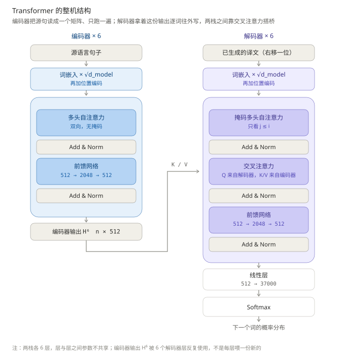
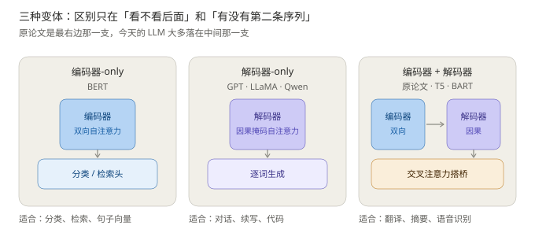
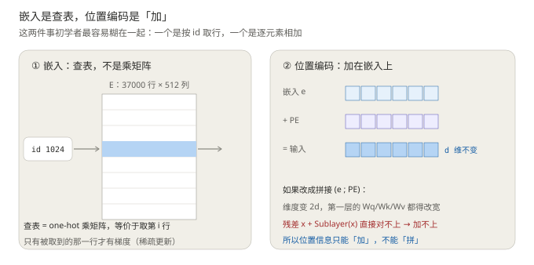
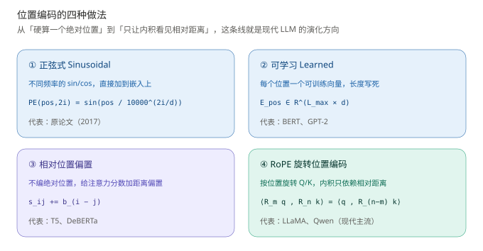
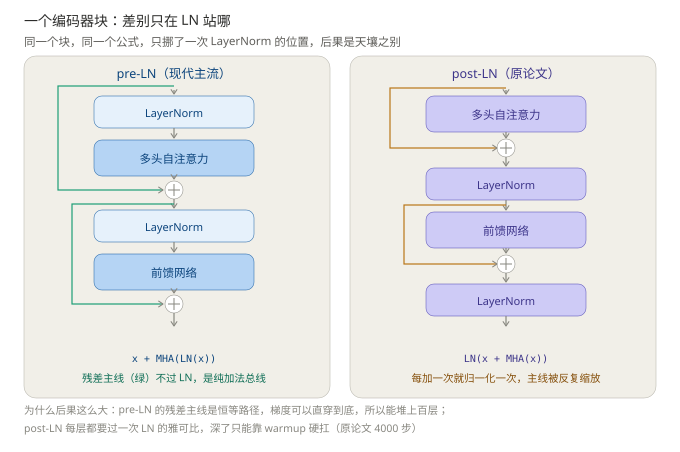
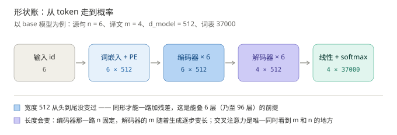
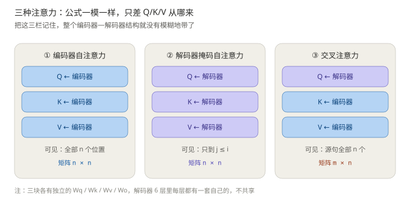
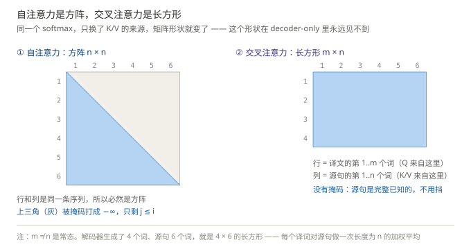
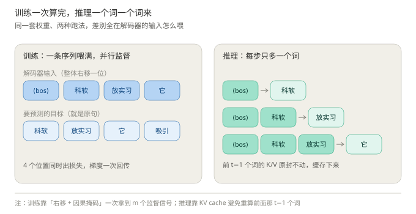

# Transformer 整体架构：从一张图到一个 Block

> **这份笔记怎么读**
>
> 1. 顺序就是数据流的顺序：先看整机 → 输入模块（分词 / Embedding / 位置编码）→ 编码器块 → 编码器输出 → 解码器 → 训练与推理 → 2017 到今天的演化。每一节只讲一个模块，讲完就能在总图上指出它在哪。
> 2. 不绑死 2017 年那篇《Attention Is All You Need》：每个模块都按 **原论文怎么做的 / 现在怎么做 / 为什么改** 三层讲。原文是骨架，现代实践是血肉。
> 3. 和《自注意力机制完整推导》分工：那篇拆的是**注意力的内部机制**（投影、缩放、掩码、softmax 饱和），这篇组装**整机**。文中标"见前篇"的地方默认你已经读过那篇。
> 4. 文末附录列了"哪些来自原论文、哪些是我加的、哪些是后续工作"，引用前先看一眼。

---

## 一、先看整机

### 1.1 一张图

从这张图里先读出三件事，后面每一节都在填这三件事的细节：

1. **两栈**：左边编码器 ×6，右边解码器 ×6。结构相同、参数完全独立，6 层之间也不共享。
2. **三块注意力**：编码器自注意力（双向）、解码器掩码自注意力（因果）、交叉注意力（两栈之间唯一的接口）。公式一模一样，只差 Q/K/V 从哪来、mask 有没有。
3. **一个事实**：编码器只跑一遍，它的输出 $H^6$ 被 6 个解码器层反复使用 —— 不是"解码器第 $l$ 层喂编码器第 $l$ 层"，没有这种逐层对齐。

### 1.2 三条流

看架构图有三种看法，对应三种问题：

- **数据流**：token id → 向量 → 一层层加工 → 概率。顺着箭头走一遍。
- **形状流**：宽度 $d_{model}$ 从头到尾不变，长度只在交叉注意力处和输出层变化。形状不变是残差能加的前提。
- **梯度流**：训练时反向传播怎么走。关键在残差 —— 它是一条恒等路径，梯度可以原封不动地穿回第一层（3.2 节展开）。

初学者最容易只看数据流。但**形状流决定"能不能连起来"，梯度流决定"能不能训起来"**，这两条流的约束才是架构长成这样的真正原因。

### 1.3 为什么非要这个结构：和 RNN 的账

2017 年之前，序列建模的默认答案是 RNN：$h_t = f(h_{t-1}, x_t)$，一步一步往前传。它有两个先天缺陷：

| | RNN | 自注意力 |
| --- | --- | --- |
| 每层顺序操作数 | $O(n)$，必须串行 | $O(1)$，所有位置一次算完 |
| 任意两位置的最大路径长度 | $O(n)$，信息要传 $n$ 跳 | $O(1)$，一步直连 |
| 每层计算量 | $O(n \cdot d^2)$ | $O(n^2 \cdot d)$ |

前两行是 Transformer 赢的原因：**能并行**（GPU 吃满）、**长依赖不用传**（隔 50 个词的指代也是一步直达）。第三行是它唯一的原罪：$n^2$。FlashAttention、稀疏注意力、线性注意力，全都是在还这笔债（6.3 节）。

"Attention is all you need" 的字面意思就在这里：把循环整个删掉，只剩注意力 + FFN。

### 1.4 三个拓扑

同一套零件，三种拼法。判断标准一句话：**输出是不是另一条完整的序列**。

- 翻译、摘要：输入输出是两条序列（长度都不同），必须有接口 → 编码器 + 解码器。
- 对话、续写：输出长在输入这条流上，不需要接口 → 解码器-only（GPT、LLaMA、Qwen）。
- 分类、检索：不生成序列，只要一个表示 → 编码器-only（BERT）。

原论文是最右边那支；今天说"LLM"基本指中间那支。**这篇笔记两条都讲**：编码器是理解"块"的最佳教材，解码器是今天 LLM 的本体。

---

## 二、编码器（一）：输入模块

编码器拿到的不是句子，是一个 id 序列。从文字到向量，要过三道工序：分词 → 查表 → 加位置。

### 2.1 分词与词表

- **BPE**（byte-pair encoding）：从字符开始，反复合并语料中出现频率最高的相邻片段，直到词表达到设定大小。原论文用 BPE，词表 37000；现代模型 32k ~ 150k 不等。
- 为什么不按"词"切？两个死结：词表爆炸（英语形态变化 + 中文分词歧义），以及**未登录词**（OOV）永远处理不完。子词是折中：常见词一个 token，生僻词拆成几段，任何字符串都能表示。
- 词表共享：原论文源语言、目标语言共用一张词表，所以整个模型只有一份嵌入矩阵。现代 decoder-only 只有一种语言（或混多种），共享与否差别不大。

一句话记住：**token 是模型世界的原子，词表是原子周期表，id 是原子序数。**

### 2.2 Embedding：本质是一次查表

嵌入层就是一个矩阵 $E \in \mathbb{R}^{V \times d}$（$V$ 词表大小，$d = d_{model}$）。token id 为 $i$，输出就是 $E$ 的第 $i$ 行。

写成矩阵形式：one-hot 向量 $e_i \in \mathbb{R}^V$ 乘 $E$，结果是取第 $i$ 行。所以"查表"和"乘一个 $V \times d$ 的矩阵"是同一件事，只是实现上前者的效率高得多（不用真乘 $V$ 那么多列）。

两个值得知道的点：

- **参数量 $V \times d$**。37000 × 512 ≈ 1900 万，占了 base 模型（65M）的三分之一弱 —— 是单块最大的参数，也是唯一"和序列长度无关"的参数。
- **梯度是稀疏的**。一个 batch 里只出现几百个不同的 token，只有这几行的嵌入会收到梯度。这是为什么早期实现用专门的 sparse embedding 优化。

### 2.3 为什么要乘 $\sqrt{d_{model}}$

原论文在 3.4 节写了一句：嵌入层的权重要乘 $\sqrt{d_{model}}$。**没解释为什么**。我们来算这笔账：

- 嵌入初始化为 $\mathcal{N}(0,1)$，则 $\|e\|^2 = d$；
- 位置编码每个分量是 sin/cos，方差约 0.5，则 $\|\text{PE}\|^2 = d/2$。

不乘的话，位置信息占总输入能量的 $\dfrac{d/2}{d + d/2} = \dfrac{1}{3}$ —— **词义和位置平起平坐**，一个 token 的表示有三分之一由"它站在第几位"决定，语义被严重稀释。

乘 $\sqrt{d}$ 之后：$\|e\|^2 = d^2$，位置占比掉到 $\dfrac{d/2}{d^2 + d/2} \approx \dfrac{1}{2d}$（$d=512$ 时约 0.1%）。**位置从"并列信号"降级成"小幅调制"** —— 这才是这句缩放的真实作用。

但这里有个更深的转折，也是现代实现把它删掉的原因：

> 原论文是 post-LN，块内第一个操作是注意力，没有归一化挡在前面，所以输入的整体尺度**确实有影响**。而 pre-LN / RMSNorm 架构里，进块第一件事就是归一化 —— RMSNorm 是**尺度不变**的（$\text{RMS}(cx) = c \cdot \text{RMS}(x)$，归一化时约掉），乘不乘 $\sqrt{d}$ 对后续计算**完全无影响**。

所以 GPT-2、BERT、LLaMA 全都不乘了。这不是偷懒，是那个缩放在新架构下变成了无操作。**知道一个技巧"为什么曾经必要"，比记住它本身重要得多** —— 这是整份笔记的方法论。

### 2.4 位置编码：没有它，注意力是"词袋"

自注意力对顺序是**置换等变**的。用置换矩阵 $P$ 打乱 token 顺序：

$$
(PX)W_Q\big((PX)W_K\big)^\top = P\,XW_QW_K^\top X^\top P^\top
\;\Longrightarrow\;
\operatorname{Attn}(PX) = P\cdot\operatorname{Attn}(X)
$$

输出只是跟着换行，**内容一模一样**。"科软 放实习" 和 "放实习 科软" 在纯注意力眼里是同一个东西；"不好"和"好不"也无法区分。

证明的推论很干脆：**模型内部没有任何一步依赖"第几个"这个信息，所以位置必须从外部注入**。这就是位置编码存在的全部理由 —— 它不是锦上添花，是必需品。

### 2.5 位置编码的四种做法

**① 正弦式（原论文）**。给每个位置 $pos$ 生成一个 $d$ 维向量，偶数维用 sin、奇数维用 cos，频率从 $1$ 到 $10000^{-1}$ 几何递减：

$$
\text{PE}(pos, 2i) = \sin\!\left(\frac{pos}{10000^{2i/d}}\right),
\qquad
\text{PE}(pos, 2i+1) = \cos\!\left(\frac{pos}{10000^{2i/d}}\right)
$$

直觉：把 $d$ 维看成 $d/2$ 个不同频率的"时钟" —— 低频像时针（大尺度位置），高频像秒针（相邻词的差别）。任何一个位置对应一组独一无二的读数。

它藏着一个重要性质：对每一对 $(\sin, \cos)$，有 $\text{PE}(pos+k)$ 等于 $\text{PE}(pos)$ 乘一个**只依赖 $k$ 的固定旋转矩阵**（因为 $\sin(a{+}b) = \sin a\cos b + \cos a\sin b$）。也就是说**相对位移对应固定变换** —— 这条性质当时没被利用起来，四年后被 RoPE 捡走了。

**② 可学习（BERT、GPT-2）**。把每个位置的向量当参数学。简单有效，但 $L_{max}$ 写死，不能外推到更长序列。

**③ 相对位置偏置（T5）**。不再造"位置向量"，而是在注意力分数上直接加一个按距离查表的偏置：$s_{ij} \mathrel{+}= b_{\,\rho(i-j)}$，$\rho$ 是把距离分桶的函数。位置信息只出现在"打分"这一步，和内容向量解耦。

**④ RoPE（现代主流）**。不往输入里加任何东西，而是在**每一层**把 $Q$、$K$ 按位置旋转。对第 $i$ 对分量，位置 $m$ 处旋转 $m\theta_i$ 角度，$\theta_i = 10000^{-2i/d}$：

$$
\langle R_m q,\; R_n k \rangle = q^\top R_m^\top R_n\, k = q^\top R_{n-m}\, k
$$

旋转矩阵相乘 $R_m^\top R_n = R_{n-m}$，所以**内积只和相对距离 $n-m$ 有关**，绝对位置被约掉了。这正是语言需要的性质 —— "它"指代谁，取决于隔了几个词，不取决于句子从第几页开始。RoPE 还有工程红利：训练 4k、推理外推 32k 这类操作（PI、NTK 缩放）都建立在它"只看相对距离"的基础上。

| | 编绝对位置？ | 能外推？ | 作用位置 |
| --- | --- | --- | --- |
| 正弦 | 是 | 理论上可以 | 输入嵌入 |
| 可学习 | 是 | 否 | 输入嵌入 |
| 相对偏置 | 否（编码距离） | 有限 | 注意力分数 |
| RoPE | 否（编码旋转） | 配合缩放技巧可以 | 每层的 Q/K |

### 2.6 加，不是拼

位置编码必须**加**到嵌入上，不能拼接。拼接会把维度变成 $2d$，第一层的 $W_q/W_k/W_v$ 和后面所有残差都接不上。另一个细节：拼接之后位置和内容分别占据独立维度，注意力在打分时可以"只看位置、完全无视内容"；加法则是两者的耦合扰动，模型只能学出怎么用 —— 后者实践中效果更好，也是 RoPE 选择在旋转层面注入的另一个理由。

---

## 三、编码器（二）：Transformer 块

### 3.0 块的骨架：LN 站哪，决定能不能堆深

一个编码器块 = 两个子层（自注意力 + FFN），每个子层配一份残差和一份归一化。**唯一的设计分歧是 LN 的位置**：

$$
\text{pre-LN：}\quad x_{l+1} = x_l + \operatorname{Attn}\big(\operatorname{LN}(x_l)\big)
\qquad
\text{post-LN：}\quad x_{l+1} = \operatorname{LN}\big(x_l + \operatorname{Attn}(x_l)\big)
$$

把 pre-LN 展开到 $L$ 层：

$$
x_L = x_0 + \sum_{l=0}^{L-1} \operatorname{Attn}\big(\operatorname{LN}(x_l)\big) + \sum_{l=0}^{L-1} \operatorname{FFN}\big(\operatorname{LN}(x_l)\big)
$$

**输出 = 输入 + 一串增量之和**。残差主线是一条只做加法的"总线"，原始信息永远在最底下，每层只是往上叠增量 —— 这就是"残差流"这个词的来源。

梯度路径也一目了然：$\dfrac{\partial x_{l+1}}{\partial x_l} = I + \dfrac{\partial F}{\partial x}$，**恒等项 $I$ 保证梯度无衰减地穿回第一层**。这就是为什么 pre-LN 能堆到 80 层、100 层不崩。

post-LN 则相反：主线每过一层都要被 LN 的雅可比缩放一次，深了之后早期梯度范数不稳，原论文因此必须 warmup 4000 步硬扛。GPT-2 之后 pre-LN 成为绝对主流（末尾再补一个 final LN 把尺度收拾干净），warmup 从"生死攸关"降级成"锦上添花"。

**比喻（记住方向就行，细节以公式为准）**：残差流像一本只增不改的流水账，每层只在后面追加一行增量；原始记录永远可以翻回去看。

### 3.1 多头自注意力

#### 3.1.1 四步运算（见前篇）

单头的完整推导在《自注意力机制完整推导》里，这里只留公式骨架：

$$
\operatorname{Attn}(X) = \operatorname{softmax}\!\left(\frac{(XW_Q)(XW_K)^\top}{\sqrt{d_k}}\right)(XW_V)\,W_O
$$

四步：投影出 Q/K/V → 打分除以 $\sqrt{d_k}$（防 softmax 饱和）→ softmax 出权重 → 加权混合 $V$。掩码是可选的第四步半，编码器里没有。

#### 3.1.2 多头 = 切分 + 并行 + 拼接

单头的问题：一个 token 对另一个 token 只有一个分数，但"它"和"放实习"之间同时存在语法关系（代词）、指代关系（指向政策）、位置关系（隔一个词）—— 一个分数表达不了多种关系。

多头把 $d$ 维切成 $h$ 份，每份 $d_k = d/h$，各自独立投影、独立打分，最后拼回来过 $W_O$：

$$
\operatorname{head}_i = \operatorname{softmax}\!\left(\frac{Q_iK_i^\top}{\sqrt{d_k}}\right)V_i,
\qquad
O = \operatorname{Concat}(\text{head}_1,\dots,\text{head}_h)\,W_O
$$

**维度账**（这个必须会算）：每个头的 $W_Q$ 是 $(d, d/h)$，$h$ 个头加起来正好 $(d,d)$ —— **多头不比单头多花参数**，是把同样一份参数切成几份并行用。头太少表达不够，头太多每个头太窄学不出东西：原论文 $512/8=64$，现代常见 $128$。

**为什么有效**：不同头在不同子空间里匹配，可视化里能看到"一个头盯前一个词、一个头盯句号、一个头做指代消解"。但分工是训练长出来的，不是设计出来的，也不保证每个头都可解释。

#### 3.1.3 现代变体：MQA 与 GQA —— 为 KV cache 而生

推理时每个 token 的 K、V 都要缓存（6.2 节），大小和 $d_{model}$ 成正比。两个省法：

- **MQA**（Multi-Query，2019）：所有 $h$ 个查询头**共享一组** K/V。KV cache 直接降到 $1/h$，代价是质量略降。
- **GQA**（Grouped-Query，2023）：折中，分成 $G$ 组共享。LLaMA-2 70B 用 64 个查询头 + 8 个 KV 头，cache 省 8 倍，质量几乎无损。

一句话：**查询头管"我要找什么"，K/V 头管"内容仓库" —— 仓库可以少几个，眼睛不能少。**

### 3.2 残差连接：梯度的高速公路

$$
y = x + F(x)
\qquad\Longrightarrow\qquad
\frac{\partial y}{\partial x} = I + \frac{\partial F}{\partial x}
$$

就算 $F$ 学得稀烂、梯度 $\partial F/\partial x \approx 0$，那个 $I$ 依然原封不动地把梯度传回去。**深网络能训起来靠的是这个 $I$，不是 LayerNorm**（LN 管的是尺度稳定，见下节）。

两个延伸：

- **"学增量比学整体容易"**。每层只需要学"这一层要往上加什么"，不用重新学"这个向量该长什么样"。原始信息永远压在总线下层，没被涂改。
- **初始化技巧**：GPT-2 把残差分支的最后一个投影乘 $1/\sqrt{2N}$，让每个增量一开始接近 0、总线平稳启动。属于工程小抄，知道有这回事即可。

### 3.3 归一化：LayerNorm 与 RMSNorm

#### 3.3.1 LayerNorm 在做什么

对一个 token 的 $d$ 维向量 $x$（**跨特征维，token 之间零交流**）：

$$
\mu = \frac{1}{d}\sum_j x_j,\quad
\sigma^2 = \frac{1}{d}\sum_j (x_j - \mu)^2,\quad
\operatorname{LN}(x) = \gamma \odot \frac{x - \mu}{\sqrt{\sigma^2 + \epsilon}} + \beta
$$

效果：把每个 token 的向量拉回均值 0、方差 1，再用可学习的 $\gamma, \beta$ 缩放平移。**方向保留，长度归一** —— 只管数值尺度稳定，不负责防梯度消失（那是残差的活，见前篇）。

为什么不用 BatchNorm？三个死结：序列长短不一没法按位置算 batch 统计；batch 一小统计就崩；推理时 batch=1 更是无从算起。（详细对比见《transformer用LN而不是BN？》那篇。）

#### 3.3.2 RMSNorm：做减法

LLaMA、Gemma、Qwen 用的 RMSNorm 把 LN 再砍掉一半：

$$
\operatorname{RMSNorm}(x) = \gamma \odot \frac{x}{\sqrt{\tfrac{1}{d}\sum_j x_j^2 + \epsilon}}
$$

去掉均值中心化（不减 $\mu$）和偏置 $\beta$。理由：归一化的收益主要来自**尺度对齐**，中心化贡献很小。少一次 mean、少一份参数，快 10~15%，效果基本持平。另外它尺度不变 —— 这正是 2.3 节"$\sqrt{d}$ 缩放失效"的数学根源。

**比喻**：LN 是"先对齐零点、再统一字号"；RMSNorm 只做"统一字号"，发现零点对不对齐无所谓。

### 3.4 前馈网络：模型的知识库

$$
\operatorname{FFN}(x) = \max(0,\; xW_1 + b_1)W_2 + b_2
\qquad (d \to d_{ff} \to d)
$$

三个必懂的问题：

1. **为什么必须有非线性？** 两个线性层叠起来还是线性：$W_2(W_1x) = (W_2W_1)x$，等于白加一层。激活函数是"层"这个概念有意义的前提。
2. **为什么中间层是 4d？** 没有推导，纯经验：给非线性留足够的工作空间。$d_{ff} = 4d$ 从 2017 用到 2023。
3. **参数都花在哪了？** FFN 是 $2 \times d \times 4d = 8d^2$，注意力是 $4d^2$ —— **一个块约 2/3 的参数在 FFN 里**（一步推导，论文没写）。所以"模型的知识主要存在 FFN 里"不是玄学，是参数量的直接推论。FFN 逐位置独立，等价于两个 kernel size 为 1 的卷积（原论文 3.3 节原话）。

**现代演化：ReLU → GELU → SwiGLU。** LLaMA 一系把 FFN 换成了门控版：

$$
\operatorname{FFN}(x) = \big(\operatorname{Swish}(xW_g) \odot xW_u\big) W_d,
\qquad \operatorname{Swish}(z) = z\cdot\sigma(z)
$$

三个矩阵（gate / up / down），中间用**逐元素乘**做门控：一个分支决定"这个特征开多大"，另一个分支提供内容。为了参数量和 ReLU 版对齐（$3 \times d \times d_{ff} = 8d^2$），宽度取 $d_{ff} = \tfrac{2}{3}\cdot 4d \approx 2.67d$。为什么更好用？乘性门控是**数据依赖的** —— 同一个位置在不同语境下打开不同的特征通道，这是两层纯线性矩阵给不了的。

### 3.5 一个块的参数账

| 模块 | 参数量 | $d=512$ 时 |
| --- | --- | --- |
| 自注意力 $W_Q, W_K, W_V, W_O$ | $4d^2$ | 105 万 |
| FFN | $8d^2$ | 210 万 |
| LN ×2 | $4d$ | 可忽略 |
| **单层合计** | **$\approx 12d^2$** | **315 万** |

编码器 6 层 = 1890 万，两栈 3780 万，加共享嵌入 1890 万 ≈ 5700 万 —— 和论文报的 65M 对上了（差值是偏置和 LN 参数）。会算这笔账，看任何模型配置（`hidden_size` / `num_layers` / `intermediate_size`）都能心算出规模。

---

## 四、编码器（三）：输出

### 4.1 $H^N$ 长什么样

编码器最后一层的输出 $H^N \in \mathbb{R}^{n \times d}$，每一行是对应 token 的**上下文向量**。因为自注意力是双向的（无掩码），**第 1 层就把全句信息混合了**：$H$ 的每一行都已经"看过"全部 $n$ 个位置。

这和 decoder-only 完全不同。decoder-only 里信息只能单向流，"每多一层往前多传一跳"，指代绑定要靠堆到中间几层才坐实（见前篇第六节）；编码器没有这个问题 —— 双向意味着**一步到位**。

### 4.2 形状账

两个规律值得背下来：

- **宽度 $d_{model}$ 从头到尾不变**。同形才能加残差，这是 96 层能叠起来的前提。
- **长度会变**：编码器那路 $n$ 固定；解码器的 $m$ 随生成变长；交叉注意力是唯一同时看到 $m$ 和 $n$ 的地方。

### 4.3 编码器输出往下走

- 走交叉注意力，进解码器（第五节）；
- 或直接接分类头（BERT）：取某一行的向量过一个线性层。取哪一行叫**池化策略** —— `[CLS]` 那一行、mean pooling、或最后一个 token，各有取舍，属于另一个话题。

---

## 五、解码器

### 5.1 与编码器的差异，全在三块注意力上

块骨架（残差、LN、FFN）与编码器完全相同；区别是解码器块有**三个**子层，其中两块是注意力。三块的 Q/K/V 来源与可见范围：

| | Q 来自 | K/V 来自 | 可见范围 | 分数矩阵 | mask |
| --- | --- | --- | --- | --- | --- |
| 编码器自注意力 | 编码器 | 编码器 | 全部 $n$ | $n \times n$ | 无 |
| 解码器掩码自注意力 | 解码器 | 解码器 | 只到 $j \le i$ | $n \times n$（下三角） | 有 |
| 交叉注意力 | 解码器 | **编码器** | 源句全部 $n$ | $\mathbf{m \times n}$ | 无 |

### 5.2 输入：右移一位

训练时解码器吃的是**整句标准答案右移一位**（前面垫 ⟨bos⟩）：

$$
\text{输入：} \langle\text{bos}\rangle\ \text{科软}\ \text{放实习}\ \text{它}
\quad\longrightarrow\quad
\text{目标：} \text{科软}\ \text{放实习}\ \text{它}\ \text{吸引}
$$

为什么能这么干？因为因果掩码保证了第 $i$ 个位置算的时候**看不到第 $i$ 个及之后的输入**（详见前篇"等于作弊"那段）。好处是巨大的：**一条序列同时提供 $m$ 个监督信号，一次前向收齐全部损失** —— 这是 Transformer 训练能并行、能吃满 GPU 的根本原因。

### 5.3 掩码自注意力

和你笔记里的下三角掩码完全一致：把 $j > i$ 的格子打成 $-\infty$，softmax 之后权重严格为 0。注意是"从分母里删掉"而不是"压低权重"（前篇讲过这个区别），第一个 token 天生只能看自己。

### 5.4 交叉注意力：两栈唯一的接口

$$
\operatorname{CrossAttn}(S, H)
= \operatorname{softmax}\!\left(\frac{(SW_Q)(HW_K)^\top}{\sqrt{d_k}}\right)(HW_V)
$$

$S \in \mathbb{R}^{m \times d}$ 是解码器状态，$H \in \mathbb{R}^{n \times d}$ 是编码器输出。和你笔记里那套公式**一模一样**，只改了三处：

1. **K/V 换了来源**：Q 问"我写到这了，接下来要写什么"，K/V 答"源句里这些内容可拿"。
2. **分数矩阵不是方阵**：$QK^\top \in \mathbb{R}^{m \times n}$，行与列来自两条不同的序列。你笔记里"$n\times n$ 方阵、下三角 21 格"的账在这里不存在。
3. **没有掩码**：源句完整已知，没有"未来"要挡。

它到底在干什么？直觉是**对齐**：每个译词去源句里"查表"，找出该抄谁的内容。但要标清楚 —— 这是 Bahdanau 注意力延续下来的教学解读，原论文没有用"对齐"描述它，也没有可视化它的 head 行为（论文附录的 Figure 3 / 4 是**编码器自注意力**第 5 层的指代消解与长距离依赖，不能搬到这里）。

工程红利：$H^6$ 在推理时**完全不变**，它的 K/V 在生成开始前一次算好、全程静态缓存。解码器自己的 K/V 是逐步增长的（6.2 节），两份分开管。

### 5.5 解码器的参数账

三块子层：掩码自注意力 $4d^2$ + 交叉注意力 $4d^2$ + FFN $8d^2$ = **$16d^2$**，比编码器块（$12d^2$）厚三分之一。这份"厚"全部花在交叉注意力上 —— 接口是有代价的。这也是 decoder-only 把编码器整个删掉之后能省下一大块的原因。

### 5.6 输出头

$$
P = \operatorname{softmax}\!\left(S^N W_{\text{vocab}}^\top\right),
\qquad W_{\text{vocab}} \in \mathbb{R}^{V \times d}
$$

线性层把 $d$ 投到词表，softmax 出概率，取最后一个位置的分布采样/beam search。两个历史细节：

- **权重共享**：这个 $W_{\text{vocab}}$ 和嵌入矩阵是同一个（原论文 3.4 节明确绑定三处）。同一个词"被读进来"和"被写出去"共享一个表示，还省下 $V\times d$ 参数。现代大模型两种都有（LLaMA 不 tie）。
- **label smoothing 0.1**：目标从 one-hot 改成 0.9 + 均摊 0.1。论文原话：伤 perplexity、涨 accuracy 和 BLEU —— 因为 beam search 需要候选词"别被过度自信的分布挤出去"。现代 LLM 基本不用了。

---

## 六、训练与推理

### 6.1 teacher forcing：一次前向，$m$ 个损失

- **训练**：标准答案右移一位整条喂进去，$m$ 个位置同时算交叉熵、同时回传。并行度 = 序列长度。
- **推理**：标准答案不存在，只能自回归 —— 每步把已生成的词全部送进去，取最后一个位置的输出，循环到 EOS。串行 $m$ 步。

同一套权重、两种跑法。**训练贵在 $n^2$（完整注意力矩阵），推理贵在串行和 KV cache** —— 这两件事的优化方向完全不同，别混。

### 6.2 自回归 + KV cache

生成第 $t$ 个词时，前 $t-1$ 个词的 K/V 算出来和上一步**一模一样**（它们前面的序列没变），缓存下来，每步只算新 token 的 $q$ 并和缓存的 K 打分：

$$
\text{每步 } O(t\cdot d) \text{ 而不是 } O(t^2 d)
\qquad
\text{cache 大小 } = 2 \times L_{\text{层}} \times m \times d_{model} \times \text{bytes}
$$

实数：32 层、$m=8192$、$d=4096$、fp16 → $2\times32\times8192\times4096\times2 \approx 4.3$ GB（见前篇）。**这就是 GQA 存在的全部理由**：K/V 头从 64 减到 8，这个 4.3 GB 直接降到 0.54 GB。

### 6.3 $O(n^2)$ 与 FlashAttention

注意力矩阵 $n \times n$ 本身要落地：$n=8192$、32 头、fp16 → 单层 4 GB，32 层 128 GB，放不下。**FlashAttention** 的做法是分块计算 + online softmax，从不显式落地整个矩阵：数学结果一位不差，显存从 $O(n^2)$ 压回 $O(n)$，速度还更快（省的是 HBM 读写，不是浮点运算）。2022 年之后"长上下文"突然可行，根子在这里。

---

## 七、从 2017 到今天：逐模块演化表

把前文散落的变化收拢成一张表 —— 每一行都对应正文的一节：

| 模块 | 2017 原论文 | 现在主流 | 为什么改（对应章节） |
| --- | --- | --- | --- |
| 嵌入缩放 | 乘 $\sqrt{d_{model}}$ | 不乘 | pre-LN 下变成无操作（2.3） |
| 位置编码 | 正弦，加在嵌入上 | RoPE 旋转 Q/K | 只看相对距离、可外推（2.5） |
| 归一化位置 | post-LN | pre-LN + final LN | 残差流保持恒等路径（3.0） |
| 归一化方法 | LayerNorm | RMSNorm | 去中心化，快 10~15%（3.3） |
| 激活函数 | ReLU | GELU → SwiGLU | 门控 = 数据依赖的乘性交互（3.4） |
| FFN 宽度 | $4d$ | $\approx 2.67d$（SwiGLU 三矩阵） | 参数量对齐（3.4） |
| 注意力头 | MHA | GQA / MLA | KV cache 太大（3.1、6.2） |
| 注意力实现 | 显式 $n\times n$ 矩阵 | FlashAttention | 显存 $O(n^2)\to O(n)$（6.3） |
| Dropout | 0.1 | 大模型基本不用 | 数据量足够大，正则让位 |
| Label smoothing | 0.1 | 基本不用 | 训练目标不再是 BLEU（5.6） |
| 优化器 | Adam | AdamW | 权重衰减与梯度解耦 |
| 学习率 | warmup 4000 + 逆平方根衰减 | 短 warmup + cosine/WSD | pre-LN 之后 warmup 不再生死攸关（3.0） |
| 拓扑 | encoder-decoder | decoder-only | 生成任务不需要接口（1.4） |
| 层数 | 6 | 32 ~ 100+ | pre-LN 让深堆成为可能（3.0） |

读这张表的正确姿势：**没有一行是推翻原论文的，全部是在它画的骨架上换零件**。注意力公式、残差、逐位置 FFN、形状不变，这些承重墙十年没动过。

---

## 八、一页速查

$$
\begin{aligned}
\text{输入：}\quad &\operatorname{Embed}(x) + \text{PE} \;\to\; \mathbb{R}^{n\times d}\ \text{（现代：不乘}\sqrt{d}\text{，PE 换成 RoPE）}\\[2pt]
\text{编码器层：}\quad &x + \operatorname{MHA}(\operatorname{LN}(x)) \;\to\; x + \operatorname{FFN}(\operatorname{LN}(\cdot))\\[2pt]
\text{解码器层：}\quad &\text{掩码自注意力} \to \operatorname{CrossAttn}(\cdot,\, H^N) \to \text{FFN}\ \text{（每步带残差）}\\[2pt]
\text{交叉注意力：}\quad &\operatorname{softmax}\!\left(\frac{(SW_Q)(HW_K)^\top}{\sqrt{d_k}}\right)(HW_V),\ \ \text{矩阵}\ m\times n\\[2pt]
\text{输出：}\quad &\operatorname{softmax}(S^N W^\top),\ \ W\ \text{常与嵌入共享}
\end{aligned}
$$

- 关键数字（原论文 base）：$L=6$、$d=512$、$h=8$、$d_k=64$、$d_{ff}=2048$、词表 37000、65M 参数
- 单块参数：编码器 $12d^2$、解码器 $16d^2$；FFN 占 2/3
- 复杂度：每层 $O(n^2 d)$，顺序操作 $O(1)$，路径长度 $O(1)$

## 九、常见误区

| 常见说法 | 实际情况 |
| --- | --- |
| "解码器第 $l$ 层看编码器第 $l$ 层的输出" | 6 层解码器看的是**同一个** $H^6$ |
| "交叉注意力也是 $n\times n$" | 是 $m\times n$，行与列来自两条序列 |
| "编码器和解码器共享参数" | 完全独立，6 层之间也不共享 |
| "位置编码是拼上去的" | 是加，拼接会变 $2d$、残差接不上 |
| "嵌入必须乘 $\sqrt{d}$" | post-LN 下是尺度补偿；pre-LN/RMSNorm 下是无操作，GPT-2 起就不乘了 |
| "LN 防止梯度消失" | 靠的是残差的恒等项；LN 管尺度稳定（见前篇） |
| "多头 = 多个模型投票" | 是同一份参数切成 $h$ 份在不同子空间并行，参数量不变 |
| "Transformer 天生自带位置信息" | 置换等变，位置全靠外部注入（2.4） |
| "FFN 里的 4d 有理论依据" | 纯经验值；SwiGLU 时代已改成 2.67d |
| "训练和推理的计算模式一样" | 训练并行吃 $n^2$；推理串行吃 KV cache，两套优化 |

---

## 附：哪些来自原论文，哪些是我加的

### 一、严格来自 Vaswani et al., 2017（arXiv:1706.03762）

| 内容 | 出处 |
| --- | --- |
| 编码器/解码器各 6 层；两子层 vs 三子层；post-LN | 3.1 节 + Figure 1 |
| 三块注意力的 Q/K/V 来源与 mask（"three different ways"） | 3.2.3 节 |
| $d_{model}=512$、$h=8$、$d_k=64$、$d_{ff}=2048$、dropout 0.1（big：1024/16/4096/0.3） | Table 3 |
| 嵌入乘 $\sqrt{d_{model}}$；三处权重共享 | 3.4 节 |
| 正弦位置编码公式；"可学习版本效果几乎一样"；选正弦的理由（可外推） | 3.5 节 |
| FFN 公式与 $d_{ff}=4d$；"等价于两个 kernel size 1 的卷积" | 3.3 节 |
| 复杂度三列对比 | Table 1 |
| Adam $\beta_2{=}0.98$、warmup 4000、学习率公式（论文未解释原因） | 5.3 节 |
| label smoothing 0.1："伤 perplexity、涨 accuracy 和 BLEU" | 5.4 节 |
| BLEU 28.4 / 41.8；8×P100；12h / 3.5 天；beam 4 + 长度惩罚 0.6；末 5 个 checkpoint 平均 | Table 2、5.2、6.1 节 |
| "its → Law"、"making … more difficult" 可视化 | 附录 Figure 3、4（**编码器自注意力**第 5 层，不是交叉注意力） |

### 二、我加的（论文里没有）

- 举例句 `[科软, 放实习, 它, 吸引, 学生, 报考]` 来自《自注意力机制完整推导》；$n=6$、$m=4$ 是我为算形状配的（论文只用一个 $n$ 泛指序列长度，$m$ 是本笔记引入的记号）。
- 所有比喻（时钟、总线、流水账、查字典、眼睛与仓库）都是脚手架，不是论文内容。
- "交叉注意力 = 对齐"是 Bahdanau 以来的教学解读，论文未如此描述。
- "2/3 参数在 FFN"、"双向编码器一次混合全句信息"是从公式直接推出的，论文未明说。

### 三、后续工作（2017 之后，本笔记用于对照现状）

- **pre-LN 成为主流**：GPT-2 起；梯度路径分析见 Xiong et al., 2020《On Layer Normalization in the Transformer Architecture》。
- **RMSNorm**：Zhang & Sennrich, 2019。
- **RoPE**：Su et al., 2021（PI / NTK 外推是其后续工程化）。
- **GELU**：Hendrycks & Gimpel, 2016，随 GPT/BERT 普及；**SwiGLU**：Shazeer, 2020。
- **MQA**：Shazeer, 2019；**GQA**：Ainslie et al., 2023；**MLA**：DeepSeek-V2, 2024。
- **FlashAttention**：Dao et al., 2022。
- **AdamW**：Loshchilov & Hutter, 2019。
- decoder-only 成为主导，是 GPT 系列的工程与 scaling 结论，不是单篇论文的功劳。

> 自查口诀：带数字的超参，对得上 Table 3；带比喻的，是我加的；带年份人名的，是后续工作。
