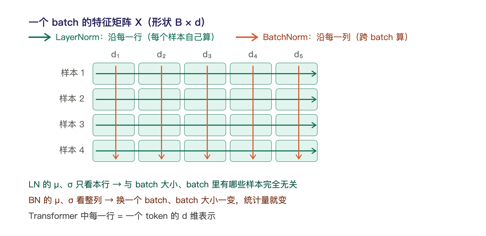
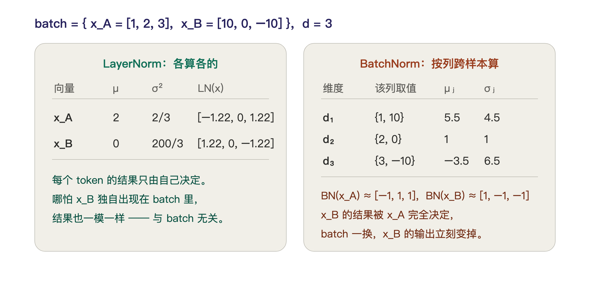
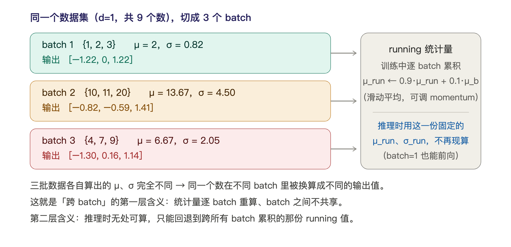
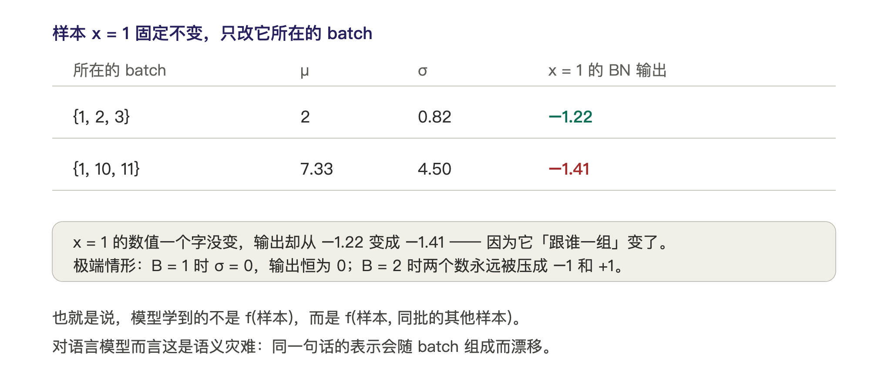

# Transformer 的 sublayer 为什么用 LayerNorm 而不是 BatchNorm？

> 学习笔记 · 2026-11-01  
> 关键词：归一化、LayerNorm、BatchNorm、变长序列

---

## 一句话总结

> **LayerNorm 只看每个 token 自己的 d 维向量——与 batch 解耦、训练推理一致、统计稳定。这就是 Transformer 每个 sublayer 都选 LN 的原因。**
>
> **BatchNorm 的统计量依赖同一个 batch 里的其他样本（跨样本），而且每个 batch 各算一套、batch 之间互不共享，推理时只能回退到跨 batch 累积的 running 值——这两点会把变长 padding、样本耦合、小 batch 高方差、逐 token 推理这些序列任务特有的麻烦全部放大。**

## 1. 一图看懂：两者"统计的方向"完全不同

把一个 batch 的特征矩阵 $X$（形状 $B \times d$）摆成网格：

- **LayerNorm（绿色，横向）**：对**每一行**（每个 token 自己的 $d$ 维向量）计算 μ 和 σ；
- **BatchNorm（橙色，纵向）**：对**每一列**（同一个特征维度，跨整个 batch 的所有样本）计算 μ 和 σ。

在 Transformer 中，每一行就是一个 token 的 $d$ 维表示。这个方向差异是一切后果的根源。

---

## 2. 数学定义

设 $x \in \mathbb{R}^d$ 是某个 token 的表示向量，$\gamma, \beta$ 是可学习参数，$\varepsilon$ 防止除零。

### LayerNorm（对每个 token 独立计算）

$$
\mu = \frac{1}{d}\sum_{j=1}^{d} x_j, \qquad
\sigma^2 = \frac{1}{d}\sum_{j=1}^{d}(x_j - \mu)^2
$$

$$
\mathrm{LN}(x) = \gamma \odot \frac{x - \mu}{\sqrt{\sigma^2 + \varepsilon}} + \beta
$$

**μ、σ 只依赖这一个 token 自己**，与 batch 大小、batch 里有哪些样本完全无关。

### BatchNorm（对每个特征维度 j，跨 batch 计算）

$$
\mu_j = \frac{1}{B}\sum_{i=1}^{B} x_{ij}, \qquad
\sigma_j^2 = \frac{1}{B}\sum_{i=1}^{B}(x_{ij} - \mu_j)^2
$$

$$
\mathrm{BN}(x)_j = \gamma_j \cdot \frac{x_j - \mu_j}{\sqrt{\sigma_j^2 + \varepsilon}} + \beta_j
$$

**$\mu_j$、$\sigma_j$ 是整个 batch 的函数**——换一个 batch，统计量就变。

---

## 3. 一个能亲手验算的数值例子

batch 里放两个 token（取 $d=3$ 方便手算）：$x_A = [1, 2, 3]$，$x_B = [10, 0, -10]$。

### LayerNorm 的计算

| 向量    | μ | σ²    | LN(x)                |
| ----- | - | ----- | -------------------- |
| $x_A$ | 2 | 2/3   | $[-1.22,\ 0,\ 1.22]$ |
| $x_B$ | 0 | 200/3 | $[1.22,\ 0,\ -1.22]$ |

验证 $x_A$：μ = (1+2+3)/3 = 2，σ² = (1+0+1)/3 = 2/3，σ ≈ 0.816，  
(1−2)/0.816 ≈ −1.22，(2−2)/0.816 = 0，(3−2)/0.816 ≈ 1.22，验证通过。

每个 token 的结果**只由自己决定**——哪怕 $x_B$ 独自出现在 batch 里，结果一模一样。

### BatchNorm 的计算（按列）

| 维度 | 该列取值     | $\mu_j$   | $\sigma_j$  |
| -- | -------- | ---- | --- |
| $d_1$ | {1, 10}  | 5.5  | 4.5 |
| $d_2$ | {2, 0}   | 1    | 1   |
| $d_3$ | {3, −10} | −3.5 | 6.5 |

归一化结果：$\mathrm{BN}(x_A) \approx [-1,\ 1,\ 1]$，$\mathrm{BN}(x_B) \approx [1,\ -1,\ -1]$。

**关键观察：$x_B$ 的归一化结果被 $x_A$ 完全决定。** 把 batch 换成 $\lbracex_B, x_C\rbrace$，$x_B$ 的输出立刻改变。这就是"样本间耦合"。

---

## 4. 为什么 Transformer 的 sublayer 必须用 LN（五个原因）

### 4.1 变长序列 + padding 污染统计量（最致命）

Transformer 处理变长句子。batch 里有长度 5 和长度 9 的句子时，短的要用 pad 补齐。BN 计算列统计量 $\mu_j = \frac{1}{N}\sum_i x_{ij}$ 时，pad 位置（通常是 0）会被一起统计：

- 设某维真实值都在 100 附近，pad 了一堆 0 → $\mu_j$ 被硬拉低、$\sigma_j$ 被撑大；
- 真实 token 的归一化结果全被带偏。

除非每一步都做精确的 masked BN，实现复杂、梯度处理麻烦；而 LN 按 token 独立计算，pad 的 token 归一化了也无所谓（反正会被 attention mask 掉，不参与 loss）。

### 4.2 BN 让样本之间耦合，违背序列建模的独立性

第 3 节的例子已经说明：同一个句子在 batch 组成不同时，BN 后的表示**不一样**。模型学到的函数不再是 $f(\text{句子})$，而是 $f(\text{句子},\ \text{batch 里其他句子})$——这对语言任务是语义灾难。LN 保证 token 的表示是它自己的确定函数。

#### 「跨 batch」到底指什么？

这个说法容易被误读成"一次计算跨越了多个 batch"，其实不是。它指下面三层含义（根源都是同一个：μ、σ 由整批算出）：

**① 统计量逐 batch 重算、batch 之间不共享。** 训练时每个 batch 进来都要现场算一套自己的 μ、σ：batch $\lbrace1,2,3\rbrace$ 用 μ=2、σ=0.82，下一个 batch $\lbrace10,11,20\rbrace$ 就用 μ=13.67、σ=4.50。没有哪一份统计量能被后面的 batch 继承——这就是"跨 batch 变化"。

**② 因此"怎么切 batch"会改变输出。** 同一个样本，只因为同批的伙伴不同，归一化结果就不同：

样本 $x=1$ 自己一个字没变，与 $\lbrace2,3\rbrace$ 同批时输出 $-1.22$，与 $\lbrace10,11\rbrace$ 同批时变成 $-1.41$。极端情形更直观：$B=1$ 时 $\sigma=0$，输出恒为 0；$B=2$ 时两个数永远被压成 $-1$ 和 $+1$，与数值大小无关。

**③ 推理时必须"跨 batch 累积"。** 推理阶段 batch 往往很小（甚至只有 1 条），根本算不出可信统计量。所以 BN 在训练时会维护滑动平均

$$
\mu_{\text{run}} \leftarrow (1-m)\hspace{0.1667em}\mu_{\text{run}} + m\hspace{0.1667em}\mu_{\text{batch}}
$$

（PyTorch 默认 momentum $m=0.1$）。训练结束后 `model.eval()` 用的就是这份**跨越所有 batch 累积出来的** $\mu_{\text{run}}, \sigma_{\text{run}}$。也就是说：训练与推理走的不是同一套统计量，这是一致性隐患。

**④ 梯度同样是跨样本的。** 因为 μ、σ 由整批算出，反向传播时 $\partial L/\partial x_i$ 中含有对 μ、σ 求导再链式回来的项，会牵扯同批其他样本——所以 BN 的反向也不是"每个样本各算各的"。

### 4.3 自回归推理阶段 BN 直接失效

- **训练时**：BN 用当前 batch 的统计量；**推理时**：用训练期累计的 running mean/var。
- 语言模型推理是**逐 token 生成**的：每一步往往只有 1 个 token。batch size = 1 时 $\sigma_j^2 = 0$，BN 退化成无用形式，且分布与训练时完全不同。
- LN 没有这个问题：统计量对每个 token 现场计算，**训练与推理行为完全一致**。

### 4.4 小 batch 下 BN 的统计方差太大

BN 的 $\mu_j, \sigma_j$ 是对 B 个样本的估计，估计噪声按 $1/\sqrt{B}$ 放大。大模型显存被注意力矩阵吃掉，实际 batch 往往很小。而 LN 在 $d$ 维上计算统计量——$d_{model}$ 通常是 512～4096+，样本量充足，估计非常稳。

### 4.5 梯度角度

LN 对每个 token 的所有维度做相同的平移和缩放，梯度在 token 内部共变，能稳定每层激活的分布与尺度。这正是它被放在每个 sublayer 的残差连接旁的目的：控制 $x + \mathrm{Sublayer}(x)$ 的尺度，防止深层网络中激活值逐层爆炸或消失。

---

---
