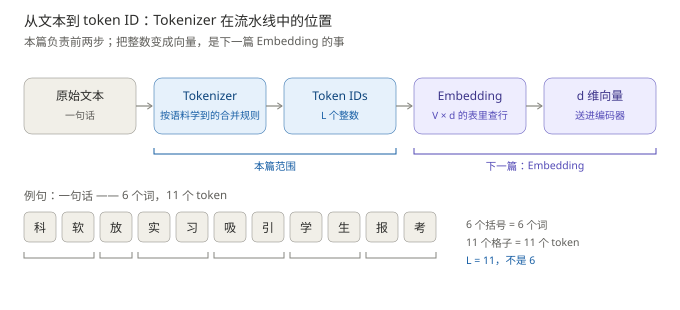
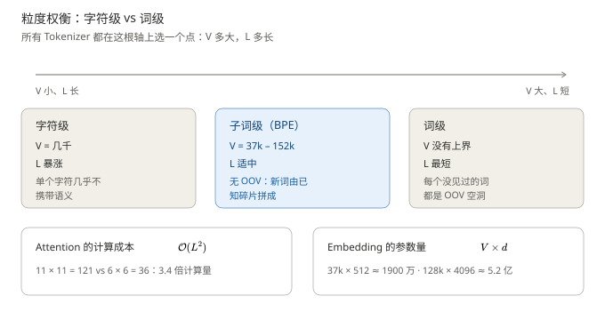
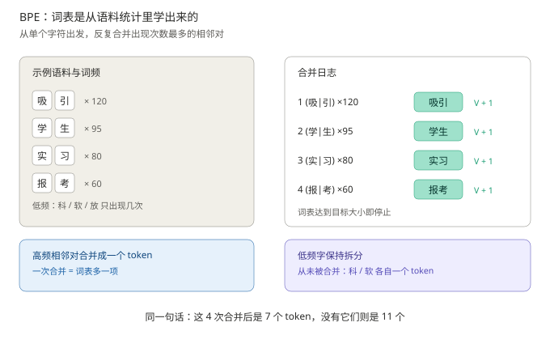

# 分词与词表：文本怎么变成数字

> **一句话结论**：模型只会算数，文字必须先变成整数——Tokenizer（分词器）负责"切"，Vocabulary（词表）负责"编号"；切粗了词表爆炸，切细了序列爆炸，BPE 取中间。
>
> - 按词切：词表无上界 + 新词永远查不到（OOV）；按字切：$L$ 暴涨，注意力成本 $\mathcal{O}(L^2)$
> - BPE 的答案：从字符出发，反复合并语料中最高频的相邻对，**合并次数 = 词表增量**
> - token 数 ≠ 词数：例句 6 个词，逐字切是 11 个 token，真实词表可在 6–16 之间，成本差 2 倍以上

**前置阅读**：无（系列入口）。全系列施工图见 [00-系列规划](../Transformer整体架构/00-系列规划.md)。

**图 1**：本篇在流水线中的位置——把文字变成整数。看图要点：下方例句按词分组是 6 个括号，按 token 计数是 11 个格子，$L=11$ 而不是 6；这 11 是"逐字切分"基线，真实词表会在 6–16 之间浮动（见第三节）。

---

## 一、先问一个更基础的问题：为什么非要 Tokenizer？

> 本节要回答的问题：文字不能直接喂给模型吗？

不能。模型从头到尾只有一种运算——矩阵乘法。它的输入、参数、输出全是数，而"科软"这两个字没法参与乘法。

所以必须先翻译成数。这一步由两个动作、两个零件完成：

$$
\text{"科软 放 实习"} \;\xrightarrow{\ \text{Tokenizer}\ }\; [\text{科},\ \text{软},\ \text{放},\ \text{实},\ \text{习}] \;\xrightarrow{\ \text{Vocabulary}\ }\; [8731,\ 2245,\ 1902,\ 1043,\ 5587]
$$

- **Tokenizer（分词器）** 负责"切"：把一整个字符串切成若干片段，每个片段叫一个 token
- **Vocabulary（词表）** 负责"编号"：每个 token 在表里有唯一整数 ID（上面的数字只是示意）
- 切出来的片段个数就是序列长度 $L$，它是后面所有形状账的起点

关于编号，有两点要先说清。第一，**编号是任意的**：第 8731 号并不比第 2245 号"大"或"更重要"，ID 之间没有任何数值关系——这个"任意性"要等 Embedding 层才被翻译成语义向量（第 1 篇细讲）。第二，编号本身没有选择余地，查表而已；**真正有选择的是"切"**：切粗一点，还是细一点？

粗到极致是"一个词一个 token"，细到极致是"一个字一个 token"。两种都很自然，但两种都有硬伤。

## 二、两种最朴素的切法，为什么都不行

> 本节要回答的问题：按词切、按字切，各自死在哪？

**先试词级。** 最自然的想法是"给每个词发一个编号"。按词切，`科软` 是一个词（中国科学技术大学软件学院的简称），占 1 个 ID——看上去完全合理。但它有两个死穴。

**死穴一：词表无上界。** 中文词语数十万，英文还有 run / runs / running 这类变形，词表 $V$ 根本封不了顶。而嵌入矩阵的大小是 $V \times d$、输出层的 softmax 也要对 $V$ 个类归一化——**两者都随 $V$ 线性变贵**。

**死穴二：OOV（Out-of-Vocabulary；未登录词）。** 语料里没出现过的新词——新术语、人名、错拼——在词表里查不到编号，模型当场失明。可语言每天都在造新词。

**再试字符级。** $V$ 确实小了（中文常用字几千个），但新的代价是序列长度 $L$ 暴涨。用本系列例句算一笔账：

- 例句 `科软 放 实习 吸引 学生 报考`：6 个词、11 个字
- 注意力要算的分数矩阵是 $L \times L$：字符级 $11^2 = 121$，词级 $6^2 = 36$
- **字符级要多花 3.4 倍的注意力计算**，而且单个字符几乎不携带语义，模型还得先学会"拼字"才能学到词义

**图 2**：粒度权衡——所有分词器都在同一根轴上选一个点。看图要点：两头都有硬伤，可行解只在中间；$V$ 变大换来 $L$ 变短，两端成本此消彼长。

所以问题从来不是"要不要编号"，而是"**在哪一级切分**"。需要一个两头都不塌的折中——Subword（子词）：常见组合整体成 token，罕见组合拆成字符。这就是 BPE 的位置。

## 三、原始设计：BPE 凭什么两头兼顾？

> 本节要回答的问题：BPE 的词表是设计出来的，还是学出来的？

BPE（Byte-Pair Encoding，字节对编码，Sennrich et al., 2016）的核心动作只有一个，反复执行：

1. 初始词表 = 语料中出现过的所有**字符**（基础很小）
2. 统计语料中所有**相邻 token 对**的出现频次，把频次最高的那对合并成一个新 token
3. 重复第 2 步，直到词表达到目标大小——**合并次数 = 词表增量**

例句相关的 toy 语料走一遍（图 3 左侧）：假设"吸引"出现 120 次、"学生"95 次、"实习"80 次、"报考"60 次。那么第 1 次合并必然是 (吸引)，第 2 次 (学生)……4 次合并后，这四个词各自成为**一个** token。

**图 3**：BPE 的合并过程——每合并一次，词表多一项。看图要点：右下角结论——同一句话在有这些合并的词表里是 7 个 token，在没有这些合并的词表里是 11 个 token，**切分粒度由词表决定，不由句子决定**。

这个 toy 演示解释了例句为什么会被切成 11 个：合并规则里没有 `科`+`软`、`放`+`实` 这些对，所以只能逐字落地。

这里要澄清一件最容易想当然的事。`科软` 是"中国科学技术大学软件学院"的简称，人一眼就知道它是一个词；但 **Tokenizer 对此一无所知**——它不认缩写、不认词义，只认"这两个字节在多长的窗口里挨着出现过多少次"。在它眼里，`科` 和 `软` 就是两个普通符号，能不能并成一个 token，纯粹看统计。

**本文取"逐字切分"作为基线：11 个字 → 11 个 token。** 这是最理想的情形（每个汉字恰好占一个 token），好处是读者能自己数、形状也整齐。真实模型不会这么干净——同一句话换个词表，token 数在 6 到 16 之间浮动：

| 情形 | token 数 | 说明 |
| --- | --- | --- |
| 本文基线（每字 1 token） | 11 | 便于手数、便于算形状，全系列沿用 |
| 中文优化词表（128k，Qwen 类） | 6–8（推算） | `科软` `实习` `学生` 可能各自整体成 token |
| GPT-4 词表 cl100k_base（实测） | 13（不加空格）/ 16（加空格） | 连 `学生` 都是 2 个 token，部分汉字还被拆成字节 |

实测数据由 OpenAI 的 `tiktoken` 库跑出；128k 那一行按常见中文分词器行为推算，未逐一实测。顺带一个实用结论：中文句子里加空格会额外吃 token（这句实测多 3 个），写 prompt 时没必要给自己加价。

为什么 cl100k 这么碎？它的训练语料以英文为主，中文相邻对在合并优先级里排不到前面——连 `学生` 这样高频的词都没并上。

这张表本身就是本篇最该记住的一句话：**同一个句子、同一套模型参数，换个词表，token 数能差 2 倍以上——差的全是钱和上下文长度。**

BPE 有两条关键性质：

- **词表是学出来的，不是人编的。** 高频组合自动成词、低频组合自动拆字，不需要语言学规则。
- **天然免疫 OOV。** 任何新词都是已有字符的拼接，只要字符集覆盖，就没有查不到的词。

《Attention Is All You Need》采用的正是 BPE：源语言和目标语言**共享一张 37000 词的词表**（论文 5.1 节），共享的理由是英德互译两种语言用同一套子词最省参数。另外词表里还有一类特殊 token——BOS（句首）、EOS（句尾）、PAD（填充），它们不参与正文切分，只是占坑，本篇不展开。

## 四、前沿演化：从 BPE 到 byte-level 与 128k 词表

> 本节要回答的问题：BPE 之后，分词器改了什么、没改什么？

演化主线只有一条逻辑：**每个新方案都在修上一个方案的具体毛病**。

**① WordPiece（Schuster & Nakajima, 2012；BERT 采用）**——修"只看频次"的毛病。BPE 谁出现得多就合并谁，会把标点、虚词这类高频但无意义的对合并进去。WordPiece 把合并准则改成"**哪个对使语料似然提升最大**"：合并它之后，语料的概率上升最多的才合并。算法骨架不变，只是选择标准从计数换成了概率。

**② SentencePiece + Unigram（Kudo & Richardson, 2018；Kudo, 2018；T5 采用）**——修两个毛病。其一，BPE 类方法依赖空格分词，对中文、日文这种没空格的语言不友好；SentencePiece 把空格当成普通字符处理，实现**语言无关**。其二，Unigram 把方向反过来：先造一个**超大**候选词表，再按概率贡献逐个剪枝——好处是同一句话可以有多种切法，保留概率最优的那种，而不是 BPE 那种唯一的贪心切法。

**③ Byte-level BPE（GPT-2，Radford et al., 2019）**——彻底消灭 OOV 的最后一公里。基础字符集改成 **256 个字节**：任何文本经 UTF-8 编码后都是字节序列，而字节只有 256 种，所以**任何输入都一定能编码**，生僻字、emoji、乱码全兜得住。代价：一个汉字在 UTF-8 里占 3 个字节，词表对中文不友好时一个字可能被拆成 2–3 个 token——这正是"中文费 token"的根源。

**④ 词表规模的军备竞赛**——折中点在移动。37000（2017）→ 32000（BERT / LLaMA）→ 50257（GPT-2）→ 128k–152k（LLaMA-3 / Qwen）。驱动力是多语言和代码：词表大，单 token 携带的信息多，$L$ 短，省注意力；但嵌入矩阵 $V \times d$ 和 softmax 随 $V$ 线性变贵。算一笔账：$37000 \times 512 \approx 1900$ 万参数（2017），$128000 \times 4096 \approx 5.2$ 亿参数（LLaMA-3 量级）——**嵌入表从零头长成了大户**，这就是折中点不能无限右移的原因。

> **进阶（可跳过）**：tokenizer-free 路线（ByT5，Xue et al., 2022；Byte Latent Transformer，2024）干脆不切词，直接吃字节，用别的设计补偿变长的序列——至今未成主流。这件事反过来说明：BPE 这个折中至今没被推翻。

**没变的是**：所有方案都保留"子词"这个中间粒度。变的是合并准则（频次 → 似然 → 概率剪枝）和兜底层（字符 → 字节）。

## 五、小结

| 对比项   | 2017 原始设计    | 当今主流                                   | 为什么变                   |
| ----- | ------------ | -------------------------------------- | ---------------------- |
| 词表构造  | BPE，按频次合并    | Byte-level BPE / SentencePiece-Unigram | 消灭 OOV、语言无关            |
| 基础字符集 | 字符           | 256 字节                                 | 任何输入都可编码               |
| 词表大小  | 37000（源目标共享） | 32k–152k                               | 多语言与代码驱动，$V$–$L$ 折中点右移 |
| 切分粒度  | 子词           | 子词（**未变**）                             | 折中至今最优                 |

## 六、面试易错点

| 面试考点                   | 常见答错          | 正确答法                                                               | 面试官在考什么                       |
| ---------------------- | ------------- | ------------------------------------------------------------------ | ----------------------------- |
| 为什么不按词/按字编码？           | "字太小，没有语义"    | 词级：$V$ 无上界 + OOV；字级：$L$ 暴涨，注意力 $\mathcal{O}(L^2)$ 成本失控；子词两头兼顾      | 是否真理解 $V$ 与 $L$ 的权衡，而不是背"子词好" |
| BPE 怎么工作？              | "保留语料里的高频词"   | 从字符开始，反复合并**频次最高的相邻对**，合并次数 = 词表增量；词表是学出来的                         | 算法过程是否亲手推过                    |
| 词表是不是越大越好？             | "越大覆盖越全，当然越好" | $V$ 大 → $L$ 短省注意力，但嵌入 $V \times d$ 与 softmax 变贵，低频词还训练不充分          | tradeoff 意识                   |
| GPT-2 为什么用 byte-level？ | "为了支持更多语言"    | 主因是**彻底消灭 OOV**——字节级任何输入都可编码；多语言只是副产物                              | 动机与因果链                        |
| 为什么中文费 token？          | "中文更难"        | 词表以英文语料为主 + UTF-8 每汉字 3 字节，byte 兜底时被切碎；换中文友好的词表（如 Qwen 扩词表）可显著降低成本 | 是否理解 tokenizer 的语言偏差          |
| `科软` 为什么被切成两个字？        | "因为它是低频词/新词"  | Tokenizer 不认词义、不认缩写，只按相邻字节对的统计频次合并；`科软` 是否成 1 个 token 完全取决于词表（cl100k 下 2 个，中文优化词表可能 1 个） | 是否理解 tokenizer 无语义、无词外知识      |

## 七、引用论文

1. Vaswani et al. *Attention Is All You Need*. NeurIPS 2017. arXiv:1706.03762.（BPE 共享 37000 词表，5.1 节）
2. Sennrich et al. *Neural Machine Translation of Rare Words with Subword Units*. ACL 2016. arXiv:1508.07909.（BPE）
3. Schuster & Nakajima. *Japanese and Korean Voice Search*. ICASSP 2012.（WordPiece）
4. Kudo. *Subword Regularization: Improving Neural Network Translation Models with Multiple Subword Vocabularies*. ACL 2018. arXiv:1804.10959.（Unigram）
5. Kudo & Richardson. *SentencePiece: A Simple and Language Independent Subword Tokenizer and Detokenizer*. EMNLP 2018. arXiv:1808.06226.（SentencePiece）
6. Radford et al. *Language Models are Unsupervised Multitask Learners*. OpenAI 2019.（GPT-2，byte-level BPE）
7. Xue et al. *ByT5: Towards a Token-Free Future with Pre-trained Byte-to-Byte Models*. 2021. arXiv:2105.13626.（tokenizer-free，进阶框）
