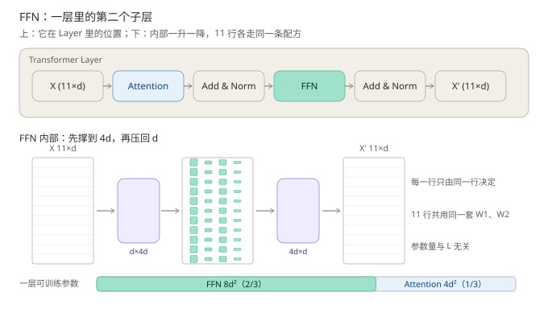
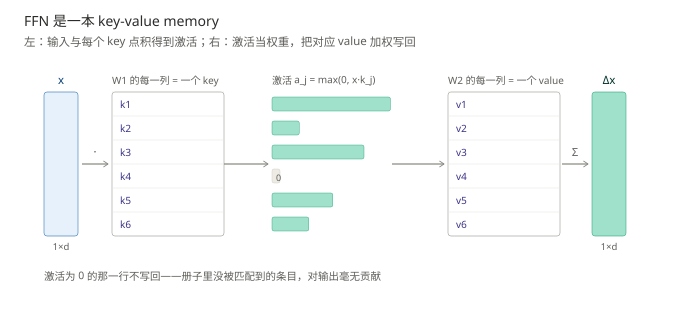
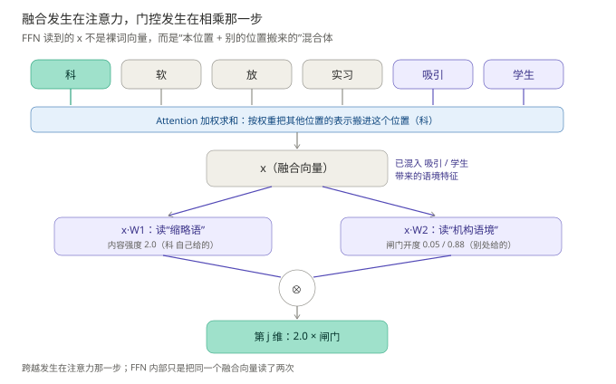
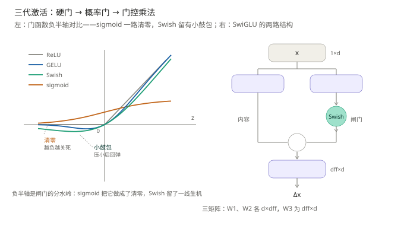
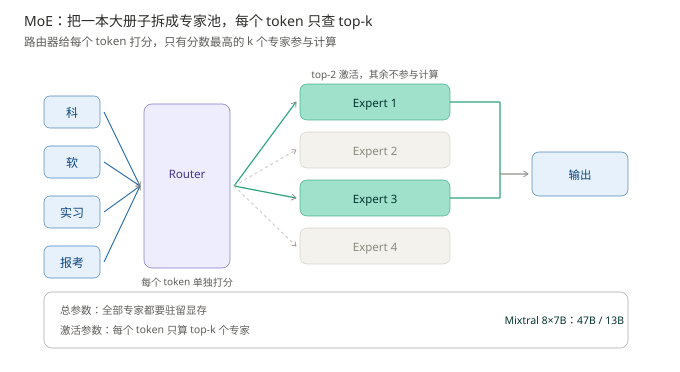

# 前馈网络：每个位置怎么被单独加工

> **一句话结论**：注意力只在**位置维**上做加权平均——权重非负、和为 1，一个位置多拿一分，其余位置就得让；FFN（Feed-Forward Network，前馈网络）只在**特征维**上做非线性变换，把取回来的向量加工成新的组合。**前者负责让信息相遇，后者负责让相遇后的信息变出新东西**。而平均永远算不出"两个特征同时出现"这种与关系，所以这一层里必须有一个带非线性的逐位置 MLP。
>
> - **缺了它，模型只能搬运、不能加工**：纯注意力堆叠会让所有 token 的表示趋于同一个向量（秩塌缩），FFN 的逐位置非线性是打破平均化的力量
> - **它是参数大户**：$d \to d_{ff} \to d$ 且 $d_{ff} = 4d$，参数 $8d^2$，占一层可训练参数的 2/3；中间撑大不是为了变大，是为了在高维里把特征摊开，并给"知识"腾出记忆槽位
> - **今天的主流是门控 + 稀疏**：SwiGLU 用三个矩阵换一次门控乘法，为保住参数量把中间维降到 $\frac{8}{3}d$；MoE 把一本大册子拆成专家池，省的是**算力**，不是显存

| **前置阅读**：[《Attention 进阶：多头、KV cache 与 FlashAttention》](../注意力机制进阶/注意力机制进阶.md)　 | 　**需要先掌握**：子层与残差的概念、矩阵形状怎么相乘 |
| ------------------------------------------------------------------------------ | ---------------------------- |

**图 1**：本篇地图。看图要点：上排是 FFN 在一层里的位置（注意力之后、第二个残差之前）；下排是它内部那一升一降，以及"每一行都走同一条配方"这件事——参数与位置数无关，正是它能当参数大户的前提。

例句沿用全系列基线：`科软 放 实习 吸引 学生 报考`，11 个 token，形状账按 $L = 11$、$d = 512$、$d_{ff} = 2048$（2017 年 base 配置）算；提到现代模型时另给真实量级。

---

## 一、注意力搬完之后，谁来加工

> 本节要回答的问题：注意力已经让每个位置看到了别的位置，为什么一层里还需要第二个子层？

**先立一个常见的错误直觉：FFN 就是个 MLP，属于"顺手加上去"的部件，真正干活的是注意力。**这个直觉错在一个地方——它没分清注意力到底能做什么、不能做什么。

### 1.1 注意力的输出，只能是已有向量的加权平均

单头注意力的输出是 $O_i = \sum_j a_{ij} V_j$，其中权重 $a_{ij}$ 由 softmax 给出：$a_{ij} \ge 0$ 且 $\sum_j a_{ij} = 1$。这是**凸组合**的定义——$O_i$ 一定落在所有值向量的凸包内。多头拼起来再过 $W_O$ 也一样：线性映射保凸组合，输出仍是各位置值向量（经同一映射）的凸组合。

这条性质决定了注意力的能力边界：**它能决定"取谁、取多少"，不能决定"取回来之后怎么算"。**权重和恒为 1 意味着它只能做**分配**，不能做**叠加增强**。

拿例句试一次。`科软` 被切成 `科`、`软` 两个 token，注意力把两个位置的值向量按权重混成一个中间向量。问题在于："科软是中国科学技术大学软件学院的简称"这个含义，本质是**两个 token 同时出现**才成立的关系。而加权平均表达不了"同时"：$a_{\text{科}} + a_{\text{软}} = 1$，让"科"的权重涨到 0.9，"软"就只剩 0.1——**它只会此消彼长，不会同时变强**。同理，维度之间的乘性交互（"既是动词、又是复数"）也无法由平均产生。

> **一个更直观的类比（是类比，不是等价）**：注意力像会议里的主持人，决定"这一轮听谁的、每人发言几分钟"，总时长固定；FFN 像会后写纪要的人，把听到的内容重新组织成新句子。主持人再公正，也写不出纪要——**他没做加工这件事**。

### 1.2 只留注意力，堆深了会塌

这不是"少了个部件，效果差一点"的程度问题。Dong et al. (2021) 证明：把残差与 FFN 都拿掉、只留纯注意力的堆叠，输出矩阵的秩随深度**双指数衰减**，最终趋近 1——所有位置的表示变成同一个向量，模型再也分不清 token。

直觉很好懂：每个位置都是别人的加权平均，反复平均就是反复低通滤波，差异被一层层抹平。**打破这个平均化过程的，正是 FFN 的逐位置非线性**：它对每个位置单独施加一个非线性函数，不参与平均，于是差异有机会被重新放大。

### 1.3 精髓句

> **注意力在位置维做"选与混"，FFN 在特征维做"变与造"；两者是正交的两件事，缺一件就有一个维度没被处理。**

术语上这叫 **token mixing（跨位置混合）** 与 **channel mixing（跨通道混合）**（Tolstikhin et al., 2021），MLP-Mixer 把这句话讲得最直白：一个网络要同时会"在位置上交流"和"在特征上组合"，两件事的算子形状完全不同。

**这就定了 FFN 的任务：逐位置、带非线性、改变特征而不改变位置间的对应关系。**接下来三节分别回答它的形状（怎么变）、共享方式（对谁变）、参数账（值不值）。

---

## 二、先撑大、再压回：那个非线性为什么必须有

> 本节要回答的问题：为什么不是一层 $d \to d$ 的线性变换，而要先升到 $4d$ 再降回来？

原始设计（Vaswani et al., 2017）只有两行：

$$
\mathrm{FFN}(x) = \max(0,\; xW_1 + b_1)\,W_2 + b_2
$$

其中 $x \in \mathbb{R}^{1 \times d}$ 是一个位置的输入向量；$W_1 \in \mathbb{R}^{d \times d_{ff}}$ 把维度从 $d$ 升到 $d_{ff}$；$W_2 \in \mathbb{R}^{d_{ff} \times d}$ 再降回 $d$；$b_1, b_2$ 是偏置；原文取 $d_{ff} = 4d = 2048$（base 配置）。

### 2.1 为什么不能省掉 $\max(0,\cdot)$

省掉它，整个式子变成 $x(W_1W_2) + b$——括号里可以先算成一个 $d \times d$ 的矩阵。而这个矩阵与注意力的输出投影 $W_O$ 都是线性的，两层线性叠在一起仍然是一层线性：**深度失去了意义**。所以非线性不是"让效果更好"的调味品，它是"多层网络"这个概念成立的前提。

### 2.2 为什么必须先升维

线性层的作用是"把特征重新组合"，但组合的前提是**特征已经被摊开**。在 $d$ 维空间里，一个神经元只能切一刀（一个超平面）；要判断"这个词既是动词、又带了否定前缀"这种非线性条件，在低维里需要很多刀才能拼出来，在高维里往往一刀就够——这就是 Cover 定理的方向：**把样本映射到更高维，线性可分的可能性变大**。

$d_{ff} = 4d$ 就是给这一层提供 $4d$ 把刀（每个中间神经元一把），各自负责一种模式。降到 $d$ 的那一步则做汇总：把 $4d$ 个"检测结果"按学到的权重加回去，写成一个 $d$ 维的更新量。

### 2.3 代算：这一层到底多大

按 base 配置 $d = 512$、$d_{ff} = 2048$：

$$
\underbrace{512 \times 2048}_{W_1} + \underbrace{2048 \times 512}_{W_2} = 2{,}097{,}152 \approx 2.1\text{M}
$$

同一层里注意力有四个 $d \times d$ 投影（$W_Q, W_K, W_V, W_O$），参数 $4 \times 512^2 = 1{,}048{,}576 \approx 1.05\text{M}$。两者一比：$2.1 : 1.05 = 2 : 1$——**FFN 占了这一层参数的 2/3**。这个比例到了百亿参数模型里基本不变，后文第六节会看到它为什么重要。

> **进阶（可跳过）**：为什么是 $4d$，不是 $2d$ 或 $8d$？Vaswani et al. (2017) 在 Table 3 里做过 $d_{ff}$ 的消融，宽度减半会掉点、翻倍收益很小；$4d$ 是"表达力随宽度线性涨、算力也随宽度线性涨"这条曲线上的经验拐点。Geva et al. (2021) 给了另一种解释：$d_{ff}$ 就是记忆槽位数，越大能记住的"模式 → 写回"对越多，但每个槽位都要在推理时被算一遍，所以不能无限加。

---

## 三、一套权重扫过所有位置：于是它成了参数大户

> 本节要回答的问题：为什么 11 个位置共用同一个 FFN，而不是每个位置一套？共用带来什么后果？

### 3.1 矩阵视角：行与行之间没有任何连接

把整句写成一个矩阵 $X \in \mathbb{R}^{11 \times 512}$（行 = 位置，列 = 维度），FFN 做的事是：

$$
X' = \max(0,\; XW_1 + b_1)\,W_2 + b_2
$$

形状上 $11 \times 512 \to 11 \times 2048 \to 11 \times 512$：**输出的第 $i$ 行只由输入的第 $i$ 行决定**，第 1 行算成什么样，与第 11 行毫无关系。这正是"逐位置独立"的意思——它是**沿行方向互不通信**的算子，通信的活已经由上一层的注意力干完了。

### 3.2 为什么可以共用一套权重

因为加工配方与位置无关。"这个词是不是动词""这个 token 是不是稀有词""这个位置是不是数字"——这些判断只看向量内容，不看它是第几个 token。位置信息在第一篇就被位置编码写进向量本身了，不需要 FFN 再额外知道。

这条共享有一个很实在的后果：**FFN 的参数量与 $L$ 无关**。$L = 11$ 和 $L = 4096$ 用的是同一套 $W_1, W_2$，只是矩阵多了几行。这是它能"又大又便宜"的根本原因——大在参数，不贵在样本数。

但要区分两件事：**共享的是"做法"，不是"原料"**。每一行走的是同一套权重，可每一行读到的向量里已经混入了上下文——注意力在上一层就把其他位置的信息按权重搬了进来（这一点在 5.3 讲门控时会用到：正因为原料是融合体，一个投影读"本体特征"、另一个读"上下文特征"才有意义）。

### 3.3 它其实就是一个 kernel=1 的卷积

逐位置作用、所有位置共享权重——这两条合起来，恰好是 1×1 卷积（kernel size = 1）的定义。所以"Transformer 的 FFN 等于两层 1×1 卷积夹一个非线性"这句话是严格成立的，不是比喻；区别只在实现：深度学习框架里把它写成两个全连接层走 GEMM，卷积网络里写成 conv1d，数学上同一个算子。（类比边界：等价的是**算子语义**，不是计算效率——1×1 卷积在某些硬件上更省，但那是实现层面的选择。）

### 3.4 算力账：它才是短上下文时的算力主体

每生成一个 token，FFN 要做 $2 d d_{ff} = 8d^2$ 次乘加（$d \to 4d$ 一次、$4d \to d$ 一次）；注意力每 token 摊到的乘加约 $4d^2 + 2Ld$（四个投影加两项 $L^2 d$ 摊到 $L$ 个位置）。令两者相等：

$$
8d^2 = 4d^2 + 2Ld \quad\Longrightarrow\quad L = 2d
$$

也就是说：**上下文长度超过 $2d$ 之后，注意力的算力才反超 FFN。**$d = 512$ 时这条线在 $L \approx 1024$；$d = 4096$ 时在 $L \approx 8192$。反过来说，日常的几 k 上下文里，FFN 一直是算力主体——这也是后面 MoE 为什么专挑 FFN 下手。

> 上面只计矩阵乘的乘加次数，忽略了 softmax、逐元素非线性与访存开销；真实 profile 里 FFN 的占比会因实现与上下文长度浮动，但数量级关系不变。

---

## 四、它到底在算什么：一本 key-value memory

> 本节要回答的问题：这 2/3 的参数，具体存了什么？

### 4.1 把 FFN 拆成"匹配 + 写回"

Geva et al. (2021) 给了一个很好用的分解。把 $W_1$ 的每一列看成一个 $d$ 维向量 $k_j$（按 PyTorch 的存储习惯，$W_1$ 存成 $d_{ff} \times d$，每个 $k_j$ 就是一行），把 $W_2$ 的每一列看成 $v_j \in \mathbb{R}^d$。那么：

$$
\mathrm{FFN}(x) = \sum_{j=1}^{d_{ff}} \underbrace{\max(0,\; x \cdot k_j)}_{a_j}\; v_j
$$

这不是新模型，只是把矩阵乘法按列展开——但读法完全变了：

- $k_j$ 是一个 **key（模式）**：它描述"什么样的输入会激活我"，比如"缩略语""机构名""后面常接动词的名词"；
- $a_j = \max(0, x \cdot k_j)$ 是**匹配强度**：输入与这个模式有多像，像就激活，不像就归零；
- $v_j$ 是对应的 **value（写回内容）**：一旦这个模式被匹配上，就把 $v_j$ 加进输出。

于是 FFN 的本质是：**用输入去查一本有 $d_{ff}$ 个条目的册子，查到哪几条，就把哪几条的内容按匹配强度加权，写回残差流。**

**图 2**：把一次 FFN 计算读成"查册子"。看图要点：中间每个 key 与输入 $x$ 算匹配分，激活条的长短就是匹配强度（有一条为 0——没匹配上就不写回）；右侧被激活的 value 按强度加权求和，得到写回残差流的 $\Delta x$。

### 4.2 用例句看一次

`科软` 这个位置进入 FFN 后，若"缩略语""高校"这几个 key 的匹配分数高，对应的 value（"常与报考、招生、考研共现"这类方向）就被写回向量。模型并没有一个"科软"的字典条目，它有的是**一组模式检测器 + 一组写回方向**——这正是"知识存在 FFN 里"这句话的具体形态。

Geva et al. (2021) 的证据是可视化的：key 的激活模式与输入里具体 token 的共现高度相关；value 的方向与下一层输出的变化方向一致。后续工作（如 Meng et al., 2022 的事实定位与编辑）进一步显示，改动某一层 FFN 的特定条目，能让模型对某个事实的回答发生定向改变。

### 4.3 这个视角解释了三件事

1. **为什么 FFN 参数这么多**：它在存知识，不是在算函数。$d_{ff}$ 就是册子的页数。
2. **为什么 MoE 有效**（第六节）：知识可以分册存放，不同的册子放不同的专家。
3. **为什么中间层不能太窄**：册子太薄，能记的模式就少——这是宽度消融会掉点的机制性解释，而不只是"容量不够"。

---

## 五、三代激活与门控：ReLU → GELU → SwiGLU

> 本节要回答的问题：激活函数换了几代，每一代是被上一代的什么毛病逼出来的？

**三代激活其实在回答同一个问题：一个特征放行多少，由谁来决定？**ReLU 说由符号决定，GELU 说由概率决定，SwiGLU 说由另一路输入决定——决定权每移交一次，这一层的表达力就多一层。

### 5.1 ReLU：由符号决定的硬门

$$
\mathrm{ReLU}(z) = \max(0,\, z)
$$

其中 $z = x \cdot k_j$ 是输入与第 $j$ 个 key 的点积（沿用第四节的记法）。代算：$z = 1.3$ 时放行 $1.3$；$z = -0.7$ 时放行 $0$——这条 value 完全不写回，册子的这一页对本次输入等于不存在。

它卡在两处。

**其一，负半轴梯度恒为 0，检测器会"死"。**反向传播时 $\frac{\partial a_j}{\partial (x \cdot k_j)}$ 在负区恒为 0，于是 $W_1$ 的第 $j$ 列（这个 key）与 $W_2$ 的第 $j$ 列（这条 value）在本步都收不到梯度。如果初始化不走运、或某次大学习率更新把 $x \cdot k_j$ 整体推到负区，这个神经元就永远沉默——不是"学得慢"，是**再也无法被改变**。$4d$ 个槽位死掉一批，等于册子被撕掉几页，而且撕掉的页在其余参数眼里从未存在过。

**其二，$z = 0$ 处不可导。**实现里用次梯度凑合（0 处随手记 0 或 1），训练能跑，但 0 附近的参数会在"活 / 死"两种状态之间抖动，优化面有一道折痕。

### 5.2 GELU：由概率决定的软门

$$
\mathrm{GELU}(z) = z\,\Phi(z), \qquad \Phi(z) = \tfrac{1}{2}\left(1 + \mathrm{erf}\!\left(\tfrac{z}{\sqrt{2}}\right)\right)
$$

$\Phi$ 是标准正态分布的累积分布函数。直觉：不再问"$z$ 是不是正的"，而是问"$z$ 有多大概率是正信号"，然后把输入乘以这个概率。

| $z$  | −2    | −1    | 0 | 1    | 2    |
| ---- | ----- | ----- | - | ---- | ---- |
| ReLU | 0     | 0     | 0 | 1    | 2    |
| GELU | −0.05 | −0.16 | 0 | 0.84 | 1.95 |

对比可见两处改进：**处处可导**（优化面没有折痕）；**弱负信号留一线生机**——$z = -1$ 时输出 $-0.16$ 而不是 0，一个看起来像负、其实只是噪声的特征不会被一刀切死。BERT 与 GPT-2 用它。

但它仍是**单路**的：无论 ReLU 还是 GELU，"放行多少"都只是 $z$ 自己的固定函数。网络想表达"当另一个特征同时出现时，这个特征才放行"，单个非线性做不到——它没有第二个输入可用。这就是下一代的切入点。

### 5.3 GLU → SwiGLU：由另一路输入决定的门

**Gated Linear Unit, GLU（Dauphin et al., 2017）**给门加了第二个输入：

$$
\mathrm{GLU}(x, W, V) = \sigma(xW) \otimes (xV)
$$

（$W, V$ 是原文符号；本篇后文记内容路为 $W_1$、门路为 $W_2$，输出矩阵为 $W_3$；$\otimes$ 是逐元素乘。）一路 $xV$ 是"内容"，回答"放什么"；一路 $\sigma(xW)$ 是"闸门"，回答"放多少"——**闸门是输入的函数，网络可以学着把它接到任何特征上**。

代算一次：设某位置投影后 $xW_1 = [2.0,\ -1.0]$、$xW_2 = [0.5,\ 1.5]$，则 $\sigma(xW_2) = [0.62,\ 0.82]$，相乘得 $[1.24,\ -0.82]$。第一个特征放行 62%；第二个内容是负的、闸门却开了 82%——**闸门只管开度，正负由内容自己带**，两个角色解耦了。

这正是 1.1 节"平均算不出与关系"的代数出口：乘积 $f(x) \cdot g(x)$ 让"特征 B 决定特征 A 的去留"，这是任何加权平均都给不出的二阶交互。

一个自然的疑问：闸门这条路走的也是 x，岂不是 x 在管自己？不是——**$\otimes$ 配对的双方是投影后的特征，不是 x 本身**。写成分量：$(xW_1)_j = x \cdot W_1[:,j]$、$(xW_2)_j = x \cdot W_2[:,j]$，两条路是同一个 x 经**两组不同权重**得到的两个线性组合——$W_1[:,j]$ 可以学成"缩略语模式"检测器，$W_2[:,j]$ 学成"机构语境"检测器，检测的东西不同，只是都从同一个 x 里抽取。$\otimes$ 按**同一坐标**配对：第 $j$ 维输出 $= (xW_1)_j \times \sigma\big((xW_2)_j\big)$，两个检测器同时命中才有大输出——内容 2.0 不变，语境闸门 0.05 时输出 0.1、0.88 时输出 1.76，**是语境这个特征决定缩略语特征写不写回**。若训练中该配对的两列错开了坐标，乘出来恒为 0、这一维作废，梯度会把它们拉回对齐：**把想一起工作的特征排进同一坐标，本身就是训练要解决的任务**。

再往前推一层：x 也不只是这个词自己的向量。FFN 的输入是残差流上的 $x = x_{\text{本位}} + \mathrm{Attn}(\cdot)$，注意力已经按权重把 `吸引`、`学生` 的贡献搬了进来——**所以"特征 B"完全可以来自别的位置**："缩略语"那一维的内容由 `科` 自己提供，"机构语境"那一维的闸门由 `吸引`/`学生` 带来的特征打开，**跨 token 的与门就是这么成立的**。但边界要划清：融合发生在注意力那一步，不在这里——FFN 只是把同一个融合向量读了两次，第 3 节"行与行互不通信"的结论不变，变的只是每一行里的原料已经带了上下文。

还有一处容易误解："内容 / 闸门"的分工不是结构天生规定的。初始化时两路完全对称（GLU 里 $xV$ 与 $\sigma(xW)$ 地位相同），是 Swish 只加在其中一边打破了对称，训练才让一边专管"放什么"、另一边专管"放多少"——**分工是学出来的结果，不是先验**。

三条澄清合起来是一句话：**注意力决定哪些特征能同时躺在同一个向量里，$\otimes$ 决定这些特征怎么互相开闸**——没有前者，门控无料可读；没有后者，融进来的特征只能被动相加，无法条件化地写回。

**图 3**：融合发生在注意力，门控发生在相乘那一步。看图要点：`科` 读到的 x 是“本位置 + `吸引`/`学生` 搬来的”混合体；两个投影从同一个混合体里各读各的——内容读“缩略语”（2.0，`科` 自己给的），闸门读“机构语境”（0.05 / 0.88，别的位置给的），相乘之后，语境才真正成为“缩略语特征写不写回”的开关。

这张图也说清了 GLU 的意义所在。ReLU 的 MLP 读的是同一个融合向量，但它的门槛只由 $x \cdot k_j$ 自己的符号决定——**读到什么就按什么放行**，没有“另一件事”插手的余地；GLU 用两个投影把**读数**和**开关**分开（图中 $xW_1$ 与 $xW_2$），“由另一件事决定放不放”才有了结构上的落点。这也是“逐位置算子”也能做出条件化行为的原因：条件不是 FFN 去别处取的，是注意力提前放进 x 里的。

**SwiGLU（Shazeer, 2020）**把 sigmoid 门换成 Swish 门：

$$
\mathrm{SwiGLU}(x) = \big(xW_1 \otimes \mathrm{Swish}(xW_2)\big)\,W_3, \qquad \mathrm{Swish}(z) = z\,\sigma(z)
$$

为什么换门？看图 4 左：sigmoid 单调、负区输出趋 0，等于把"压小"做成了"清零"——闸门对负信号一路关死；Swish 在负半轴有个小鼓包（最低约 $-0.28$，在 $z \approx -1.2$ 处），大多数负信号被压小、少数被保留——对"看起来负其实有用"的特征更宽容。Shazeer (2020) 在同参数量的对照里发现 GLU 变体普遍优于 ReLU / GELU，其中 Swish 门最好，此后 SwiGLU 成为 PaLM、LLaMA 等模型的默认选择。

**图 4**：三代门函数与 SwiGLU 的两路结构。看图要点：左图负半轴是分水岭——ReLU 恒为 0、sigmoid 一路清零，GELU 与 Swish 都留有余地，而 Swish 的"小鼓包"（先压小再回弹）正是它换掉 sigmoid 门的理由；右图是 SwiGLU 的三矩阵结构，内容路（$xW_1$）与门路（$xW_2$ 过 Swish）逐元素相乘后再经 $W_3$ 写回。

### 5.4 那个奇怪的 $\frac{8}{3}d$ 是怎么来的

注意 SwiGLU 有**三个**矩阵：$W_1, W_2 \in \mathbb{R}^{d \times d_{ff}}$、$W_3 \in \mathbb{R}^{d_{ff} \times d}$，参数量是 $3 d d_{ff}$。若还取 $d_{ff} = 4d$，参数就变成 $12d^2$，是原来的 1.5 倍——**比较就不公平了**。要让参数量与原始 FFN 的 $8d^2$ 持平：

$$
3\,d\,d_{ff} = 8d^2 \quad\Longrightarrow\quad d_{ff} = \tfrac{8}{3}d \approx 2.67d
$$

所以"中间维从 $4d$ 降到 $\frac{8}{3}d$"不是模型变窄了，而是**换成三矩阵结构后为保住总量做的换算**。LLaMA 7B（$d = 4096$）取 $d_{ff} = 11008$：$\frac{8}{3} \times 4096 = 10922.7$，向上取整到 256 的倍数正好 11008——那个看起来很怪的数字就是这么来的。

---

## 六、MoE：把一本大册子拆成专家池

> 本节要回答的问题：参数越多越强，但参数与算力绑死在一起，怎么解开？

### 6.1 绑在哪：稠密 FFN 的账

稠密 FFN 的约束是**每个 token 都要完整过一遍全部参数**：$8d^2$ 个参数，$L$ 个 token 就要做 $8Ld^2$ 次乘加（第三节算过）。想让模型"懂得更多"就得加参数，而加参数的训练与推理成本同步上涨——**参数规模与每 token 计算量是焊死的**。MoE（Mixture-of-Experts，混合专家）拆的就是这条焊缝：**把知识容量（总参数）与每 token 计算量（激活参数）解耦**。

### 6.2 机制：每个 token 只走少数几个专家

把一个大 FFN 换成 $N$ 个独立的小 FFN（专家），再加一个 router（路由器）：

$$
\mathrm{MoE}(x) = \sum_{j \in \mathrm{TopK}(g(x))} g_j\;\mathrm{FFN}_j(x), \qquad g(x) = \mathrm{softmax}(xW_g)
$$

$W_g \in \mathbb{R}^{d \times N}$ 给每个专家打分；只保留分数最高的 $k$ 个（常见 $k = 1$ 或 $2$），$g_j$ 取这 $k$ 个分数并重新归一化，专家输出按权重相加。三点补充：

1. **top-k 不可导，梯度怎么回？**"选谁"是离散操作，但它由连续分数 $xW_g$ 的大小决定——梯度沿加权系数 $g_j$ 与专家输出两条路回传，router 照常训练，不需要对"选谁"本身求导。
2. **代算**：base 配置（$d = 512$、$d_{ff} = 2048$）下把一个 FFN 换成 $N = 8$ 个专家：总参数 $8 \times 2.1\text{M} = 16.8\text{M}$，每个 token 激活的仍是 $2.1\text{M}$——**容量 ×8，算力不变**。放大到 Mixtral 8×7B：总参数约 47B，每 token 只激活约 13B。
3. **位置**：MoE 替换的只是 FFN 子层，注意力不动；Mixtral 每一层都换，早期做法（GShard 一系）是每隔一层换一个。

**图 5**：MoE 的路由与合并。看图要点：router 给每个 token 单独打分（每个 token 走的路可以不同）；实线是本例中被 top-k 选中的专家，虚线是没被选中的——没被选中的专家这次一个数都不算，这是"省算力"的直接来源；各专家输出按路由权重 $g_j$ 加权合并后写回。

### 6.3 账要算对：省的是算力，不是显存

- **省下来的**：每 token 的计算量只按激活参数（13B）的量级走，而不是 47B；
- **没省下来的**：47B 的权重必须全部驻留显存（或分片装进多卡），推理时还要按路由结果去取。

面试里"MoE 省显存"是最常见的错答。准确说法是：**MoE 用显存换算力**——容量买贵了，单次查询便宜了。

### 6.4 负载均衡：router 的马太效应

router 会自我强化：被选中的专家训练得更充分、输出更"可靠"，下次更容易被选中；冷落的专家越来越差，最后所有 token 挤向少数专家，稀疏化名存实亡。对策是辅助损失（aux loss，Switch Transformer 口径）：

$$
L_{\mathrm{aux}} = \alpha \cdot N \cdot \sum_{j=1}^{N} f_j \cdot P_j
$$

$f_j$ 是这一批里分给专家 $j$ 的 token 比例，$P_j$ 是 router 分给它的平均概率。代算：$N = 4$、完全均匀时 $f_j = P_j = 0.25$，和式 $= 4 \times 0.0625 = 0.25$，$L_{\mathrm{aux}} = \alpha$；若专家 1 独占（$f_1 = P_1 \approx 1$），和式 $\approx 1$，$L_{\mathrm{aux}} \approx 4\alpha$——**越不均罚得越重**。$\alpha$ 取很小的值（如 0.01），让均衡约束不喧宾夺主。

工程上还有一道保险：capacity factor（容量因子）。给每个专家开一个大小为 $c \times (\text{token 数}/N)$ 的缓冲区（$c$ 通常取 1.0–1.25），缓冲满了后来的 token 被丢弃、走残差直通。$c$ 调大则更少丢 token，但显存与算力浪费同步涨。

### 6.5 通信：稀疏换来的新账单

专家分布在不同设备上（expert parallelism，专家并行），每个 token 要先 all-to-all 送到它的专家所在设备、算完再送回来。**省下的 FLOPs，一部分被通信吃掉**；跨机带宽往往是 MoE 训练的真正瓶颈——这是"省算力不省显存"之外的第三条账。

### 6.6 为什么掉点小：分工真实存在，但不是按语义

直觉上"8 个专家各学各的，会不会互相陌生？"Mixtral (2024) 的分析给出了反直觉的答案：路由决策与"主题"关系不大，更多由**低层语法特征**（标点、数字、token 身份）决定；相邻层被选中的专家有很强的复用性。分工是真实的，只是分工的维度不是人类能命名的语义类别。

**为什么专挑 FFN 稀疏**：因为 2/3 的参数在 FFN——在 FFN 上做稀疏，同样的算力换到最多的容量。注意力上的稀疏（滑窗）省的是另一个维度（$L^2$ 的账），那是《Attention 进阶》讲过的故事。

## 七、小结

| 机制               | 解决什么（缺了会怎样）               | 精髓一句话                   | 代价                           |
| ---------------- | ------------------------- | ----------------------- | ---------------------------- |
| FFN 本体           | 注意力只能加权平均，算不出特征间的与关系与乘性交互 | 在特征维做非线性加工，与位置维的混合正交    | 参数 $8d^2$，是每层的 2/3           |
| 升维 $d \to 4d$    | 低维里非线性条件要很多刀才切得开          | 高维把特征摊开，$4d$ 个检测器各管一种模式 | 中间激活占显存，宽度线性吃算力              |
| 逐位置共享            | 每个位置一套权重会随 $L$ 爆炸         | 加工配方与位置无关，参数与 $L$ 解耦    | 单层内不做位置间通信（由注意力负责）           |
| key-value memory | 参数"存了什么"说不清               | 每个中间神经元是一个模式，第二层写回内容    | 册子太薄记不住，太厚算不起                |
| GELU / SwiGLU    | ReLU 负半轴梯度为 0，单路非线性表达力有限  | 概率门 + 门控乘法，多一次二阶交互      | 三矩阵结构，中间维要换算成 $\frac{8}{3}d$ |
| MoE              | 稠密 FFN 的参数与算力绑定           | 参数与每 token 计算量解耦        | 显存与通信更贵，需负载均衡                |

## 八、面试易错点

| 面试考点                             | 常见答错              | 正确答法                                                                  | 面试官在考什么            |
| -------------------------------- | ----------------- | --------------------------------------------------------------------- | ------------------ |
| FFN 在 Transformer 里起什么作用？        | "就是个 MLP，加深网络用的"  | 注意力只在位置维做加权平均（凸组合），FFN 在特征维做非线性变换；缺了它模型只能搬运不能加工，纯注意力堆深了会秩塌缩           | 是否理解两个子层是正交的两种运算   |
| 为什么中间层要放大到 $4d$？                 | "为了增加参数量、提升效果"    | 升维让非线性条件在高维更易线性可分，并提供 $d_{ff}$ 个模式检测器（记忆槽位）；$4d$ 是表达力与算力的经验折中，有宽度消融支撑 | 是否知道"为什么"而不是背配置    |
| SwiGLU 为什么把中间维改成 $\frac{8}{3}d$？ | "模型变小了 / 省参数"     | 三个矩阵下为保持总参数 $8d^2$：$3 d d_{ff} = 8d^2$；不是变窄，是换结构后的等参数换算               | 会不会做这个换算，是否理解对照公平性 |
| MoE 省的是算力还是显存？                   | "省显存，因为每次只用一部分专家" | 省算力（每 token 只激活 top-k），不省显存——全部专家都要驻留，还要额外通信与负载均衡                     | 是否分得清总参数与激活参数      |
| FFN 逐位置独立，它怎么知道上下文？              | "它也做注意力 / 它看整句"   | 它不需要知道：上下文已由前一个子层的注意力混进每个位置的向量里，FFN 只加工不通信                            | 是否理解一层的执行顺序        |
| FFN 和 1×1 卷积什么关系？                | "没关系，一个是全连接一个是卷积" | 语义上等价：逐位置作用 + 权重共享 = kernel=1 卷积，只是实现走 GEMM                           | 能否把两个框架里的同一算子认出来   |

## 九、引用论文

1. Vaswani, A., Shazeer, N., Parmar, N., et al. Attention Is All You Need. NeurIPS, 2017. arXiv:1706.03762. <https://arxiv.org/abs/1706.03762>
2. Geva, M., Schuster, R., Berant, J., Levy, O. Transformer Feed-Forward Layers Are Key-Value Memories. EMNLP, 2021. arXiv:2012.14913. <https://arxiv.org/abs/2012.14913>
3. Dong, Y., Cordonnier, J.-B., Loukas, A. Attention Is Not All You Need: Pure Attention Loses Rank Doubly Exponentially with Depth. ICML, 2021. arXiv:2103.03404. <https://arxiv.org/abs/2103.03404>
4. Hendrycks, D., Gimpel, K. Gaussian Error Linear Units (GELUs). arXiv, 2016. arXiv:1606.08415. <https://arxiv.org/abs/1606.08415>
5. Dauphin, Y. N., Fan, A., Auli, M., Grangier, D. Language Modeling with Gated Convolutional Networks. ICML, 2017. arXiv:1612.08083. <https://arxiv.org/abs/1612.08083>
6. Shazeer, N. GLU Variants Improve Transformer. arXiv, 2020. arXiv:2002.05202. <https://arxiv.org/abs/2002.05202>
7. Shazeer, N., Mirhoseini, A., Maziarz, K., et al. Outrageously Large Neural Networks: The Sparsely-Gated Mixture-of-Experts Layer. ICLR, 2017. arXiv:1701.06538. <https://arxiv.org/abs/1701.06538>
8. Fedus, W., Zoph, B., Shazeer, N. Switch Transformers: Scaling to Trillion Parameter Models with Simple and Efficient Sparsity. JMLR, 2022. arXiv:2101.03961. <https://arxiv.org/abs/2101.03961>
9. Jiang, A. Q., Sablayrolles, A., Roux, A., et al. Mixtral of Experts. arXiv, 2024. arXiv:2401.04088. <https://arxiv.org/abs/2401.04088>
10. Touvron, H., Lavril, T., Izacard, G., et al. LLaMA: Open and Efficient Foundation Language Models. arXiv, 2023. arXiv:2302.13971. <https://arxiv.org/abs/2302.13971>
11. Tolstikhin, I., Houlsby, N., Kolesnikov, A., et al. MLP-Mixer: An All-MLP Architecture for Vision. NeurIPS, 2021. arXiv:2105.01601. <https://arxiv.org/abs/2105.01601>
12. Meng, K., Bau, D., Andonian, A., Belinkov, Y. Locating and Editing Factual Associations in GPT. NeurIPS, 2022. arXiv:2202.05262. <https://arxiv.org/abs/2202.05262>
