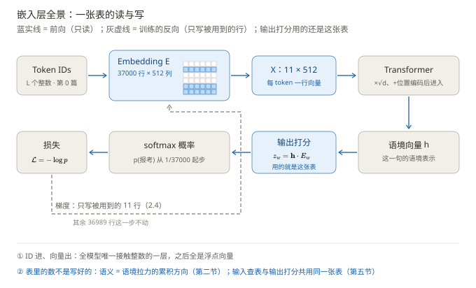
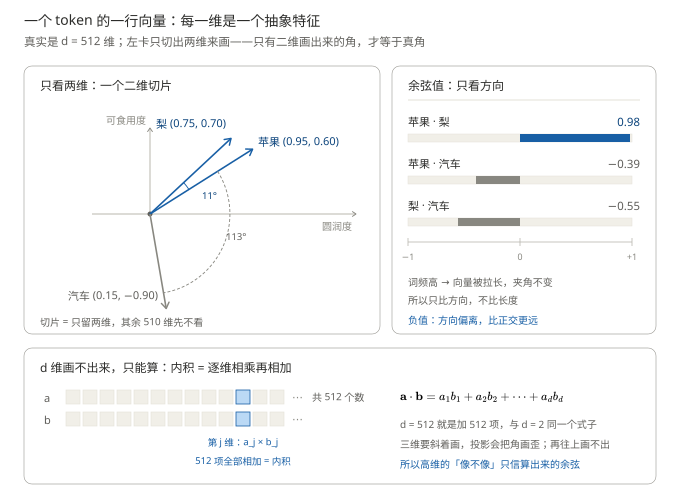
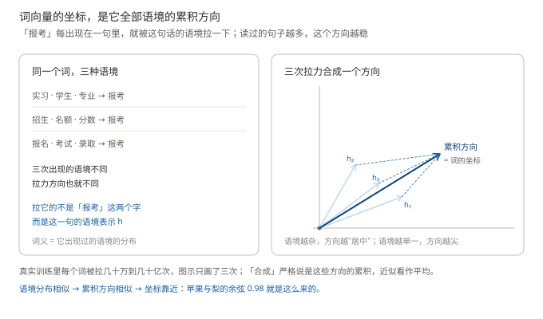
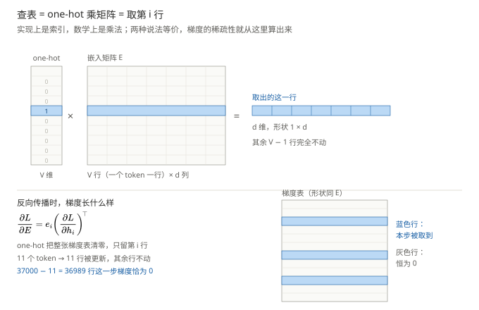
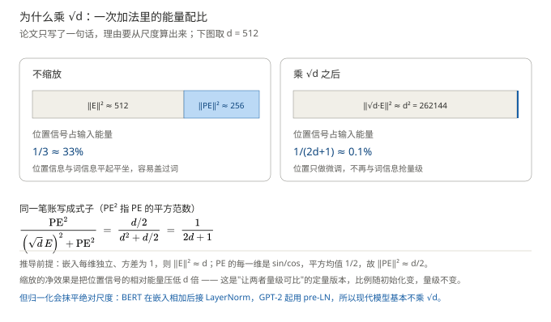
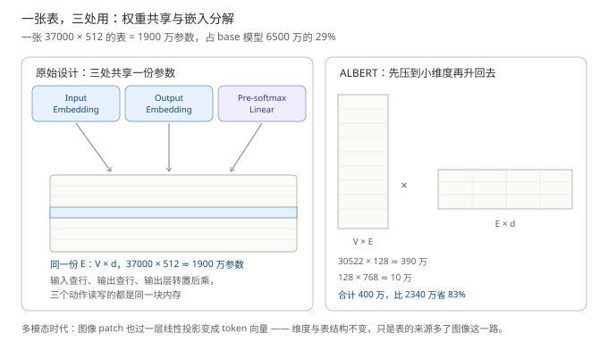

# 嵌入层：token 怎么变成向量

> **一句话结论**：Embedding（嵌入层）就是一张"每个词一行"的参数表，模型靠它把整数 ID 换成向量（特征）；表里的数不是人写好的，是训练时被上下文一次次"拉"出来的。
>
> - 向量的每一维是一个抽象语义特征（圆不圆、能不能吃……）：苹果与梨取值接近，余弦相似度 $0.98$；汽车明显偏离，$-0.39$
> - 训练信号（以自回归模型为例）来自"预测下一个词"：目标词的向量被拉向它的语境方向，语境分布相似的词因此被拉到相近的位置
> - 一次更新只动被用到的几行（例句 11 个 token → 11 行，其余 36989 行不动）；乘 $\sqrt{d}$ 是调尺度，如今基本不乘；三处共用一张表，省 3800 万参数

**前置阅读**：[分词与词表](../分词与词表/分词与词表.md)。全系列施工图见 [00-系列规划](../Transformer整体架构/00-系列规划.md)。

**图 1**：嵌入层全景：一张表的读与写。看图要点：蓝实线是前向（只读），灰虚线是训练的反向（只写被用到的 11 行）；输出打分 $z_w$ 用的还是这张表（第五节），而表里的语义是语境拉力的累积方向（第二节）。

---

## 一、token 变成向量：用一组表示"特征"的数表征语义

> 本节要回答的问题：第 0 篇已经把例句变成了 11 个整数，模型直接拿这些整数去算，为什么不行？换成向量又好在哪里？

**先离开模型，看一个生活里的场景。** 两个人站在你面前，让你说清"他们哪里不一样"。你多半不会报身份证号——你会说：甲高、偏瘦、短头发；乙矮、偏胖、长头发。三个特征（高矮、胖瘦、头发长短）就把两个人分开了，还能顺带比较：甲和乙身高差得多，体型也差得多。

**深度学习用的是同一套办法。** 假设甲、乙在词表里的编号分别是 100 和 101，模型给每个编号配一行数，三列分别对应高矮、胖瘦、头发长短：

| 编号     | 高矮  | 胖瘦   | 头发长短 |
| ------ | --- | ---- | ---- |
| 100（甲） | 0.9 | −0.4 | −0.6 |
| 101（乙） | 0.2 | 0.5  | 0.8  |

这一行数就是编号 100 的**特征向量（feature vector）**：行是对象、列是特征，第 $j$ 个数表示对象在第 $j$ 种特征上的取值——正数表示"有"，越接近 0 越弱，负数表示"沿相反方向"（胖瘦一列取负，读作"偏瘦"；头发长短取负，读作"短"）。

**关键在于它替掉了什么。** 只有编号 100 和 101，你什么也比不出来——号码只保证唯一，不携带信息；换成两行数之后，"像不像"变成可以逐列对齐的东西，还能参与后面的乘加运算（被加权、被求和、被做内积）。这也是 **embed（嵌入）** 名字的由来：把离散符号嵌进一个连续空间，用一组数描述它。

**换成词，道理完全一样。** 词表里「科」是 8731，「棵」是 8732——编号只差 1，语义毫无关系；「学」是 1902，编号差 6829，语义却近得多。这个顺序是 BPE 合并的顺序、词的频次，**是建词表时的副产品，不是语义**。所以模型也给每个词配一行"语义特征"：

| 词  | 圆润程度 | 可食用程度 | 尺寸大小 |
| -- | ---- | ----- | ---- |
| 苹果 | 0.95 | 0.60  | 0.3  |
| 梨  | 0.75 | 0.70  | 0.3  |
| 汽车 | 0.15 | −0.90 | 0.9  |
| 报考 | ？    | ？     | ？    |

「报考」那一行只能填问号——这正是问题的关键。**人的特征（高矮胖瘦）能用尺子量，词的特征量不了**："圆润程度"这类名字只是我为了让读者看懂挑出来的两三维；真到 37000 个 token、每种语境，人能想到的特征列不完、也列不准（「报考」的圆润程度是什么？）。

所以这排格子里的数**不能人工填，必须让模型自己学**：把每一维当成一个可调的参数，训练时自动长出"该有什么特征"。怎么学是第二节的事，这里先确认一件事：token 的表示形式是"一行特征值"，不是"一个编号"。

还要说破一点：**真实模型里，每一维并没有这么干净的名字。** 512 维里可能没有任何一维恰好是"圆润程度"——一个特征往往摊在许多维上，一维也参与许多特征。但"**一行向量 = 一组可学习的特征取值**"这个图景是对的，它是理解一切表示学习的地基；上面的表格就是从这图景里挑出"人能叫出名字"的维度，让初学看得见。

### 余弦相似度：把"像不像"变成一个数

几何上先切出两维来看（第三维"尺寸大小"指向纸面外）：苹果 $(0.95,\ 0.60)$、梨 $(0.75,\ 0.70)$、汽车 $(0.15,\ -0.90)$。方向的接近程度用 **cosine similarity（余弦相似度）** 度量：

$$
\cos(\mathbf a, \mathbf b) = \frac{\mathbf a \cdot \mathbf b}{\lVert \mathbf a \rVert\, \lVert \mathbf b \rVert}
$$

- $\mathbf a \cdot \mathbf b = \sum_j a_j b_j$：内积——逐维相乘再相加，把"两个词在每个特征上的一致程度"汇总成一个数；方向一致为正、垂直为零、相反为负
- $\lVert \mathbf a \rVert = \sqrt{\sum_j a_j^2}$：向量模长
- 整体含义：夹角 $0°$ 时为 $1$，$90°$ 时为 $0$，$180°$ 时为 $-1$

代算第一对：$\mathbf a \cdot \mathbf b = 0.95 \times 0.75 + 0.60 \times 0.70 = 1.133$，两个模长分别约 $1.124$ 与 $1.026$，相除得 $0.98$。第二对：$0.95 \times 0.15 + 0.60 \times (-0.90) = -0.398$，除以模长积约 $1.025$，得 $-0.39$。

**图 2**：一个 token 的向量 = 一组特征取值。看图要点：左卡是二维切片——只有二维画出来的角才等于真角，苹果与梨同向（$11°$），汽车偏离（$113°$）；右卡把夹角换算成余弦值；底卡回答"512 维怎么办"。

两点诚实的标注：

- **为什么只画两维：因为高维画不出来。** 三维以上没有可视化——512 根轴，纸面装不下；更麻烦的是三维必须斜着画，投影本身会把角画歪，眼睛看到的角不再等于真实夹角。二维切片是唯一"画出来的角就是真角"的情形，所以左卡的 $11°$ 你可以拿量角器复核。高维不画、只算：余弦只用内积和模长，两者都是对每一维求和（$\sum_{j=1}^{d}$），$d$ 是 2 还是 512，算式一个字不用改——底卡就是把这件事摊开：一行是 512 个数，内积就是把 512 个乘积加起来。
- **余弦只比方向、不比长度，这是特意选择。**&#x51FA;现次数多的词，向量往往被训练拉得更长；若用欧氏距离，高频词会显得"离谁都远"。余弦把长度这个无关变量除掉。

### one-hot 为什么不行

one-hot 也是向量：长度等于词表大小 $V$，只有第 $i$ 位是 1，其余全是 0。它表达不了语义，因为它的几何里**所有词都同样不像**：任意两个不同词的 one-hot 内积恒为 0，夹角恒为 90°，余弦恒为 0——苹果和梨的相似度与苹果和汽车的相似度完全相等，"方向"没有携带任何信息。此外它没有可训练参数（坐标是规定的，不是学出来的），而且是 $V = 37000$ 维的稀疏向量，同样的信息用 $d = 512$ 维稠密向量装，只需要约 1/70 的坐标。

本节确立了两件事：**token 的新表示是一行可学习的特征值，"像不像"落在方向上**；而特征不能人工定，只能学。下一节回答怎么学。

## 二、语义是怎么训练出来的

> 本节要回答的问题：苹果是 $(0.95,\ 0.60)$、梨是 $(0.75,\ 0.70)$——这些特征值是谁填进去的？没有人标注过词义，模型怎么会知道苹果和梨像？

### 2.1 起点：一张全是随机数的表

最常见的错误直觉是：**"Embedding 是一张现成的语义字典，第 8731 号的行向量写着'科软'的含义。"** 按这个理解，嵌入表应该在训练之前就"有内容"。

事实相反。先把这张表的样子看清楚：

$$
E \in \mathbb{R}^{V \times d}
$$

- $E$：Embedding matrix（嵌入矩阵），整个模型唯一的查找表
- $V$：Vocabulary（词表）大小，本系列取 37000——表有 37000 **行**，每个词一行
- $d$：向量维度，本系列取 512——每行有 512 **列**；$E$ 的第 $k$ 行 $E_{k,:} \in \mathbb{R}^d$ 就是 ID $k$ 的向量

训练开始时，这 $37000 \times 512 = 18\,944\,000 \approx 1900$ 万个数全部从随机分布里抽出来——此时苹果和梨的余弦可能是 0.03，苹果和汽车是 −0.07，**没有任何规律**。这 1900 万个数是 **parameter（参数）**：可以被梯度调整的数，模型要学的东西正是它们。

### 2.2 训练信号从哪来：谁在判对错

**2.1 留下一个问题：随机数怎么变对？** 办法只有"错了就改"，可改之前得有东西告诉你"错了、差多少"。麻烦在于语言任务没有现成的对错标签——逐句人工标注"下一个词该是哪个"，成本高到不可能：互联网规模的语料，谁也标不完。

**答案是：拿原文自己判。** 给模型看「科软 放 实习 吸引 学生」，让它猜下一个词；原文的下一个词就是「报考」，答案不必人标注，语料本身就是答案。这种"标签由数据自动产生"的训练叫 **self-supervised（自监督）**——今天所有大模型都靠它起步。

**但有一条硬约束：猜之前不能偷看答案。** 如果模型能看到后面的词，"猜"就退化成"抄"，一个参数都不会学对。所以干这件事的部件必须被限定成"只看前文"，这个限定叫 **causal mask（因果掩码）**，被限定的部件叫**解码器**。反过来看就明白编码器为什么干不了这活：它看整句（双向），答案天生在它眼前。

**于是训练路线分成三条，区别只在信号从哪来：**

- **2017 论文**：编码器读源句，解码器逐词生成译文，损失算在解码器的"猜下一个"上。编码器自己不产生损失——但它的表示若不够好，解码器就会猜错；猜错产生的梯度经交叉注意力传回编码器，照样修正它的表示。
- **GPT**：只留解码器，整台机器都在做"猜下一个"这一件事。
- **BERT**：只留编码器（双向），既然不能猜下一个，就换个问法——随机遮住句中 15% 的词，让模型还原，这就是 **MLM（掩码语言模型）**。

> **进阶（可跳过）**：三种路线对照——结构决定"谁能看见谁"，目标决定"算什么损失"，两者可以自由组合（mask 与三种拓扑在装配篇展开）。

> | 部件 / 模型     | 看得到谁            | 训练时算什么损失                |
> | ----------- | --------------- | ----------------------- |
> | 2017 论文的编码器 | 双向，无 mask       | 不自算损失；梯度由解码器的损失经交叉注意力回传 |
> | 2017 论文的解码器 | 单向（causal mask） | 预测目标句的下一个词              |
> | GPT（只留解码器）  | 单向              | 预测下一个词                  |
> | BERT（只留编码器） | 双向              | MLM：遮住 15% 的词让它还原       |

**但对嵌入表来说，这三条路没有区别。** 它不决定"谁能看见谁"（那是 mask 的职责），也不决定"算什么损失"（那是输出层和任务的事），它只负责查表。所以不管梯度从哪条路回来，落到表上的动作都是同一句：**把被用到的那几行，往这一次的语境方向拉。** 下面就用最单纯的一条——GPT 式自回归——把这个"拉"推一遍：每个位置都有一次猜下一个的机会，信号最密，最容易看清。

**第一步是打分。** 例句「科软 放 实习 吸引 学生 **？**」，正确答案「报考」。模型怎么猜？它先把"实习、吸引、学生"这一串语境信息揉成一个 $d$ 维向量 $\mathbf h$（这是后面几十层网络算出来的，这里只当它是"这句话语境的表示"），然后给每个候选词打分：

$$
z_w = \mathbf h \cdot E_{w}
$$

- $z_w$：候选词 $w$ 的分数（logit），一个标量
- $\mathbf h \cdot E_w$：语境向量与词向量的内积

**为什么内积能当分数**：第一节说过，内积大 = 两个向量方向接近。所以"给「报考」打高分"这个动作，数学上就是"要求 $E_{\text{报考}}$ 的方向和语境 $\mathbf h$ 接近"。分数再过一层 **softmax（归一化）** 变成概率：

$$
p_w = \frac{e^{z_w}}{\sum_{w'} e^{z_{w'}}}
$$

- $e^{z_w}$：把分数放大成正数，指数会放大差距
- 分母：对所有 37000 个候选求和，保证 $\sum_w p_w = 1$

训练开始时 $E$ 全是随机数，所以「报考」的概率大约就是 $1/37000$，模型几乎必错。错得有多离谱，用 **cross-entropy（交叉熵）** 损失衡量：

$$
\mathcal{L} = -\log p_{\text{报考}}
$$

- $\mathcal{L}$：损失（系列约定 $L$ 表示序列长度，所以损失记作 $\mathcal{L}$）
- $p_{\text{报考}}$：模型给正确答案的概率

概率越接近 1，$-\log p$ 越接近 0；概率是 $1/37000$，损失就是 $\log 37000 \approx 10.5$。**训练的全部目标，就是把这个数压下去。**

### 2.3 梯度怎么把坐标改对：拉近与推远

**先破一个很常见的误解：前向不改表。** 查表是只读动作——整句算过去，$E$ 里 1900 万个数一个都没变。真正改表发生在训练的反向，而"往哪改"由损失说了算。

| 阶段    | 嵌入表在做什么      | 谁在改       |
| ----- | ------------ | --------- |
| 训练·前向 | 只读：按 ID 取行   | 没有人改      |
| 训练·反向 | 才写：梯度落到被取到的行 | 优化器按梯度挪一步 |
| 推理·上线 | 只读           | 完全冻结      |

**gradient（梯度）**&#x56DE;答"该往哪调、调多少"：它是损失对参数的导数，更新规则是"参数减去学习率乘梯度"，即沿损失下降的方向挪一小步。

对分数求导（softmax 加交叉熵的组合有个很干净的结果）：

$$
\frac{\partial \mathcal{L}}{\partial z_w} = p_w - y_w
$$

- $y_w$：正确答案的指示，目标词为 1，其余为 0
- 目标词：$p_w - 1 < 0$；其余词：$p_w - 0 > 0$

把这个梯度传回嵌入表（假定输出层与嵌入表共用同一份参数，第五节解释为什么敢共用；即使不共用，语义也会经反向传播流回嵌入表，结论方向不变），得到两条更新：

- **目标词被拉近语境**：$E_{\text{报考}} \leftarrow E_{\text{报考}} + \eta\,(1 - p_{\text{报考}})\,\mathbf h$——往 $\mathbf h$ 的方向挪一步
- **其余词被推离语境**：$E_w \leftarrow E_w - \eta\,p_w\,\mathbf h$——远离 $\mathbf h$ 一点
- $\eta$：learning rate（学习率），每步挪动的步长

**关键在"被拉近的是什么"。**$\mathbf h$ 不是"报考"这个词本身，而是这一句的语境（实习、学生、吸引……）。所以真正发生的事是：**「报考」的向量被这句话的语境拉了一下。**&#x6CE8;意这里没有"它自己调整"这回事——往哪挪、挪多远，全由语境表示 $\mathbf h$ 和学习率 $\eta$ 决定，它只是被动的那一方（这条被动性正是语料偏见会被原样学进向量的原因，2.5 还会回到它）。「报考」还会出现在别的句子里——"名额有限，抓紧报考""去年录取线，报考人数创新高"——每次被拉向不同的方向。几十万、几十亿次之后，它的坐标停在**所有这些拉力的累积方向**上。

**图 3**：一个词的坐标 = 它全部语境的累积方向。看图要点：拉它的从来不是这个词自己，而是它出现过的每句话的语境表示 $\mathbf h$。

于是整个机制闭环了：**语境分布相似的两个词，收到的拉力方向集合相似，累积方向就相似，坐标就靠近。**"苹果"和"梨"都反复出现在"水果、甜、吃"这类语境里，被拉到同一个邻域；"汽车"的语境是"驾驶、加油、公路"，被拉去了另一个方向。第一节里那组 $(0.95,\ 0.60)$ 的坐标，就是这样从"预测下一个词"这一个目标里**长**出来的——没有人标注过词义，词义是"和谁一起出现"的副产品（"上下文相近则表示相近"是分布假说的直觉版，≈ 类比，不是严格结论）。

**这一节可以用一句话收口：** 训练时，一个 token 在成千上万句不同语境里被反复用到；每用到一次，它的向量就被那句话的语境方向拉一小步（不在这一批里就一步不动）；这些拉力累积起来，就是它最终的坐标。

### 2.4 一次更新只动几行：稀疏更新

"被拉一下"落在哪几行？语境表示 $\mathbf h$ 只跟这一句里出现过的词有关，所以这一步的梯度**只在出现过的那些词的行上非零**。用例句数一遍：11 个 token，11 行被更新，$37000 - 11 = 36989$ 行这一步梯度恰好为 0——**它们根本没参与这句话的计算，也就什么都没学到**。这就是嵌入层最特殊的性质：**sparse update（稀疏更新）**。稀疏的推导过程和具体形状在第三节给出，这里先记住结论。

它直接解释了第 0 篇埋下的伏笔"低频词训练不充分"：一个 token 出现得越少，被拉的次数就越少，坐标就越是停在随机数附近。图 3 里只画了三次拉力，真实训练是几十万次起步——次数不够，"平均方向"就还是一片噪声。

### 2.5 训练完之后，表里能读到什么

- **近邻**：查"苹果"最近的几个向量，是"梨、香蕉、水果"——第一节的余弦相似度在这里变成一个可执行的操作。
- **类比**：著名的 $\text{king} - \text{man} + \text{woman} \approx \text{queen}$。为什么能成立：某种关系（性别）在语料里反复以同样的相对位移出现，就被累积成向量里的一个稳定方向。
- **边界**，三条都要记住：多义词被平均（bank 的"河岸"和"银行"混成一个点，模型靠上下文层去分辨，不靠嵌入表）；语料里的偏见会被原样学进向量（职业与性别的刻板印象关联）；类比关系不是可靠推理，只是统计痕迹。

## 三、"查表"到底是什么：ID 怎么变成向量

> 本节要回答的问题：前面反复说"查表"，到底在查什么？现在的模型明明是直接喂 ID 进去的，还需要这张表吗？

### 3.1 表就是一张 37000 行的表格

把 $E$ 想成一张 Excel：37000 行 × 512 列，**行号就是 ID**，第 8731 行就是「科」的向量。"查表"这个动作没有任何计算——**按编号取出对应的那一行**，跟查价目表、查座位表一样（≈ 类比，边界：价目表的内容是人填的，这张表的内容是训练出来的）。

这是整个模型里唯一接触整数的地方。ID 进来，向量出去，从这一步之后全是浮点数。

### 3.2 为什么教科书里写成 one-hot 乘矩阵

2.4 说过"一次更新只动 11 行"，但要把这句话变成能验证的式子，得先有一个可求导的表达式——而"取行"是个索引动作，没有表达式。one-hot 在这里换了角色：不是当语义表示（第一节已证明它不行），而是当**选择器**——长度为 $V$、只有第 $i$ 位是 1 的行向量 $e_i$，左乘 $E$ 时恰好把第 $i$ 行挑出来，其余行全被 0 乘掉：

$$
x = e_i\, E \in \mathbb{R}^{d}, \qquad x = E_{i,:}
$$

- $e_i$：ID $i$ 的 one-hot 行向量，只在第 $i$ 位是 1
- $x$：查出来的 $d$ 维向量，数值上与"取第 $i$ 行"完全相同

整句话就是 11 次选择：$X = E[\mathrm{ids}] \in \mathbb{R}^{11 \times 512}$，**行 = 位置、列 = 维度**（系列约定）。

写成乘法之后，2.4 的结论就能证明了。对 $x = e_i E$ 用链式法则：

$$
\frac{\partial \mathcal{L}}{\partial E} = e_i^{\top} \frac{\partial \mathcal{L}}{\partial x}
$$

- $\dfrac{\partial \mathcal{L}}{\partial x} \in \mathbb{R}^{1 \times d}$：损失对输出向量的梯度
- $e_i^{\top} \in \mathbb{R}^{V \times 1}$：one-hot 转置成列向量
- 外积得到 $V \times d$ 的矩阵——**除了第 $i$ 行，其余行全是 0**

整句推广成 $\frac{\partial \mathcal{L}}{\partial E} = P^{\top}\frac{\partial \mathcal{L}}{\partial X}$（$P$ 是 $11 \times V$ 的 one-hot 矩阵），同一 ID 出现多次时它的行把多份梯度**累加**。这就是 2.4"只动 11 行"的出处。

**图 4**：查表 = one-hot 乘矩阵 = 取第 $i$ 行，以及由此而来的稀疏梯度。看图要点：等号右边被取出的行，就是左边高亮那一行——其余 $V-1$ 行在前向和反向里都是旁观者。

工程上没有人真的构造 37000 维的 one-hot 再乘——那要做 37000 次乘 0。框架直接按索引取行（gather），数学完全等价。

### 3.3 所以"直接喂 ID"和"需要查表"是同一件事

你见到的"模型输入是 ID"，指的正是这一层：框架里的 `nn.Embedding`，本质就是"一个 $V \times d$ 的参数矩阵 + 一个按索引取行的操作"。表没有消失，它只是变成了第一层的一个参数张量，名字里不带"查"字而已。

这条界线在别的领域也一样成立，**凡是离散、无序、只有编号的输入，都需要一张表查成向量；本身就是数值的，直接过一层线性映射**：

| 输入类型         | 例子                         | 变成向量的方式       |
| ------------ | -------------------------- | ------------- |
| 类别特征（本质是 ID） | 用户 ID、商品 ID、城市、图像 patch 序号 | Embedding 表查行 |
| 连续特征         | 价格、时长、年龄                   | 一层 Linear，没有表 |

推荐系统里最大的一块参数往往就是各种 ID 的嵌入表；ViT 把图像 patch 当 token，也是因为 patch 序号是离散的。最后补一个工程细节：嵌入层**没有偏置、没有激活函数**——加偏置相当于给每行加同一个向量，白费参数；加非线性也只是把每个行向量各自再变换一次，后面的 Transformer 块会做——查表本身已经是全部工作了。

## 四、乘 √d：一笔必须算清的尺度账

> 本节要回答的问题：查表出来的向量，下一步要和位置编码相加——直接加行吗？

行不行取决于两边量级差多远，这又是一笔要亲手算的账。

前提说清楚（这是教学简化，不是论文设定）：设嵌入每维独立、方差为 1，则由平方均值公式，每个 token 向量的能量为

$$
\lVert E_{k,:} \rVert^2 = \sum_{j=1}^{d} E_{kj}^2 \approx d = 512
$$

位置编码那边（第 2 篇细讲），每一维是 sin/cos 值，平方均值 1/2，所以

$$
\lVert \mathrm{PE} \rVert^2 \approx \tfrac{d}{2} = 256
$$

两者相加时不缩放的话，位置信号占输入能量的 $256 / (512+256) = 1/3$——位置信息和词信息**平起平坐**。乘上 $\sqrt{d}$ 之后，能量变成 $d \cdot d = d^2$：

$$
\frac{\mathrm{PE}^{2}}{\left(\sqrt{d}\,E\right)^{2} + \mathrm{PE}^{2}} \;=\; \frac{d/2}{d^{2} + d/2} \;=\; \frac{1}{2d+1} \approx 0.1\%
$$

- $\mathrm{PE}^2$：PE 向量的平方范数 $\approx d/2$
- $\left(\sqrt{d}\,E\right)^2$：缩放后嵌入向量的平方范数 $\approx d^2$
- $d = 512$ 时算出来是 $1/1025 \approx 0.1\%$——位置信号从"三分天下"降到"千分之一样"的微调

**图 5**：乘 √d 前后的能量配比。看图要点：右面板的蓝色条已经窄到只剩一条缝——乘 √d 的净效果就是把位置信号的相对能量压低 $d$ 倍。

要诚实标注两点。其一，1/3 这个数依赖"每维方差为 1"的假设，换初始化比例会变，但"**缩放把位置相对能量压低 $d$ 倍**"这个结论不变。其二，这笔账本身已被后来的架构淘汰：BERT 在嵌入相加后直接接 LayerNorm，GPT-2 起改用 pre-LN——**归一化对整体缩放不变**（$\mathrm{LN}(c\,x) \approx \mathrm{LN}(x)$，缩放被均值和方差一起吸收），输入向量的绝对量级变成无关变量。所以 GPT-2、LLaMA 都不乘 $\sqrt{d}$。一个技巧"曾经必要、后来失效"的完整闭环，本系列还会见到很多次。

## 五、三处共用一张表：权重共享的参数账

> 本节要回答的问题：输出层给 37000 个词打分，是不是还要再准备一张同样大的表？

论文 3.4 节："we share the same weight matrix between the two embedding layers and the pre-softmax linear transformation."（与 Inan et al., 2016；Press & Wolf, 2017 的做法一致。）三个零件：

- **输入嵌入**：编码器/解码器的输入侧，查表得向量（本篇主角）
- **输出嵌入**：解码器目标序列的嵌入层（翻译任务里目标句也要查表）
- **pre-softmax Linear**：输出头，把 $d$ 维向量映回 $V$ 维分数，其权重矩阵 $W \in \mathbb{R}^{d \times V}$ 恰好是 $E$ 的转置

参数账这样算：三处若各自独立，是 $3 \times 18.9\text{M} \approx 56.8\text{M}$；共享后只剩 $18.9\text{M}$，**省 38M**。核对一下总量：编码器 6 层 $\times 12d^2$ = 18.9M，解码器 6 层 $\times 16d^2$ = 25.2M，加上共享的嵌入 18.9M，合计约 63M——与论文报告的 base 模型 65M 对上了（差值是偏置与 LayerNorm 的零头）。这张参数账也解释了为什么嵌入不可忽视：**一张表占 base 模型近三成**。

为什么敢共享？第二节其实已经用了这个事实——输出打分 $z_w = \mathbf h \cdot E_w$ 里，打分用的就是嵌入表本身。输入方向是"ID → 向量"，输出方向是"向量 → 对各 ID 的打分"，两者天然是同一个语义空间的正反两面：**预测一个词，等于在嵌入表里做反查**。共享还有训练上的红利：输出层的梯度会沿着 $E^\top$ 流回嵌入表，每个 token 的行向量多得到一份监督信号，语言模型实验里同时降参数、降困惑度（Inan et al., 2016；Press & Wolf, 2017）。

**图 6**：三处共享一份参数（左），以及把一张表拆成两张的分解式设计（右，第六节展开）。看图要点：左侧三个框共用同一块内存；右侧 $V \times E$ 与 $E \times d$ 一竖一横的形状差，正是"先压维度、再升回去"的直观体现。

## 六、前沿演化：绑定、分解与多模态

> 本节要回答的问题：2017 年之后，嵌入层改了什么、没改什么？

**① 绑定输出层成为默认。** 原论文共享的是编码器-解码器六个位置；到 GPT 这类 decoder-only 模型，"输入嵌入 + 输出层"两处绑定成了默认配置。但这条趋势有边界：$V \times d$ 的占比随模型变大而稀释——128000 × 4096 ≈ 5.2 亿参数在 7B 模型里只占 7%，共享的收益缩水，所以超大模型是否绑定开始变成权衡项而非铁律。

**② ALBERT：把一张表拆成两张。** 词表涨到 12 万之后，$V \times d$ 重新变得昂贵。ALBERT（Lan et al., 2020）在两者之间插入一个小维度 $E$（如 128）：查表先取 $V \times E$ 的低维向量，再乘 $E \times d$ 升回模型维度。以 BERT-base 的配置（$V{=}30522$，$d{=}768$）算：$30522 \times 768 \approx 2340$ 万 → $30522 \times 128 + 128 \times 768 \approx 400$ 万，**省 83%**。代价是每次前向多一次矩阵乘，换的是嵌入不再绑架总参数量。

**③ 多模态统一嵌入。** ViT（Dosovitskiy et al., 2020）把一张图切成 patch，每个 patch 过一层线性投影压成 $d$ 维向量——动作和查表同构：离散的"patch 序号"变成了连续向量，之后与文本 token 走完全相同的 Transformer 流水线。CLIP（Radford et al., 2021）进一步让图像向量和文本向量在同一个空间里对齐。今天的视觉语言模型里，"图像 patch 也当 token"已经实现——嵌入表的结构没变，只是行里多了一种来源。

**没变的是**：嵌入层仍是整个模型里唯一接触整数 ID 的地方；它的矩阵仍是**随机初始化、端到端训练**的（现代模型不再加载 Word2Vec 之类的预训练词向量做初始化，那是另一个时代的技术路线）；"语境决定坐标"的训练机制没有任何变化——变的只是表的大小、共享的范围和输入的来源。

## 七、小结

| 对比项  | 2017 原始设计               | 当今主流                | 为什么变                    |
| ---- | ----------------------- | ------------------- | ----------------------- |
| 词的表示 | one-hot：$V$ 维稀疏，词间余弦恒 0 | $d$ 维稠密向量，方向携带语义    | 几何空间让"比较语义"成为可能         |
| 语义来源 | 解码器侧预测下一词，语境拉近目标词 | 不变（编码器侧改用遮词还原，机制相同） | "和谁一起出现"仍是词义的唯一来源       |
| 查表方式 | one-hot 乘矩阵（实现为索引）      | 不变                  | 等价且稀疏梯度性质不变             |
| 乘 √d | 乘（尺度对齐位置编码）             | 基本不乘                | pre-LN / RMSNorm 抹平绝对尺度 |
| 权重共享 | 输入/输出嵌入 + 输出层三处共享       | 绑定输出层成默认；超大模型权衡     | $V \times d$ 占比随规模稀释    |
| 嵌入结构 | 一张 $V \times d$ 表       | 一张表或 ALBERT 式分解     | 词表涨到 128k 后嵌入太贵         |
| 输入来源 | 文本 token                | 文本 + 图像 patch 统一向量化 | 多模态统一架构                 |

## 八、面试易错点

| 面试考点                            | 常见答错                      | 正确答法                                                                                              | 面试官在考什么                          |
| ------------------------------- | ------------------------- | ------------------------------------------------------------------------------------------------- | -------------------------------- |
| 模型输入是 ID，还需要嵌入层吗？               | "ID 直接进网络就行"              | ID 是无序编号，任何乘加运算都没有语义解释；第一层的嵌入表就是把编号查成向量，`nn.Embedding` 的前向就是按索引取行                                 | 是否理解"离散 → 连续"这一步不可省              |
| Embedding 和 Word2Vec 什么关系？      | "加载 Word2Vec / GloVe 当嵌入" | Transformer 的 $E$ 随机初始化、随任务端到端训练；Word2Vec 是独立的静态词向量技术，两码事                                         | 是否混淆两代技术路线                       |
| 训练目标就是"预测下一个词"吗？               | "是，Transformer 都这么训"      | 只有解码器这么训。2017 论文的编码器是双向的、没有 mask、也没有自身损失，梯度由解码器损失经交叉注意力回传；BERT 这类只用编码器的模型改用 MLM 遮词还原。对嵌入表而言三条路都只是"把用到的行往语境方向拉" | 是否分清"结构决定谁能看见谁"与"目标决定算什么损失" |
| 嵌入层的梯度有什么特点？                    | "和平常一样是稠密的"               | one-hot 外积使 $\partial \mathcal{L}/\partial E$ 只在被取到的行上非零；batch 内未出现的 token 行梯度为 0——这正是低频词训练不充分的原因 | 是否理解稀疏更新及其后果                     |
| 词向量相似度为什么用余弦不用欧氏距离？             | "都能用，没想过区别"               | 词频会把向量拉长，欧氏距离混入长度因素；余弦只比方向、对长度不敏感，高频低频一视同仁                                                        | 是否理解"方向携带语义"这一表示学习的基本假设          |
| 为什么乘 √d？现在还乘吗？                  | "为了数值稳定"（背不出细节）           | 尺度配比：把位置信号占输入能量的比例从 1/3 压到 1/(2d+1)；pre-LN 后归一化抹平绝对尺度，GPT-2 起基本不乘                                 | 是否能把一个技巧放到"它为什么诞生、为什么退役"的完整因果链里讲 |
| 为什么嵌入和输出层可以共享权重？                | "为了省参数呗"                  | 输入是 ID→向量、输出是向量→ID 打分，是同一语义空间的正反两面；共享还有梯度互相印证的收益，语言模型上同时降参数与困惑度                                   | 是否理解共享的语义依据，而不只看到省参数             |
| Attention 里除 √d_k，这里乘 √d，是不是矛盾？ | "是不是论文写错了"                | 不矛盾：除 √d_k 防内积方差随 $d_k$ 增大，稳定 softmax 输入；乘 √d 抬高嵌入范数，理顺加法配比——方向相反，但都在管尺度                          | 是否理解两处缩放各自的目的                    |

## 九、引用论文

1. Vaswani et al. *Attention Is All You Need*. NeurIPS 2017. arXiv:1706.03762.（三处权重共享与乘 √d，3.4 节；base 模型 65M）
2. Inan, Khosravi & Kaiser. *Tying Word Vectors and Word Classifiers: A Loss Framework for Language Modeling*. 2016. arXiv:1611.01462.（权重绑定的先声）
3. Press & Wolf. *Using the Output Embedding to Improve Language Models*. EACL 2017. arXiv:1608.05859.（输出层绑定）
4. Mikolov et al. *Efficient Estimation of Word Representations in Vector Space*. ICLR Workshop 2013. arXiv:1301.3781.（Word2Vec；king−man+woman 类比的出处）
5. Devlin et al. *BERT: Pre-training of Deep Bidirectional Transformers for Language Understanding*. NAACL 2019. arXiv:1810.04805.（MLM 训练目标；嵌入相加后接 LayerNorm 的替代方案）
6. Lan et al. *ALBERT: A Lite BERT for Self-supervised Learning of Language Representations*. ICLR 2020. arXiv:1909.11942.（嵌入因式分解）
7. Radford et al. *Language Models are Unsupervised Multitask Learners*. OpenAI 2019.（GPT-2：pre-LN、绑定输出层、不再乘 √d）
8. Dosovitskiy et al. *An Image is Worth 16x16 Words: Transformers for Image Recognition at Scale*. ICLR 2021. arXiv:2010.11929.（ViT patch 投影）
9. Radford et al. *Learning Transferable Visual Models From Natural Language Supervision*. ICML 2021. arXiv:2103.00020.（CLIP 对齐）
