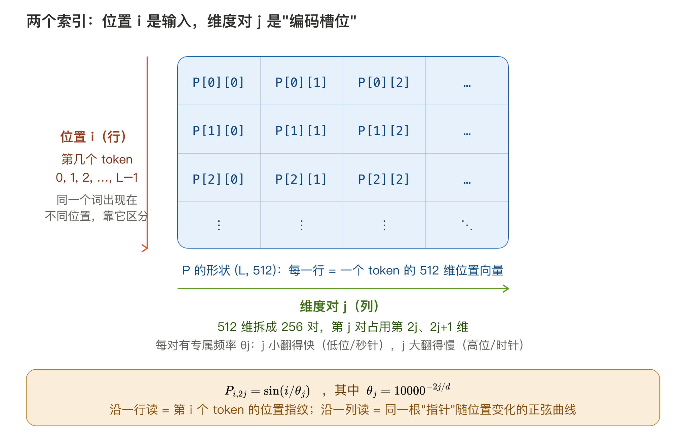
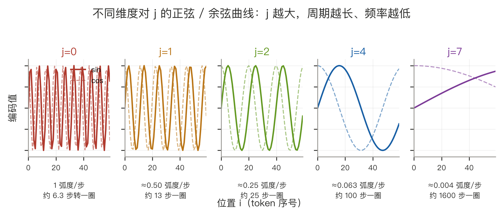
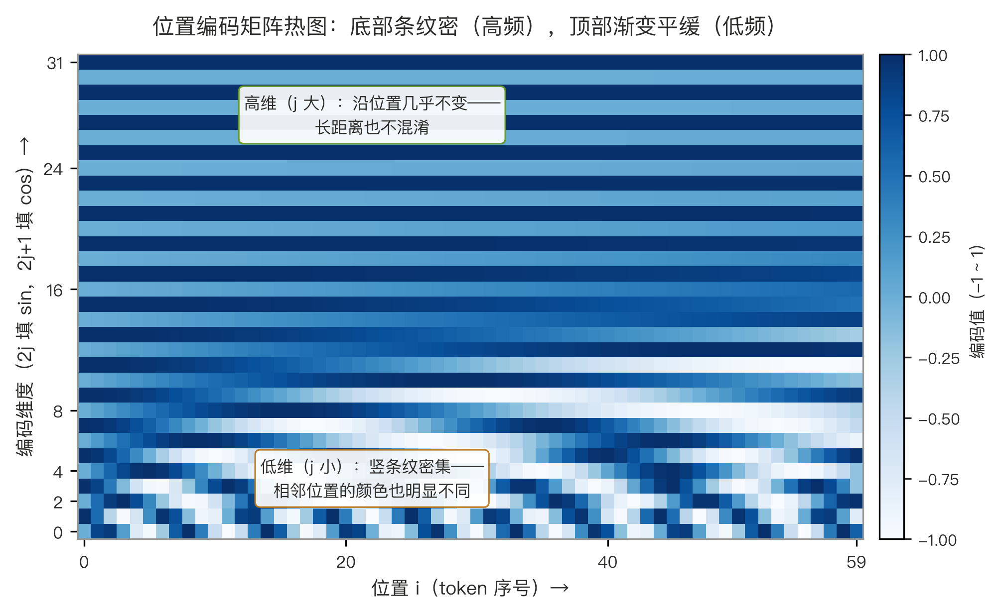
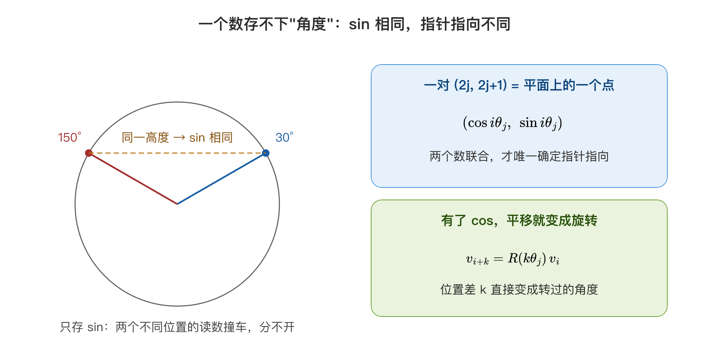
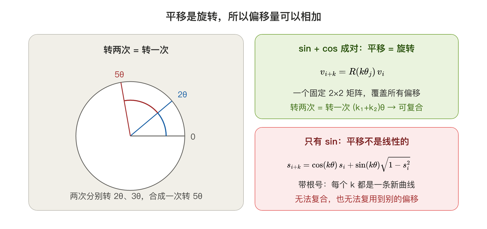
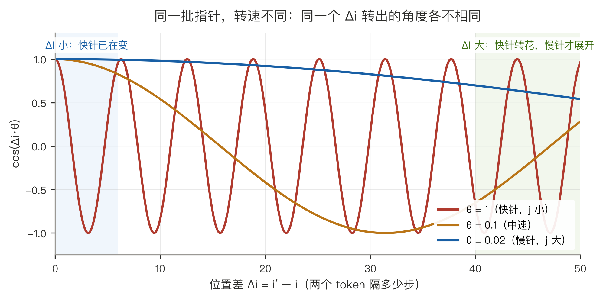
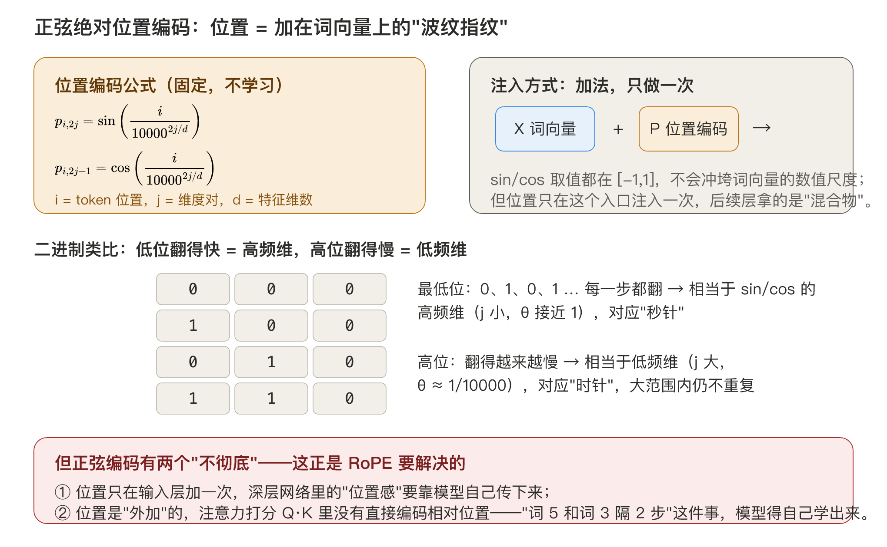
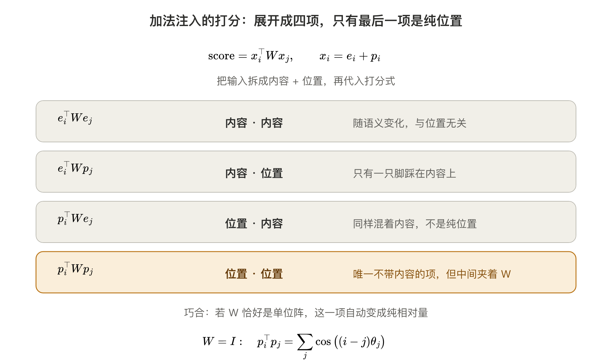

# 旋转位置编码（RoPE）

> 学习笔记 · 2026-11-03  
> 关键词：位置编码、正弦编码、RoPE、旋转矩阵、相对位置、复平面、LLaMA

---

## 一句话总结

> **正弦编码把位置"加"在词向量上，相对关系要靠模型自己学；RoPE 把位置"转"进 Q/K 里，用一行恒等式直接保证注意力打分只依赖相对位置——编码是绝对的，打分是相对的。**

单位记忆法：**位置 $i$ 的唯一作用是让 Q、K 在 384 个小平面上各自转过 $i\cdot\theta_j$ 弧度；两个 token 之间的"指针夹角差"就是它们的相对距离。**

> 符号约定（全文统一）：位置沿用第 1 节的 $i$，两个 token 的位置记作 $i$ 与 $i'$，相对位置差记作 $\Delta i = i' - i$；维度对仍记作 $j$。凡位置与频率相乘一律显式写乘号，如 $\Delta i\cdot\theta_j$。RoFormer 原论文用 $m$、$n$ 表示两个位置（对应关系 $m \leftrightarrow i$、$n \leftrightarrow i'$），读原文时可自行换算；复数视角中的虚数单位用正体 $\mathrm{i}$，与斜体的位置 $i$ 区分。

---

## 1. 起点：正弦绝对位置编码

### 1.1 公式与两个索引

对位置 $i$、维度对 $j$：

$$
p_{i,2j} = \sin\left(\frac{i}{10000^{2j/d}}\right), \quad p_{i,2j+1} = \cos\left(\frac{i}{10000^{2j/d}}\right)
$$

公式里两个下标是两个完全不同的角色：

- **位置 $i$（行索引）——输入**：token 在序列里的序号（0, 1, 2, …, L−1）。同一个词出现在第 2 个位置和第 10 个位置，词向量相同，位置编码不同——$i$ 就是公式的自变量；
- **维度对 $j$（列索引）——编码槽位**：每个 token 的位置向量是 512 维，正弦编码把它**两两配对**成 256 对，第 $j$ 对占用第 $2j$、$2j+1$ 维（分别填 sin、cos）。每对有专属频率 $\theta_j = 10000^{-2j/d}$：$j$ 小转速快，$j$ 大转速慢。



沿不同方向读矩阵 P（形状 (L, 512)）会得到两种图景：

- **沿一行读**（固定 $i$）：固定"什么时刻"，读出此刻全部 256 根指针的指向——第 $i$ 个 token 的完整位置"指纹"；
- **沿一列读**（固定 $j$）：固定"哪根指针"，看它的读数如何随位置变化——就是下一节画出的正弦/余弦曲线。

一句话：**$i$ 是要被编码的"数值"（时刻），$j$ 是"哪根指针、插在哪一格"**。

### 1.2 画出来看：转速不同，读数就不同

"$j$ 小转速快、$j$ 大转速慢"不必停留在公式上——把矩阵 P 真的画出来（对应 notebook 里的两组图）。

先**沿一列读**：固定几个 $j$，看编码值如何随位置 $i$ 变化：



- **左三块（j = 0, 1, 2）**：几十步内就振荡多个周期——位置每 +1，读数都明显不同，是最灵敏的一批指针；
- **右两块（j = 4, 7）**：曲线近乎直线缓慢爬升，60 步都没走完一个相位——对位置的微小变化几乎无感，要隔很远读数才拉开差距；
- sin 与 cos 相位差 90°，同一对里的两条曲线形状相同、只错开四分之一个周期——这就是每个维度对要同时存 sin 和 cos 两个数的原因（第 2 节会看到：这两个数正好构成旋转的 cos 与 sin 分量）。

再看**整张矩阵的俯视图**（60 个位置 × 32 维）：



- **底部（维度小，j 小）**：竖条纹密集——沿位置方向颜色快速翻转；
- **顶部（维度大，j 大）**：横条纹平缓——几乎不随位置变化；
- **任意两行都不相同**：快慢指针的读数组合，让每个位置都有唯一的"指纹"。

这两幅图就是"多频率时钟"的实物照片：**256 根转速各不相同的指针，任何一个位置留下的都是一组独一无二的读数组合**。RoPE 沿用的正是同一套 $j \to \theta_j$ 转速分配（见第 3 节），只是把"刻在数值上"换成"刻在旋转速度上"。

### 1.3 为什么必须成对：一个数存不下一个"角度"

sin 和 cos 总是成对出现（占相邻的 $2j$、$2j+1$ 两维）——不是冗余，是三个层次的要求：



**① 一个数存不下"角度"。** sin 只是圆上的"高度"：$\sin 30° = \sin 150° = 0.5$，无数个角度共用同一个高度，只存 sin 位置会撞车。而 $(\cos i\theta_j,\ \sin i\theta_j)$ 两个数合起来是平面上的一个点，唯一确定"第 $j$ 根指针此刻指向哪里"——**每一对存的不是数值，是指向**。

**② 有了 cos，"平移"才能变成"旋转"。** 由 $\sin(a+b)=\sin a\cos b+\cos a\sin b$：

- 只有 sin：$\sin\big((i+k)\theta\big)=\cos(k\theta)\sin(i\theta)+\sin(k\theta)\sqrt{1-\sin^2(i\theta)}$ —— 带根号，每个 $k$ 是一条形状不同的非线性曲线，模型得为每个偏移各拟合一条；
- sin+cos 成对：$v_{i+k}=R(k\theta)\,v_i$ —— 一个固定的 2×2 矩阵，**所有偏移共用同一形式，只有角度不同**。

**③ 为 RoPE 铺路。** 第 2 节的旋转矩阵 $R(i\theta)$ 的四个元素恰好由 cos 与 sin 构成——旋转消费的正是这一对数；相邻配对让同一对天然属于同一个平面。

### 1.4 为什么"平移 = 旋转"是硬要求

把 1.3 的 ② 展开成一张对照表——"能存位置"和"学得动位置"是两回事：

| 层次       | 要求            | 只有 sin | sin + cos 成对 |
| -------- | ------------- | ------ | ------------ |
| 可表示（能存）  | $i \to$ 编码是单射 | 基本满足   | 满足           |
| 可学（好训练）  | 位置平移 = 固定线性算子 | 不满足    | 满足           |
| 可组合（能外推） | 偏移量能相加        | 不满足    | 满足           |



成对之后，$i \mapsto R(i\theta)$ 是一个**同态**：位置的加法 ↔ 旋转的复合，$R(k_1\theta)R(k_2\theta)=R\big((k_1+k_2)\theta\big)$。只取 sin 相当于只记下旋转矩阵第一列里的一个数——群结构丢了，不能复合、不能求逆。这个性质好在三处：

- **参数/样本效率**：模型学的是"怎么比较"（一份规则），偏移由已知旋转承担，不为每个 $k$ 存一条规则；
- **可组合**：没直接见过的偏移，可以由见过的偏移拼出来；
- **能与点积配合**：旋转能"穿过"注意力打分——第 2 节的恒等式由此成立。

最后回答"区分不同位置到底靠什么"：靠**转速不同的指针在同一个位置差 $\Delta i = i'-i$ 上转出不同的角度**。任何一个 $\Delta i$ 都由 $(\cos(\Delta i\cdot\theta_0),\ \cos(\Delta i\cdot\theta_1),\ \ldots,\ \cos(\Delta i\cdot\theta_{255}))$ 这组读数共同表示，而不是某一列单独负责某段距离：



转速快（$\theta$ 大）的指针在 $\Delta i$ 稍大时就"转花"了——快速振荡、平均趋近 0；转速慢的指针要 $\Delta i$ 很大才展开读数。**多转速组合保证：训练范围内的每个 $\Delta i$ 都有唯一的读数组合作指纹。**

### 1.5 j 的两个身份：转速标签与坐标槽位

$j$ 同时扮演两个角色，分量不同：

- **转速标签（主身份）**：$j \to \theta_j = 10000^{-2j/d}$，设计固定、不参与学习；
- **坐标槽位**：$j$ 决定这一对占用第 $2j$、$2j+1$ 维。这个身份在两种编码里分量不同：
  - **绝对位置编码**：把 256 对任意重排，效果不变——后续线性层 $W$ 的列跟着重排即可吸收，槽位只是约定；
  - **RoPE**：旋转矩阵是分块对角的，块必须和坐标布局严格对齐——`view` 要求同一对的两维在内存里相邻，否则要换成 GPT-NeoX 的前后半配对约定（见 6.2）。**训练用哪种布局，推理必须用哪种。**

**"各维等价"要分两句话说**：内容维度上等价（可置换、$W$ 吸收）；位置维度上不等价（$\theta_j$ 各不相同——若所有对同速，256 对就退化成 256 份重复信息，指纹立刻塌掉）。判据是"互换后结果是否改变"：换槽位不变 ✓，换转速立刻变 ✗。

### 1.6 两条直觉（收拢）

把 1.1–1.5 收拢成两条设计意图（notebook 里可逐条验证），**后面会原封不动地迁移到 RoPE**：



- **多转速 = 二进制类比**：低位（j 小）每步都翻、高位（j 大）翻得慢——1.2 的曲线和热图就是它的连续版。多转速组合让每个位置都有唯一"读数"；
- **取值 [-1, 1]**：和词向量相加不会冲垮数值尺度（这就是 notebook 里 `X + P` 直接加的原因）。

### 1.7 两个"不彻底"——现在能说清为什么了

1. **位置只在输入层加一次**。第 2 层、第 3 层……拿到的是被注意力反复改写过的"混合物"，位置感要靠网络自己传下来；
2. **加法注入与注意力打分解耦**。把 $x_i = e_i + p_i$ 代入打分式 $x_i^\top W x_j$，展开成四项：



前三项都有一只"脚"踩在内容上，会随 token 变化；只有 $p_i^\top W p_j$ 是纯位置项——**但它中间夹着 $W$**。$W = W_QW_K^\top$ 是学出来的任意矩阵，没有任何机制迫使 $p_i^\top W p_j$ 只依赖 $i-j$。

有个巧合能说明"相对性本来就在"：若 $W$ 恰好是单位阵，$p_i^\top p_j=\sum_j\cos\big((i-j)\theta_j\big)$，$i$、$j$ 自动相减、恰好是纯相对量。**可惜 $W$ 不保证是单位阵**——相对性在编码层存在，却在打分层被 $W$ 打散，模型只能从数据里自己学。

RoPE 的答案：**别加了，转起来——把旋转搬到 $W$ 外面去。**

## 2. RoPE 的核心思想：位置 = 旋转角度

### 2.1 二维版：把两个分量看成平面坐标

把向量的相邻两维 $(x_1, x_2)$ 看成平面上的一个点。位置 $i$ 的 token，其 Q、K 向量在提交给注意力**之前**，被旋转 $i\cdot\theta_j$ 弧度（$\theta_j$ 是这个平面的"转速"）：

$$
R(i\cdot\theta_j) = \begin{bmatrix} \cos(i\cdot\theta_j) & -\sin(i\cdot\theta_j) \\ \sin(i\cdot\theta_j) & \cos(i\cdot\theta_j) \end{bmatrix}
$$


**一行推导看清全部**（$R(i\cdot\theta_j)^\top = R(-i\cdot\theta_j)$，旋转矩阵转置即反转）：

$$
\big(R(i\cdot\theta_j)q\big)\cdot\big(R(i'\cdot\theta_j)k\big) = q^\top R(i\cdot\theta_j)^\top R(i'\cdot\theta_j)\,k = q^\top R\big(\Delta i\cdot\theta_j\big)\,k
$$

绝对位置 $i$、$i'$ 单独消失了，**打分只依赖相对位置 $\Delta i$**。这就是"编码绝对、打分相对"两全其美：

- 每个 $i$ 有唯一的旋转角 → 绝对位置信息没丢；
- 点积只吐出夹角差 → 相对位置直接内建，不用学。

复数视角一句话：$e^{\mathrm{i}\,i\cdot\theta_j}\cdot\overline{e^{\mathrm{i}\,i'\cdot\theta_j}} = e^{\mathrm{i}\,\Delta i\cdot\theta_j}$——旋转差 = 位置差（正体 $\mathrm{i}$ 是虚数单位）。

### 2.2 展开打分：位置只给一个角度，参数一个没多

单个平面里的两个分量记作 $q_0=(q_{2j},q_{2j+1})$、$k_0=(k_{2j},k_{2j+1})$（已经是 $W_Q$、$W_K$ 投影之后的内容向量）。旋转矩阵可以拆成"单位阵 + 90° 旋转阵"：

$$
R(\Delta i\cdot\theta_j)=\cos(\Delta i\cdot\theta_j)\,I+\sin(\Delta i\cdot\theta_j)\,J,\qquad J=\begin{bmatrix}0&-1\\ 1&0\end{bmatrix}
$$

于是这个平面上的打分被拆成两项：

$$
\text{score}_j=\cos(\Delta i\cdot\theta_j)\cdot\underbrace{q_0^\top k_0}_{s}+\sin(\Delta i\cdot\theta_j)\cdot\underbrace{q_0^\top Jk_0}_{c}
$$

- $s=q_0^\top k_0$：普通点积，两个内容向量"同向多少"；
- $c=q_0^\top Jk_0$：把 $k_0$ 先转 90° 再点积，"正交多少"（差一个符号约定，本质是二维叉积）；
- 两个系数 $\cos$、$\sin$ 只由位置差 $\Delta i$ 与转速 $\theta_j$ 决定。


这张式子把分工说得最干净：**内容提供两个读数 $(s,c)$，位置提供一个角度，打分是这个角度方向上的投影。**

由此可以回答几个常见疑问：

**① 位置编码"零参数"，为什么还能起作用。** 位置的全部信息就是一个确定的角度 $\Delta i\cdot\theta_j$，它不需要学、只需要算。它起作用的方式是决定两个内容读数按什么比例混合——角度一变，混合比例就变，打分随之变化。位置没有"自己的一份表示"，它寄生在内容的两个读数之间。

**② 不需要一个额外的"内容度量矩阵"。** 展开式里的 $s$、$c$ 完全由 $W_Q$、$W_K$ 决定（$q_0$、$k_0$ 本身就是投影结果），没有任何新参数。若一定要把"内容怎么比"写成矩阵，那也只是 $W_Q$、$W_K$ 在这个平面上的影子，不是独立对象：单侧的那个矩阵可以整体并进 $W_Q$，不增加表达能力。

**③ 与"比例常数"的区别。** 位置在这里是**相位**，不是量纲换算系数：它携带的是"隔了几步"这一信息量，而不是为了对齐单位而设的倍率。注意力里真正扮演固定常数角色的是缩放因子 $1/\sqrt{d_{\text{head}}}$——它不学、只为把 logits 的方差拉回 1，RoPE 也不改它。

一句话：**可学的只有内容（$W_Q$、$W_K$ 决定的 $s$、$c$），位置只是把两项混合起来的相位角。**

### 2.3 直观类比：时钟


- **秒针 60 秒一圈、分针 3600 秒一圈、时针 43200 秒一圈**——三根指针就是三个不同频率的"维度对"；
- **绝对位置**：任意时刻，三根指针的角度组合唯一确定这个时刻（频率不成整数比，读数几乎永不撞车）；
- **相对位置**：比较"现在"和"3 小时前"，不需要知道当前时刻——**只看两幅表盘的指针夹角差**。夹角差 = 时间差 × 转速，与绝对时刻无关。

这正是二进制类比的连续版：**秒针 = 二进制最低位（翻得最快），时针 = 最高位（翻得最慢）**。正弦编码把这套频率"刻在数值上"，RoPE 把同一套频率"刻在旋转速度上"。

---

## 3. 从 2 维到 768 维：切平面 + 多频率


一个 64 维的头切成 **32 个两维平面**，第 $j$ 个平面的转速：

$$
\theta_j = 10000^{-2j/d}, \quad j = 0, 1, \ldots, d/2-1
$$

以 d=64 感受三档速度：

| 平面       | 转速         | 转一圈    | 分工           |
| -------- | ---------- | ------ | ------------ |
| j=0（秒针）  | 1 弧度/步     | ~6.3 步 | 精细分辨相邻 token |
| j=8（分针）  | ≈0.10 弧度/步 | ~63 步  | 段落级远近感       |
| j=31（时针） | ≈1e-4 弧度/步 | ~6 万步  | 超大范围内不混淆     |

**和正弦编码的频率公式一字不差**——RoPE 不是另起炉灶，而是把同一套"多频率时钟"从加法搬进旋转。学过正弦编码再学 RoPE，频率谱完全相同，只差"加法 → 旋转"这最后一步。

---

## 4. RoPE 装在哪：每层注意力前，只转 Q/K


- **只旋转 Q 和 K**：位置只需要影响"看谁、带谁回来"的打分与选择；
- **V 不旋转**：V 带的是"内容"，旋转它只会把内容搅乱，没有收益；
- **每一层都做**：不是输入层加一次的"一次性腌制"，而是每层算注意力时"现场登场、用完即走"；  
  |  |  |  |  |  |  
  | --- | --- | --- | --- | --- |  
  |- **残差流零污染**：主干里流淌的始终是纯内容表示，旋转不改变 $\|Q\|$、$\|K\|$（正交变换），深层堆叠也不会冲刷位置信号。

对比正弦编码：它是 `X ← X + P` 一次性加在输入上，位置与打分解耦；RoPE 把位置放进打分的**运算过程**里，相对性由数学直接保证。

---

## 5. 为什么现代 LLM 集体换成 RoPE

| 性质          | 说明                                                          |          |                           |
| ----------- | ----------------------------------------------------------- | -------- | ------------------------- |
| 相对位置显式保证    | $q^\top R(\Delta i\cdot\theta_j)k$，打分天然只看相对距离，无需模型自己学       |          |                           |
| 零参数         | cos/sin 表预计算即可，不像可学习编码占参数                                   |          |                           |
| 不污染表示       | 旋转是正交变换，向量长度不变，训练稳定                                         |          |                           |
| 兼容 KV cache | 每个 token 的旋转只依赖自己的位置 $i$，增量解码时新 token 旋转自己即可                |          |                           |
| 远程衰减趋势      | 点积幅值随 $                                                     | \Delta i | $ 增大平均意义下衰减，符合"远的词该少看"的先验 |
| 可扩展上下文      | 长度外推/插值有成熟套路（Position Interpolation、NTK-aware scaling、YaRN） |          |                           |

使用者：**LLaMA / Llama 2/3、Qwen、Mistral、ChatGLM、GPT-NeoX、PaLM**……可以说 2023 年之后的新模型几乎清一色 RoPE。

---

## 6. PyTorch 实现（真实代码）

### 6.1 最小手写实现（面试/理解够用）

```python
import torch

def rope_tables(seq_len, head_dim, base=10000.0):
    """预计算 cos/sin 表：theta_j = base^(-2j/d)"""
    inv_freq = 1.0 / (base ** (torch.arange(0, head_dim, 2).float() / head_dim))  # (d/2,)
    pos = torch.arange(seq_len).float()                                           # (L,)
    angles = torch.outer(pos, inv_freq)                                           # (L, d/2)
    return angles.cos(), angles.sin()

def apply_rope(x, cos, sin):
    """x: (B, h, L, d)。相邻两维 (2j, 2j+1) 当作一个平面"""
    x1, x2 = x[..., 0::2], x[..., 1::2]          # 各 (B, h, L, d/2)
    cos, sin = cos[None, None], sin[None, None]
    out = torch.empty_like(x)
    out[..., 0::2] = x1 * cos - x2 * sin          # 平面旋转公式
    out[..., 1::2] = x1 * sin + x2 * cos
    return out

# 用法：每层注意力里
# Q = apply_rope(Q, cos, sin);  K = apply_rope(K, cos, sin)   # V 不动
```

注意 `apply_rope` 里就是那个 2×2 旋转矩阵逐平面作用——没有任何超出本文公式的魔法。

### 6.2 HuggingFace 里的真名


- **LLaMA 系列**：`LlamaRotaryEmbedding`（配置里叫 **`rope_theta`**，即 base=10000；`rope_scaling` 控制外推策略）；前向里传入 **`position_ids`**，内部 `apply_rotary_pos_emb(q, k, cos, sin, position_ids)`；
- **GPT-NeoX / GPT-J 两种切法**：上面手写版把**相邻两维** (2j, 2j+1) 配对（GPT-J 风格）；GPT-NeoX 把**前后两半**配对（用 `rotate_half` 实现），数学等价、只是"哪些维组成一个平面"的约定不同；
- **torchtune**：`RotaryPositionalEmbeddings(dim, max_seq_len, base)` 一个模块直接用。

---

## 7. 正弦编码 vs RoPE 对照表

|        | 正弦绝对编码                 | RoPE                               |
| ------ | ---------------------- | ---------------------------------- |
| 注入方式   | **加法**：X ← X + P       | **旋转**：Q←R(i)Q，K←R(i)K             |
| 作用位置   | 只在输入 embedding 一次      | **每层**自注意力前                        |
| 作用对象   | 整个词向量                  | 只 Q/K，**V 不动**                     |
| 相对位置   | 无保证（$W=I$ 时才巧合成立，见 1.7） | 恒等式直接保证打分只依赖 $\Delta i$                   |
| 对表示的影响 | 改变向量长度/方向              | 正交变换，长度不变                          |
| 频率公式   | $\sin(i/10000^{2j/d})$ | $\theta_j = 10000^{-2j/d}$（**同构**） |
| 残差流    | 位置被"腌"进主干              | 主干保持纯内容                            |
| 代表模型   | 原始 Transformer、BERT    | LLaMA、Qwen、Mistral、ChatGLM         |

---

## 8. 七个常见误区

1. **"RoPE 也是加在 embedding 上的"**——恰恰相反，RoPE 不碰输入和残差流，只在每层 Q/K 上旋转；"取值 [-1,1] 可加"是正弦编码的特性。
2. **"V 也要旋转"**——不用。V 带内容，位置只需影响"看谁"；转 V 没有数学收益还破坏内容。
3. **"RoPE 是相对位置编码，所以没有绝对位置信息"**——编码是绝对的（每个 $i$ 有唯一旋转角），只是打分效果是相对的。它同时具备两者。
|  |  |  |  |  |
| --- | --- | --- | --- | --- |
4. **"旋转会放大/缩小注意力分数"**——不会，旋转是正交变换，$\|Q\|$、$\|K\|$ 不变，logits 尺度稳定。
5. **"RoPE 天生能无限外推"**——不能。训练长度之外旋转角超出训练所见范围，效果会崩；要外推得配 Position Interpolation、NTK-aware scaling 或 YaRN（这就是 LLaMA 里 `rope_scaling` 存在的原因）。
7. **"位置编码必然带来一个配合用的比例常数（类似 F = kma 里的 k）"**——不必。展开打分只有两项内容读数 $s$、$c$ 和两个位置系数 $\cos$、$\sin$，参数一个没多（见 2.2）；注意力里真正的固定常数是缩放因子 $1/\sqrt{d_{\text{head}}}$。
6. **"sin 和 cos 存一个就够了"**——不行。只存 sin，角度读数会撞车（1.3 ①），且"平移"不再是线性操作、偏移无法复合（1.3 ② 与 1.4）。

---

## 9. 和已有笔记的接口

- 《自注意力机制完整推导》：RoPE 作用在"Q/K 投影之后、打分之前"，替换掉那篇里"注意力是无位置的"这个前提；
- 《Transformer整体架构梳理》：输入侧的"×√d_model / 正弦 PE"对应这篇 1 节；现代解码器侧（LLaMA 式）输入换成 RMSNorm + RoPE；
- 《深度学习基本超参数》：`max_position_embeddings`、`rope_theta`、`rope_scaling` 是这篇的直接落地参数。
