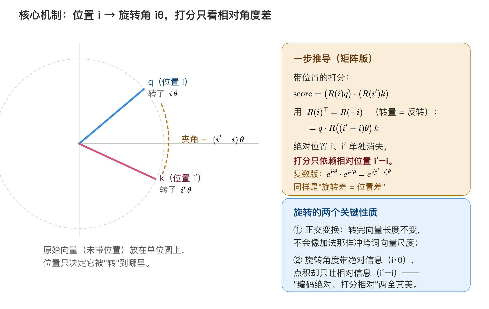
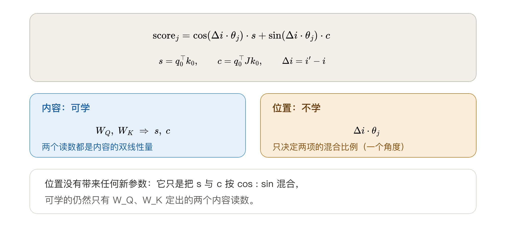
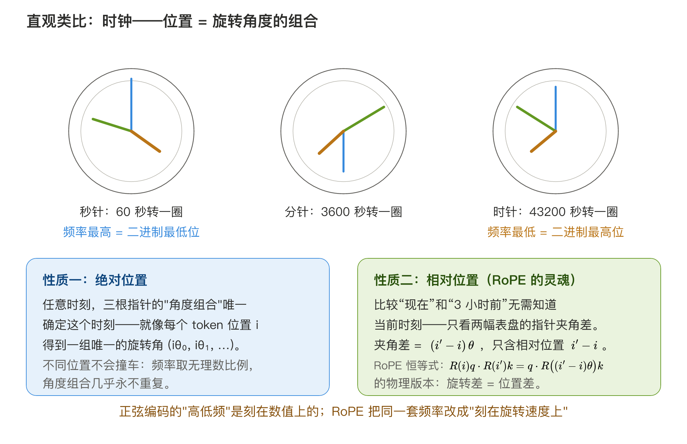
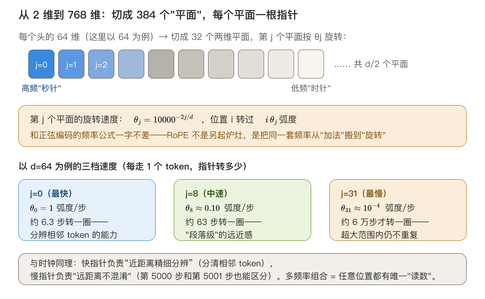
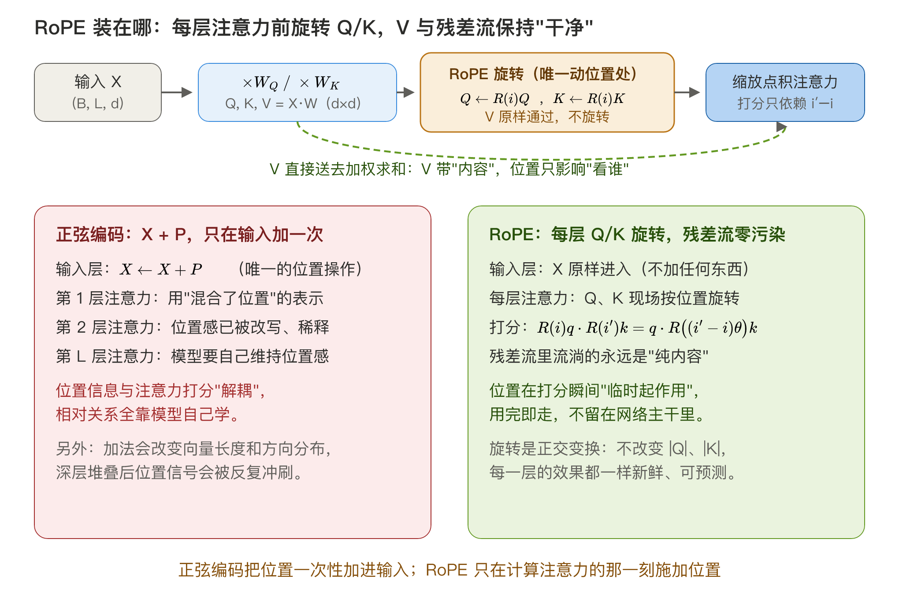

# 旋转位置编码（RoPE）

> 学习笔记 · 2026-11-04  
> 关键词：RoPE、旋转矩阵、相对位置、复平面、KV cache、LLaMA

---

## 一句话总结

> **位置“加”进词向量（X+P）会被权重搅乱、相对距离保不住（正弦位置编码）；RoPE 不再把位置"加"进词向量，而是让每个 token 的 Q、K 按自己的位置转一个角度：编码仍是绝对的（每个位置一个唯一转角），两个 token 一相乘，转角就相减——打分只依赖距离。**

具体到操作层面：**每个 token 的 Q、K 向量会被切成一堆二维小平面，每个平面按自己的速度转一个角度；转多少只取决于这个 token 坐在第几号位置。两个 token 打分时，快慢不同的平面各自"多转了一点"，加起来的分数就只跟两把椅子隔多远有关。**

---

## 0. 从正弦位置编码X+P的缺点出发

正弦位置编码：把位置直接加到词向量上，$x_i=e_i+p_i$，注意力分数展开成四项，前三项都有一只脚踩在内容上，唯一不带内容的 $p_i^\top Wp_{i'}$ 又被学出来的满矩阵 $W$ 搅散——只有 $W=I$ 时才退回 $\sum_j\cos(\Delta i\cdot\theta_j)$，而没有任何机制保证这一点。**位置以"加"的方式进入，就注定和内容混在同一张 $W$ 里，相对性保不住。**

所以真正想要的东西很简单：**同一对词，隔 3 个位置和隔 900 个位置，模型该用同一套方式去比较它们**——位置的影响只要一个自变量（隔了多远），学一次就能全长通用；若要分别看 $i$、$i'$ 各是第几号，同一条规律就得每个位置各学一遍，长位置的样本少，学不到的部分就成了"长文失忆"。用符号写出来：$\text{score}$ 只跟 $e_i$、$e_{i'}$ 和 $\Delta i=i'-i$ 有关，$i$、$i'$ 本身不进这个函数。

绕开 $W$ 的办法不是把 $W$ 约束成单位阵，而是换位置进入的时机：**不再往 $x=e+p$ 里加一项，而是让位置去改写投影之后的 $q$、$k$ 本身**。位置作用在 $W_Qe$、$W_Ke$ 上，而不是投影之前的词向量上——$W$ 已经用完，没有机会再把位置和内容搅在一起。

"改写"该用哪种操作？这个问题在正弦位置编码里已经回答过：一维上既要"平移可乘"（同态 $\phi(i+k)=T_k\phi(i)$）又要"有界"（数值不炸），$T_k$ 的特征值只能是纯虚数，操作只能是**旋转**。结论直接搬过来用：这里不是"可以转"，而是"只能转"。

把这两步合起来，第一行推导就出来了：$q$、$k$ 各自按位置转一个角，点积时两个角相减，只剩 $\Delta i$。

> 符号约定：位置 $i$、$i'$，$\Delta i=i'-i$，维度对 $j$，转速 $\theta_j=10000^{-2j/d}$（$j$ 小转得快）。凡位置与频率相乘一律显式写乘号；虚数单位用正体 $\mathrm{i}$，与位置 $i$ 区分。

---

## 1. RoPE：把位置从"加法"改成"旋转"

### 1.1 二维版：一行推导

**先看清"加"和"转"差在哪。** 正弦编码把位置做成**一个加项**塞进词向量（$x_i=e_i+p_i$）：位置成了内容的一部分，之后乘什么权重都会把它和词义搅在一起，拆不开。RoPE 换成**一个操作**——不改数值、只改方向，而且作用在已经投影好的向量上。前者是"把位置写进向量"，后者是"按位置摆向量"，这就是加法注入与旋转的全部区别。

**位置进入的时机也因此推后。** $x_i$ 不加 $p_i$，先乘 $W_Q$、$W_K$ 投出**纯内容**的 $q_i=W_Qx_i$、$k_{i'}=W_Kx_{i'}$，再用位置去旋转它们：$\tilde q_i=R(i\cdot\theta_j)\hspace{0.1667em}q_i$、$\tilde k_{i'}=R(i'\cdot\theta_j)\hspace{0.1667em}k_{i'}$。位置不参与加和，只在旋转这一步出场。

**转的是哪两维？** 第 $j$ 对是第 $2j$、$2j+1$ 维；RoPE 把它们看成平面上的一个点 $(q_{2j},\ q_{2j+1})$，在这个平面里转 $i\cdot\theta_j$ 弧度（$\theta_j$ 是这个平面的"转速"），每个维度对各转各的角度、快慢不同。RoFormer 论文把一对写作 $(q_{2i-1},\ q_{2i})$、块编号从 1 起，与这里 0 起的 $2j,\ 2j+1$ 是同一种切法，只差 $i=j+1$：

$$
R(i\cdot\theta_j) = \begin{bmatrix} \cos(i\cdot\theta_j) & -\sin(i\cdot\theta_j) \\ \sin(i\cdot\theta_j) & \cos(i\cdot\theta_j) \end{bmatrix}
$$

**一行推导看清全部**。用到旋转矩阵的两个性质：正交性（$R(a)^\top=R(-a)$，转置即反向转）与角度可加（$R(a)R(b)=R(a+b)$，先转 $b$ 再转 $a$ 等于一次转 $a+b$）：

$$
\big(R(i\cdot\theta_j)q_i\big)\cdot\big(R(i'\cdot\theta_j)k_{i'}\big) = q_i^\top \underbrace{R(i\cdot\theta_j)^\top}_{=\hspace{0.1667em}R(-i\cdot\theta_j)} R(i'\cdot\theta_j)\hspace{0.1667em}k_{i'} = q_i^\top R\big((i'-i)\cdot\theta_j\big)\hspace{0.1667em}k_{i'} = q_i^\top R\big(\Delta i\cdot\theta_j\big)\hspace{0.1667em}k_{i'}
$$

绝对位置 $i$、$i'$ 单独消失了，**打分只依赖相对位置 $\Delta i$**。这就是"编码绝对、打分相对"两全其美：

- 每个 $i$ 有唯一的旋转角 → 绝对位置信息没丢；
- 点积只吐出夹角差 → 相对位置直接内建，不用学。

复数视角一句话：$e^{\mathrm{i}\hspace{0.1667em}i\cdot\theta_j}\cdot\overline{e^{\mathrm{i}\hspace{0.1667em}i'\cdot\theta_j}} = e^{\mathrm{i}\hspace{0.1667em}\Delta i\cdot\theta_j}$——旋转差 = 位置差（正体 $\mathrm{i}$ 是虚数单位）。

**为什么 Q 和 K 必须两边都转？** 若只转 query、key 原地不动，打分变成 $q_i^\top R(-i\cdot\theta_j)k_{i'}$——只跟 query 自己的绝对位置 $i$ 有关，key 坐在哪儿完全看不出来，相对性无从谈起。只转 key 同理。必须 $R(i'\theta_j)\hspace{0.1667em}R(-i\theta_j)=R\big((i'-i)\theta_j\big)$ 才能让两个绝对位置在相乘时相减。位置差为负（key 排在 query 左边）时也不需要额外规则，角度取负即可。

### 1.2 走一遍完整计算：两个 token 的分数是怎么算出来的

前面都是符号。这一节用真数字把 1.1 的流程原样走一遍：**各自旋转、再做点积**——这一步走通，RoPE 就没有剩余的神秘感了。

**设定**（维数取 4 只为手算方便，真实是 64/128）：

- 一个头切成 $d/2 = 2$ 个平面，$j = 0, 1$；
- 转速：$\theta_0 = 10000^{0} = 1$（最快），$\theta_1 = 10000^{-2/4} = 0.01$（最慢）；
- query 坐在位置 $i = 2$，key 坐在位置 $i' = 5$，所以 $\Delta i = 3$；
- 已经投影好的内容向量（$W_Q$、$W_K$ 的输出）：$q = (1,\ 0,\ 0,\ 1)$，$k = (1,\ 0,\ 1,\ 0)$。

**第一步，切平面**。相邻两维一组：

$$
q_0 = (1,\ 0),\quad q_1 = (0,\ 1); \qquad k_0 = (1,\ 0),\quad k_1 = (1,\ 0)
$$

**第二步，每个平面按各自的绝对位置旋转**。$R(\phi)$ 对一对分量的作用规则是 $(u_1,u_2)\mapsto(u_1\cos\phi-u_2\sin\phi,\ \ u_1\sin\phi+u_2\cos\phi)$：

| 平面    | $q_j$  | 转角 $i\cdot\theta_j$ | 旋转后 $\tilde q_j$ | $k_j$  | 转角 $i'\cdot\theta_j$ | 旋转后 $\tilde k_j$ |
| ----- | ------ | ------------------- | ---------------- | ------ | -------------------- | ---------------- |
| $j=0$ | (1, 0) | 2 弧度                | (−0.416, 0.909)  | (1, 0) | 5 弧度                 | (0.284, −0.959)  |
| $j=1$ | (0, 1) | 0.02 弧度             | (−0.020, 1.000)  | (1, 0) | 0.05 弧度              | (0.999, 0.050)   |

**第三步，逐平面点积，再把所有平面相加**：

$$
\tilde q_0\cdot\tilde k_0 = (-0.416)(0.284)+(0.909)(-0.959)=-0.990
$$

$$
\tilde q_1\cdot\tilde k_1 = (-0.020)(0.999)+(1.000)(0.050)=0.030
$$

$$
\text{score}=-0.990+0.030=-0.96
$$

**注意：整个过程没有人算过 $\Delta i=3$。** query 只用了自己的 $i=2$，key 只用了自己的 $i'=5$；但乘积合起来只由 $i'-i=3$ 决定——把这对 token 整体平移到 $i=7,\ i'=10$，每个转角都加上 $5\theta_j$，最终分数一个数字都不会变。这就是 1.1 恒等式的数值验证。

**再看位置在每一项里干了什么**：

- **平面 0**：两个向量内容完全同向，不转的话点积是 $1$。但 $\Delta i=3$ 让它们相对转开 3 弧度（172°），点积翻成 $-0.99$——**位置把"内容很像"判成"不相干"**；
- **平面 1**：内容正交，不转的话点积是 $0$；转角只有 0.03 弧度，贡献 0.030，几乎为零——**这一维对 3 步的距离不敏感，是留给几百步之外的距离用的**（$\theta_1=0.01$ 转一圈要 628 步）；
- 合起来 $-0.96$。

**提醒**：$-0.96$ 只是 logit，要和这一行所有 key 的分数一起过 softmax；真正起作用的是相对大小，不是绝对值。

把 $\Delta i$ 换成 0（自己看自己）：每个平面转角为 0，score 直接退回未旋转的点积 $1+0=1$——**位置差为 0 时 RoPE 完全不干扰内容**，差得越远拧得越狠。

既然结果只由 $\Delta i$ 决定，能不能不转两次、用 $\Delta i$ 一步算出分数？能——这就是下一节。

### 1.3 展开成两项：内容给两个读数，位置给一个角度

1.2 是"转两次、点积一次"的笨办法。代数上可以把它压缩成一步：让 $\Delta i\cdot\theta_j$ 的旋转矩阵直接夹在两个内容向量中间，再把旋转矩阵拆成"单位阵 + 90° 旋转阵"。（记号约定：1.2 里 $q_0$ 指"第 0 个平面"；本节的 $q_0,k_0$ 指**任意第 $j$ 个平面内的那对分量** $(q_{2j},q_{2j+1})$、$(k_{2j},k_{2j+1})$，下标 0 表示"平面内的两个坐标"。）

因为：

$$
R(\varphi)=\begin{bmatrix}\cos\varphi & -\sin\varphi\\ \sin\varphi & \cos\varphi\end{bmatrix}
=\cos\varphi\underbrace{\begin{bmatrix}1&0\\0&1\end{bmatrix}}_{I}+\sin\varphi\underbrace{\begin{bmatrix}0&-1\\1&0\end{bmatrix}}_{J}
$$

所以：

$$
R(\Delta i\cdot\theta_j)=\cos(\Delta i\cdot\theta_j)\hspace{0.1667em}I+\sin(\Delta i\cdot\theta_j)\hspace{0.1667em}J,\qquad J=\begin{bmatrix}0&-1\\ 1&0\end{bmatrix}
$$

**为什么值得这么拆？** 因为 $J$ 就是"逆时针转 90°"这个操作本身，而且

$$
J^2=\begin{bmatrix}0&-1\\1&0\end{bmatrix}\begin{bmatrix}0&-1\\1&0\end{bmatrix}=\begin{bmatrix}-1&0\\0&-1\end{bmatrix}=-I
$$

$J^2=-I$ 与虚数单位 $\mathrm{i}^2=-1$ 完全同构，所以 $\cos\varphi\hspace{0.1667em}I+\sin\varphi\hspace{0.1667em}J$ 不过是 $e^{\mathrm{i}\varphi}=\cos\varphi+\mathrm{i}\sin\varphi$ 的实数版：把 $\mathrm{i}$ 换成矩阵 $J$，公式一字不改。1.1 末尾那句"复数视角"里的 $e^{\mathrm{i}\varphi}$，说的就是这个东西。

**它怎么变成打分里的两项？** $I$、$J$ 都是常矩阵，夹进点积后可以逐项分配：

$$
q_0^\top R(\varphi)\hspace{0.1667em}k_0=\cos\varphi\hspace{0.1667em}(q_0^\top k_0)+\sin\varphi\hspace{0.1667em}(q_0^\top Jk_0)
$$

第二项把矩阵乘开（设这一对分量 $q_0=(q_a,q_b)$、$k_0=(k_a,k_b)$）：

$$
q_0^\top Jk_0=\begin{bmatrix}q_a & q_b\end{bmatrix}\begin{bmatrix}0&-1\\1&0\end{bmatrix}\begin{bmatrix}k_a\\k_b\end{bmatrix}=q_a k_b-q_b k_a
$$

$q_a k_b-q_b k_a$ 正是二维叉积（两个向量张成的有向面积），也就是下面那个"正交多少"的读数 $c$。

于是这个平面上的打分被拆成两项：

$$
\text{score}_j=\cos(\Delta i\cdot\theta_j)\cdot\underbrace{q_0^\top k_0}_{s}+\sin(\Delta i\cdot\theta_j)\cdot\underbrace{q_0^\top Jk_0}_{c}
$$

- $s=q_0^\top k_0$：普通点积，两个内容向量"同向多少"；
- $c=q_0^\top Jk_0$：把 $k_0$ 先转 90° 再点积，"正交多少"（差一个符号约定，本质是二维叉积）；
- 两个系数 $\cos$、$\sin$ 只由位置差 $\Delta i$ 与转速 $\theta_j$ 决定。

**内容提供两个读数 $(s,c)$，位置提供一个角度，打分是这个角度方向上的投影。**

由此可以回答几个常见疑问：

**① 位置编码"零参数"，为什么还能起作用。** 位置的全部信息就是一个确定的角度 $\Delta i\cdot\theta_j$，它不需要学、只需要算。它起作用的方式是决定两个内容读数按什么比例混合——角度一变，混合比例就变，打分随之变化。位置没有"自己的一份表示"，它寄生在内容的两个读数之间。

**② 不需要一个额外的"内容度量矩阵"。** 展开式里的 $s$、$c$ 完全由 $W_Q$、$W_K$ 决定（$q_0$、$k_0$ 本身就是投影结果），没有任何新参数。若一定要把"内容怎么比"写成矩阵，那也只是 $W_Q$、$W_K$ 在这个平面上的影子，不是独立对象：单侧的那个矩阵可以整体并进 $W_Q$，不增加表达能力。

**③ 与"比例常数"的区别。** 位置在这里是**相位**，不是量纲换算系数：它携带的是"隔了几步"这一信息量，而不是为了对齐单位而设的倍率。注意力里真正扮演固定常数角色的是缩放因子 $1/\sqrt{d_{\text{head}}}$——它不学、只为把 logits 的方差拉回 1，RoPE 也不改它。

一句话：**可学的只有内容（$W_Q$、$W_K$ 决定的 $s$、$c$），位置只是把两项混合起来的相位角。**

### 1.4 同一件事的两种看法：转 key，还是把 query 拨回去

1.1 的恒等式还可以写成另一种形式（用 $R(\Delta i\cdot\theta_j)^\top=R(-\Delta i\cdot\theta_j)$）：

$$
q^\top R(\Delta i\cdot\theta_j)\hspace{0.1667em}k \hspace{0.2778em}=\hspace{0.2778em} \big(R(-\Delta i\cdot\theta_j)\hspace{0.1667em}q\big)^\top k
$$

同一个数字，两种读法：

- **看法 A（实现采用）**：q、k 各自按自己的**绝对**位置转 $i\theta_j$、$i'\theta_j$，转完直接点积。算的时候谁也不知道 $\Delta i$ 是多少，它是在点积里自动冒出来的；
- **看法 B（直观看相对性）**：key 原地不动，把 query **反向拨回** $\Delta i\cdot\theta_j$ 的角度再比。这时只有"相对转角"参与运算，绝对位置彻底看不见了。

两种算法结果逐位相同——**"编码绝对、打分相对"不是巧合，是同一个数的两种读法**。看法 A 解释了工程上的好处：每个 token 的旋转只依赖自己的位置，所以 K 一旦算好、转好，就可以扔进 KV cache 反复使用，新来的 token 只需转自己那一下（见第 3 章）。

把这句话往下拆，还有三处容易说歪：

**① 转的是向量，不是权重。** 被旋转的是每个位置投影出来的 $q_i$、$k_i$——整块 $[L,d]$ 的矩阵按行转，每行角度不同；$W_Q$、$W_K$ 这些权重本身不转，$V$ 也完全不转（第 3 章讲为什么）。能这样"按行各转各的"，是因为转角只由自己这一行的位置 $i$ 决定，与其他 token 无关。

**② "既有绝对、又有相对"不是两套信息相加。** RoPE 里并没有把 $p_i$ 这一项加进词向量，只有一组转角，两个视角看它：

- 单看一个 token：转角 $i\cdot\theta_j$ 由它的绝对位置唯一确定（$i\mapsto R(i\cdot\theta_j)$ 是单射：位置每加 1，相位就前进 $\theta_j$，两个位置要撞号得让 $\Delta i\cdot\theta_j$ 恰好是 $2\pi$ 的整数倍，而 $\theta_j=10000^{-2j/d}$ 的取值下整数 $\Delta i$ 无解），这就是绝对性——每个位置有自己的相位，且只依赖自己；
- 成对相乘：$R(i\cdot\theta_j)^\top R(i'\cdot\theta_j)=R\big((i'-i)\cdot\theta_j\big)$，两个绝对转角一起消掉、只剩角度差，这就是相对性；
- 两件事用的是**同一组 cos/sin、同一个转角**，区别只在"看一个"还是"看一对"。

**③ 相对位置是"不用学"，不是"学到了"。** $\theta_j=10000^{-2j/d}$ 是预设的，$\Delta i$ 由位置索引直接算出，两者都不参与训练——相对性由恒等式保证，训练开始前就已经成立。模型真正学的仍是内容侧：$W_Q$、$W_K$ 怎么把 token 投到各平面，以及每个平面里两个读数 $s_j$、$c_j$ 按什么比例混合（1.3）。这也是 RoPE 与 T5 bias、ALiBi 的分界：后两者把"距离 → 分数"做成一个**加在打分上的偏置项**（T5 bias 学一张分桶表，ALiBi 直接写死成固定斜率的直线），形状由外部规定；RoPE 不加偏置，只改内容被比较的方式，距离的影响形状由内容自己长出来。

### 1.5 直观类比：时钟

- **秒针 60 秒一圈、分针 3600 秒一圈、时针 43200 秒一圈**——三根指针就是三个不同频率的"维度对"；
- **绝对位置**：任意时刻，三根指针的角度组合唯一确定这个时刻（频率不成整数比，读数几乎永不撞车）；
- **相对位置**：比较"现在"和"3 小时前"，不需要知道当前时刻——**只看两幅表盘的指针夹角差**。夹角差 = 时间差 × 转速，与绝对时刻无关。

这正是多进制计数的连续版：**秒针 = 最低位（翻得最快），时针 = 最高位（翻得最慢）**。正弦编码把这套频率"刻在数值上"，RoPE 把同一套频率"刻在旋转速度上"。

---

## 2. 从 2 维铺到整个头维度：切平面 + 多频率

### 2.1 一个头切成 d/2 个平面

一个 64 维的头切成 **32 个两维平面**，第 $j$ 个平面的转速：

$$
\theta_j = 10000^{-2j/d}, \quad j = 0, 1, \ldots, d/2-1
$$

整块旋转矩阵因此是**分块对角**的——对角线上每个块是第 $j$ 个平面的 $2\times2$ 旋转，块与块互不干扰（RoFormer 论文里记作 $\mathbf{R}^d_{\Theta,i}$）：

$$
\mathbf{R}^d_{\Theta,i}=\begin{bmatrix} R(i\cdot\theta_0) & 0 & \cdots & 0\\ 0 & R(i\cdot\theta_1) & \cdots & 0\\ \vdots & \vdots & \ddots & \vdots\\ 0 & 0 & \cdots & R(i\cdot\theta_{d/2-1}) \end{bmatrix}
$$

以 d=64 感受三档速度：

| 平面       | 转速         | 转一圈    | 分工           |
| -------- | ---------- | ------ | ------------ |
| j=0（秒针）  | 1 弧度/步     | ~6.3 步 | 精细分辨相邻 token |
| j=8（分针）  | ≈0.10 弧度/步 | ~63 步  | 段落级远近感       |
| j=31（时针） | ≈1e-4 弧度/步 | ~5 万步  | 超大范围内不混淆     |

**和正弦编码的频率公式一字不差**——RoPE 不是另起炉灶，而是把同一套"多频率时钟"从加法搬进旋转。学过正弦编码再学 RoPE，频率谱完全相同，只差"加法 → 旋转"这最后一步。

### 2.2 完整打分 = 所有平面相加

单个平面按 1.2 算出 $\text{score}_j$，整个头的分数是 32 个平面加起来：

$$
\text{score}=\sum_{j=0}^{d/2-1}\Big[\cos(\Delta i\cdot\theta_j)\hspace{0.1667em}s_j+\sin(\Delta i\cdot\theta_j)\hspace{0.1667em}c_j\Big]
$$

记住这个式子的形状：**一个总分数 = 32 项求和，每项都是"内容读数 × 位置系数"**。由此可以直接读出几个性质：

- **距离越远，分数平均越小**。把 32 项看成 32 根转速不同的指针：$\Delta i$ 一大，高频平面各自转到不同相位，正负互相错开、求和时抵消掉大半；低频平面虽然没转开，但只有少数几项，撑不起总分。于是总和随 $\Delta i$ 增大而缩小——这符合"隔得远的词通常关系弱"的先验。注意它是**趋势**而非严格单调：RoFormer 论文用 Abel 变换证明的是衰减上界，具体某一对 token 完全可能远处得分更高；
- **没有任何一项是"位置专用"的**。32 项全都在乘内容读数 $s_j$、$c_j$，位置只出现在系数里——这就是"零参数"的确切含义；
- **不同平面的敏感度天然分工**。判断"相邻两个词"主要靠 $j$ 小的几项，判断"跨段落指代"主要靠 $j$ 大的几项，模型不需要显式选择，加和自动完成。

---

## 3. 装在哪：每层注意力前，只转 Q/K

- **只旋转 Q 和 K**：位置只需要影响"看谁、带谁回来"的打分与选择；
- **V 不旋转**：V 带的是"内容"，旋转它只会把内容搅乱，没有收益；
- **每一层都做**：不是输入层加一次的"一次性腌制"，而是每层算注意力时"现场登场、用完即走"；
- **残差流零污染**：主干里流淌的始终是纯内容表示，旋转不改变向量长度（正交变换），深层堆叠也不会冲刷位置信号；
- **KV cache 友好**：每个 token 的 K 只按自己的绝对位置转一次，转完就存着；解码到第 100 个 token 时，前 99 个的 K 不用重算——这是 RoPE 能配增量解码的关键，位置若依赖"两个 token 的关系"就做不到。

对比正弦编码：它是 `X ← X + P` 一次性加在输入上，位置与打分解耦；RoPE 把位置放进打分的**运算过程**里，相对性由数学直接保证。

---

## 4. 为什么现代 LLM 集体换成 RoPE

| 性质          | 说明                                                          |
| ----------- | ----------------------------------------------------------- |
| 相对位置显式保证    | $q^\top R(\Delta i\cdot\theta_j)k$，打分天然只看相对距离，无需模型自己学       |
| 零参数         | cos/sin 表预计算即可，不像可学习编码占参数                                   |
| 不污染表示       | 旋转是正交变换，向量长度不变，训练稳定                                         |
| 兼容 KV cache | 每个 token 的旋转只依赖自己的位置 $i$，增量解码时新 token 旋转自己即可                |
| 远程衰减趋势      | 点积幅值随 $\vert\Delta i\vert$ 增大平均意义下衰减，符合"远的词该少看"的先验          |
| 可扩展上下文      | 长度外推/插值有成熟套路（Position Interpolation、NTK-aware scaling、YaRN） |

使用者：**LLaMA / Llama 2/3、Qwen、Mistral、ChatGLM、GPT-NeoX、PaLM**……可以说 2023 年之后的新模型几乎清一色 RoPE。

---

## 5. PyTorch 实现

### 5.1 HuggingFace 里的真名

- **LLaMA 系列**：`LlamaRotaryEmbedding`（配置里叫 **`rope_theta`**，即 base=10000；`rope_scaling` 控制外推策略）；前向里传入 **`position_ids`**，内部 `apply_rotary_pos_emb(q, k, cos, sin, position_ids)`；
- **GPT-NeoX / GPT-J 两种切法**：本文公式把**相邻两维** (2j, 2j+1) 当作一个平面（GPT-J 风格）；GPT-NeoX 把**前后两半**配对（用 `rotate_half` 实现），数学等价、只是"哪些维组成一个平面"的约定不同；
- **torchtune**：`RotaryPositionalEmbeddings(dim, max_seq_len, base)` 一个模块直接用。

---

## 6. 正弦编码 vs RoPE 对照表

|        | 正弦绝对编码                 | RoPE                               |
| ------ | ---------------------- | ---------------------------------- |
| 注入方式   | **加法**：X ← X + P       | **旋转**：Q←R(i)Q，K←R(i)K             |
| 作用位置   | 只在输入 embedding 一次      | **每层**自注意力前                        |
| 作用对象   | 整个词向量                  | 只 Q/K，**V 不动**                     |
| 相对位置   | 无保证（$W=I$ 时才巧合成立）      | 恒等式直接保证打分只依赖 $\Delta i$            |
| 对表示的影响 | 改变向量长度/方向              | 正交变换，长度不变                          |
| 频率公式   | $\sin(i/10000^{2j/d})$ | $\theta_j = 10000^{-2j/d}$（**同构**） |
| 残差流    | 位置被"腌"进主干              | 主干保持纯内容                            |
| 代表模型   | 原始 Transformer、BERT    | LLaMA、Qwen、Mistral、ChatGLM         |

---

## 7. 七个常见误区

1. **"RoPE 也是加在 embedding 上的❌"**——恰恰相反，RoPE 不碰输入和残差流，只在每层 Q/K 上旋转；"取值 [-1,1] 可加"是正弦编码的特性。
2. **"V 也要旋转❌"**——不用。V 带内容，位置只需影响"看谁"；转 V 没有数学收益还破坏内容。
3. **"RoPE 是相对位置编码，所以没有绝对位置信息❌"**——编码是绝对的（每个 $i$ 有唯一旋转角），只是打分效果是相对的。它同时具备两者。正弦编码同理："区分绝对位置"靠相位单射，"区分距离"靠相位差，两件事本来就同时成立。
4. **"旋转会放大/缩小注意力分数❌"**——不会，旋转是正交变换，$\lVert Q\rVert$、$\lVert K\rVert$ 不变，logits 尺度稳定。
5. **"RoPE 天生能无限外推❌"**——不能。训练长度之外旋转角超出训练所见范围，效果会崩；要外推得配 Position Interpolation、NTK-aware scaling 或 YaRN（这就是 LLaMA 里 `rope_scaling` 存在的原因）。
6. **"sin 和 cos 存一个就够了❌"**——不行。一个数定不出一个角度：$\sin$ 在 $[0,2\pi)$ 上不可逆，$\pm\Delta i$ 会给出同一个值；而且只有 sin 时"平移"不是线性操作，偏移量无法复合成一次加法。
