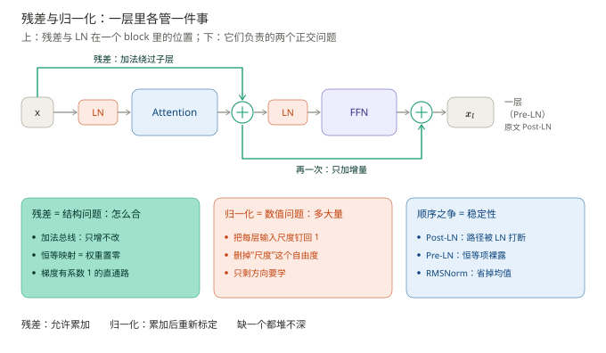
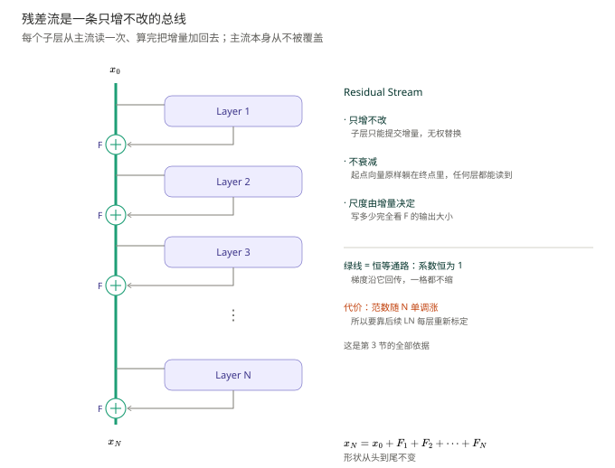
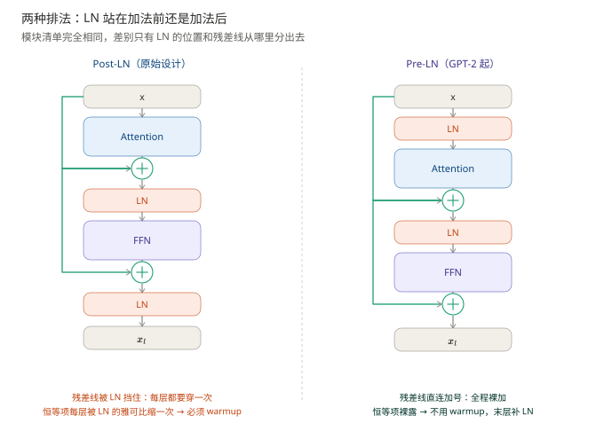
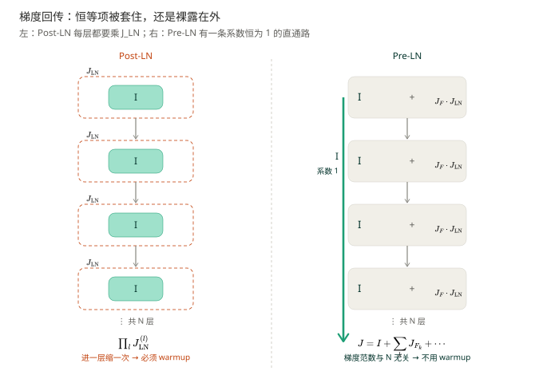
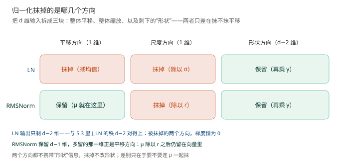
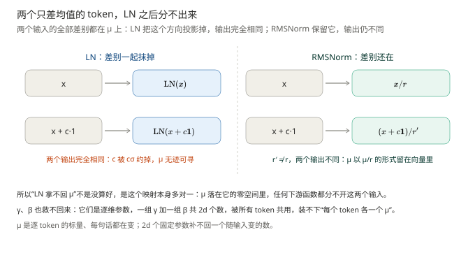
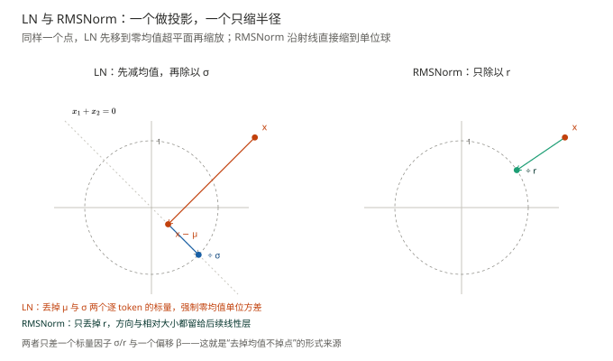

# 残差与归一化：100 层为什么还能训得动

> **一句话结论**：残差把每一层的职责从"重写整个向量"降级为"追加一个增量"，归一化把每层的输入尺度钉回可控范围。**能堆深是这两件事合作的结果，不是 LN（Layer Normalization，层归一化）单方面的功劳**——残差给梯度开了一条系数为 1 的直通路，归一化保证这条路上的数值不失控。
>
> - **缺了残差，深网络连"什么都不做"都学不会**：50 层的普通网络训练误差比 20 层还高（退化问题），不是容量不够，而是"精确复制输入"极难被训练找到
> - **缺了归一化，残差会把账算炸**：恒等项只保证梯度不消失，不保证不爆炸，增量稍大 $(1+\Vert J_F\Vert)^N$ 就是天文数字
> - **今天的主流是 Pre-LN + RMSNorm**：LN 移到子层入口，恒等通路变干净，代价是残差流范数随深度单调增长、末层要补一个 LN。注意 Transformer 原文（Vaswani et al., 2017）用的是 Post-LN，Pre-LN 是后来（GPT-2 起）才取代它的——**本篇图例一律按今天通行的 Pre-LN 画，两种配置的差别在第五节专门讲**

| **前置阅读**：[《前馈网络：每个位置怎么被单独加工》](../前馈网络/前馈网络.md)　 | 　**需要先掌握**：矩阵乘法、链式法则、均值与标准差 |
| ----------------------------------------------- | --------------------------- |

**图 1**：本篇地图。看图要点：上排是一层里残差与 LN 各自站的位置（每个子层配一套），画的是今天通行的 **Pre-LN** 配置——Transformer 原文是 Post-LN（LN 挪到加法之后），主干一模一样、只差 LN 的位置，第五节专门对比；下排是它们各管一件正交的事——残差管结构（怎么合），归一化管数值（多大量），缺一个都堆不深。

例句沿用全系列基线：`科软 放 实习 吸引 学生 报考`，11 个 token；张量形状按 $L = 11$、$d = 512$、$N = 6$（2017 年 base 配置）算，讲深层时另给 $N = 50$、$N = 100$ 的数字。

---

## 一、先看没有它会怎样

> 本节要回答的问题：把 50 个 Transformer block 直接摞起来，为什么会训不动？

先破一个流传很广的错误直觉：**深网络训不动是因为梯度消失。**这个答案对了一半，漏掉了更基本的那一半。

### 1.1 退化：训练误差随深度变差

He et al. (2016) 在 ResNet（残差网络）论文里给了一个当时很难解释的实验：20 层和 56 层的**普通**卷积网络对比，**56 层的训练误差反而比 20 层更高**。

注意这不是过拟合——过拟合是训练误差低、测试误差高；这里是训练误差本身就下不去。也不是梯度消失到 0：那样参数完全不动，损失会是一条平线，而不是更差。这个现象叫 Degradation（退化问题）。

Transformer 一样。把 $N$ 个 block 摞起来，如果每个 block 都是"整体替换"的形式（$x \mapsto \mathrm{LN}(F(x))$），24 层以上就开始难训，48 层以上基本要靠极其精细的初始化和 warmup 才能跑起来。

### 1.2 为什么"什么都不做"这么难学

关键在于：**深网络的默认行为是"每层都扰动一下"，不是"每层都不动"。**

一个随机初始化的子层拿到输入 $x$，输出 $F(x)$ 与 $x$ 几乎不相关——它是随机权重的乘积。$N$ 层之后，输出是 $N$ 次随机扰动的复合，与输入的关系早被打散。

于是要让 50 层网络学到恒等映射，唯一的办法是让每一层的 $F_l$ 都恰好学会 $F_l(x) = x$，需要 50 组权重精确配平。**梯度不会帮你找这个解，因为它在初始化时完全不知道"复制"是个好主意**——它只知道下降方向，而"精确复制"是一个维度极高、测度极窄的解集。

### 1.3 精髓句

> **精髓句**：残差做的事，是把"恒等映射"从"需要精确配平 50 组权重才能命中的窄解"变成"把所有子层权重置零就自动成立的默认状态"。训练的起点因此天然是恒等，网络只需要在恒等之上**逐步加上有用的增量**。

这个转变的意义远超"梯度好传"：它把"学一个 50 层的函数"重新表述成"学 50 个小的修正量"，而后者对优化器友好得多——每一层的任务从"重建全部信息"缩成"补充缺少的那一点"。

## 二、残差是一条加法总线

> 本节要回答的问题：$x_l = x_{l-1} + F_l(x_{l-1})$ 里那一个加号，到底改变了什么结构？

### 2.1 把加号展开

反复代入，得到

$$
x_N = x_0 + \sum_{l=1}^{N} F_l(x_{l-1})
$$

其中 $x_0$ 是嵌入层的输出，$F_l$ 是第 $l$ 个 block 的增量（该层注意力和 FFN 两个子层各写一次，合记为一个 $F_l$），$N$ 是层数。

代算：$L = 11$、$d = 512$、$N = 6$，共 6 个 block、12 次写入。$x_0$ 是 $11\times 512$ 的矩阵，每个 block 往里加一个同形状的增量，最终 $x_6 = x_0 + \sum_{l=1}^{6} F_l$。**形状从头到尾没变过**——这是下面那个视角成立的前提。

### 2.2 残差流：一条共享的草稿纸

把上式读成一句话：**整条主干是一条固定宽度的通道，每个子层从通道上读一次，算完把结果加回去。**这条通道叫 Residual Stream（残差流）。

它有三个直接推论，每一个都能在后面的设计里找到落点。

**其一，每层只写增量，不覆盖。**子层没有"输出新向量替换旧向量"的权力，只能提交一个修改量。第 4 篇说"FFN 在特征维造新东西"，现在可以补一句：它造出来的东西是**加**上去的，不是**替换**上去的。

**其二，任何一层的信息都能被后面任何一层无损读到。**加法不衰减——$x_0$ 始终原样躺在 $x_N$ 里。对比没有残差的网络：$x_N = F_N(\cdots F_1(x_0))$，$x_0$ 要穿过 $N$ 次变换才能到达顶层，每穿一次都可能被改写一次。

**其三，增量的范数就是"这一层改写的力度"。**流本身不限制你写多少，写多少完全由 $F_l$ 的输出尺度决定。这既是自由，也是第三节和第四节所有麻烦的根源。

**图 2**：残差流是一条只增不改的总线。看图要点：左边那条绿色粗线就是流本身，也是第三节要用的恒等通路——每个子层从它分叉、算完再加回去，全程没有任何一步被覆盖。

> **一个类比（是类比，不是等价）**：残差流像一块共享白板，每个子层走上来读一遍板上现有的内容、在旁边算一算、把结论**追加**到空白处，没有哪一层擦掉别人写的字。边界在于：白板是"只增不改"的，真实残差流是数值相加，多个增量会在同一组坐标上叠加，可能互相抵消。

### 2.3 为什么是加法，不是拼接或乘法

三种"合并"方式都被试过，只有加法活下来了：

| 方式               | 恒等映射怎么实现                 | 代价                               |
| ---------------- | ------------------------ | -------------------------------- |
| 拼接 $[x;\,F(x)]$  | 无法实现（维度必然变宽）             | 每层维度增长，参数爆炸                      |
| 乘法 $x\odot F(x)$ | 要求 $F(x)\equiv\mathbf 1$ | 梯度含 $F$ 的因子，$F\approx 0$ 时梯度也跟着没 |
| 加法 $x + F(x)$    | 要求 $F(x)\equiv\mathbf 0$ | 无                                |

**加法是唯一"恒等映射对应零输出"的合并方式**，而"零输出"恰好是权重置零就能达到的状态——神经网络的默认初始化本来就在零附近。乘法不行：$\partial(xF)/\partial x = F$，$F$ 稍小于 1 梯度就跟着衰减，问题原封不动地留着。拼接更不行，它连"恒等"这个目标都写不出来。

这一条就是残差的全部理由，也是它从 2015 年起成为所有深网络标配的原因。

**它为什么值得反复强调：恒等是一种参数化先验，不是一种训练技巧。**1.3 已给出解耦和起点两层理由（初始即浅层可用的模型，加层只加补丁，所以不掉点），第三层则是它能跨领域迁移。凡是"让默认行为等于什么都不做、把学习留给偏离"的设计，都是同一个先验的变体：Diffusion Model（扩散模型）预测噪声 $\epsilon$ 而不是图像本身，LoRA（低秩适配）只学增量 $\Delta W$，LayerScale 把 $\gamma$ 初始化成 $10^{-6}$，zero-init 残差分支把最后一层权重置零，Pre-LN 把 LN 移出主干。机制彼此毫不相干，共享的只有一句：**起点必须是恒等，深度才只负责加补丁。**

边界也得说清，否则容易被当成万能药：恒等只在形状相同时有意义（ResNet 用 $1\times1$ projection 对齐通道，Transformer 靠 $d$ 不变才能裸加，FFN 内部升维那一段就没有残差）；它把每层的函数类限制在"恒等 + 小扰动"，大变换只能靠多层累积；而没有归一化时，这条恒等通路反而会把尺度漂移一路放大成 $1.9^{50}$——这正是第三节的伏笔。

一句话：**没有恒等，深度是负债；有了恒等，深度至少是中性的；再配上归一化，才把中性变成资产。**

> **进阶（可跳过）**：残差还有一层"多路径集成"解释（Veit et al., 2016）。展开 $x_N$ 后，梯度可以沿 $2^N$ 条不同长度的路径回传（每层自由选择"走恒等"或"走子层"），整体行为像一个隐式的深层集成。它解释了"随机删掉一层不太掉点"这个现象，但对理解主线不是必需的。

## 三、梯度为什么能穿过去

> 本节要回答的问题：加了那个 $+\,x$，反向传播时到底多了什么？

### 3.1 求一次导

把 $x_l = x_{l-1} + F_l(x_{l-1})$ 对 $x_{l-1}$ 求导：

$$
\frac{\partial x_l}{\partial x_{l-1}} = I + \frac{\partial F_l}{\partial x_{l-1}}
$$

从第 $l$ 层到第 $N$ 层，链式法则给出连乘：

$$
\frac{\partial x_N}{\partial x_l} = \prod_{k=l+1}^{N}\left(I + J_{F_k}\right)
$$

其中 $J_{F_k} = \partial F_k/\partial x_{k-1}$ 是第 $k$ 个子层的雅可比矩阵，$I$ 是 $d\times d$ 单位阵。

### 3.2 把连乘打开

$N-l$ 个 $(I+J)$ 相乘，展开后共有 $2^{N-l}$ 项：

$$
\prod_{k=l+1}^{N}\left(I + J_{F_k}\right)
= I \;+\; \sum_{k} J_{F_k} \;+\; \sum_{i\lt j} J_{F_i}J_{F_j} \;+\; \cdots \;+\; \prod_{k} J_{F_k}
$$

**第一项就是 $I$，系数恰好为 1。**它的含义：从第 $N$ 层回传到第 $l$ 层，存在一条"全程只走恒等分支、一次子层都不经过"的路径，这条路径上的梯度**一格都没被缩放**。

其余各项的系数取决于 $J_F$ 的大小。子层学到的变换越小（$J_F\to 0$），整个连乘越趋近 $I$，梯度几乎原样传回；子层变化剧烈时高阶项会放大或衰减，但**第一项永远在**。

### 3.3 数字对比：残差把"必然消失"换成了"可能爆炸"

设每层的雅可比范数 $\Vert J_F\Vert = 0.9$（子层有相当强度，但远不是恒等）。

- **无残差**：连乘是 $0.9^{50} = 0.0052$。梯度传到第 1 层只剩千分之五，等于没了；$N=100$ 时是 $2.7\times 10^{-5}$。
- **有残差、$J_F$ 与 $I$ 同向**：每层因子范数 $1.9$，$1.9^{50}\approx 9\times 10^{13}$——**爆炸**。  
- **有残差、$J_F$ 小**（$\Vert J_F\Vert=0.1$）：$1.1^{50} = 117$。涨了两个数量级，但可控。

这里必须诚实地指出一件事：**残差并没有让梯度"稳定"，它只是把"必然消失"换成了"可能爆炸"。**$1.9^{50}$ 和 $0.0052$ 一样不可用。

所以"残差解决梯度消失"这个说法是不完整的。准确的说法是：**残差保证梯度有一条不衰减的通路，但这条通路上的总增益由每层增量的尺度决定——控制这个尺度，是归一化的活。**这正是下一节要讲的事，也是"残差与 LN 必须配对"的第一个理由。

## 四、归一化干的是另一件正交的事

> 本节要回答的问题：LN 不改"算什么"，它到底改了什么？

### 4.1 LN 在算什么

对每个 token 的 $d$ 维向量 $x$ 单独做（不跨 batch、不跨位置）：

$$
\mathrm{LN}(x) = \frac{x-\mu}{\sigma}\odot\gamma + \beta,\qquad
\mu = \frac{1}{d}\sum_{i=1}^{d}x_i,\qquad
\sigma = \sqrt{\frac{1}{d}\sum_{i=1}^{d}(x_i-\mu)^2}
$$

$\gamma,\beta\in\mathbb R^d$ 是可学的逐维重标定参数，$\odot$ 是逐元素乘。

代算：设 `科` 这个位置、$d = 512$ 的向量里 $\mu = 0.3$、$\sigma = 2.1$。归一化把每个分量先减 0.3 再除 2.1，整条向量被拉到"零均值、单位方差"；再乘 $\gamma$、加 $\beta$，把"每一维该多重要"与"整体该偏多少"还回去。

> **LN 与 BN（Batch Normalization，批归一化）的完整对比**（统计方向、padding 污染、自回归推理失效、小 batch 方差）：见[《为什么 Transformer 用 LN 而不是 BN》](../transformer用LN而不是BN？/为什么用LayerNorm而不是BatchNorm.md)。一句话版本：**LN 沿特征维统计、每个 token 独立算，BN 沿 batch 维统计、每个特征跨样本算**；变长序列加 padding 会污染 BN 的统计量，LN 天然免疫。本篇不重复那五条原因。

### 4.2 为什么它必须和残差配对

残差允许每层往流里追加增量，于是产生一个后果：**流的尺度会随深度漂移。**

代算。假设每个增量与当前流正交、且每层增量固定为 $\Vert F_l\Vert = 0.1\Vert x_0\Vert$（以第 0 层的流长为尺子），则

$$
\Vert x_N\Vert^2 = \Vert x_0\Vert^2 + \sum_{l=1}^{N}\Vert F_l\Vert^2 = \Vert x_0\Vert^2\left(1 + 0.01N\right)
$$

$N=100$ 时是 $\sqrt 2$ 倍，温和。但增量同向时（训练早期很常见，各子层输出还偏向同一个初始方向）就变成线性累加：$\Vert x_{100}\Vert = \Vert x_0\Vert + 100\times 0.1\Vert x_0\Vert = 11\Vert x_0\Vert$。更糟的是增量按比例放大的情形：若每层 $\Vert F_l\Vert = 0.5\Vert x_{l-1}\Vert$ 且同向，就是复利 $1.5^{100}\approx 4\times 10^{17}$。

LN 的作用就是在每次追加之后把尺度重新钉住：

$$
\Vert x\Vert\ \xrightarrow{\ \mathrm{LN}\ }\ \Vert\hat x\odot\gamma + \beta\Vert \approx \Vert\gamma\Vert
$$

下一层拿到的输入永远在同一量级，$J_F$ 的尺度也就跟着稳定。**残差负责"允许累加"，LN 负责"累加完重新标定"**，一个也不能少——这解释了为什么现代 Transformer 的每个子层都同时带这两样东西，而不是二选一。

### 4.3 尺度不变性：LN 让上游权重的尺度彻底失效

LN 有一个容易被低估的性质：对任意 $c>0$，

$$
\mathrm{LN}(cx) = \mathrm{LN}(x)
$$

因为 $\mu(cx) = c\mu(x)$、$\sigma(cx) = c\sigma(x)$，分子分母同时乘 $c$ 后约掉。

直接后果：若 LN 接在某个线性层之后，$\mathrm{LN}(xW)$ 对 $W$ 的整体缩放完全免疫——$W$ 乘 10 还是乘 0.1，LN 的输出一模一样。于是

- 梯度对 $\Vert W\Vert$ 的分量为 0（只对方向有梯度），**权重范数不再是一个会失控的量**；
- 学习率不必再与初始化尺度精细匹配；
- $\gamma$ 成为唯一控制"这一维该多大"的旋钮，而它是逐维的、可控的。

这是"加了 LN 之后训练稳得多"的机制层解释：**它把"尺度"这个自由度从优化问题里删掉了，只剩"方向"要学。**

### 4.4 为什么 $\gamma$ 和 $\beta$ 必须可学

若 LN 只做 $\hat x = (x-\mu)/\sigma$，输出被强制成零均值单位方差，等于对所有 token 宣布"你们的表示必须一样规范"。这丢掉两类信息：

- **逐维的重要性**：某些维度本该比别人大（表示"是不是动词"的那一维天然比噪声维更该有大幅值），$\gamma$ 把它还回来；
- **整体偏移**：$\beta$ 允许某一维的基准不为 0。

所以 LN 的结构是"归一化 + 可学重标定"：前者负责稳，后者负责不损失表达力。经验上**去掉 $\gamma$ 会明显掉点**（等于强迫所有维度同等重要），**去掉 $\beta$ 影响很小**（后面的线性层能补一个常数偏移）——这也是 RMSNorm 敢把 $\beta$ 整个删掉的依据，第六节会把它讲成严格论证。

## 五、Post-LN 与 Pre-LN：恒等路径上有没有被插一刀

> 本节要回答的问题：两个模型的模块清单完全相同，只是 LN 放的顺序不同，为什么一个必须 warmup、另一个不用？

### 5.1 两种排法

Post-LN（Vaswani et al., 2017 的原始设计）把归一化放在残差**之后**：

$$
x_l = \mathrm{LN}\big(x_{l-1} + F_l(x_{l-1})\big)
$$

Pre-LN（GPT-2 起成为默认）把归一化放在子层**入口**，残差保持裸加：

$$
x_l = x_{l-1} + F_l\big(\mathrm{LN}(x_{l-1})\big)
$$

**图 3**：两种排法的流水线。看图要点：模块数量一个不少、一模一样，差别只在两处——LN 站在"加法前"还是"加法后"，以及绿色的残差线是从哪里分出去的。

六个步骤逐步怎么算、$x$、$x'$、$x''$ 三个记号怎么用，见[《Post-LN 与 Pre-LN 结构详解》](../Post-LN与Pre-LN原理/Post-LN%20与%20Pre-LN%20结构详解.md)第 2、3 节，那里把每一步的矩阵都走了一遍，本篇不重复。本节只回答一件事：**这点顺序差别为什么会长在梯度上。**

### 5.2 雅可比视角：恒等项被包在哪一层括号里

对 Post-LN 求导：

$$
\frac{\partial x_l}{\partial x_{l-1}} = J_{\mathrm{LN}}\Big\vert_{x_{l-1}+F}\cdot\left(I + J_{F_l}\right)
$$

对 Pre-LN 求导：

$$
\frac{\partial x_l}{\partial x_{l-1}} = I + J_{F_l}\cdot J_{\mathrm{LN}}\Big\vert_{x_{l-1}}
$$

差别只有一处括号的位置，后果却很大：

- **Post-LN**：$I$ 被夹在 $J_{\mathrm{LN}}$ 的右边。连乘 $N$ 次后，每一项最左边都挂着一个 $J_{\mathrm{LN}}$——**恒等项每穿过一层就被 LN 的雅可比缩放一次，从来没有原样通过**。
- **Pre-LN**：$I$ 裸露在最外层。展开连乘时，"每层都选 $I$"这条路径的系数恰好是 1——**梯度可以一路不打折地回到第 1 层**。

**图 4**：两条回传路线的对比。看图要点：左边 $I$ 被 $J_{\mathrm{LN}}$ 一层层套住，进一层缩一次；右边 $I$ 在最外层，那条绿色路径的系数始终是 1。

### 5.3 $J_{\mathrm{LN}}$ 长什么样，为什么它是不稳定源

对 4.1 的式子求导：

$$
J_{\mathrm{LN}} = \frac{1}{\sigma}\,\mathrm{diag}(\gamma)\left(I - \frac{1}{d}\mathbf 1\mathbf 1^\top - \frac{1}{d}\hat x\hat x^\top\right)
$$

其中 $\hat x = (x-\mu)/\sigma$ 是归一化后的向量，$\mathbf 1$ 是全 1 向量。

读这个式子：

- 括号里后两项都是**投影**：$-\frac{1}{d}\mathbf 1\mathbf 1^\top$ 抹掉"整体平移"方向，$-\frac{1}{d}\hat x\hat x^\top$ 抹掉"整体缩放"方向（沿 $\hat x$ 改长度会被 $\sigma$ 定义式直接抵消）。这两个方向本来就不携带信息，抹掉不吃亏；
- 剩下的 $d-2$ 个方向，统一乘上 $\frac{1}{\sigma}$。

**问题就在这个 $\frac{1}{\sigma}$。**$\sigma$ 是随输入变化的随机量，训练早期还在漂。$\sigma$ 偏小时 $J_{\mathrm{LN}}$ 整体放大，偏大时整体缩小，$N$ 层连乘下来就是 $\prod_l 1/\sigma_l$ 的指数级漂移。

旧稿算过一笔账：48 层里每个 $\sigma$ 只偏一点，48 次方之后就是数量级的差距，warmup 等的是"$\sigma$ 不再动"那一刻。结论指回那里，这里只留住机制：**Post-LN 的恒等路径被一个数据相关、尺度不定的矩阵层层包裹，所以必须用 warmup 熬过早期的不稳定期。**

**补一个最容易被跳过的问题：训练一段时间后，$\sigma$ 为什么就"不再动"了？**如果它永远在漂，warmup 就永远等不到头，这个论证也就没落地。

先澄清"不动"指什么。$\sigma$ 永远随输入变——同一个 LN 遇到不同 token、不同句子，算出的 $\sigma$ 都不同。这里说的是**它的分布不再随训练步数系统性漂移**：第 100 步和第 10000 步过同一个 LN，同一批数据给出的 $\sigma$ 逐条都不一样，但整批数据的 $\sigma$ 分布已经收进一个窄带。

三件事让它慢下来。

**其一，$\sigma$ 不是参数，是流内容的统计量。**它由 $x_{l-1}$ 决定，而 $x_{l-1}$ 由前面所有层的权重决定。权重不再大改，$\sigma$ 就没有独立的动力源，只能跟着权重慢慢挪。所以"$\sigma$ 不动"的本质是"权重进入了一个变化很慢的区域"。

**其二，尺度是 loss 的弱约束方向。**LN 在每次使用流之前都把绝对大小除掉：$\mathrm{LN}(cx)=\mathrm{LN}(x)$（$c>0$，均值与标准差同比例缩放，正好约掉）。所以在 Pre-LN 里，子层拿到的是归一化后的向量，流的绝对尺度几乎不被任何一层直接看到，只有 $F_l$ 与 $x_{l-1}$ 的**相对比例**才影响结果；Post-LN 的子层直接吃未归一化的流，尺度的影响更强，但它依然不是 loss 想要优化的量。

于是沿"整体放缩"这个方向，梯度只有很弱的间接分量——它是个**慢变量**，不像权重里的有用方向那样被 loss 一把拽到位。

**其三，早期这个慢变量被正反馈放大，后期正反馈失效。**$\sigma$ 偏小 $\to$ $J_{\mathrm{LN}}\propto 1/\sigma$ 偏大 $\to$ 梯度大 $\to$ 权重一步跨得远 $\to$ 流的内容和 $\sigma$ 又被大幅改写 $\to$ $\sigma$ 继续偏。这个环在最初增益最大，warmup 就是用小学习率把增益压到 1 以下。

进入稳定期后，两件事让连乘不再爆炸：一是每层 $\sigma$ 的偏差本身变小；二是各层的偏差不再同向——$\log\prod_l 1/\sigma_l=\sum_l \log(1/\sigma_l)$ 从"同号累加"（按 $N$ 增长，指数级）变成"零均值随机游走"（按 $\sqrt N$ 增长）。

> **一个类比（是类比，不是等价）**：一群人合写文档，每个人对"字号多大算正常"有自己的尺子；开工时各自放大缩小、越改越乱，写到后面被同一份排版规则逼到统一，就只剩小幅抖动。边界在于：没有人协商，所谓"统一"是梯度动力学把不一致的部分当噪声抹掉的结果。

所以 warmup 等的是一个**动力学状态**，不是一个具体数值：等正反馈增益降下来、各层偏差不再同向，$1/\sigma$ 的连乘就从"系统性放大"退化成"小幅抖动"，Post-LN 才稳得住。推理时更直接——$\sigma$ 完全由输入数据决定，根本不参与漂移，这也是为什么训练好的 Post-LN 模型前向毫无问题。

### 5.4 Pre-LN 的代价

Pre-LN 不是免费的，它把问题从"梯度"搬到了"前向"。

**其一，残差流范数随深度单调增长。**$x_l = x_{l-1} + F(\cdot)$，没有任何一步把流拉回单位尺度，$N$ 层之后 $\Vert x_N\Vert$ 可以比 $\Vert x_0\Vert$ 大一个数量级。于是**最后一层输出必须再过一次 LN**（final LN）才能接输出头——这就是所有 Pre-LN 模型末尾都额外挂一个 LN 的原因。

**其二，深层时最终性能未必更好。**Xiong et al. (2020) 的分析给出：Post-LN 的初始梯度范数随深度增长（这正是它需要 warmup 的原因），Pre-LN 的梯度范数与深度无关（所以不需要）；但在翻译任务上，调好的 Post-LN 最终 BLEU 略高。实践中的取舍是：**Pre-LN 换来"不调就能训"，代价是"调好了可能差一点"。**

**其三，深层还有表征塌缩的风险。**流范数一路涨，归一化后的 $\hat x$ 反而越来越接近某个固定方向，层与层之间的区分度下降——这与第 4 篇讲的秩塌缩是同一类病，只是病根在前向尺度而不在平均化。

> **进阶（可跳过）**：Nguyen & Salazar (2019) 提出在 Pre-LN 的残差分支上加一个固定缩放 $1/\sqrt{N}$，把流范数的增长压住，不做 warmup 也能训 24 层以上。这个技巧后来演化成第六节的残差缩放。

## 六、今天在用的配方：RMSNorm 与残差缩放

> 本节要回答的问题：LLaMA 把 LN 换成 RMSNorm，去掉"减均值"这一步凭什么不掉点？

### 6.1 RMSNorm：只缩半径，不做中心化

$$
\mathrm{RMSNorm}(x) = \frac{x}{\mathrm{RMS}(x)}\odot\gamma,\qquad
\mathrm{RMS}(x) = \sqrt{\frac{1}{d}\sum_{i=1}^{d}x_i^2}
$$

对比 LN：少了减均值、少了 $\beta$，分母从标准差换成均方根。

**名字就是定义：Root-Mean-Square Normalization（均方根归一化）。**把 RMS 从右往左拆：每个分量先**平方**（square）、对 $d$ 个分量取**平均**（mean）、再**开根**（root），得到的正是 $\sqrt{\frac1d\sum_i x_i^2}$——向量长度在 $d$ 个维度上的平均分摊。几何上 $\Vert x\Vert^2 = d\cdot\mathrm{RMS}(x)^2$（$\Vert x\Vert$ 指 L2 范数），于是 $\mathrm{RMSNorm}(x)=\sqrt d\,x/\Vert x\Vert$：它其实就是 L2 归一化差一个常数，这也是名字里 Norm 的来历。归一化后 $\mathrm{RMS}=1$，即把向量压到半径 $\sqrt d$ 的球面上。

**分母为什么是 RMS 而不是 $\sigma$：因为这里假设了零均值。**RMS 把均值也计入"长度"，$\sigma$ 只计偏离均值的部分，两者差一个均值——$r\ge\sigma$，仅当 $\mu=0$ 时相等（精确关系下一段给出）。用 RMS 做分母等于声明"均值方向不携带信息，不必先减掉再量长度"，省下的正是减均值那一步；代价留到 6.2 算。

**两个名字回答的不是同一个问题。**LayerNorm 里的 Layer 说的是**沿哪个维度统计**（特征维，区别于 BatchNorm 的批维），RMSNorm 里的 RMS 说的是**用什么统计量**。所以它不是一个"更好的 LayerNorm"式泛称，而是精确声明了分母是什么——名字即定义。

差别可以精确写出来。记 $\mu$ 为均值、$\sigma$ 为标准差、$r$ 为均方根，三者满足 $r^2 = \sigma^2 + \mu^2$。把 LN 用 RMSNorm 改写（推导：$(x-\mu\mathbf 1)/\sigma = \frac{r}{\sigma}\cdot\frac{x}{r} - \frac{\mu}{\sigma}\mathbf 1$）：

$$
\mathrm{LN}(x) = \frac{r}{\sigma}\cdot\mathrm{RMSNorm}(x) + \beta \;-\; \frac{\mu}{\sigma}\,\mathbf 1\odot\gamma
$$

也就是说，**LN 等于 RMSNorm 乘一个标量 $r/\sigma$，加偏移 $\beta$，再减去一个沿全 1 方向的均值修正项**。多出来的只有最后那一项——它正是 6.2 要论证"可以被线性层接管"的部分。$r/\sigma = 1\big/\sqrt{1-\mu^2/r^2}\ge 1$，均值占比越大，偏离 1 越多。

### 6.2 严格论证：去掉均值为什么不损失表达力

这一节回答两个环环相扣的问题：**(i) 被丢掉的 μ，为什么是真的拿不回来；(ii) 既然拿不回来，凭什么不影响训练。**论证前先立一个前提，把"表达力"说清楚。

**"表达力"不是"能不能拟合任意函数"，而是"输入里的哪些差别，下游还看得到"。**归一化是一个投影：它沿几个特定方向把输入压扁，被压扁的方向从此不可分辨。于是问题可以精确化——LN 与 RMSNorm 各抹掉哪些方向？抹掉的方向上如果有信息怎么办？

**图 5**：两种归一化各抹掉哪些方向。看图要点：d 维输入拆成平移、缩放、形状三块；LN 抹掉前两块只剩 $d-2$ 维，RMSNorm 只抹缩放、留 $d-1$ 维，差的那一维正是 μ。

**先把方向的账算清。**$d$ 维输入可以拆成三块：整体平移（沿 $\mathbf 1$ 方向，大小就是 $\mu$）、整体缩放（沿归一化后向量的方向）、剩下的 $d-2$ 个"形状"方向。LN 减均值杀掉平移、除 $\sigma$ 杀掉缩放，只剩形状乘 $\gamma$；RMSNorm 只除 $r$，杀掉的只有缩放。这与 5.3 的账对得上：$J_{\mathrm{LN}}$ 的秩是 $d-2$，$J_{\mathrm{RMSNorm}}$ 的秩是 $d-1$，少的那一维就是 μ 方向。**被抹掉的方向上梯度恒为 0**——无论 loss 是什么，训练都不会往那里放东西。

**μ 为什么是真的拿不回来：LN 的映射是多对一的。**对任意常数 $c$，

$$
\mathrm{LN}(x+c\,\mathbf 1)=\mathrm{LN}(x)
$$

（分子里的 $c$ 与分母里的 $c\sigma$ 正好约掉）。$x$ 与 $x+c\mathbf 1$ 是两个不同的输入、$\mu$ 相差 $c$，输出却完全相同——μ 落在映射的零空间里。所以"拿不回来"可以严格证明：**假如存在某个下游函数能从 LN 的输出恢复 μ，它对这两个输入必须给出两个不同的答案，而它拿到的输入一模一样——矛盾。**不是难恢复，是逻辑上不可能。

**图 6**：两个只差均值的 token 在两种归一化下的命运。看图要点：LN 之后两个输入得到同一个输出；RMSNorm 之后 $r'\ne r$，输出仍不同，μ 以 $\mu/r$ 的形式留在向量里。

代算：取 $x=(1,2,3)$ 与 $x'=(11,12,13)$（整体平移 10）。两者 $\mu=2$ 与 $12$、偏离量的形状完全相同，LN 输出同为 $(-1.22,\,0,\,1.22)$——分不出谁是谁。RMSNorm 则是 $r=\sqrt{14/3}\approx2.16$、$r'=\sqrt{434/3}\approx12.03$，输出 $(0.46,\,0.93,\,1.39)$ 与 $(0.91,\,1.00,\,1.08)$，仍然分得开；注意第二个分量恰好等于 $\mu/r$——μ 就藏在这。

**γ、β 为什么救不回来：参数类型不匹配。**$\gamma$ 与 $\beta$ 是**逐维**参数，一组 $d$ 个、两组共 $2d$ 个数，**所有 token 共用**。而 μ 是**逐 token** 的标量，每句话、每个位置都在变。用 $2d$ 个固定参数去补一个"每个输入各不相同"的量，原理上就不可能：$\beta$ 只能给所有 token 加同一个偏移，补不出"这个 token 的 μ 是 0.3、那个是 3"。

**那么，拿不回来为什么不妨碍训练？三条。**

**其一，梯度在 μ 方向恒为 0，训练从不"试图"用 μ。**前向抹掉一个方向，反向那个方向的梯度就是 0（$J_{\mathrm{LN}}$ 的零空间）。网络不会"先学了把信息放进 μ、再发现取不出来"——它从一开始就没有机会放，每一步更新都只发生在保留的 $d-2$ 维里。

**其二，μ 不是一种能力，只是 $d$ 个方向中的一个。**若模型想给某个 token 记一个标量 $s$（比如"这个位置重要"），不必非放在均值方向：任何方向 $u$ 都能编码 $s$（让某层输出 $s\,u$），而 $u$ 取哪个方向由权重决定、可学。均值方向唯一的特殊性就是"会被 LN 抹掉"，此外并不特殊——线性层自己随时能造出固定方向（$xW$ 里的 $\mu(\mathbf 1W)$ 项就是 $W$ 的列和方向），抹掉输入侧的这一个，等于把 $d$ 个编码槽收走 1 个，不是收走某一类函数。

**其三，这个约束反而有用。**"信息不许放在 μ 方向"等价于"同一条信息不许既存进形状、又存进平移"——它消除了冗余，逼迫所有层在统一的形状坐标系里表达，需要学的自由度更少。这与 4.3 的尺度不变性是同一类规范化选择，只是管的是平移不是缩放。

三句话合起来：**μ 方向被抹掉是 LN 的主动设计（规范化选择），抹掉后信息进不去也取不出，但可学的方向还剩 $d-2$ 个，任何标量特征都能改放别的方向——所以不损失表达力，只损失一个冗余槽位。**RMSNorm 与它的真正差异是少抹一个 μ：子层读到的输入里 $\mu/r$ 仍然可见，代价是 $\mu\gg\sigma$ 时非均值方向被压扁（下面算）。

**图 7**：LN 与 RMSNorm 的几何差别。看图要点：左图 LN 先把点沿 $\mathbf 1$ 方向平移到零均值线上（$x_1+x_2=0$，$\mu$ 从此不可恢复），再缩到单位圆；右图 RMSNorm 只沿原方向把半径缩到 1，方向与相对大小原封不动。

> **代价要诚实标出**：若某个 token 的均值很大（$\mu\gg\sigma$），$r$ 会被均值主导，除完之后非均值方向的信号被压得很小——这就是"保留 μ"要付的钱。LN 把这个风险直接删掉，换代价 $\beta$ 只能做逐维平移。实践上这个情形不常见——残差流经多层累加后均值通常不大，且 $\gamma$ 会把这个方向的增益学回来。Zhang & Sennrich (2019) 的实验结论是：效果相当，训练与推理提速 7%–64%（取决于模型与硬件）。

### 6.3 省下来的到底是什么

不是 FLOPs 的大头，而是**访存与同步**。LN 要先算均值（一次跨 $d$ 维的 reduce）、再算方差（第二次 reduce，因为要用到均值）、再做两次逐元素运算；RMSNorm 只要一次平方和 reduce。

在 $d=4096$、几十层、序列几千的规模下，这一层每个 token 都要走一遍，省一次 reduce 就是实打实的带宽。这是**小而确定**的收益——正是 RMSNorm 从 LLaMA 起成为默认配置的原因：不掉点、白拿的速度。

### 6.4 残差缩放：把"初始近似恒等"再往前推一步

残差保证了"权重为零时是恒等"，但随机初始化并不为零。三个方案在解决同一件事——**让网络从"几乎不动"开始，逐层慢慢打开**：

- **LayerScale**（Touvron et al., 2021）：在残差分支出口乘一个可学的逐维向量 $\lambda$，初始化为很小的值（$10^{-4}$ 或 $10^{-6}$）。初始时 $x_l\approx x_{l-1}$，深层网络的初始行为接近恒等。
- **DeepNorm**（Wang et al., 2022）：把残差放大 $\alpha$ 倍、同时把子层初始化缩小，$\mathrm{LN}(\alpha x + F(x))$，$\alpha>1$。用"放大主路、缩小支路"把梯度范数控制在常数级，训到了 1000 层。
- **固定缩放**（Nguyen & Salazar, 2019）：直接乘 $1/\sqrt N$，不加参数，用来替代 warmup。

三者是同一思想的不同实现：**残差给了"恒等是默认"的可能性，残差缩放让它真的从恒等附近出发。**

### 6.5 Sandwich 与 Peri-LN：把两种排法的好处拼起来

Post-LN 的问题是恒等路径被 LN 打断，Pre-LN 的问题是流尺度无约束。Sandwich-LN 一系的做法是**两头都加**：入口的 LN 保证子层看到规范化的输入（Pre-LN 的好处），出口的 LN 保证流尺度受控（Post-LN 的好处）。2024 年的 Peri-LN 在此基础上调整了 LN 的位置与初始化，报告了更深时的稳定性提升。这里只提名字与思路，具体收益仍在争论中。

## 七、小结

| 机制 | 解决什么（缺了会怎样） | 精髓一句话 | 代价 |
| --- | --- | --- | --- |
| 残差连接 | 深网络连恒等映射都学不会（退化） | 把恒等映射变成"权重置零"这个平凡解 | 流尺度随深度漂移，可能爆炸 |
| 归一化 | 残差累加导致尺度失控、$J_F$ 不稳定 | 删掉"尺度"这个自由度，只留"方向"要学 | 多一次跨维 reduce；LN 多丢一个 $\mu$ |
| Pre-LN | Post-LN 的恒等路径被 $J_{\mathrm{LN}}$ 打断，必须 warmup | 把 $I$ 挪到最外层，梯度不打折回传 | 末层要补 LN；深层性能有争论 |
| RMSNorm | LN 的均值计算是纯开销 | 只缩半径，均值交给线性层自己决定 | 均值极大的 token 会被压扁 |
| 残差缩放 | 随机初始化不等于零，起点不是恒等 | 让网络从"几乎不动"开始 | 多一组超参要调 |

## 八、面试易错点

| 面试考点 | 常见答错 | 正确答法 | 面试官在考什么 |
| --- | --- | --- | --- |
| 残差解决了什么 | "解决梯度消失" | 首要是把恒等映射变成平凡解（解决退化）；梯度上提供一条系数为 1 的直通路，但**不保证不爆炸** | 是否知道退化 $\ne$ 梯度消失 |
| 为什么能堆深 | "因为有 LayerNorm" | 残差提供通路、归一化控制尺度，两者正交且必须配对 | 是否把功劳全给了 LN |
| Pre-LN 为什么不用 warmup | "因为 LN 在前面，梯度更好" | 恒等项 $I$ 裸露在最外层，连乘里有一条系数恰为 1 的路径，梯度范数与深度无关（Xiong et al., 2020） | 能不能落到雅可比的括号位置上 |
| LN 和 BN 的区别 | "LN 是按层算，BN 是按 batch 算" | 统计方向不同：LN 沿特征维、每 token 独立；BN 沿 batch 维、每特征跨样本。变长 + padding 会污染 BN 统计量 | 是否知道"层"指特征维，不是层数 |
| $\gamma,\beta$ 有什么用 | "防止梯度消失" / "没什么用" | 归一化强制零均值单位方差会丢信息：$\gamma$ 还回逐维重要性、$\beta$ 还回偏移；去 $\beta$ 影响小，去 $\gamma$ 会掉点 | 是否理解归一化不是越强越好 |
| RMSNorm 为什么能去掉均值 | "因为均值不重要" | 均值成分能被后续线性层表示，去均值是提前替网络做题；RMSNorm 反而少丢一个 $\mu$ | 能否给论证而不是背结论 |
| Post-LN 为什么需要 warmup | "因为梯度消失" | $\sigma$ 早期在漂，$J_{\mathrm{LN}}\propto 1/\sigma$ 尺度不定，连乘后指数漂移；warmup 等的是 $\sigma$ 稳定 | 是否知道不稳定源是 $\sigma$，不是 $\Vert W\Vert$ |
| Pre-LN 有什么代价 | "没有代价，全面更好" | 残差流范数随深度单调涨，末层要补 LN；深层最终性能有争论 | 是否只会背优点 |

## 九、引用论文

1. He, K., Zhang, X., Ren, S., Sun, J. Deep Residual Learning for Image Recognition. CVPR 2016. arXiv:1512.03385
2. Ba, J. L., Kiros, J. R., Hinton, G. E. Layer Normalization. arXiv 2016. arXiv:1607.06450
3. Ioffe, S., Szegedy, C. Batch Normalization: Accelerating Deep Network Training by Reducing Internal Covariate Shift. ICML 2015. arXiv:1502.03167
4. Vaswani, A., et al. Attention Is All You Need. NeurIPS 2017. arXiv:1706.03762
5. Xiong, R., et al. On Layer Normalization in the Transformer Architecture. ICML 2020. arXiv:2002.04745
6. Nguyen, T. Q., Salazar, J. Transformers without Tears: Improving the Normalization of Self-Attention. IWSLT 2019. arXiv:1910.05895
7. Zhang, B., Sennrich, R. Root Mean Square Layer Normalization. NeurIPS 2019. arXiv:1910.07467
8. Touvron, H., et al. Going Deeper With Image Transformers. ICCV 2021. arXiv:2103.17239
9. Wang, H., et al. DeepNet: Scaling Transformers to 1,000 Layers. arXiv 2022. arXiv:2203.00555
10. Veit, A., Wilber, M., Belongie, S. Residual Networks Behave Like Ensembles of Relatively Shallow Networks. NeurIPS 2016. arXiv:1605.06431
