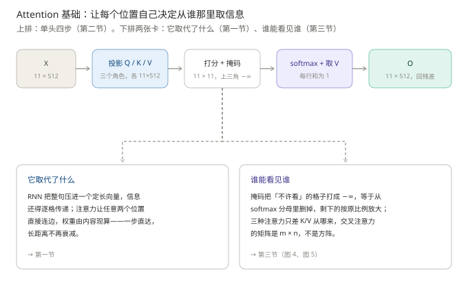
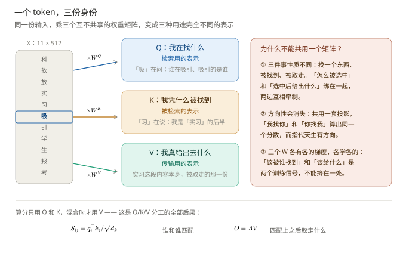
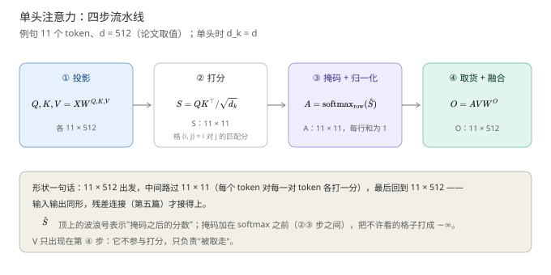
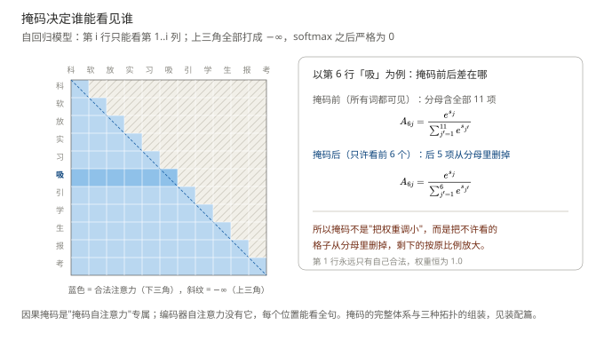
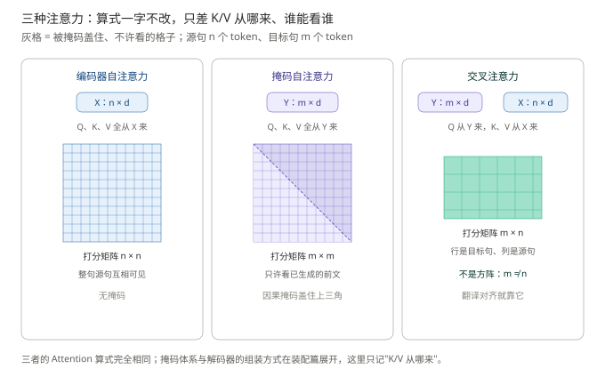

# Attention 基础：让每个位置自己决定从谁那里取信息

> **一句话结论**：Attention（注意力）把"位置之间怎么通信"从**固定的顺序传递**改成**按内容动态连边**——每个位置用自己学出来的 Q 去和全句的 K 比匹配度，再按匹配度把各处的 V 加权取一份；softmax 让"选谁"从不可导的挑选变成可导的加权平均，掩码让"谁能看谁"变成一行配置。
>
> - 注意力取代 RNN 的根本原因：RNN 的信息只能沿位置逐格传递、整句要压进一个定长向量；注意力让任意两个位置**直接连边**，边的权重由内容现算——长距离依赖不再衰减，信息通道不再有瓶颈
> - 三个投影把"匹配标准"从写死的度量（像不像）变成学出来的双线性型 $W^QW^{K\top}$；匹配（Q、K）与交付（V）分开，是因为"凭什么被选中"和"被选中后给什么"本就是两件事
> - softmax 是"选谁"从不可导的 argmax 变成可导加权平均的那一步，注意力能端到端训练全系于它；$\div\sqrt{d_k}$ 则是防止这份可导性被自己的饱和吃掉

**前置**：输入向量从哪来见[《嵌入层》](../嵌入层/嵌入层.md)；RoPE 为什么要装进每层注意力的 Q、K，见[《旋转位置编码RoPE》](../旋转位置编码RoPE/旋转位置编码RoPE.md)。单头讲完，一个头够不够、这套机制的账单怎么付，见[《Attention 进阶：多头、KV cache 与 FlashAttention》](../注意力机制进阶/注意力机制进阶.md)。

**图 1**：本篇地图。看图要点：上排是单头注意力的四步流水线（第二节）；下排两张卡对应两个前置问题——它取代了什么（第一节）、谁能看见谁（第三节）。

例句沿用全系列基线：`科软 放 实习 吸引 学生 报考`，11 个 token（逐字切分基线；真实 tokenizer 会浮动到 6–16 个），形状账统一按 $L = 11$、$d = 512$ 算。

## 一、注意力为什么会出现：两个卡死的旧方案

> 本节要回答的问题：在注意力之前，序列里两个位置的信息是怎么到达彼此的？卡在哪？

### 1.1 旧方案卡在哪

2014 年的主流是 RNN 编码器-解码器：编码器从左到右读完整句源句，把**整句话压成一个定长向量**，解码器只拿着这一个向量生成目标句。两个卡点都是结构性的：

- **定长瓶颈**。源句 5 个词还是 50 个词，全压进同一个 512 维向量——句子越长，每份信息摊得越薄；翻译长句时，解码器拿不到开头的主语。
- **逐格传递**。位置 $i$ 的信息要想到达位置 $i+5$，必须一步一步传过去；传得越远，早期信息被冲淡得越厉害（梯度同理）。"第 1 个词和第 11 个词的关系"要经过 10 次有损转手。

Bahdanau et al.（2015）的解法很直接：**别压缩了，让解码器每生成一个词，回头把编码器所有位置看一遍、按需要取**。"按需要"由一个打分函数决定——这就是 attention 的诞生。2017 年的 Transformer 再往前一步：连 RNN 也扔掉，把"回头查"变成位置之间**唯一**的通信方式。

> **精髓句**：注意力把位置间通信从"固定顺序传递 + 定长压缩"改成"按内容动态连边"——任意两个位置一步直达，边的权重由数据现算。这是它取代 RNN 的根本原因，不是"并行好训练"这种工程理由。

### 1.2 嵌入给了向量，但没给关系

嵌入表给每个 token 一份向量，但**向量各管各的**：「吸」的向量装着自己的特征，"它和「实习」「学生」是什么关系"这件事不在任何一个向量里。而语言恰恰由关系驱动——预测「报考」，必须知道前面是"实习吸引学生"这组主宾结构。注意力补的就是这一块：**每个位置主动去别的位置取相关信息**。

取多少不能均匀、不能按距离，该由**内容**决定。于是问题拆成两步：怎么判断"该多看谁"（打分），判断完怎么取（加权平均）。

还有一个前提要说破：**注意力对顺序完全无感**。把 11 个 token 打乱，$Q$、$K$ 只是跟着换行，打分矩阵行列同时重排，输出只换行序、内容不变——所以顺序必须由位置编码额外注入（第 2 篇），本篇全部机制都建立在"位置已注入"的输入之上。

## 二、单头的机制：Q 问、K 答、V 给

> 本节要回答的问题：一次"按内容取信息"具体怎么算？哪一步是设计的关键？

### 2.1 三个投影：把"匹配"从固定度量里解放出来

判断"该多看谁"，需要每个 token 有两种身份：作为**询问者**表达"我在找什么"，作为**被查者**表达"我凭什么被找到"；取货时还要第三种——"匹配上了，实际给什么"。三个投影对应三件事（Vaswani et al., 2017 原符号），对输入 $X \in \mathbb{R}^{11\times512}$：

$$
Q = XW^Q,\qquad K = XW^K,\qquad V = XW^V
$$

- $W^Q, W^K, W^V \in \mathbb{R}^{512\times512}$：三个可学习投影，单头时各是方阵
- $Q, K, V \in \mathbb{R}^{11\times512}$：每个 token 各有三份 512 维表示

**图 2**：Q、K、V 三个角色与"为什么不能共用一个投影"。看图要点：三个 $W$ 形状相同、参数互不共享、各学各的；算分只用 Q 和 K。

**为什么不能直接用词向量算内积、非要学三个投影？** 用 $x_i^\top x_j$ 打分，模型只有一种固定度量——"这两个词**像不像**"。「吸」该多看「实习」，靠的不是像，是"它是我的前半"这种**关系**；这种关系在不同层、不同任务里标准还不一样。$W^Q W^{K\top}$ 是一对可学习的矩阵，乘起来是一个**可学的双线性型**：模型可以学出"在什么子空间里量、怎么量"——同一对 token，这一层量句法、下一层量指代，度量可以完全不同。**这就是精髓：匹配标准从写死的变成了学出来的。**

**为什么匹配和给货要分开？** "我凭什么被选中"和"我被选中后给什么"是两件事：句法上决定谁看谁的特征，未必是想传递的内容。绑在一个向量里互相牵制；分开后 $V$ 可以给完全不同的东西——被用 $K$ 表达"我是依存关系的宾语"，被选中后用 $V$ 递出我的语义内容。

### 2.2 四步流水线：形状从 11×512 回到 11×512

**图 3**：单头注意力的四步流水线与形状变化。看图要点：中间那张 $11\times11$ 的打分矩阵是全篇主角，本节之后的所有机制（掩码、多头、KV cache）都围绕它展开。

$$
S = \frac{QK^\top}{\sqrt{d_k}},\qquad
A = \operatorname{softmax}_{\text{row}}(\tilde S),\qquad
O = AVW^O
$$

- $S \in \mathbb{R}^{11\times11}$：打分矩阵，第 $(i, j)$ 格是"位置 $i$ 对位置 $j$ 的匹配分"，由 $q_i \cdot k_j$ 除以 $\sqrt{d_k}$ 得来（除法的作用见 2.4）
- $\tilde S$：掩码之后的分数——把"不许看"的格子打成 $-\infty$，机制在第三节
- $\operatorname{softmax}_{\text{row}}$：**逐行**做 softmax，每行内部归一化、行和严格为 1；$A$ 的每一行就是位置 $i$ 的"取货比例"
- $O = AVW^O$：先按比例混合各处的 $V$（$AV \in \mathbb{R}^{11\times512}$），再乘输出投影 $W^O \in \mathbb{R}^{512\times512}$（它的真正作用在进阶篇第一节揭晓）

形状一句话：$11\times512$ 出发，路过 $11\times11$，回到 $11\times512$。**输入输出同形不是巧合而是要求**——残差连接（第五篇）要把注意力的输出原位加回输入，形状不同就加不上。

**四步里真正的设计关键在 softmax。**"该看谁"本质上是个选择问题，最自然写法是 argmax——但 argmax 的导数是 0：选错了不知道该怪谁，选对了也不知道第二名差多少，**没有梯度就没有学习**。softmax 把硬选择换成软选择：每个候选都拿到一份连续的权重，权重对分数可导，梯度能顺着每一条边流回打分函数——**模型由此第一次能"学习该看谁"**。注意力的可训练性，就是这一步换来的。

### 2.3 手算一个能验算的最小例子

> 本小节可跳过；但数字小到计算器可验，强烈建议算一遍。

真实模型 $d=512$ 手算不动，这里缩到 2 个 token、$d=2$（记号不变，只是 $n=2$、$d_k=2$）：

$$
X = \begin{pmatrix} 1 & 0 \\ 0 & 1 \end{pmatrix},\quad
W^Q = \begin{pmatrix} 1 & 1 \\ 0 & 1 \end{pmatrix},\quad
W^K = \begin{pmatrix} 1 & 0 \\ 1 & 1 \end{pmatrix},\quad
W^V = \begin{pmatrix} 1 & 2 \\ 3 & 4 \end{pmatrix}
$$

**第一步** $Q = XW^Q = \begin{pmatrix} 1 & 1 \\ 0 & 1 \end{pmatrix}$，$K = XW^K = \begin{pmatrix} 1 & 0 \\ 1 & 1 \end{pmatrix}$，$V = XW^V = \begin{pmatrix} 1 & 2 \\ 3 & 4 \end{pmatrix}$。

**第二步** $QK^\top$：第一行 $[1,\ 2]$，第二行 $[0,\ 1]$，即 $S_0 = \begin{pmatrix} 1 & 2 \\ 0 & 1 \end{pmatrix}$。

**第三步** 加掩码、除 $\sqrt{2}\approx1.414$：第 1 个 token 只能看自己，右上的格子打成 $-\infty$，得 $\tilde S = \begin{pmatrix} 0.707 & -\infty \\ 0 & 0.707 \end{pmatrix}$。

**第四步** 逐行 softmax：第一行只剩一个合法格子，权重 $[1.0,\ 0.0]$；第二行 $e^0=1$、$e^{0.707}=2.028$，归一化得 $[0.330,\ 0.670]$。

**第五步** 取货：$O_1 = (1.00, 2.00)$；$O_2 = 0.330\times(1,2) + 0.670\times(3,4) = (2.34,\ 3.34)$。

读出两个事实：第 2 个 token 的输出**约 1/3 来自别人、2/3 来自自己**——注意力就是一次按权重混合；第 1 个 token 的输出完全是它自己——因果掩码下它无处可看（这个"孤独"有个真实后果，见第三节的 attention sink）。顺带验证掩码的必要性：不掩码的话第一行变成 $\operatorname{softmax}([0.707, 1.414]) = [0.33,\ 0.67]$，第 1 个 token 会去"抄"第 2 个——而它正是训练目标的一部分，**这等于偷看答案**。

### 2.4 为什么除以 $\sqrt{d_k}$：让尖锐程度与维度无关

设 $q$、$k$ 的各分量独立、均值 0、方差 1，则 $q\cdot k$ 的方差是 $d_k$——维度越宽，分数越容易拉开到 $\pm30$ 的量级，softmax 一压就**饱和**：最大的格子吃掉几乎全部权重，分布退化成 one-hot。饱和的后果在梯度里：softmax 的梯度含因子 $p(1-p)$，$p\to1$ 时梯度 $\to0$，被冷落的位置永远学不到东西——**刚刚靠 softmax 换来的"能学"，又被自己的饱和吃掉了**。

把账算实（一行 6 个候选、最强匹配高 1.9 个标准差，其余为 0）：

| $d_k$ | 不除 $\sqrt{d_k}$：最大权重 | 除以 $\sqrt{d_k}$ 后 |
| ----- | -------------------- | ----------------- |
| 2     | 0.75                 | 0.57              |
| 8     | 0.98                 | 0.57              |
| 64    | 1.0000               | 0.57              |

$\sqrt{d_k}$ 的本意不是让权重变小，是**让注意力的"尖锐程度"与 $d_k$ 无关**——头再宽，分布的软硬都停在同一个水平，梯度也都还活着。这就是公式名叫 scaled dot-product（缩放点积）而不是 dot-product 的原因。

## 三、谁能看见谁：掩码决定信息流向

> 本节要回答的问题："这个位置不许看那个位置"是怎么实现的？为什么要限制？

### 3.1 因果掩码：从分母里删掉格子

自回归模型（GPT 一族）的规则是：**第 $i$ 个位置只能看第 $1..i$ 个**。规则写在 softmax 之前——把 $j > i$ 的格子全部改成 $-\infty$，softmax 里 $e^{-\infty} = 0$，这些格子彻底出局：

**图 4**：因果掩码与它的真实作用。看图要点：蓝色下三角是合法注意力；右卡两个分式的分母不同——掩码改变的不是某几个权重，而是**归一化的范围**。

最容易误解的一点：**掩码不是"把后面的权重调小"，而是把它们从分母里删掉，剩下的按原比例放大**。用第 6 行「吸」看数字（演示值）：设不掩码时它对前 6 个位置的比例合计 0.70、对全部 11 个位置合计 1.00；掩码后分母只剩前 6 项，「科」从 $0.28$ 变成 $0.28/0.70 = 0.40$，其余同理——**相对偏好一点没变，变的是分母**。

为什么要限制？任务设定是"预测下一个词"：位置 $i$ 的训练目标就是第 $i+1$ 个 token，若能看到它，任务退化为抄写。掩码把这条作弊通道在每个位置同时封死。

> **精髓句**：掩码只动一个加法（往打分矩阵上加 $-\infty$），就让"信息流向"成了可配置项——同一个注意力算子，配上不同 mask 就是编码器（全可见）、解码器（只看过去）、前缀模型（看一段前缀）。三种拓扑共用一份实现，靠的就是它。

> **进阶（可跳过）**：第一个 token 在因果掩码下永远只能看自己，权重恒为 1.0——它是最"孤独"的位置。这催生一个真实现象 **attention sink**：模型需要一个"垃圾桶"存放"这一步谁都不该看"时多出来的概率，而第一个 token 对所有位置都可见，天然成了垃圾桶——于是句首 token 常吸走一大片注意力，哪怕它语义上什么都不是。这不是 bug：删掉它模型会崩。看注意力热力图时，别被"句号权重为什么这么高"骗了。

### 3.2 三种注意力：算式一字不改，只差 K/V 从哪来

**图 5**：三种注意力的 K/V 来源与打分矩阵形状。看图要点：灰色格是被掩码盖住的格子；交叉注意力的打分矩阵是 $m\times n$ 长方形，不是方阵。

| 种类      | Q 从哪来    | K、V 从哪来 | 打分矩阵              | 典型位置     |
| ------- | -------- | ------- | ----------------- | -------- |
| 编码器自注意力 | $X$（源句）  | $X$     | $n\times n$，无掩码   | 编码器每层    |
| 掩码自注意力  | $Y$（目标句） | $Y$     | $m\times m$，上三角被盖 | 解码器第一个子层 |
| 交叉注意力   | $Y$（目标句） | $X$（源句） | $m\times n$       | 解码器第二个子层 |

**交叉注意力是 1.1 那个"定长瓶颈"的最终答案。**解码器要读源句，RNN 时代的接口是把编码器压成一个向量；交叉注意力把接口换成了**整张 $m\times n$ 打分矩阵**——目标句的每个位置自己去源句里找该看的地方，两个**变长**序列直接对齐，中间不再有任何压缩。翻译的"对齐"就发生在这张非方阵矩阵上。掩码体系的完整规则与三种拓扑怎么组装，留给装配篇；这里只记住"K/V 从哪来"这一个问题。

## 四、小结

| 机制 | 缺了会怎样 | 精髓一句话 | 代价 |
| --- | --- | --- | --- |
| Q/K/V 三投影 | 匹配标准写死，只能量"像不像" | 匹配标准是学出来的双线性型，匹配与给货分离 | 三份参数，各学各的 |
| softmax | argmax 无梯度，"该看谁"学不了 | 硬选择换成可导的软选择，注意力才能端到端训练 | 无 |
| $\div\sqrt{d_k}$ | $d_k$ 大时 softmax 饱和、梯度消失 | 尖锐程度与维度无关 | 无 |
| 因果掩码 | 训练时偷看答案；三拓扑要三套实现 | 一个加法让信息流向可配置 | 句首位置"孤独"（attention sink） |
| 三种注意力（K/V 来源） | 变长对变长仍要过定长瓶颈 | 两个序列直接对齐，接口从定长向量换成整张 $m\times n$ 矩阵 | 交叉注意力是非方阵 |

如果只记三句话：**注意力把位置间通信改成按内容动态连边，这是它取代 RNN 的结构原因，不是"并行快"**；**softmax 让"该看谁"变得可学，$\sqrt{d_k}$ 让这份可学性不被饱和吃掉**；**掩码不调权重，它改的是归一化的范围**。别把比喻当机制：$QK^\top$ 是学出来的双线性型而不是语义相似度，掩码不是把权重调小。

## 五、面试向易错点

| 面试考点 | 常见答错 | 正确答法 | 面试官在考什么 |
| --- | --- | --- | --- |
| 为什么需要注意力，RNN 不行吗？ | "RNN 不能并行，训练慢" | 结构原因是两条：信息逐格传递长距离衰减、整句压进定长向量；并行只是附带的工程收益 | 能否区分结构缺陷与工程缺点 |
| 注意力为什么用 softmax 不用 argmax？ | "归一化一下而已" | argmax 无梯度、无法学习；softmax 是可导的软选择，梯度能流回打分函数 | 是否理解"能训练"从哪来 |
| 为什么三个矩阵不能共用？ | "为了多几份参数" | 三件事性质不同（找/被找/给）；且共用会让打分对称，表达不了有向关系；$W^QW^{K\top}$ 还让匹配标准可学 | 是否理解 QKV 分工的因果 |
| 注意力矩阵是对称的吗？ | "相似度当然对称" | **不对称**：$A_{ij}$ 是"我关注你"、$A_{ji}$ 是"你关注我"，行 softmax 之后是两个数 | 是否亲手算过 $A$ |
| $QK^\top$ 是语义相似度吗？ | "就是算两个词像不像" | 是学出来的双线性型，可能学到语法依存或共现，不保证符合人类语义 | 是否混淆"内积"与"余弦" |
| 掩码怎么起作用？ | "把后面的权重乘 0 调小" | softmax **之前**把格子打成 $-\infty$，等价于从分母里删掉、剩下的按原比例放大 | 是否理解归一化范围的变化 |
| 交叉注意力的打分矩阵什么形状？ | "也是 $n\times n$ 方阵" | $m\times n$ 长方形：行是目标句、列是源句，翻译对齐就发生在非方阵上 | 形状感与数据流意识 |
| 注意力能感知顺序吗？ | "能，它知道谁在前" | **不能**：打乱 token 只是行列同时重排，输出只换行序；顺序必须由位置编码额外注入 | 是否分得清"机制"与"注入的信息" |

## 六、引用论文

1. Vaswani et al. *Attention Is All You Need*. NeurIPS 2017. arXiv:1706.03762.（缩放点积、QKV、$W^O$、$d_k = 64$、三种注意力的原始出处）
2. Bahdanau, Cho, Bengio. *Neural Machine Translation by Jointly Learning to Align and Translate*. ICLR 2015. arXiv:1409.0473.（注意力的诞生：打破定长向量瓶颈）
3. Xiao et al. *Efficient Streaming Language Models with Attention Sinks*. ICLR 2024. arXiv:2309.17453.（attention sink 现象与 StreamingLLM）

---

**下一篇**：[《Attention 进阶：多头、KV cache 与 FlashAttention》](../注意力机制进阶/注意力机制进阶.md)——一个 softmax 为什么不够用、$h$ 个头凭什么不多花参数，以及推理与训练两张账单怎么付。
