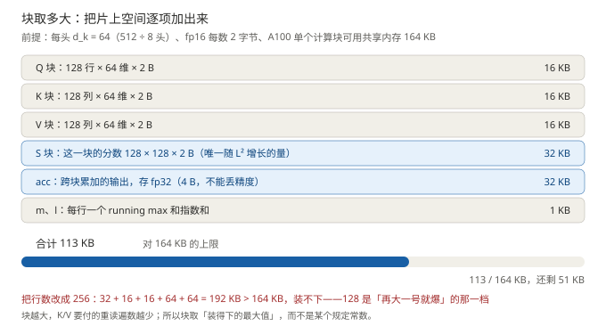
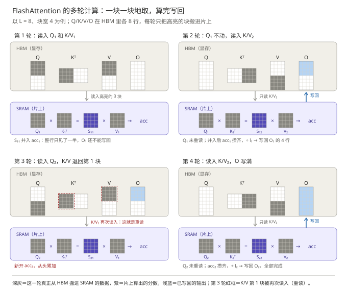
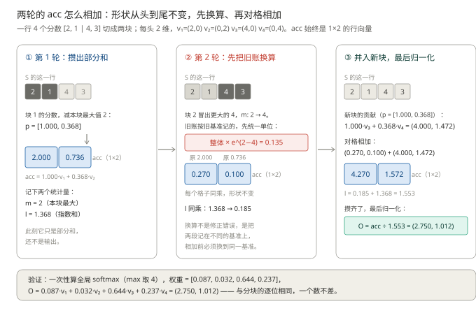
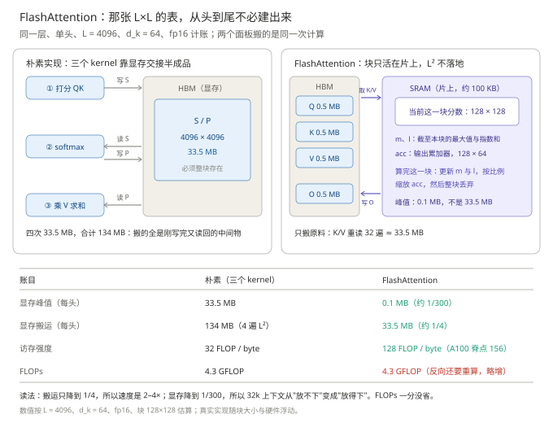
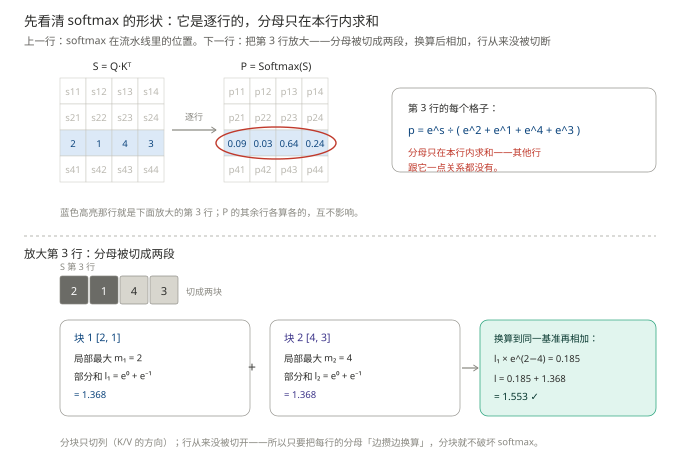
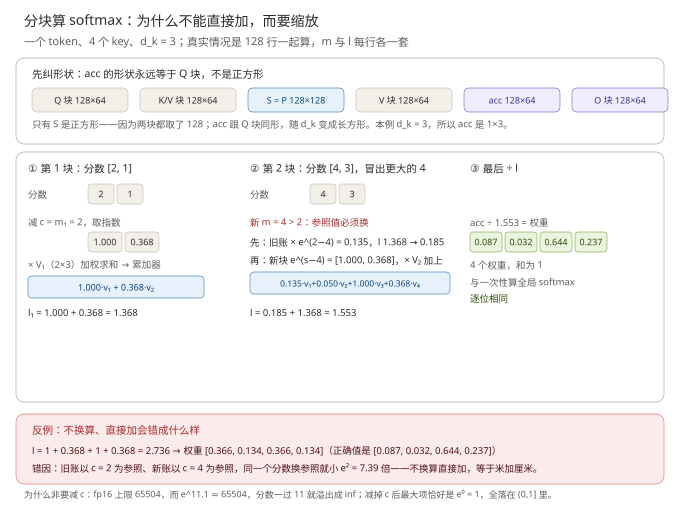

# Attention 进阶：多头、KV cache 与 FlashAttention

> **一句话结论**：单头已经把"按内容取信息"做成了，但它只能表达**一种**权衡——多头把同一份参数沿列切成 $h$ 条，换来 $h$ 份互不竞争的 softmax 预算；而机制一旦真的要用，两张账单立刻出现：推理端是 KV cache（$2NLhd_kB$），训练端是 $L\times L$ 的打分矩阵。
>
> - 多头**不多花参数**：$h$ 套投影是把一张 $d\times d$ 沿列切成 $h$ 条（$h\cdot d\cdot d_k = d^2$，与单头分毫不差），多出来的是 $h$ 个 softmax 分母——$h$ 份独立预算。论文 Table 3 参数不动，24.9 → 25.8 BLEU
> - KV cache 只存 K/V：因果掩码保证它们算过就不变，每步变动的只有 Q。代价是显存随 $L$ 线性长，70B 模型 4k 上下文 MHA 要 10.7 GB
> - 两条省钱路：**GQA** 把 KV 组数压到 $g$（10.7 → 1.34 GB，省的是带宽不是参数）；**FlashAttention** 不建那张 $L^2$ 表、块留在片上、分母靠 online softmax 边攒边重标定——精确等价，搬运量降到 $1/4$、显存峰值降到 $1/300$。滑窗走的是另一条：真近似

**前置**：单头的完整算式（Q/K/V 三投影、softmax、$\div\sqrt{d_k}$、掩码、三种 K/V 来源）见[《Attention 基础：让每个位置自己决定从谁那里取信息》](../注意力机制基础/注意力机制基础.md)，本篇一字不重复，直接从"一个头不够"讲起。

**图 1**：本篇地图。看图要点：上排是能力（多头：一份参数切出 $h$ 份预算）；下排是两张账单——推理端先 KV cache 再 GQA（省带宽），训练端先 FlashAttention 再滑窗（先省带宽，再砍范围）。

例句沿用全系列基线：`科软 放 实习 吸引 学生 报考`，11 个 token，形状账按 $L = 11$、$d = 512$ 算；算真实模型时改用 $L = 4096$、70B 配置。

## 承上：把注意力放回一层里

单头的算式到基础篇结束时就完整了：$11\times512$ 进，$11\times512$ 出。但它只是**一层里的一个子层**，要问"一个头够不够"，先得看清这个子层在什么位置上——只立三个坐标，细节分别在《前馈网络》《残差与归一化》与装配篇展开。

**其一，残差**：$O$ 与输入同形，一层走的是 $x + \text{MHA}(\cdot)$ 的加法。残差的意义不止"不覆盖原文"：它让每个子层的**默认行为是恒等映射**——训练初期注意力还没学会任何东西时，信号原样通过，"加一层"的最坏情况是不变差；深网络才堆得起来。**其二，归一化**：现代模型（pre-LN）在注意力**之前**做 LayerNorm，把进入注意力的向量拉回稳定尺度；2017 原论文放在之后（post-LN），深了要靠 warmup 硬扛。**其三，FFN**：注意力之后每个 token 独立过一遍前馈网络——**注意力负责"跨位置取信息"，FFN 负责"取回来之后自己消化"**，两者交替才构成完整的一层：一个管通信，一个管加工。

多层堆叠还有一个单向模型特有的推论：第 1 层位置 $i$ 只能看 $1..i$；到第 2 层，位置 $i$ 已经混入了更早位置的信息，别人看它就等于**间接**看到那些信息——每多一层，信息多传一跳。所以"第 1 个 token 的信息怎么传给最后一个"不靠单层注意力，靠层数。

**位置清楚了，问题就回到子层内部：这一个子层里，一个 softmax 够用吗？** 接下来四节按"能力从哪来、账单怎么付"的顺序走——多头（能力）、KV cache（推理账单）、GQA（把 cache 压下去）、FlashAttention 与滑窗（把 $L^2$ 的账压下去）。

## 一、多头：让多个互不竞争的 softmax 各管一种关系

> 本节要回答的问题：一对 token 之间只打一个分，够用吗？不够的话，多开几个头为什么就能解决？

### 1.1 单头的两个天花板

「吸」和「习」之间同时存在好几种关系：构词上"吸引"是一个词、句法上"实习"是施动者、语义上这是"吸引学生"这个动作的一部分。单头表达不了它们，卡点有两个，都是**结构性的**，与参数多少无关：

- **一个 softmax 是竞争性的**。权重和恒为 1：一种关系多占一分，其余关系就得让。模型想同时盯住"构词"和"句法"，单头只能取折中——两边的打分都被稀释，哪边都不尖锐。
- **一对 token 只有一个分**。$q_i \cdot k_j$ 再怎么学，也只是一个数；"因为构词该看"和"因为句法该看"如果方向相反，一个数无从同时表达。

### 1.2 多头的做法

$$
\text{head}_i = \text{Attention}(QW_i^Q,\ KW_i^K,\ VW_i^V),\qquad
\text{MultiHead}(Q,K,V) = \text{Concat}(\text{head}_1,\dots,\text{head}_h)\,W^O
$$

- $W_i^Q, W_i^K, W_i^V \in \mathbb{R}^{d\times d_k}$：第 $i$ 个头自己的三个投影，把 $d$ 维投到 $d_k$
- $h$：头的个数，$d_k$ 通常取 $d/h$，这样 $h$ 个头的总宽度正好等于 $d$
- $W^O \in \mathbb{R}^{hd_k\times d}$：输出投影，把 $h$ 份独立结论重新融合

**下面这组具体数字按论文 base 配置**：$d = 512$、$h = 8$、$d_k = 64$（现代模型常见 $h = 32/64$、每头 $d_k = 128$）。于是每个 $W_i^{Q}$ 是 $512\times64$，Concat 把 8 份 $11\times64$ 拼回 $11\times512$。

**图 2**：多头的拆分与拼接。看图要点：每个头内部与单头完全同构；全部差别发生在 Concat 与 $W^O$；行 = 位置 $i$、列 = 维度 $j$ 的约定不变。

### 1.3 为什么 $h$ 套投影不多花参数：是"切"，不是"复制"

**先把数量算清。** 单头的一张 $W^Q$ 是 $512\times512$，$262144$ 个数。多头的一头 $W_i^Q$ 是 $512\times64$，$32768$ 个数；8 头合计 $8\times32768=262144$，与单头那张分毫不差。

这不是巧合，是 $d_k=d/h$ 的必然：$h\times(d\times d_k)=d\times(h\,d_k)=d\times d$。**多头不是"多长出 7 张表"，而是把原来那张 $512\times512$ 沿列切成 8 条**，每条 $512\times64$ 交给一个头——图 2 里从 X 分出去的那一摞，就是从同一张表上切下来的条。

多头属于**划分**：$h$ 个头各学各的，谁也不约束谁，只是它们加起来正好占满单头那张表的容量。**"参数总量不变"不等于"没有区别"，更不等于"退化回单头"**——这一条是后面整个精髓论证的地基。

**代价也是真的**：每头只分到 $d_k=d/h$ 那么宽（论文配置下 64 维，单头是 512 维）。所以头数不能无限加——论文 Table 3 里把 $h$ 加到 32、每头只剩 16 维时，效果反而回落。

> **注意这个前提**："不多花参数"依赖 $d_k=d/h$ 这个约定。若有人取每头 $d_k=d$（每头都不降维），参数就真变成 $h$ 倍——那是另一种设计，不是这里讨论的多头。

### 1.4 精髓：多出来的是 $h$ 个分母，不是 $h$ 倍参数

每个头有自己的 $W_i^Q W_i^{K\top}$——**$h$ 个不同的双线性型，等于 $h$ 把不同的"量关系"的尺子**；每头有自己的 softmax——**$h$ 个互不竞争的归一化**，一种关系占满权重也不影响另一种。

**为什么"参数一样"不等于"白改"？** 因为改的是**计算图**，不是数字。同一批 $262144$ 个数，单头的约束是"每个位置只有一份概率分布，它得同时服务全部 512 个输出维"；多头把约束放宽成"每个位置有 $h$ 份分布，各服务 $d_k$ 个维"。落到算子上，差别只有一处——**同一行的归一化有几份**：

$$
\sum_{j} \exp\left(s^{(m)}_{ij}\right)=1,\qquad m=1,\dots,h
$$

$s^{(m)}_{ij}$ 是第 $m$ 个头给位置对 $(i,j)$ 打的分；$m$ 只取 $1$ 就是单头。权重和仍然都是 $1$，但**现在每个头各自归到 $1$**。

"互不竞争"的确切含义就在这里。单头里"把 $0.9$ 的权重给实习"和"把 $0.9$ 的权重给学生"不可能同时成立——权重和恒为 $1$，$0.9+0.9>1$，两者只能互相抢；多头里这两件事发生在两份独立预算里，各自都能满到 $0.9$。**所以多头多出来的从来不是参数，是 $h$ 份互不相干的归一化预算。**

原论文的实证正是冲着这一点设计的（Vaswani et al., 2017 Table 3）：层数、宽度、训练数据全都不动，只换"一个位置有几份预算、每份管多少维"——单头 24.9 BLEU，多头 25.8 BLEU。**参数一分没多，涨的 0.9 只能归给计算结构。**

这些关系不是设计者指定的，是训练自己长出来的。可视化研究（Voita et al., 2019）在训练好的模型里找到了稳定的专化头：有盯**前一个词**的位置头、有追踪**句法依存**的头、有处理**稀有词**的头，还有基础篇第三节说的 sink 头：

**图 3**：多头分工长什么样（示意图，模式取自真实可视化里常见的专化头类型）。看图要点：六个面板没有任何两个相同——同一张 $11\times11$ 矩阵，每个头填进一种不同的模式，这就是"多头多出来的能力"看得见的样子。

**为什么必须拼接、不能相加？** 设把 $h$ 个头的结果按元素相加成一个 $11\times64$：一是**坐标混叠**——同一维上头 $a$ 的 0.8 和头 $b$ 的 −0.6 加成 0.2，"这是谁说的"从此无从分辨，$W^O$ 想区别对待也找不到对象；二是 $h$ 份结论被硬塞进 64 维，每头投影时丢掉的维度信息回不来。拼接把 $h$ 份结论各占 $d_k$ 维地排好，"哪个头说的"成为可辨识的位置块；$W^O$ 的每个行块因此可以学到"重点听某个头的"——**分工由 $h$ 个独立 softmax 实现，融合由 $W^O$ 学出来，两步都不能省**（钉成一叠纪要保留页码，揉成一团就分不出谁写的 ≈ 类比，边界在"拼接只是摆放，融合仍靠 $W^O$"）。

**参数账**：每头 3 个投影各 $d\times d_k$，$h$ 头合计 $h \times 3 \times d \times d_k = 3d^2$（因为 $h\,d_k = d$），与单头三个 $d\times d$ 完全相等；代入论文配置就是 $8\times3\times512\times64 = 3\times512^2$。$W^O$ 单头同样要有。合计 $4d^2$——所以上面 0.9 BLEU 的提升才能干净地归因于结构。算力也是同账：$h\times L^2 d_k = L^2 d$，与单头一样。真正变多的只有打分矩阵的显存（$h$ 张 $L\times L$），这正是第四节 FlashAttention 要处理的那块。

> **进阶（可跳过）**：换一个角度看表达力。$W^Q W^{K\top}$ 的秩最多 $d_k$；单头只有一把秩-$d_k$ 的尺子，多头把 $h$ 把**不同的**秩-$d_k$ 尺子并联，$h$ 个子空间合起来覆盖的关系种类，远多于一把 $d$ 维的尺子能同时表达的。另外 $h$ 与 $d_k$ 的取舍有下限：$d_k$ 太小则每头表达不足；且专化头只是可视化里**能找到**的模式，不可解释的头同样大量存在，分工是训练的涌现结果，不是保证。

## 二、KV cache：推理时到底缓存什么

> 本节要回答的问题：生成第 $t$ 个词时，前面 $t-1$ 个位置的 K、V 真的要重算吗？

**先立一个错误直觉：推理就是每步把整句重新算一遍。**按这个直觉，生成 1000 个词要算 $1 + 2 + \dots + 1000$ 次投影，长上下文根本不可用。真实的浪费比这更具体：**前 $t-1$ 个位置的 K 和 V，在第 $t$ 步一个数都没变，却被重算了一遍**。

为什么没变？因果掩码保证位置 $i$ 的 K、V 只由 $x_1, \dots, x_i$ 决定，与后来者无关。生成第 $t$ 个词时，唯一的新东西是 $Q_t$：它问"我现在要找什么"，天然每步都是新的；K、V 是"被查的字典"，一旦写好就不改。**精髓在于先分清"什么变了、什么没变"：变的只有 Q，于是只算 Q；不变的是 K/V，于是只存一次**——这一条判断把推理从"每步重算"变成"每步增量"，是整个推理加速体系的第一块基石。

$$
\text{KV cache} = 2 \cdot N \cdot L \cdot h \cdot d_k \cdot B
$$

| 符号    | 含义          | 例句 / 70B 模型的取值           |
| ----- | ----------- | ------------------------ |
| 2     | K 和 V 各存一份  | —                        |
| $N$   | 层数          | 论文 $N = 6$（演示值）；70B 是 80 |
| $L$   | 已生成的长度      | 11 → 4096                |
| $h$   | Q 头数（MHA 时） | 8 → 64                   |
| $d_k$ | 每头维度        | 64 → 128                 |
| $B$   | 每个数字的字节数    | fp16 取 2                 |

代算例句：$2 \times 6 \times 11 \times 8 \times 64 \times 2 = 135{,}168$ 字节 $\approx 132$ KB（$N = 6$ 是论文演示值）。代算 70B：$2 \times 80 \times 64 \times 128 \times 2 \approx 2.62$ MB/token——每生成一个词，cache 就长 2.62 MB；4k 上下文累计 10.7 GB。

**图 4**：KV cache 随长度线性增长。看图要点：两条线都是直线，GQA 与 MHA 的差别只在斜率，不在形状。

cache 的账还揭示了一件硬件层面的事：decode 阶段每生成一个词都要把整份 cache 从显存读一遍，**读的字节数远超算术量**——decode 是 **memory-bound（访存受限）**的，算力反而闲置。这就是"cache 大"为什么致命：它同时吃显存容量和每步的读取带宽——**下一节的 GQA 与再下一节的 FlashAttention，各自从这两头下手**。

## 三、GQA / MQA：把 KV 组数减下来

> 本节要回答的问题：cache 要 10.7 GB，从哪个变量下手最划算？

公式里 $N$、$L$、$d_k$ 由模型能力决定，$B$ 由精度决定，唯一松动的是 $h$。MQA（Shazeer, 2019）的洞察先看清了一个事实：**"被查的字典"不需要每个 Q 头一本专属**。所有 Q 头共享同一组 K/V，cache 直接缩到 $1/h$；代价是 $h$ 个头挤一本字典，质量损失明显。GQA（Ainslie et al., 2023）折中：$h$ 个 Q 头分成 $g$ 组、每组共享一套 K/V；$g = h$ 退回 MHA，$g = 1$ 退回 MQA。LLaMA-2 70B 取 64 个 Q 头、8 组 KV。

**为什么共享 KV 掉点不大？** 回到第一节的分工图：多头学出来的专化，大头在**提问方式**上——头 1 问"前一个词是谁"、头 5 问"「实习」在哪"，这些差异体现在 $W^Q$ 里；而 $K$、$V$ 提供的是**同一份可检索的内容**——"前一个词"也好"「实习」"也好，谁的字典里都是那 11 个 token 的信息。**分工主要长在 Q 侧，字典可以共用**，这是共享不掉点的结构原因；组数切得太少（MQA 的 $g=1$）才会伤到 K/V 侧本来就存在的多样性。

**图 5**：MHA / MQA / GQA 的 KV 共享方式。看图要点：连线表示这个 Q 头用哪组 KV；cache 大小与 KV 组数严格成正比。

**关键辨析：GQA 省的是 cache，不是参数。**KV 投影参数从 $h \cdot 2 \cdot d \cdot d_k$ 降到 $g \cdot 2 \cdot d \cdot d_k$，在几十亿参数里只占一小角；而 cache 从 10.7 GB 缩到 1.34 GB（$1/8$）是实打实的 8 倍，省下的显存用来放更大的 batch 和更长的上下文。工程上还有一条便宜的迁移路径：训好的 MHA 检查点做少量"上训练"（uptraining，原论文约 5% 训练量）即可转成 GQA——这是它迅速普及的原因。更进一步的 MLA（DeepSeek-V2）把 KV 压缩进低秩潜在向量，只提名字。

## 四、复杂度与 FlashAttention、滑窗：$L^2$ 的账怎么省

> 本节要回答的问题：cache 之外，注意力本身 $L^2$ 的计算怎么省？

### 4.1 账有多重

打分矩阵是 $L\times L$ 的，训练时**时间 $O(L^2 d)$、显存 $O(L^2 h)$**。给个实数：$L = 8192$、$h = 32$、fp16 存，单层单条序列的注意力矩阵是 $8192 \times 8192 \times 32 \times 2$ 字节 $\approx 4.0$ GB——一层 4 个 G、80 层就是 320 G，根本放不下。长上下文在 2022 年后才可行，转折点是 FlashAttention（Dao et al., 2022）。

### 4.2 块取多大：128 这个数是怎么算出来的

FlashAttention 的好处全都建立在"块能留在片上"这一件事上，所以第一个要定的量是**块有多大**：Q 块的行数 $B_q$、K/V 块的列数 $B_k$。它俩不是论文规定的常数，而是**用片上容量反推出来的**。

算这笔账先立三个前提：每头维度 $d_k = 64$（base 配置 $d_{\text{model}}=512$ 除以 8 个头）、数值按 fp16 存（每数 2 字节）、A100 上一个计算块最多能申请 164 KB 共享内存。然后逐项列出"一块算完之前必须同时活着"的东西：

| 片上要同时放 | 尺寸 | 字节 |
| --- | --- | --- |
| Q 块 | $128\times64\times2$ | 16 KB |
| K 块 | $128\times64\times2$ | 16 KB |
| V 块 | $128\times64\times2$ | 16 KB |
| 这一块的分数 S | $128\times128\times2$ | 32 KB |
| 输出累加 acc | $128\times64\times4$（fp32） | 32 KB |
| 每行统计量 $m$、$l$ | $128\times2\times4$ | 1 KB |
| 合计 | | 113 KB |

113 KB 对 164 KB，装得下，还剩 51 KB。把行数翻倍到 256 呢：Q 块 32 KB、S 块 $256\times128\times2=64$ KB、acc $256\times64\times4=64$ KB，加上 K/V 的 32 KB，已经 192 KB，**溢出**。所以 128 是"再大一号就爆"的那一档——取它是因为块越大，下一节要付的 K/V 重读越少；取 2 的幂是因为 GPU 的 warp 是 32 线程、cache line 是 128 字节，非 2 的幂会切出半个 warp。

换一张卡、换一个 $d_k$，答案就变：H100 的 SRAM 更大，能取到 256 行；$d_k=128$ 的模型（LLaMA 系列）每行占 256 字节，行数必须往下压。**要带走的是"容量 ÷ 每行字节数"这个方法，不是 128 这个数**。官方 kernel 里 `BLOCK_M=128`、`BLOCK_N` 取 64 或 128，就是按这个算法在 A100 上标定出的默认值。

**图 6**：128 的来历。看图要点：六项逐个加起来 113 KB，还剩 51 KB；改成 256 行就溢出——块取的是「装得下的最大值」，128 是被容量逼出来的，不是规定值。

### 4.3 怎么走：外层换 Q 块，内层把 K/V 扫一遍

块定下来，执行顺序就一句话：**外层循环换 Q 块，内层循环把 K/V 从头扫到尾**。

为什么非得扫完？看输出的定义：

$$o_r=\sum_{j=1}^{L}p_{rj}v_j,\qquad p_{rj}=\frac{\exp(s_{rj})}{\sum_{j'=1}^{L}\exp(s_{rj'})},\qquad s_{rj}=\frac{q_r\cdot k_j}{\sqrt{d_k}}$$

第 $r$ 行的输出是**整行**的加权和，求和的 $j$ 从 1 走到 $L$；K/V 的第 $j$ 块只贡献其中一项，分母 $\sum_{j'}$ 同理。所以一块 Q 想输出，必须见过全部 K/V——这不是实现上的取舍，是定义决定的。

$L=8$、块宽 4 时切出 $2\times2$ 四块，顺序是：

| 步 | Q | K/V | 发生了什么 |
| --- | --- | --- | --- |
| 1 | 块 1（行 1–4） | 块 1（列 1–4） | 算这一块的分数，加权求和**累加进 acc**（输出累加器），并记下本块的最大分数 $m_1$ 与指数和 $l_1$ |
| 2 | 块 1 不动 | 块 2（列 5–8） | 若本块冒出更大的分数，先把旧 acc **乘一个系数换算**再并入；acc 攒齐后除以 $l_1$，$O_1$ 写回显存 |
| 3 | 块 2（行 5–8） | 块 1 | **K/V 退回第 1 块：这一下就是重读** |
| 4 | 块 2 | 块 2 | $O_2$ 攒齐、归一化、写回 |

**图 7**：四轮计算全程。看图要点：深灰是这一轮真正从显存搬进片上的数据，浅蓝是已写回的输出；Q 块在两轮内循环里**不重读**，K/V 的第 1 块却在第 1、3 轮被搬了两次（红框）——**重读发生在换 Q 块的时刻**。

图 7 里第 1、2 轮之间的"乘一个系数换算再并入"，是整个算法里最陌生的一步——acc 到底怎么加？看图 8：**acc 从头到尾是同一块 $1\times2$ 的长方形**，第 2 轮先整体乘 0.135 换算基准，再与新块的贡献对格相加，最后除以 $l$ 归一化。

**图 8**：两轮的 acc 怎么相加。看图要点：三个面板里 acc 是同一块长方形，变的只是里面的数——先换算（$\times0.135$）、再对格相加、最后归一化；底部用一次性全局 softmax 验算，逐位相同。为什么必须先换算，4.5 节展开。

到这里，"为什么朴素实现不用重读"也就清楚了：朴素做法把 $q_rk_j$ 的结果写进了显存的 $S$，**$K$ 的贡献被抄了下来**，第二个 kernel 读 $S$ 就够，不必再碰 $K$；FlashAttention 不建这张表，$K$ 的贡献只存在于"重算一次 $q_rk_j$"里，于是只能重读。**省掉的那 4 遍 $L^2$ 交接文件，是从"K/V 多读几十遍"里借出来的。**

### 4.4 这笔交换划不划算：两侧都换成字节

把两种做法的搬运量写出来，代进数就能对账（$L=4096$、$d_k=64$、fp16、$B_q=128$）：

- 朴素：$S$ 与 $P$ 各写一次读一次，共 $4L^2$ 个数 $=4\times4096^2\times2$ 字节 $=134$ MB，全是中间物。
- FlashAttention：K/V 各读 $L/B_q$ 遍，共 $2Ld_k\cdot\frac{L}{B_q}=2\times4096\times64\times32$ 个数 $=33.5$ MB，全是原料。

$$\frac{4L^2}{2L^2d_k/B_q}=\frac{2B_q}{d_k}=4$$

这个式子值得多看一眼：**重读的代价只由块大小与头维度之比决定**，所以块要尽量取大——而 4.2 说块被 SRAM 封顶在 128。硬件上限直接决定了这个优化的天花板。

再确认一件事：分块**没有多算一次乘加**。$32\times32=1024$ 个块，每块两次矩阵乘各 $2B_qB_kd_k=2\times128\times128\times64$ FLOP，合计 $1024\times4.19\text{ MFLOP}=4.29$ GFLOP，与整块算法的 $2L^2d_k\times2=4.29$ GFLOP 一字不差。

**图 9**：同样的计算，两种数据通路。看图要点：左边搬的 134 MB 里没有原料，全是 kernel 之间的交接文件；右边 K/V 被多读了 32 遍，但那张 $L^2$ 的表从头到尾不存在。

所以"算完也要全部搬完"这句话**对**：搬运总量没有归零，134 MB → 33.5 MB（$1/4$），这正是速度提升只有 2–4× 的原因——省下的时间被剩下那 $4.29$ GFLOP 的计算时间兜住了。真正数量级的差别在**显存峰值**：$L^2$ 不落地意味着从 $O(L^2)$ 回到 $O(L)$，峰值就是片上那 113 KB $\approx 0.1$ MB，对 33.5 MB 是 $1/300$——32k 上下文从"放不下"变成"放得下"，省下的显存还能换成更大的 batch。

最后补一刀硬件账。A100 的算力/带宽比约 $312\text{ TFLOPS}\div2\text{ TB/s}=156$ FLOP/byte：每个字节从显存搬上来，最多"值得" 156 次乘加，低于这个数 GPU 就在等数据。朴素做法 $4.29$ GFLOP 对 134 MB，强度 32 FLOP/byte，**远低于脊点，GPU 大部分时间闲着**；FlashAttention $4.29$ GFLOP 对 33.5 MB，强度 128 FLOP/byte，逼近脊点，算力才被喂饱。**同样的 FLOPs，快出来的全是带宽**。

### 4.5 online softmax：分了块，归一化怎么还能精确？

4.3 的表里两次出现"缩放 acc"，这一节把它讲透：**acc 是什么形状、为什么不能直接加、缩放到底在换算什么。**

**先纠形状。** acc 不是正方形，它的形状**永远等于 Q 块**（$B_q\times d_k$）：

| 张量 | 形状（按 4.2 的块大小） | 说明 |
| --- | --- | --- |
| Q 块 | $128\times64$ | 一批查询 |
| K 块、V 块 | $128\times64$ | 一批键、一批值 |
| $S=QK^\top$ 与 $P$ | $128\times128$ | **唯一可能是正方形**——只因两块都取了 128 |
| $PV$ | $128\times64$ | $(128\times128)(128\times64)$ |
| acc | $128\times64$ | 累加的正是一块一块算出的 $PV$ 部分和 |
| O 块 | $128\times64$ | 等于 acc ÷ $l$ |

"两个正方形相加"只是小例子的巧合（那里 $d_k$ 恰好等于块宽）；真实形状是 $128\times64$ 的长方形，每次并入的 $PV$ 与它同形。

**那为什么不直接加？** 纯数学上，直接加是**对**的——softmax 本来就是整行的和：

$$o_r=\frac{\sum_{j}e^{s_{rj}}v_j}{\sum_{j}e^{s_{rj}}}$$

分块只是把分子分母各拆成两段再相加，不需要任何额外操作。softmax 的形状、分块切的是什么，看图 10：

**图 10**：softmax 是逐行的，分母只在本行内求和。看图要点：上半是它在流水线里的位置（红圈那行下面放大）；分块切的是**列**方向（K/V 的方向），**行从来没被切开**——所以分母可以拆成两段，先各记各的，再换算到同一基准相加。问题出在 $e^{s}$ 这个数本身：fp16 的上限是 65504，而 $e^{11.1}\approx65504$——**分数一旦超过 11 就溢出成 inf**，后面全是 nan。真实模型里 $s=q\cdot k/\sqrt{d_k}$ 上到几十很常见。

标准解法是**先减一个参照值 $c$ 再取指数**：

$$\frac{\sum_j e^{s_j}v_j}{\sum_j e^{s_j}}=\frac{\sum_j e^{s_j-c}v_j}{\sum_j e^{s_j-c}}$$

分子分母同乘 $e^{-c}$，商不变，所以 $c$ 取**任何值**都对——前提是**所有项用同一个 $c$**。取 $c=\max_j s_j$ 最合适：最大的指数项恰为 $e^0=1$，其余全落在 $(0,1]$，既不溢出、也不会整体下溢成 0。

**麻烦就出在"同一个"上。** 分块时第 1 块算完，你并不知道后面还有没有更大的分数，只能先用 $m_1=2$ 当 $c$；第 2 块冒出 $4$，为了继续待在安全区，$c$ 必须更新成 $4$——可旧账是按 $c=2$ 记的。**同一个分数，换了参照值，指数值就跟着变**：$e^{2-2}=1$ 在 $c=4$ 下应是 $e^{2-4}=0.135$，小了 $e^2=7.39$ 倍。所以旧账必须整体乘 $e^{m_{\text{旧}}-m_{\text{新}}}$ 换算过来——这一步叫 **rescale（重标定）**。

**换算不是"为了让结果对"的数学变换，而是"统一单位"。** 类比记账：前半本记的是厘米、后半本记的是米，相加前必须先统一单位（≈ 是类比，不是等价）。不换算直接加会错多少？直接加得 $l=1+0.368+1+0.368=2.736$，权重 $[0.366,\ 0.134,\ 0.366,\ 0.134]$；正确值是 $[0.087,\ 0.032,\ 0.644,\ 0.237]$——**第 1 块的权重被高估了约 4 倍**，因为它的每一项都大了 7.39 倍。

**图 11**：两步的账。看图要点：第 2 块出现更大的最大值后，旧 acc 与旧 $l$ **一起**乘 0.135 换算，再并入新块——acc 与 $l$ 同乘一个因子，商不变，所以结果不受影响；不换算直接加，权重会整体错位（红框反例）。

把全程写成一张表（一行四个分数切成两块 $[2,\,1]$ 与 $[4,\,3]$）：

| 步骤 | $m$ | $l$ | acc（未归一化） |
| --- | --- | --- | --- |
| 并入块 1 $[2,1]$ | $2$ | $e^{0}+e^{-1}=1.368$ | $1\cdot v_1+0.368\,v_2$ |
| 块 2 出现更大的 4 | $2\to4$ | $1.368\times e^{-2}=0.185$ | $\times e^{-2}$：$0.135\,v_1+0.0498\,v_2$ |
| 并入块 2 $[4,3]$ | $4$ | $0.185+1+0.368=1.553$ | $0.135\,v_1+0.0498\,v_2+1\cdot v_3+0.368\,v_4$ |
| 最后统一除以 $l$ | — | $1.553$ | $\div\,1.553\to[0.087,\ 0.032,\ 0.644,\ 0.237]$ |

一次性算全局 softmax（max 取 4、和为 1.553）得到的正是 $[0.087,\ 0.032,\ 0.644,\ 0.237]$——**逐位相同，一个数不差**。这就是"精确等价"的确切含义：FlashAttention 没有近似任何东西，它只是把"先攒齐整行分母再归一化"改成"边攒边重标定"（这套递推就叫 online softmax，名字里的 online 指逐块流入、随时修正）。

### 4.6 滑窗：另一条路，真近似

滑窗注意力（sliding window，Mistral 7B 用 $w = 4096$）是另一种思路：**直接放弃看全局**。每个位置只与最近 $w$ 个位置算注意力，计算与 cache 都从 $L$ 降到 $w$——但这是真近似，窗口外的信息这一层确实看不见。补偿靠层间传播：一层看 4096、32 层理论上能把感受野叠到十三万，只是信息经多层转手，远距离的精确对齐会受损。

|           | FlashAttention | 滑窗            |
| --------- | -------------- | ------------- |
| 与标准注意力的关系 | 精确等价           | 近似（放弃全局）      |
| 省什么       | 显存峰值（$O(L^2)\to O(L)$）与读写带宽 | 计算量与 cache 大小 |
| 不省什么      | FLOPs（反向还重算，略增）；K/V 要多读 $L/B_q$ 遍 | 远距离对齐的精度      |

两者不互斥：Mistral 就是"滑窗 + FlashAttention 实现"。选型逻辑一句话——**要精确，省带宽；要便宜，砍范围**。

## 五、小结

| 机制 | 缺了会怎样 | 精髓一句话 | 代价 |
| --- | --- | --- | --- |
| 多头 | 一个 softmax 只能表达一种权衡 | $h$ 套投影是把一张 $d\times d$ 切成 $h$ 条；多出的是 $h$ 个分母（$h$ 份独立预算） | 每头只剩 $d_k=d/h$ 维；打分矩阵显存 $\times h$ |
| Concat + $W^O$ | 相加坐标混叠，"谁说的"不可辨 | 分工靠独立 softmax，融合靠 $W^O$ 学出来 | 不能换成相加 |
| KV cache | 推理每步重算整句 | 分清"变的只有 Q"，推理变增量 | 显存随 $L$ 线性增长 |
| GQA | cache 太大，decode 带宽吃不消 | 分工长在 Q 侧，字典可以共用 | 组数太少伤质量 |
| FlashAttention | $L^2$ 交接文件吃满带宽与显存峰值 | 不建那张 $L^2$ 表：块留在片上，分母靠 rescale 边攒边补 | K/V 多读 $L/B_q$ 遍；反向要重算 |
| 滑窗 | 全局注意力太贵 | 只看最近 $w$ 个，感受野靠层间传播 | 真近似 |

如果只记三句话：**多头多出来的不是参数，是 $h$ 份互不相干的归一化预算**；**KV cache 的全部依据是"因果掩码下 K/V 算过就不变"**；**GQA 省的是带宽、FlashAttention 省的是搬运与显存峰值、滑窗省的是范围——三者省的从来不是同一样东西**。别把比喻当机制：加法不是拼接、掩码不是调小权重。

## 六、面试向易错点

| 面试考点 | 常见答错 | 正确答法 | 面试官在考什么 |
| --- | --- | --- | --- |
| 多头为什么比单头好？ | "参数更多，所以更强"（或反过来："参数一样，那不就等于没改"） | 参数完全相同（$4d^2$）：$h$ 套投影是把一张 $d\times d$ **沿列切成 $h$ 条**，不是复制 $h$ 份，各头条数互不相同（划分，不是共享）；多出来的是 $h$ 个 softmax 分母，即 $h$ 份独立预算。论文 Table 3：单头 24.9 vs 多头 25.8 BLEU，参数没变 | 能否区分"容量"与"计算结构"，以及划分 vs 共享 |
| 多个头的输出怎么合并？ | "各头结果按位相加" | Concat 沿特征维拼回 $d$ 维再乘 $W^O$；相加坐标混叠、丢掉"哪个头说的" | 维度账是否亲手算过 |
| KV cache 缓存什么？ | "Q、K、V 都缓存" | 只缓存 K/V——因果掩码下它们一旦算出就不变；Q 每步都是新的 | 是否真理解"什么变了、什么没变" |
| GQA 省的是什么？为什么掉点不大？ | "省参数、省计算" | 省 KV cache 显存（缩到 $g/h$）与读取带宽；掉点不大是因为多头分工主要长在 Q 侧，K/V 字典可共用 | 是否理解 decode 是 memory-bound + 分工归属 |
| FlashAttention 是近似吗？ | "分块算肯定有误差"（或"反正数据都要搬完，能省多少"） | 精确等价：rescale 的依据是"分子分母同乘常数商不变"，逐位还原全局 softmax；省的不是原料搬运，是不建 $L^2$ 的交接文件——显存峰值降到约 1/300，搬运量约 1/4，FLOPs 反而略增 | 是否混淆"省带宽"与"降精度"，能否算清搬运账 |
| 分了块，直接把各块的结果相加不行吗？ | "行，反正都是加权和" | 不行：各块取的指数基准不同（各自用自己的最大值），旧账必须乘 $e^{m_{\text{旧}}-m_{\text{新}}}$ 换算到同一基准再相加；直接加会让先算的块权重被高估 $e^{\Delta m}$ 倍 | 是否理解"缩放是统一单位，不是数学变换" |
| 块大小 128 是怎么定的？ | "经验值 / 论文规定" | 由片上容量反推：Q/K/V/S/acc/统计量六项合计 113 KB，对上 A100 的 164 KB；256 行要 192 KB，溢出。换成 H100 或 $d_k=128$，答案就变 | 是否会把硬件约束当常数背 |
| 滑窗注意力会丢信息吗？ | "不会，信息能传过去" | 单层真丢（近似）；多层靠感受野叠加补回，但远距离精确对齐受损 | 能否给"近似 vs 等价"分类 |
| 层数符号为什么用 $L$？ | "堆 $n$ 层" | $n$ 已被序列长度占用；且单向模型里层数再多，单层内第 1 个 token 也看不到第 $n$ 个 | 符号纪律 + 对信息流向的理解 |

## 七、引用论文

1. Vaswani et al. *Attention Is All You Need*. NeurIPS 2017. arXiv:1706.03762.（多头、$W^O$、$d_k = 64$、Table 3 的单头/多头对照）
2. Voita et al. *Analyzing Multi-Head Self-Attention: Specialized Heads Do the Heavy Lifting, the Rest Can Be Pruned*. ACL 2019. arXiv:1905.09418.（位置头、句法头、稀有词头的可视化证据）
3. Shazeer. *Fast Transformer Decoding: One Write-Head is All You Need*. arXiv:1911.02150, 2019.（MQA）
4. Ainslie et al. *GQA: Training Generalized Multi-Query Transformer Models from Multi-Head Checkpoints*. EMNLP 2023. arXiv:2305.13245.（GQA 与 uptraining）
5. Dao et al. *FlashAttention: Fast and Memory-Efficient Exact Attention with IO-Awareness*. NeurIPS 2022. arXiv:2205.14135.（分块与 online softmax，精确等价）
6. Dao. *FlashAttention-2: Faster Attention with Better Parallelism and Work Partitioning*. arXiv:2307.08691, 2023.（只提名字：反向重算与并行划分的改进）
7. Jiang et al. *Mistral 7B*. arXiv:2310.06825, 2023.（滑窗注意力）
8. DeepSeek-AI. *DeepSeek-V2: A Strong, Economical, and Efficient Mixture-of-Experts Language Model*. arXiv:2405.04434, 2024.（MLA，只提名字）

---

**下一篇**：[《前馈网络：每个位置怎么被加工》](../前馈网络/前馈网络.md)——注意力负责"跨位置取信息"，取回来之后由谁消化。
