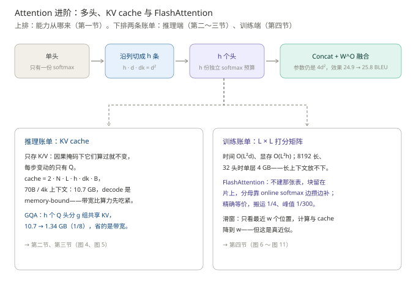
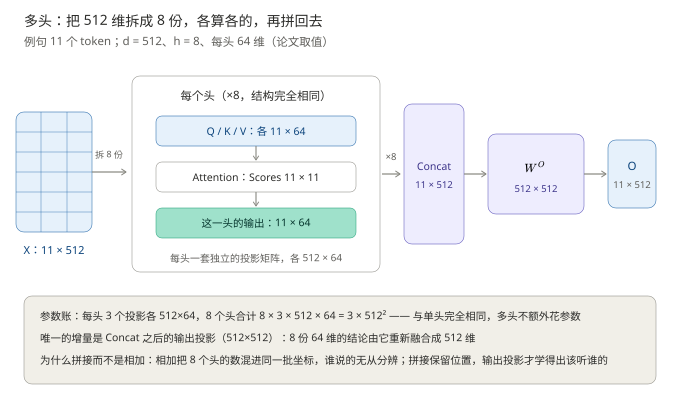
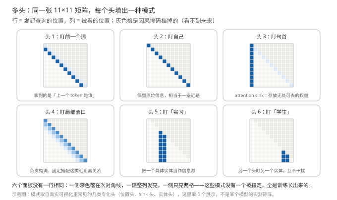
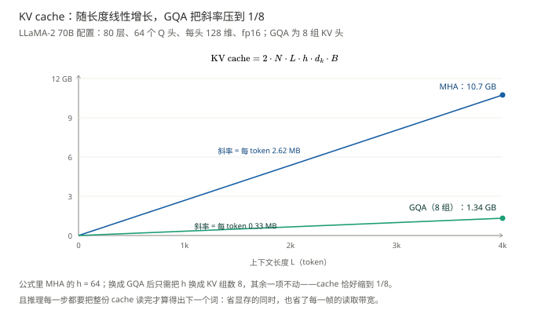
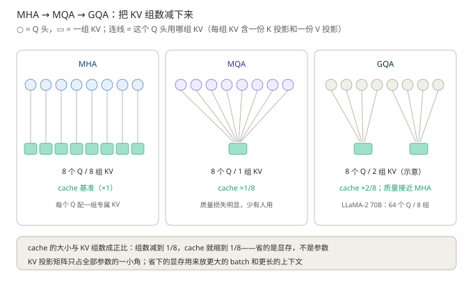
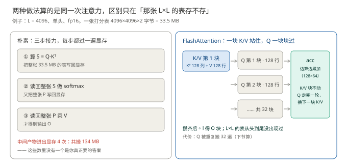
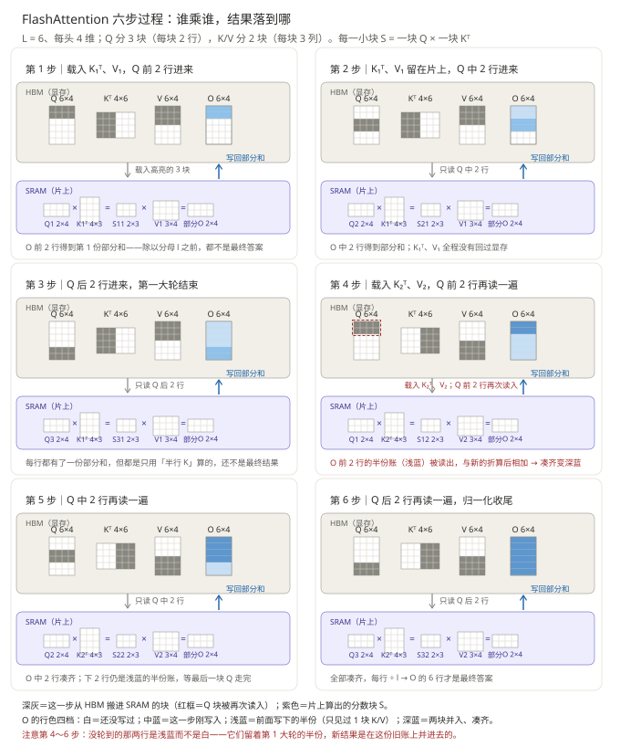
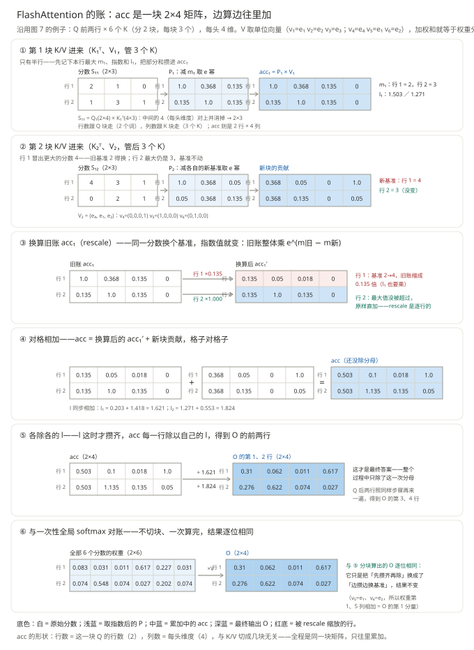
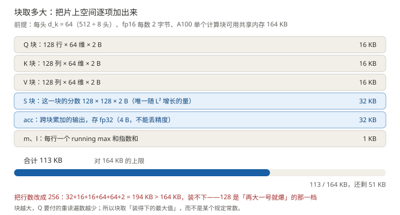

# Attention 进阶：多头、KV cache 与 FlashAttention

> **一句话结论**：多头的精髓不是"多算几遍"，而是**让同一个词在同一层里被多种关系同时解释**——每个头握着一份自己的权重分布，一个头可以把 0.9 给"吸引"的构词关系，另一个头把 0.9 给"学生"的句法角色，谁也不给谁让路。单头只有一份权重、和恒为 1，一种关系多占一分，其余就得让。这份能力几乎不花参数（$h$ 套投影是把一张 $d\times d$ 沿列切成 $h$ 条），但机制一旦真要用，两张账单立刻出现：推理端的 KV cache，训练端的 $L\times L$ 表。
>
> - **多头：多视角并存，而不是多算几遍。** $h$ 个头各有一份 softmax，等于 $h$ 份互不挤占的权重预算——同一层里"构词"和"句法"都能各自占满，不必折中。参数与算力和单头持平（$h\cdot d\cdot d_k = d^2$）；论文里参数不动，BLEU 24.9 → 25.8，训练好的模型里能直接看到位置头、句法头、稀有词头
> - **推理端的账单是 KV cache**：因果掩码让 K/V 算过就不变，于是每步只算新词的 Q——代价是显存随 $L$ 线性长（70B、4k 上下文约 10.7 GB）。GQA 顺着"分工长在 Q 侧、字典可以共用"这个事实，把 cache 压到 $1/g$
> - **训练端的账单是那张 $L\times L$ 表**：FlashAttention 把它整个取消，精确等价，代价是 Q 多读几十遍；滑窗则干脆承认"远处的信息这一层可以不要"。两者省的从来不是同一样东西

**前置**：单头的完整算式（Q/K/V 三投影、softmax、$\div\sqrt{d_k}$、掩码、三种 K/V 来源）见[《Attention 基础：让每个位置自己决定从谁那里取信息》](../注意力机制基础/注意力机制基础.md)，本篇一字不重复，直接从"一个头不够"讲起。

**图 1**：本篇地图。看图要点：上排是能力（多头：一份参数切出 $h$ 个互不挤占的视角）；下排是两张账单——推理端先 KV cache 再 GQA（省带宽），训练端先 FlashAttention 再滑窗（先省带宽，再砍范围）。

例句沿用全系列基线：`科软 放 实习 吸引 学生 报考`，11 个 token，形状账按 $L = 11$、$d = 512$ 算；算真实模型时改用 $L = 4096$、70B 配置。

## 承上：把注意力放回一层里

单头的算式到基础篇结束时就完整了：$11\times512$ 进，$11\times512$ 出。但它只是**一层里的一个子层**，要问"一个头够不够"，先得看清这个子层在什么位置上——只立三个坐标，细节分别在《前馈网络》《残差与归一化》与装配篇展开。

**其一，残差**：$O$ 与输入同形，一层走的是 $x + \text{MHA}(\cdot)$ 的加法。残差的意义不止"不覆盖原文"：它让每个子层的**默认行为是恒等映射**——训练初期注意力还没学会任何东西时，信号原样通过，"加一层"的最坏情况是不变差；深网络才堆得起来。**其二，归一化**：现代模型（pre-LN）在注意力**之前**做 LayerNorm，把进入注意力的向量拉回稳定尺度；2017 原论文放在之后（post-LN），深了要靠 warmup 硬扛。**其三，FFN**：注意力之后每个 token 独立过一遍前馈网络——**注意力负责"跨位置取信息"，FFN 负责"取回来之后自己消化"**，两者交替才构成完整的一层：一个管通信，一个管加工。

多层堆叠还有一个单向模型特有的推论：第 1 层位置 $i$ 只能看 $1..i$；到第 2 层，位置 $i$ 已经混入了更早位置的信息，别人看它就等于**间接**看到那些信息——每多一层，信息多传一跳。所以"第 1 个 token 的信息怎么传给最后一个"不靠单层注意力，靠层数。

**位置清楚了，问题就回到子层内部：这一个子层里，一个 softmax 够用吗？** 接下来四节按"能力从哪来、账单怎么付"的顺序走——多头（能力）、KV cache（推理账单）、GQA（把 cache 压下去）、FlashAttention 与滑窗（把 $L^2$ 的账压下去）。

## 一、多头：让同一个词同时被多种关系解释

> 本节要回答的问题：一对 token 之间只打一个分，够用吗？不够的话，多开几个头凭什么就能解决？

### 1.1 单头卡在哪：一份权重，要同时服务好几种关系

例句里「吸」要同时看三个位置，而看它们的理由完全不同：

- 看「习」，理由是**构词**——"吸引"是一个词，"引"必须和"习"绑在一起；
- 看「实」，理由是**句法**——"实习"是这个动作的施动者，而"实"是它的第一个 token；
- 看「学生」，理由是**语义角色**——"学生"是动作的承受者（占两个 token）。

单头要做的事，是把这三份不同的理由**压成一个数**，再在整行上归一化。麻烦正出在归一化上：权重和恒为 1，想让「习」拿到 0.9，留给「学生」的就只剩 0.1。这不是"没学好"，是**结构上装不下**，卡点有两处：

- **权重是竞争性的**。两种关系都想要 0.9，可 $0.9+0.9>1$，只能互相稀释成各约 0.5——两边都不尖锐，等于对两种关系都"半看半不看"。
- **一对 token 只有一个分**。$q_i\cdot k_j$ 是一个标量；"因为构词该看"和"因为句法该看"即使指向完全不同的方向，这一个数也只能取折中。

**失败长什么样**：单头训出来的注意力图，往往是一条"什么都看了一点"的平缓分布——没有尖到「习」，也没有尖到「学生」。图上不是空白，是模糊：**它把两种关系平均掉了，而不是表达出来了**。

### 1.2 精髓：多视角能并存，靠的是 h 份互不挤占的预算

**精髓句：多头多出来的从来不是参数，而是 $h$ 份互不相干的归一化——于是"同时"才成为可能：第 1 个头把 0.9 给「习」的构词关系，第 2 个头把 0.9 给「学生」的句法关系，两件事不再互相扣分。**

为什么"同时"只能这样换来？因为一次 softmax 就是一次预算分配，和恒为 1，天然排他：

$$
\sum_{j}\exp\left(s^{(m)}_{ij}\right)=1,\qquad m=1,\dots,h
$$

$s^{(m)}_{ij}$ 是第 $m$ 个头给位置对 $(i,j)$ 打的分；$m$ 只取 $1$ 就退回单头。权重和仍然都是 1，但**现在每个头各自归到 1**——两份互不相干的预算，"各自满到 0.9"才第一次成立。

两条岔路可以排掉：把 $d$ 加大、只用一个更长的头，权重仍是同一份，竞争关系一点没变；把 $h$ 个头的结果先加起来再归一化，等于把预算又合回一份。**"多视角并存"这个能力，只能由"多份归一化"换来**——这是本节最该带走的一句，也是"参数没涨却更强"的根据。

### 1.3 做法：一张表沿列切成 h 条

$$
\text{head}_m = \text{Attention}(QW_m^Q,\ KW_m^K,\ VW_m^V),\qquad
\text{MultiHead}(Q,K,V) = \text{Concat}(\text{head}_1,\dots,\text{head}_h)\,W^O
$$

- $W_m^Q, W_m^K, W_m^V \in \mathbb{R}^{d\times d_k}$：第 $m$ 个头自己的三个投影，把 $d$ 维投到 $d_k$
- $h$：头的个数；$d_k$ 通常取 $d/h$，于是 $h$ 个头的总宽度正好等于 $d$
- $W^O \in \mathbb{R}^{hd_k\times d}$：输出投影，把 $h$ 份独立结论重新融合

**换成 1.2 的语言看这三个矩阵**：$W_m^Q$ 决定这个头"问什么"，$W_m^K$ 决定它"按什么线索去对"，$W_m^V$ 决定它"对上了取走什么"。三样各头各一套，每个头才可能盯住不同的关系——这就是"多视角"落在参数上的位置。

**下面这组具体数字按论文 base 配置**：$d = 512$、$h = 8$、$d_k = 64$（现代模型常见 $h = 32/64$、每头 $d_k = 128$）。于是每个 $W_m^{Q}$ 是 $512\times64$，Concat 把 8 份 $11\times64$ 拼回 $11\times512$。

**图 2**：多头的拆分与拼接。看图要点：每个头内部与单头完全同构；全部差别发生在 Concat 与 $W^O$；行 = 位置 $i$、列 = 维度 $j$ 的约定不变。

**"$h$ 套投影"会不会变成 $h$ 倍参数？不会——是切，不是复制。** 单头的一张 $W^Q$ 是 $512\times512$、$262{,}144$ 个数；多头的一头 $W_m^Q$ 是 $512\times64$、$32{,}768$ 个数，8 头合计 $262{,}144$，与单头那张分毫不差。这不是巧合，是 $d_k=d/h$ 的必然：$h\times(d\times d_k)=d\times(h\,d_k)=d\times d$。**多头不是"多长出 7 张表"，而是把原来那张 $512\times512$ 沿列切成 8 条**，每条交给一个头——图 2 里从 X 分出去的那一摞，就是从同一张表上切下来的条。

多头属于**划分**：$h$ 个头各学各的，谁也不约束谁，只是加起来正好占满单头那张表的容量。"参数总量不变"不等于"没有区别"，更不等于"退化回单头"——差别全在归一化被拆成了几份（1.2 节），不在这批数字上。

**代价也是真的**：每头只分到 $d_k=d/h$ 那么宽（论文配置下 64 维，单头是 512 维）。所以头数不能无限加——论文 Table 3 里把 $h$ 加到 32、每头只剩 16 维时，效果反而回落。

> **注意这个前提**："不多花参数"依赖 $d_k=d/h$ 这个约定。若有人取每头 $d_k=d$（每头都不降维），参数就真变成 $h$ 倍——那是另一种设计，不是这里讨论的多头。

### 1.4 凭什么更好：实验、可视化与结构论证

**一是对照实验。** 原论文的消融正是冲着这一点设计的（Vaswani et al., 2017 Table 3）：层数、宽度、训练数据全都不动，只换"一个位置有几份预算、每份管多少维"——单头 24.9 BLEU，多头 25.8 BLEU。**参数一分没多，涨的 0.9 只能归给计算结构**：同一批数，被组织成了多份互不挤占的预算。

**二是看得见的专化。** 这些关系不是设计者指定的，是训练自己长出来的。可视化研究（Voita et al., 2019）在训练好的模型里找到了稳定的专化头：盯**前一个词**的位置头、追踪**句法依存**的头、处理**稀有词**的头，还有基础篇第三节说的 sink 头。

**图 3**：多头分工长什么样（示意图，模式取自真实可视化里常见的专化头类型）。看图要点：六个面板没有任何两个相同——同一张 $11\times11$ 矩阵，每个头填进一种不同的模式，这就是"多视角"看得见的样子。

**三是"必须拼接，不能相加"。** 设把 $h$ 个头的结果按元素相加成一个 $11\times64$：一是**坐标混叠**——同一维上头 $a$ 的 0.8 和头 $b$ 的 −0.6 加成 0.2，"这是谁说的"从此无从分辨，$W^O$ 想区别对待也找不到对象；二是 $h$ 份结论被硬塞进 64 维，每头投影时丢掉的维度信息回不来。拼接把 $h$ 份结论各占 $d_k$ 维地排好，"哪个头说的"成为可辨识的位置块，$W^O$ 的每个行块因此可以学到"重点听某个头的"——**分工由 $h$ 个独立 softmax 实现，融合由 $W^O$ 学出来，两步都不能省**（钉成一叠纪要保留页码，揉成一团就分不出谁写的 ≈ 类比，边界在"拼接只是摆放，融合仍靠 $W^O$"）。

**把账收在一处**（数字在 1.3 已经算过）：三个投影合计 $3d^2$、$W^O$ 再 $d^2$，总共 $4d^2$，与单头一字不差；算力 $h\times L^2 d_k = L^2 d$ 也是同账。所以 0.9 BLEU 的提升才能干净地归因于结构，而不是"参数变多"。真正变多的只有打分矩阵的显存（$h$ 张 $L\times L$），第四节处理。

> **进阶（可跳过）**：换一个角度看表达力。$W^Q W^{K\top}$ 的秩最多 $d_k$；单头只有一把秩-$d_k$ 的尺子，多头把 $h$ 把**不同的**秩-$d_k$ 尺子并联，$h$ 个子空间合起来覆盖的关系种类，远多于一把 $d$ 维的尺子能同时表达的。另外 $h$ 与 $d_k$ 的取舍有下限：$d_k$ 太小则每头表达不足；且专化头只是可视化里**能找到**的模式，不可解释的头同样大量存在，分工是训练的涌现结果，不是保证。

## 二、KV cache：推理只算新词，因为旧内容不会变

> 本节要回答的问题：生成第 $t$ 个词时，前面 $t-1$ 个位置的 K、V 真的要重算吗？

**先立一个错误直觉：推理就是每步把整句重新算一遍。**按这个直觉，生成 1000 个词要算 $1 + 2 + \dots + 1000 \approx 5\times10^5$ 次投影（而增量做法只要 1000 次），长上下文根本不可用。真实的浪费比这更具体：**前 $t-1$ 个位置的 K 和 V，在第 $t$ 步一个数都没变，却被重算了一遍**。

为什么没变？因果掩码保证位置 $i$ 的 K、V 只由 $x_1, \dots, x_i$ 决定，与后来者无关。生成第 $t$ 个词时，唯一的新东西是 $Q_t$：它问"我现在要找什么"，天然每步都是新的；K、V 是"被查的字典"，一旦写好就不改。**精髓句：先分清"什么变了、什么没变"——变的只有 Q，于是只算 Q；不变的是 K/V，于是只存一次。**——这一条判断把推理从"每步重算"变成"每步增量"，是整个推理加速体系的第一块基石。

这条判断能成立，靠的是注意力把**"此刻要找什么"和"句子里有什么"拆成了两样东西**：$Q$ 是当下的问题，$K$/$V$ 是句子写好的档案。RNN 没有这个拆分——它的隐状态每读一个词就被自己改写一次，"算过就不变"的东西根本不存在，缓存也就无从谈起。**可缓存不是工程技巧，是 QKV 结构的红利**：先有"内容静态"，才谈得上"增量计算"。

$$
\text{KV cache} = 2 \cdot N \cdot L \cdot h \cdot d_k \cdot B
$$

| 符号    | 含义          | 例句 / 70B 模型的取值           |
| ----- | ----------- | ------------------------ |
| 2     | K 和 V 各存一份  | —                        |
| $N$   | 层数          | 论文 $N = 6$（演示值）；70B 是 80 |
| $L$   | 已生成的长度      | 11 → 4096                |
| $h$   | Q 头数（MHA 时） | 8 → 64                   |
| $d_k$ | 每头维度        | 64 → 128                 |
| $B$   | 每个数字的字节数    | fp16 取 2                 |

代算例句：$2 \times 6 \times 11 \times 8 \times 64 \times 2 = 135{,}168$ 字节 $\approx 132$ KB（$N = 6$ 是论文演示值）。代算 70B：$2 \times 80 \times 64 \times 128 \times 2 \approx 2.62$ MB/token——每生成一个词，cache 就长 2.62 MB；4k 上下文累计 10.7 GB。

**图 4**：KV cache 随长度线性增长。看图要点：两条线都是直线，GQA 与 MHA 的差别只在斜率，不在形状。

cache 的账还揭示了一件硬件层面的事：decode 阶段每生成一个词都要把整份 cache 从显存读一遍，**读的字节数远超算术量**——decode 是 **memory-bound（访存受限）**的，算力反而闲置。这就是"cache 大"为什么致命：它同时吃显存容量和每步的读取带宽——**下一节的 GQA 与再下一节的 FlashAttention，各自从这两头下手**。

## 三、GQA / MQA：让多个 Q 头共用一本字典

> 本节要回答的问题：cache 要 10.7 GB，从哪个变量下手最划算？

公式里 $N$、$L$、$d_k$ 由模型能力决定，$B$ 由精度决定，唯一松动的是 $h$。MQA（Shazeer, 2019）的洞察先看清了一个事实：**"被查的字典"不需要每个 Q 头一本专属**。所有 Q 头共享同一组 K/V，cache 直接缩到 $1/h$；代价是 $h$ 个头挤一本字典，质量损失明显。GQA（Ainslie et al., 2023）折中：$h$ 个 Q 头分成 $g$ 组、每组共享一套 K/V；$g = h$ 退回 MHA，$g = 1$ 退回 MQA。LLaMA-2 70B 取 64 个 Q 头、8 组 KV。

**精髓句：多头的分工主要长在"怎么问"上，不在"字典里写了什么"上——所以一本字典可以几头共用，掉点有限。** 回到第一节的分工图：多头学出来的专化，大头在**提问方式**上——头 1 问"前一个词是谁"、头 5 问"「实习」在哪"，这些差异体现在 $W^Q$ 里；而 $K$、$V$ 提供的是**同一份可检索的内容**——"前一个词"也好"「实习」"也好，谁的字典里都是那 11 个 token 的信息。**分工主要长在 Q 侧，字典可以共用**，这是共享不掉点的结构原因；组数切得太少（MQA 的 $g=1$）才会伤到 K/V 侧本来就存在的多样性。

**图 5**：MHA / MQA / GQA 的 KV 共享方式。看图要点：连线表示这个 Q 头用哪组 KV；cache 大小与 KV 组数严格成正比。

**关键辨析：GQA 省的是 cache，不是参数；而 cache 的代价不只是显存，是并发。**KV 投影参数从 $h \cdot 2 \cdot d \cdot d_k$ 降到 $g \cdot 2 \cdot d \cdot d_k$，在几十亿参数里只占一小角；而 cache 从 10.7 GB 缩到 1.34 GB（$1/8$）是实打实的 8 倍。这里的意义要说透：一张 80 GB 的卡，按 10.7 GB/条算只放得下 7 条并发序列；而这个数字直接压住吞吐——decode 是 memory-bound，每条序列每步都要把整份 cache 读一遍，并发数上不去，算力就只能空转。**GQA 省下的 8 倍显存，换来的是 8 倍并发**，这也是它先在大模型推理上普及、而不是先谈"省参数"的原因。工程上还有一条便宜的迁移路径：训好的 MHA 检查点做少量"上训练"（uptraining，原论文约 5% 训练量）即可转成 GQA——这也是它能在几个月内替换掉 MHA 的工程原因。更进一步的 MLA（DeepSeek-V2）把 KV 压缩进低秩潜在向量，只提名字。

## 四、FlashAttention：不建那张表，也不牺牲精度

> 本节要回答的问题：注意力非要一张 $L\times L$ 的表不可吗？没有这张表，softmax 还能算对吗？

### 4.1 问题：一张 4096×4096 的表，算完还得存起来

**精髓句：FlashAttention 没有减少一次乘加，而是把"注意力太贵"重新诊断成"搬运太贵"。** 诊断一变，做法就跟着变：既然贵在把 $L^2$ 的中间产物搬进搬出，那就让它根本不落地——数学一个字不改，结果逐位等价。这条路线与它之前的所有办法都不同：稀疏、低秩、滑窗都是"用精度换速度"，而它证明**不牺牲精度也能快**。

打分矩阵 $S$ 的形状是 $L\times L$——**只由序列长度决定，与每个头有多宽无关**。这是多头最反直觉的一笔账：多头几乎不增加参数（1.3 节算过，$h$ 套投影只是把 $d\times d$ 沿列切成 $h$ 条），却让这张表的数量乘以 $h$——因为**每个头都要独立铺满一整张 $L\times L$ 的配对表**，哪怕它只管 64 维。参数是权重，只有 $d\times d$ 那么大；$S$ 是中间激活，大小只跟着 $L$ 走。

代个数：$L = 4096$、fp16，一张表 $4096\times4096\times2$ 字节 $\approx 33.5$ MB。一层 $h=32$ 就是 32 张、约 1 GB；再乘 32 层、乘 batch，就是几十 GB——**参数没涨，激活涨了 $h$ 倍**。上下文从 4k 拉到 32k，$L^2$ 还要再涨 64 倍。**没有它会怎样**：32k 上下文的训练，光这一项的峰值就落到几十 GB，先把显存吃满——所以 2022 年之前，长上下文要么训不动，要么只能靠近似方法把表砍小。

朴素实现分三步（图 6 左）：① 算出整张 $S$，写回显存；② 读回 $S$ 做 softmax，把权重 $P$ 又写回显存；③ 读回 $P$ 乘 $V$，才得到输出 $O$。$S$ 和 $P$ 各写一遍读一遍，中间产物进出显存 4 次，共搬 134 MB——**这些数里没有一个是你真正要的答案**。长上下文在 2022 年后才可行，转折点就是 FlashAttention（Dao et al., 2022）。它问了一个更根本的问题：这张表，能不能**根本不存**？

**图 6**：两种数据通路。看图要点：左边每一步都要读写整张表；右边一块 K/V 站在片上、Q 一块块流过来，表从头到尾不存在。

### 4.2 想法：让表根本不落地——一块 K/V 站住，Q 从头走一遍

先注意一个事实：**$S$ 的每一行只属于一个 Q 词、每一列只属于一个 K 词**——第 1 个词的输出只由 $S$ 的第 1 行决定。于是把 Q 按行切块、K/V 按列切块，$S$ 就切成一个个小块：**每一小块 = 一块 Q × 一块 Kᵀ**，谁跟谁乘、结果落到 O 的哪几行，全都对得整整齐齐（图 7）。

小块的形状有严格的来历，拿图 7 的例子算一遍：$Q_1$ 是 $Q$ 的前 2 行，形状 $2\times4$（2 个词、每词 4 维）；$K_1^\top$ 是 $K^\top$ 的前 3 列，形状 $4\times3$（4 维 × 3 个 K）。矩阵乘法要求**内维相等并对消**——$(2\times4)\cdot(4\times3)$ 中间的两个 4 正好咬合、消掉，剩下 $2\times3$。所以 **S 的行数跟 Q 块走（几个词在算），列数跟 K 块走（跟几个词算），与每头多少维无关**。这也解释了后面 acc 的形状：$S_{11}\,(2\times3)$ 再乘 $V_1\,(3\times4)$，3 又被消掉，得到 $2\times4$——**行数始终跟 Q 块，列数回到每头维度**，acc 全程都是同一块 $2\times4$。

FlashAttention 的走法（$L=6$、每头 4 维的玩具例子：Q 分 3 块、每块 2 行；K/V 分 2 块、每块 3 列）：

- **第 1 大轮**：载入 $K_1^\top$（$K^\top$ 的前 3 列）和 $V_1$（$V$ 的前 3 行），在片上站住；Q 的第 1 块进来，$Q_1 \times K_1^\top$ 得到 $S$ 的左上 2×3，乘 $V_1$ 得到 $O$ 前两行的一份**部分和**；Q 第 2、3 块依次进来，各得各的部分和。
- **第 2 大轮**：载入 $K_2^\top$、$V_2$，**Q 退回第 1 块再走一遍**，新的部分和与第 1 轮的按比例折算后相加（为什么不能直接加，见 4.3 节）。
- 六步走完，每行除以自己的 $l$，$O$ 才落定。

$L\times L$ 的表从头到尾没有完整存在过——这就是 FlashAttention 的全部。代价也在这里：**Q 要按 K/V 的块数重复读**（例子里的 Q 被读了两遍；真实场景 4096 个词、每块 128，Q 要读 32 遍），这笔账 4.4 节算。

**图 7**：六步全程。看图要点：上层深灰 = 这一步真正从 HBM 搬进片上的块；下层 SRAM 永远是同一条链 $Q_i \times K_j^\top = S_{ij} \times V_j$，算出的部分和写回 O 对应的行；第 4 步红框 = Q 前 2 行被再次读入。O 的行色四档：白 = 还没写过；中蓝 = 这一步刚写入；浅蓝 = 前面写下的半份（只见过 1 块 K/V）；深蓝 = 两块并入、凑齐。特别注意第 4～6 步：没轮到的那几行是**浅蓝而不是白**——它们留着第 1 大轮的半份账，新结果是在这份旧账上并进去的。

**为什么分块在数学上站得住？** 因为 softmax 的分子 $\sum_j e^{s_{ij}}v_j$ 和分母 $\sum_j e^{s_{ij}}$ 都是**求和**，而求和可拆段：先算前一半、再算后一半、最后相加，与一次算完结果相同。**分块没有改变任何数学，只是把一次求和换成了多次求和。** 但「可拆」有一个前提——各段必须用同一个基准；而每一段只能看到自己的最大值。这就是剩下的唯一麻烦，下一节处理。

### 4.3 唯一的麻烦：分母要整行，可你只有一半

softmax 每一行独立归一化：分母是这一行**所有**分数的指数和。分块后，每一行的完整部分和要等所有 K/V 块都轮过一遍才凑得齐——**任何一轮手里都只有半行**。FlashAttention 的办法是**记账**：每算完一块，给每一行记三个数——本块最大分数 $m$、本块指数和 $l$、已攒的部分和 acc（acc 就是你最终要的那行输出，只是还没除以分母）；等下一块来了再合并。

合并时会遇到一件事：**后面那块冒出了更大的分数**。为什么麻烦？因为取指数前必须先减一个参照值 $c$（fp16 上限 65504，而 $e^{11.1}\approx65504$，分数一超过 11 就溢出），而 $c$ 必须整行统一。第 1 块算完时你不知道后面还有没有更大的，只能拿当时的最大值当 $c$；第 2 块来了更大的 4，$c$ 就得换成 4——**同一个分数，参照值换了，指数值就跟着变**（$e^{2-2}=1$ 在 $c=4$ 下应是 $e^{2-4}=0.135$）。所以旧账（acc 和 $l$ 一起）必须整体乘 $e^{m_{\text{旧}}-m_{\text{新}}}$ 折算过来，这一步叫 **rescale（重标定）**。

图 8 沿用图 7 的例子，把 Q 的前两行从头算到尾，三个看点：

1. **acc 是一块 $2\times4$ 矩阵**：行数 = 这一块 Q 的行数（2），列数 = 每头的维度（4），与 K/V 切成几块无关。它全程是**同一块矩阵**——每并入一块 K/V，是把旧账按新基准折算后**往里累加**，不是从头重算；
2. **$m$ 和 $l$ 是逐行的**：图里第 2 行的最大值本来就是 3，第 2 块没超过它，就**不用 rescale**；第 1 行从 2 涨到 4，才要乘 0.135；
3. **最后只除一次**：$l$ 攒齐后，acc 每一行除以自己的 $l$，得到 O 的这两行——与把整张 $S$ 一次性 softmax 的结果逐位相同（图 8 第 ⑥ 步）。

**图 8**：Q 前两行的完整演算（与图 7 同一套数字，六个 K 分两块、每块 3 个，每头 4 维）。看图要点：acc 从头到尾是同一块 2×4 矩阵，只往里累加；第 1 行经历了 rescale（×0.135），第 2 行原样直加——rescale 是逐行的；第 ⑥ 步与一次性全局 softmax 对账，逐位相同。

这套"边攒边修账"的递推就叫 **online softmax**——online 指分数一块一块流入、账随时修正。它保证了一个反直觉的结论：**FlashAttention 是精确等价，没有近似任何东西**。

### 4.4 值不值：三个数各回答一个问题

- **放得下吗（显存峰值）**：从一张 33.5 MB/头的表，变成片上一块 128×128 的分数（≈0.1 MB），**1/300**。这一条才是长上下文能训练的真正原因——峰值一旦落到几十 GB，模型再对也跑不起来。
- **搬得动吗（搬运量）**：表没了，但 Q 要按 K/V 的块数重复读——$4096/128 = 32$ 遍，134 MB → 33.5 MB，**1/4**。这里的 33.5 MB 与 4.1 那张表同值纯属巧合（比值恰好是 $2B_q/d_k=4$）：一个是"一张表有多大"，一个是"整个过程一共搬多少"，含义不同。
- **有没有偷工减料（计算量）**：一次乘加都没多算，FLOPs 不变（反向还要重算，略增）——这一条保证了它"快"不是靠少算。

所以实测只快 2–4 倍：省的是搬数据的时间，不是计算的时间。

### 4.5 进阶框（可跳过）：块为什么偏偏是 128

块越大，Q 要重复读的遍数越少，但块必须整个装进片上内存。每行占多少字节由 $d_k$ 决定，而 $d_k$ 不是自由参数、它是 $d/h$（1.3 节）——按论文 base 配置 $d=512$、$h=8$、$d_k=64$，fp16 下每行就是 128 字节。A100 单个计算块 164 KB，把"一块算完之前必须同时活着"的东西逐项加起来：Q 块 16 KB + K 块 16 KB + V 块 16 KB + 分数块 32 KB + acc 32 KB + 统计量 1 KB = 113 KB，装得下；行数翻倍到 256 就是 194 KB（含 $m$、$l$ 的 2 KB），**溢出**。所以 128 = "再大一号就爆"的那一档。换一张卡、换一个 $d_k$，答案就变（H100 能取 256 行；LLaMA-7B 的 $d_k=128$ 每行字节翻倍，同样 164 KB 只装得下 64 行）——**要带走的是"容量 ÷ 每行字节数"这个方法，不是 128 这个数**。官方 kernel 的 `BLOCK_M=128` 就是这么在 A100 上标定出来的。

**图 9**：128 的来历。看图要点：六项加起来 113/164 KB，还剩 51 KB；256 行溢出——128 是被容量逼出来的，不是规定值。

### 4.6 滑窗：另一条路，真近似

**精髓句：滑窗不是加速技巧，而是承认"远处的信息这一层可以不要"——它改变的是模型能看到什么，不是怎么算。** 具体做法（sliding window，Mistral 7B 用 $w = 4096$）很直接：**放弃看全局**。每个位置只与最近 $w$ 个位置算注意力，计算与 cache 都从 $L$ 降到 $w$——但这是真近似，窗口外的信息这一层确实看不见。补偿靠层间传播：一层看 4096、32 层理论上能把感受野叠到十三万，只是信息经多层转手，远距离的精确对齐会受损。

|           | FlashAttention | 滑窗            |
| --------- | -------------- | ------------- |
| 与标准注意力的关系 | 精确等价           | 近似（放弃全局）      |
| 省什么       | 显存峰值（$O(L^2)\to O(L)$）与读写带宽 | 计算量与 cache 大小 |
| 不省什么      | FLOPs（反向重算，略增）；Q 要多读 $L/128$ 遍 | 远距离对齐的精度      |

两者不互斥：Mistral 就是"滑窗 + FlashAttention 实现"。选型逻辑一句话——**要精确，省带宽；要便宜，砍范围**。

## 五、小结

| 机制 | 缺了会怎样 | 精髓（多出了什么能力） | 代价 |
| --- | --- | --- | --- |
| 多头 | 一份权重和恒为 1，几种关系只能互相稀释 | 同一层里**同时**表达多种关系：$h$ 份互不挤占的归一化，各自都能满到高权重 | 每头只剩 $d_k=d/h$ 维；打分矩阵 $\times h$ |
| Concat + $W^O$ | 相加则坐标混叠，"谁说的"不可辨 | $h$ 份结论各占一段，"谁说的"可辨识，融合方式由 $W^O$ 学出来 | 融合要多一次投影 |
| KV cache | 每步重算整句，推理慢到不可用 | Q/K/V 拆分让"内容"静态，于是"只算新词"成立 | 显存随 $L$ 线性增长 |
| GQA | cache 同时吃掉并发与上下文长度 | 分工长在 Q 侧、字典可共用：显存与带宽同时降 $g$ 倍 | 组数太少伤质量 |
| FlashAttention | $L^2$ 中间产物吃满带宽与显存峰值 | 把"贵"从算力改判为搬运，于是**不牺牲精度也能快**（精确等价） | Q 多读 $L/B_q$ 遍；反向要重算 |
| 滑窗 | 全局注意力在长序列上不可负担 | 只保留最近 $w$ 个：感受野靠层间传播折算 | 真近似，远距离对齐受损 |

如果只记三句话：**多头多出来的是「同一层里同时表达多种关系」的能力，而它靠的不是更多参数，是 $h$ 份互不相干的归一化预算**；**KV cache 的全部依据是"因果掩码下 K/V 算过就不变"**；**GQA 省的是带宽、FlashAttention 省的是搬运与显存峰值、滑窗省的是范围——三者省的从来不是同一样东西**。别把比喻当机制：加法不是拼接、掩码不是调小权重。

## 六、面试向易错点

| 面试考点 | 常见答错 | 正确答法 | 面试官在考什么 |
| --- | --- | --- | --- |
| 多头为什么比单头好？ | "参数更多，所以更强"（或反过来："参数一样，那不就等于没改"） | **能力上**：同一个词在同一层里能被多种关系同时解释——每个头一份独立 softmax，一个头盯构词、一个盯句法，互不抢权重；单头一份预算、和恒为 1，只能折中。**代价上**：几乎不多花参数，因为 $h$ 套投影是把一张 $d\times d$ 沿列切成 $h$ 条（划分，不是复制），合计仍是 $4d^2$。论文 Table 3：参数不动，24.9 → 25.8 BLEU | 会不会只背"多头更好"，说不出好在哪里、也没算过参数账 |
| 多头的"分工"是设计出来的吗？ | "论文规定了每个头各管一件事" | 不是。分工是训练自己长出来的：可视化里能看到位置头、句法头、稀有词头，也同样存在大量不可解释的头；能确定的只是"$h$ 份独立预算给了并存的可能" | 是否把涌现现象当成硬编码规则 |
| 多个头的输出怎么合并？ | "各头结果按位相加" | Concat 沿特征维拼回 $d$ 维再乘 $W^O$；相加坐标混叠、丢掉"哪个头说的" | 维度账是否亲手算过 |
| KV cache 缓存什么？ | "Q、K、V 都缓存" | 只缓存 K/V——因果掩码下它们一旦算出就不变；Q 每步都是新的 | 是否真理解"什么变了、什么没变" |
| GQA 省的是什么？为什么掉点不大？ | "省参数、省计算" | 省 KV cache 显存（缩到 $g/h$）与读取带宽；掉点不大是因为多头分工主要长在 Q 侧，K/V 字典可共用 | 是否理解 decode 是 memory-bound + 分工归属 |
| FlashAttention 是近似吗？ | "分块算肯定有误差"（或"反正数据都要搬完，能省多少"） | 精确等价：它不是把注意力算粗，而是把瓶颈从算力改判为搬运——rescale 的依据是"分子分母同乘常数商不变"，逐位还原全局 softmax。省的是不建那张 $L^2$ 的交接文件：显存峰值约 1/300，搬运量约 1/4，FLOPs 反而略增 | 是否理解"它改的是数据通路，不是数学"，能否算清搬运账 |
| 分了块，直接把各块的结果相加不行吗？ | "行，反正都是加权和" | 不行：各块取的指数基准不同（各自用自己的最大值），旧账必须乘 $e^{m_{\text{旧}}-m_{\text{新}}}$ 换算到同一基准再相加；直接加会让先算的块权重被高估 $e^{\Delta m}$ 倍 | 是否理解"缩放是统一单位，不是数学变换" |
| 块大小 128 是怎么定的？ | "经验值 / 论文规定" | 由片上容量反推：Q/K/V/S/acc/统计量六项合计 113 KB，对上 A100 的 164 KB；256 行要 194 KB，溢出。换成 H100 或 $d_k=128$，答案就变 | 是否会把硬件约束当常数背 |
| 滑窗注意力会丢信息吗？ | "不会，信息能传过去" | 单层真丢（近似）；多层靠感受野叠加补回，但远距离精确对齐受损 | 能否给"近似 vs 等价"分类 |
| 层数符号为什么用 $L$？ | "堆 $n$ 层" | $n$ 已被序列长度占用；且单向模型里层数再多，单层内第 1 个 token 也看不到第 $n$ 个 | 符号纪律 + 对信息流向的理解 |

## 七、引用论文

1. Vaswani et al. *Attention Is All You Need*. NeurIPS 2017. arXiv:1706.03762.（多头、$W^O$、$d_k = 64$、Table 3 的单头/多头对照）
2. Voita et al. *Analyzing Multi-Head Self-Attention: Specialized Heads Do the Heavy Lifting, the Rest Can Be Pruned*. ACL 2019. arXiv:1905.09418.（位置头、句法头、稀有词头的可视化证据）
3. Shazeer. *Fast Transformer Decoding: One Write-Head is All You Need*. arXiv:1911.02150, 2019.（MQA）
4. Ainslie et al. *GQA: Training Generalized Multi-Query Transformer Models from Multi-Head Checkpoints*. EMNLP 2023. arXiv:2305.13245.（GQA 与 uptraining）
5. Dao et al. *FlashAttention: Fast and Memory-Efficient Exact Attention with IO-Awareness*. NeurIPS 2022. arXiv:2205.14135.（分块与 online softmax，精确等价）
6. Dao. *FlashAttention-2: Faster Attention with Better Parallelism and Work Partitioning*. arXiv:2307.08691, 2023.（只提名字：反向重算与并行划分的改进）
7. Jiang et al. *Mistral 7B*. arXiv:2310.06825, 2023.（滑窗注意力）
8. DeepSeek-AI. *DeepSeek-V2: A Strong, Economical, and Efficient Mixture-of-Experts Language Model*. arXiv:2405.04434, 2024.（MLA，只提名字）

---

**下一篇**：[《前馈网络：每个位置怎么被加工》](../前馈网络/前馈网络.md)——注意力负责"跨位置取信息"，取回来之后由谁消化。
