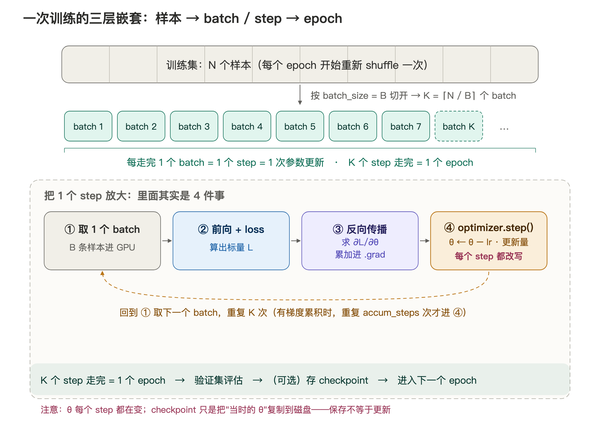
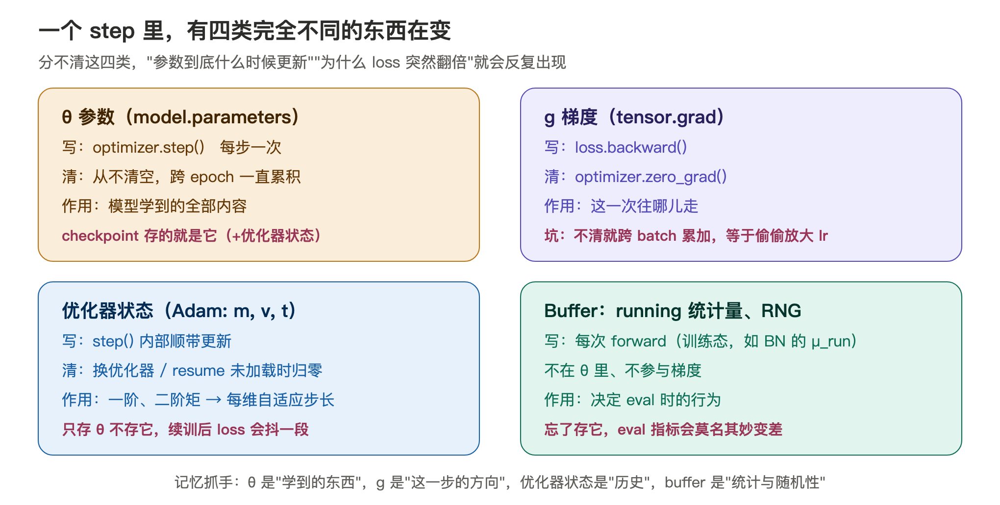
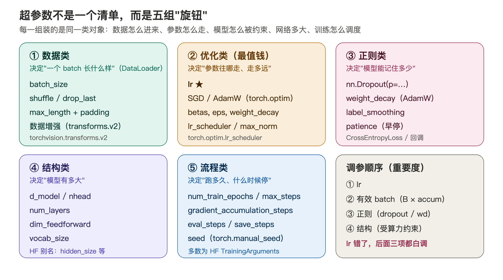
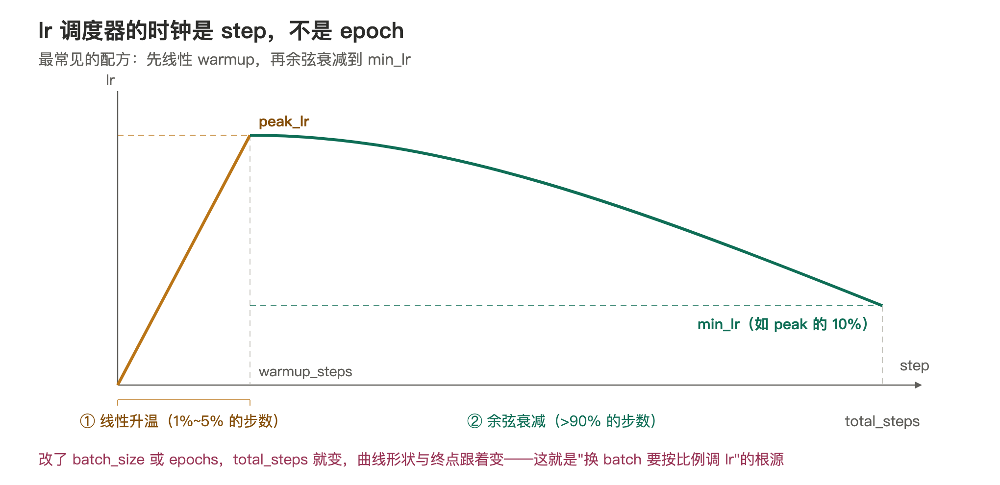
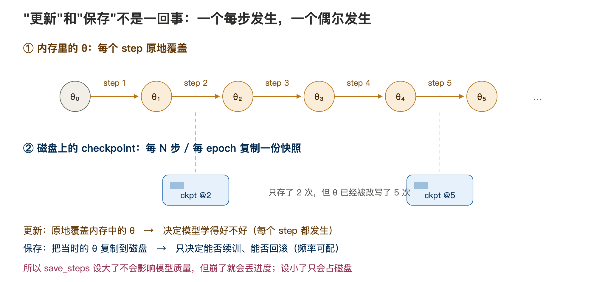
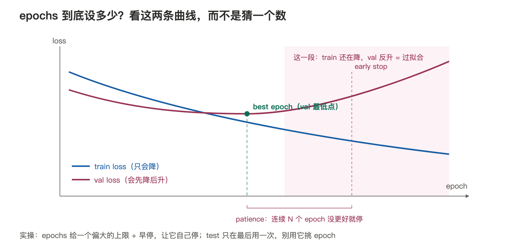

# 深度学习基本超参数

> 学习笔记 · 2026-11-02  
> 关键词：超参数、batch_size、step、epoch、checkpoint、学习率调度、梯度累积

---

## 一句话总结

> **超参数不是一个平铺的清单，而是五组"旋钮"：数据类（一个 batch 长什么样）、优化类（参数往哪走、走多远）、正则类（模型能记住多少）、结构类（模型多大）、流程类（跑多久、什么时候停）。**
>
> 单位记忆法：**batch 是数据单位，step 是最小执行单位，epoch 是"数据集过一遍"的计量单位，checkpoint 是把内存里的 θ 复制到磁盘的动作**——更新每步都发生，保存偶尔发生。

## 1. 一般模型的训练过程：

### 1.1 四个基本超参数单位

| 概念                   | 单位属性       | 含义                    | 换算                             |
| -------------------- | ---------- | --------------------- | ------------------------------ |
| `batch_size`（B）      | 数据单位       | 一个 batch 装几个样本        | —                              |
| `step` / `iteration` | **最小执行单位** | 走完 1 个 batch，更新参数 1 次 | 处理 B 个样本                       |
| `epoch`              | 计量单位       | 训练集完整过一遍              | $K = \lceil N/B \rceil$ 个 step |
| `checkpoint`         | 磁盘动作       | 把当时的 θ 复制一份落盘         | 频率可配，不影响训练本身                   |

例：MNIST 有 $N = 60000$，$B = 64$，则 1 个 epoch = $\lceil 60000/64 \rceil = 938$ 步。日志里"走了 100 步"只是 $100/938 \approx 0.11$ 个 epoch，连第一遍数据都没走完。

**两个容易脱钩的地方：**

- **梯度累积**：设 `gradient_accumulation_steps = 4`、micro-batch = 16，则 4 次前向才做 1 次参数更新，**有效 batch = 16 × 4 = 64**。看别人脚本要分清 micro-batch（硬件单位）和 optimizer step（更新单位）。
- **shuffle 发生在 epoch 边界**：`DataLoader(shuffle=True)` 每个 epoch 重新洗牌一次，保证每个 epoch 的 batch 组合都不同——"随机"是打乱顺序，不是抽样。

### 1.2 一次训练的三层嵌套

公式：

$$
K = \left\lceil \frac{N}{B} \right\rceil \quad(\text{steps per epoch，向上取整，最后一批不足 B 也算一步})
$$

$$
\texttt{total\_steps} = \texttt{epochs} \times \frac{K}{\texttt{gradient\_accumulation\_steps}} \quad(\text{lr 调度器的总时长})
$$

$$
B_{\text{有效}} = B_{\text{micro}} \times \texttt{gradient\_accumulation\_steps}
$$

把 1 个 step 放大是 4 件事：①取 batch → ②前向 + loss → ③反向传播（梯度累加进 `.grad`）→ ④`optimizer.step()` 改写 θ。注意 **θ 每个 step 都在被改写**；epoch 边界上发生的验证和存 checkpoint 只是"检查"和"备份"，不是更新。

### 1.3 一个 step 里，四类东西在变

| 状态                       | 谁写它                | 谁清它           | 常见坑                          |
| ------------------------ | ------------------ | ------------- | ---------------------------- |
| θ 参数                     | `optimizer.step()` | 从不清空          | —                            |
| 梯度 `.grad`               | `loss.backward()`  | `zero_grad()` | **不清空会跨 batch 累加**，等于偷偷放大 lr |
| 优化器状态（m, v, t）           | `step()` 内部        | 换优化器时丢失       | 只恢复 θ 不恢复它，续训后 loss 会抖一段     |
| Buffer（BN running 量、RNG） | 每次 forward         | —             | 忘了存进 checkpoint，eval 指标会莫名变差 |

这份表解释了：**一个完整的 checkpoint = θ + 优化器状态 + buffer + Random Number Generator 状态**

---

## 2. 超参数全景图

把上面这个过程里可以拧的旋钮按作用分组，就是下面这份全景图：

---

## 3. 数据类：batch_size 决定梯度的质量

数据类参数决定"一个 batch 长什么样"：**`batch_size`、`shuffle`、`drop_last`（都在 `torch.utils.data.DataLoader` 上）、`max_length` 与 padding 策略（tokenizer / `torch.nn.utils.rnn`）、数据增强强度（`torchvision.transforms.v2`）**。其中 batch_size 最重：它同时决定**显存占用**（激活 ∝ B）和**梯度质量**（对 B 个样本的梯度求平均）。

### 3.1 `batch_size` 与 `lr` 必须一起调（重点）

梯度是 $B$ 个样本梯度的平均，其估计噪声按 $1/\sqrt{B}$ 缩放：

- **B 大** → 梯度更稳，但同一个 lr 下"每步走得相对太小" → 需要**按比例放大 lr**（线性缩放规则：$B$ 翻倍，lr 翻倍；保守版用 $\sqrt{B}$）；
- **B 小** → 梯度噪声大，反而自带正则效果，但统计不稳定；
- **B = 1** 时某些机制直接失效（如 BatchNorm 的 $\sigma_j^2 = 0$）。

显存上激活 ∝ B，所以 B 通常是"显存塞得下的最大值"，再用 lr 去适配它。

### 3.2 `shuffle`：打乱的是顺序，不是抽样

- **作用**：让每个 batch 的样本组成随机化。不 shuffle 时 batch 有系统性偏差（数据集若按类别排序，每个 batch 的梯度都偏向单一类别，更新方向来回摆）；
- **典型值**：训练集 `True`，**验证/测试集固定 `False`**（保证指标可比较）；
- **调错表现**：不 shuffle 时训练后期 loss 降不动、val 指标抖；另外 shuffle 依赖 RNG，固定 seed 才能复现实验。

### 3.3 `drop_last`：最后一个不满的 batch 扔不扔

$N$ 不一定能被 $B$ 整除，最后一个 batch 只有 $N \bmod B$ 个样本：

- `drop_last=True` → $K = \lfloor N/B \rfloor$，最后一批直接丢弃；
- **为什么经常丢**：最后一批可能只有 1~2 个样本，训练态的 BatchNorm 会直接报错或输出垃圾统计量；且这批梯度噪声极大，反而干扰末尾几步；
- **eval 时相反**：验证集必须 `drop_last=False`，否则评测少了样本、指标不可比。

### 3.4 `max_length` 与 padding 策略（tokenizer / `torch.nn.utils.rnn`）

变长序列必须截断或补齐到统一长度：

- **截断**：HF tokenizer 的写法是 `tokenizer(..., max_length=L, truncation=True)`；超长的砍头（保结尾，适合摘要类）还是砍尾（保开头，适合文章类），按任务定；
- **padding 位置**：Transformer 用 mask 屏蔽 pad 位（HF 里叫 `attention_mask`，`torch.nn.MultiheadAttention` 里叫 `key_padding_mask`），前后补都行；RNN 类结构建议**后补**，配合 `torch.nn.utils.rnn.pack_padded_sequence` 跳过 pad 步骤；
- **代价**：显存 ∝ B × L（注意力部分 ∝ B × L²），`max_length` 设太大=白烧显存。实用做法是**动态 padding**（`tokenizer(..., padding=True)`，只补到本 batch 最长句）。

### 3.5 数据增强强度：免费的"扩数据"

- **CV**：`torchvision.transforms.v2` 里的 `RandomHorizontalFlip`、`RandomResizedCrop`、`ColorJitter` 是标配；`MixUp(alpha=…)` / `CutMix(alpha=…)` 属于强增强，能把小数据集的过拟合明显压下去；
- **NLP**：同义替换、回译要慎用——改一个词可能改变语义，宁缺毋滥；
- **怎么判断强度**：增强过强时 **train loss 也降不下去**（相当于数据难度变大），这是欠拟合信号；只在 val 曲线明显过拟合时才加大增强（`MixUp` / `CutMix` 的 `alpha` 越大越强）。

---

## 4. 优化类：最重要的是 lr

优化类参数决定参数怎么更新：**`lr`、优化器类（`torch.optim.SGD` / `Adam` / `AdamW`）、`betas`、`eps`、`weight_decay`、lr 调度器（`torch.optim.lr_scheduler`）、`warmup_steps`、`max_norm`（梯度裁剪）**。

### 4.1 `lr`：唯一几乎必须调的参数

- **PyTorch 里的正式名字就是 `lr`**（`torch.optim.AdamW(model.parameters(), lr=1e-4)`；`learning_rate` 是 Lightning / HF 的叫法）；
- **典型值**：Adam 系从头训练 1e-4 ~ 6e-4；微调 1e-5 ~ 5e-5；SGD + momentum（CV）0.01 ~ 0.1；
- **症状**：太大 → loss 震荡甚至 NaN；太小 → loss 缓慢下降、迟迟不收敛；
- **怎么调**：对数刻度扫（1e-5 → 1e-2，每个量级一个点），找到"能稳定下降的最大 lr"再配 warmup + 衰减；

### 4.2 优化器：`torch.optim.SGD` 还是 `torch.optim.AdamW`

- **`torch.optim.SGD(momentum=0.9, nesterov=True)`（精调）**：只在"当前梯度"上叠加历史速度，状态量小（每个参数 1 份），泛化常更好；但各维共享步长，对 lr 极敏感，需要精调；
- **`torch.optim.Adam` / `AdamW`（微调）**：为每个参数维护自适应步长（见 4.3），对 lr 鲁棒，是 Transformer / NLP 的默认选择；代价是每个参数多 2 份状态（显存 ×3 量级）；
- **`AdamW` 与 `Adam` 的区别**：Adam 把 L2 正则混进梯度，会被自适应步长"稀释"，正则失效；AdamW 把衰减直接作用在 θ 上，见 5.2；
- **注意**：换优化器 = 丢掉旧的优化器状态（1.3 节），续训时别中途换。

### 4.3 `betas` 与 `eps`：Adam 的两个"弹簧"

- **$\beta_1$（默认 0.9）**：一阶矩（动量）的记忆长度，$\approx 1/(1-\beta_1) = 10$ 步的平均梯度。梯度噪声大时可降到 0.85；
- **$\beta_2$（默认 0.999）**：二阶矩的记忆长度（约 1000 步）。batch 很小、梯度方差大时，过长的记忆会让步长缩放失真——**GPT-3 训练用的是 (0.9, 0.95)**；
- **eps（默认 1e-8）**：防止除零的地板。混合精度（bf16/fp16）下梯度数值很小，eps 相对变大，常改 1e-6；
- **调错表现**：这两个一般不动；训练早期 loss 突然飙升，先怀疑 $\beta_2$ 与 batch 大小不匹配。

### 4.4 调度器与 warmup：`torch.optim.lr_scheduler`

- **warmup 为什么必要**：① Adam 的二阶矩估计 $v_t$ 在最初几步严重偏低（偏差没被 $1/(1-\beta_2^t)$ 完全纠正），等效步长异常大；② 深层模型（尤其 Post-LN 结构）初始时对大步长极敏感。所以前 1%–5% 的步数把 lr 从 0 线性升上来；
- **常见形状**：cosine（`CosineAnnealingLR`，最常用）、linear（`LinearLR`）、step decay（`StepLR`）、poly（`PolynomialLR`）；大模型标准配方 = 线性 warmup + cosine 衰减到 peak 的 10%；
- **PyTorch 写法**：`LinearLR(start_factor=0.0, total_iters=warmup_steps)` 负责升温段，再和 `CosineAnnealingLR(optimizer, T_max=total_steps)` 用 `SequentialLR` 拼接；HF 则是 `get_cosine_schedule_with_warmup(optimizer, num_warmup_steps=…, num_training_steps=total_steps)` 一步到位；
- **时钟是 step 不是 epoch**：`total_steps` 算错，lr 会提前衰减完或衰减不完，模型明显变差。改了 batch_size 或 epochs 都要重算 `total_steps`。

### 4.5 梯度裁剪：`torch.nn.utils.clip_grad_norm_`

- **做法**：`torch.nn.utils.clip_grad_norm_(model.parameters(), max_norm=1.0)`——当梯度范数 $\Vert g\Vert $ 超过 `max_norm` 时把整条梯度按比例缩到阈值内。PyTorch 没有训练时的开关参数，要在 `loss.backward()` 之后、`optimizer.step()` 之前手动调这一行；
- **`clip_grad_norm_` vs `clip_grad_value_`**：按范数缩放是主流（整体缩放，保持各维相对大小）；按值逐元素截断会扭曲方向，少用；
- **调错表现**：正常训练时它不该被频繁触发；loss 训到一半突然飞升然后 NaN，就是没剪或剪晚了。深网 + 大 lr 时必开。

---

## 5. 正则类：控制"模型能记住多少"

### 5.1 `nn.Dropout(p=…)`：训练时随机丢，推理时全开

- **机制**：训练时以概率 $p$ 把每个激活置零，其余乘 $1/(1-p)$（inverted dropout，保证期望不变）；推理关闭、不打折；
- **放哪**：Transformer 里通常放注意力权重上、FFN 输出后、embedding 之后，各自可配（GPT-2 配置里的真名就是 `attn_pdrop` / `resid_pdrop` / `embd_pdrop`）；
- **典型值**：0.1；数据少、模型大时可加到 0.2–0.3；预训练大模型数据充足时常为 0；
- **调错表现**：过大 → train loss 与 val loss 都高（欠拟合）；过小/没有 → train 低 val 高（过拟合）。

### 5.2 `weight_decay`：L2 正则的正确打开方式

- **机制**：loss 加 $\lambda\Vert \theta\Vert ^2$，等价于每步把 θ 往 0 收缩，压制参数变得过大、模型记死样本；构造时就是 `torch.optim.AdamW(model.parameters(), weight_decay=0.01)`；
- **Adam 系必须用 AdamW**：Adam 把 L2 混进梯度，会被自适应步长"稀释"，正则失效；AdamW 把衰减从梯度里解耦出来直接作用于 θ；
- **典型值**：0.01–0.1；**不对 bias 和 LayerNorm 参数做衰减**——实现上分成两个参数组：`AdamW([{"params": decay}, {"params": no_decay, "weight_decay": 0.0}])`；
- **调错表现**：过大 → 欠拟合、loss 高；漏配 → val 曲线过拟合明显。

### 5.3 `label_smoothing`：别让模型过度自信

- **机制**：把 one-hot 标签 $[0,\dots,1,\dots,0]$ 换成 $[0,\dots,1-\varepsilon+\varepsilon/K,\dots,\varepsilon/K]$，逼模型别把概率压到 1。PyTorch 里就是损失函数的一个参数：`nn.CrossEntropyLoss(label_smoothing=0.1)`；
- **作用**：改善校准（置信度更可信）、轻度正则，机器翻译等 seq2seq 任务标配；
- **代价**：train loss 永远降不到 0（这是正常的，别当成 bug）；评测时用 argmax 不受影响。

### 5.4 早停的 `patience`：让"停"也变成超参数

- **机制**：连续 `patience` 个评估点 val 指标没有改善就停止训练，并回滚到**历史最优**的那个 checkpoint。PyTorch 本体没有早停，实际用框架回调：HF `EarlyStoppingCallback(early_stopping_patience=3, metric_for_best_model="eval_loss")`，Lightning `EarlyStopping(monitor="val_loss", patience=3)`；
- **典型值**：3–10 个 epoch（或相应的 eval 步数）；
- **与 epochs 的关系**：有了它，epochs 就可以放心设大，让曲线自己决定停在哪——这就是 7.2 的实操写法。

---

## 6. 结构类：多半由算力倒推

结构类参数决定模型多大：**`hidden_size`、`num_attention_heads`、`num_hidden_layers`、`intermediate_size`、`vocab_size`、`max_position_embeddings`**（torch 与 HF 的叫法在各小节里对照给出）。参数量近似公式（Transformer，忽略 embedding）：

$$
P \approx 12 \, L \, d_{\text{model}}^2 \quad (L \text{ 层，每层四个 } d^2 \text{ 矩阵：QKVO 与 FFN})
$$

给定算力和训练 token 数，这组参数基本是被倒推出来的，不是自由调参项。显存满足：**激活 ∝ B × L × d_model × num_layers**。

### 6.1 `hidden_size`：特征的维数

每个 token 表示的向量维度，也是 embedding 维度。base 级 512 / 768，large 级 1024+。算力与显存都按 $d^2$ 增长，所以它是结构里"最贵"的一个旋钮。

### 6.2 `num_attention_heads`：多头注意力的头数

多头注意力把 $d_{\text{model}}$ 切成 h 份，每头 $d_{\text{head}} = d_{\text{model}} / h$（常取 64）。**num_attention_heads必须整除 d_model**；头数太少→每头太宽、表达模式少；太多→每头太窄、单头能力不足。经验：$d_{\text{head}} \in [32, 128]$。

### 6.3 `num_hidden_layers`：transformer块的层数

层数决定"抽象层级"，每层把表示精炼一次（`nn.TransformerEncoder(encoder_layer, num_layers=L)`）。显存激活 ∝ L，通信（张量并行）也随 L 增加。深度换性能通常比宽度划算，但过深会遇到训练稳定性问题（这正是 Pre-LN + warmup 存在的原因）。

### 6.4 `intermediate_size`：FFN 中间隐藏层的宽度

前馈层中间维度，传统取 $4 \times d_{\text{model}}$；用 SwiGLU 激活的新模型取 $\frac{8}{3} d_{\text{model}}$（再对齐到 256 的倍数）以保持参数量相当。FFN 占每层约 2/3 参数，是"知识存储"的主要位置。标准transformer里的FFN是一个固定的2层MLP

### 6.5 `vocab_size` 与上下文长度

- **`vocab_size`**（HF 配置名；PyTorch 里对应 `nn.Embedding(num_embeddings=V)`）：由 tokenizer 决定（BPE 常见 3 万–15 万），不是自由参数；embedding 参数 = vocab × d_model，在小模型里占比可观；

- **上下文长度**（HF 里叫 `max_position_embeddings`，GPT-2 叫 `n_positions`）：决定模型一次能看多长；注意力算力 ∝ L²，加大一倍训练成本约 ×4（注意力部分）。位置编码（RoPE 等）能否外推到更长序列是另一个工程问题。

---

## 7. 流程类：跑多久、什么时候停

### 7.1 "更新"与"保存"是两条时间线

|              | 频率                  | 对象          | 影响           |
| ------------ | ------------------- | ----------- | ------------ |
| 更新参数         | 每个 step             | 内存中的 θ，原地覆盖 | 决定模型学得好不好    |
| 存 checkpoint | 每 N 步 / 每 epoch（可配） | 磁盘文件，复制一份   | 只决定能否续训、能否回滚 |

推论：`save_steps` 设大了不影响模型质量，但崩了丢进度；设小了只占磁盘。用 `save_top_k=1~3`（Lightning）或 `save_total_limit=3`（HF）只留最好的几个。

### 7.2 `num_train_epochs` / `max_steps`：看曲线，不猜数

- 实操写法：**`num_train_epochs` 给偏大的上限 + 早停**（见 5.4；HF 里 `max_steps` 的优先级高于 `num_train_epochs`），让它自己停；
- 经验值：MNIST/CIFAR 级 10–100；中等数据集 5–30；**大模型预训练 < 1（0.5–1 epoch，数据几乎不重复）**；微调 1–3；
- **决策纪律**：挑 epoch、调超参用 val；test 只在最后用一次。用 test 挑 epoch，指标必然偏乐观。

### 7.3 `gradient_accumulation_steps`：显存不够时的"拼批"

- **机制**：每个 micro-batch 各做一次前向 + 反向（梯度**累加**在 `.grad` 里），攒够 `gradient_accumulation_steps` 次才执行一次 `optimizer.step()` + `zero_grad()`。等效 batch = micro × accum（1.2 节公式）；
- **典型值**：1–8（不够就加，纯时间换显存）；
- **两个坑**：① loss 要除以 accum_steps（或保证 backward 前缩放），否则等效 lr 被放大 accum 倍；② BatchNorm 的统计量仍按 micro-batch 算，"拼批"对 BN 无效（Transformer 用 LN 所以无此问题）。

### 7.4 `eval_steps` 与 `save_steps`：多久看一次、多久存一次

- **`eval_steps`**（HF 参数，需配 `eval_strategy="steps"`）：多久在验证集上测一次。太频繁→训练变慢；太疏→错过 val 最低点、早停也不灵敏。经验：每个 epoch 至少 1 次，长训练每 500–2000 步一次；
- **`save_steps`**：多久落盘一次，通常与 eval 对齐（"测完顺手存"），并用 `save_total_limit`（HF）/ `save_top_k`（Lightning）控制磁盘；
- **联动**：早停的 patience 以"评估次数"为单位，改 eval_steps 等于改 patience 的实际时长。

### 7.5 `seed` 与确定性开关：可复现性的下限

- **作用**：初始化、shuffle 顺序、dropout 的掩码、数据增强，全都吃同一个 RNG。`torch.manual_seed(seed)` 固定后这些序列可复现（HF `TrainingArguments` 里也有 `seed` 参数）；
- **典型做法**：固定一个 seed 并写进实验记录；多 seed 跑 3 次报均值±方差才是严谨结论；
- **确定性开关**：`torch.backends.cudnn.benchmark = True`（快但不确定）与 `torch.use_deterministic_algorithms(True)`（确定但可能更慢、部分算子不支持）二选一。完全 bit 级复现很难，通常"固定 seed + 记录环境"就够。

---

## 8. 五个常见误区

1. **把"走了 100 步"当成 100 个 epoch**——步数和轮数差一个 $K$。
2. **只改 batch_size 不改 lr**——等效于偷偷缩小了步长。
3. **只改 micro-batch 以为主 batch 变了**——不看 `grad_accum`，有效 batch 才是真实的。
4. **把 checkpoint 当成"参数在那时才更新"**——θ 每步都在变，checkpoint 只是快照。
5. **用 test 集挑 epoch / 调超参**——test 必须留到最后，否则所有指标都不可信。
