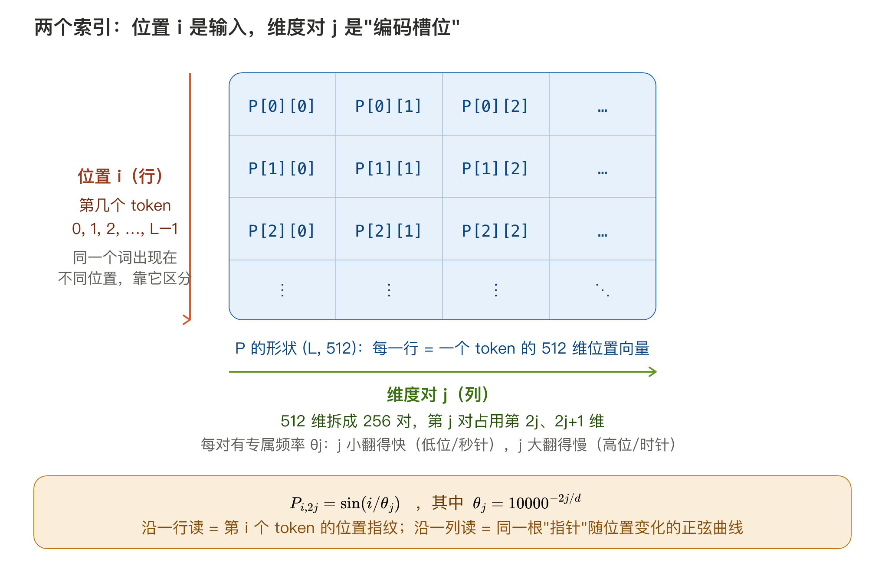
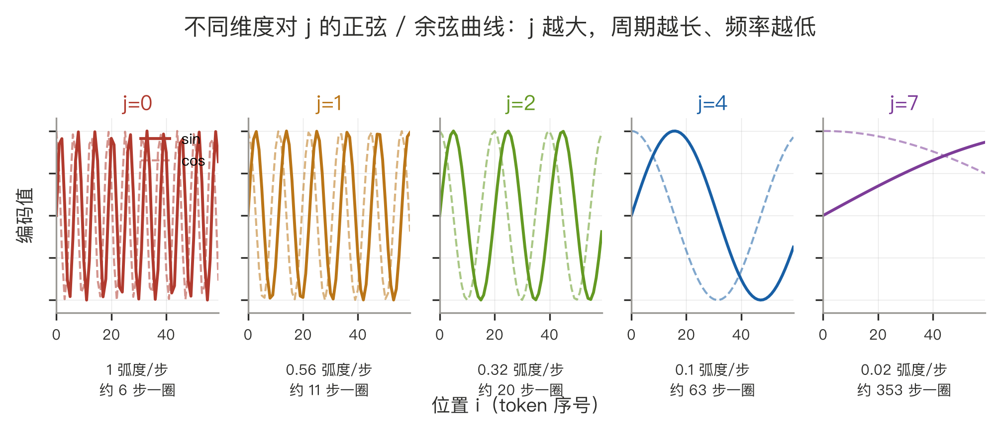
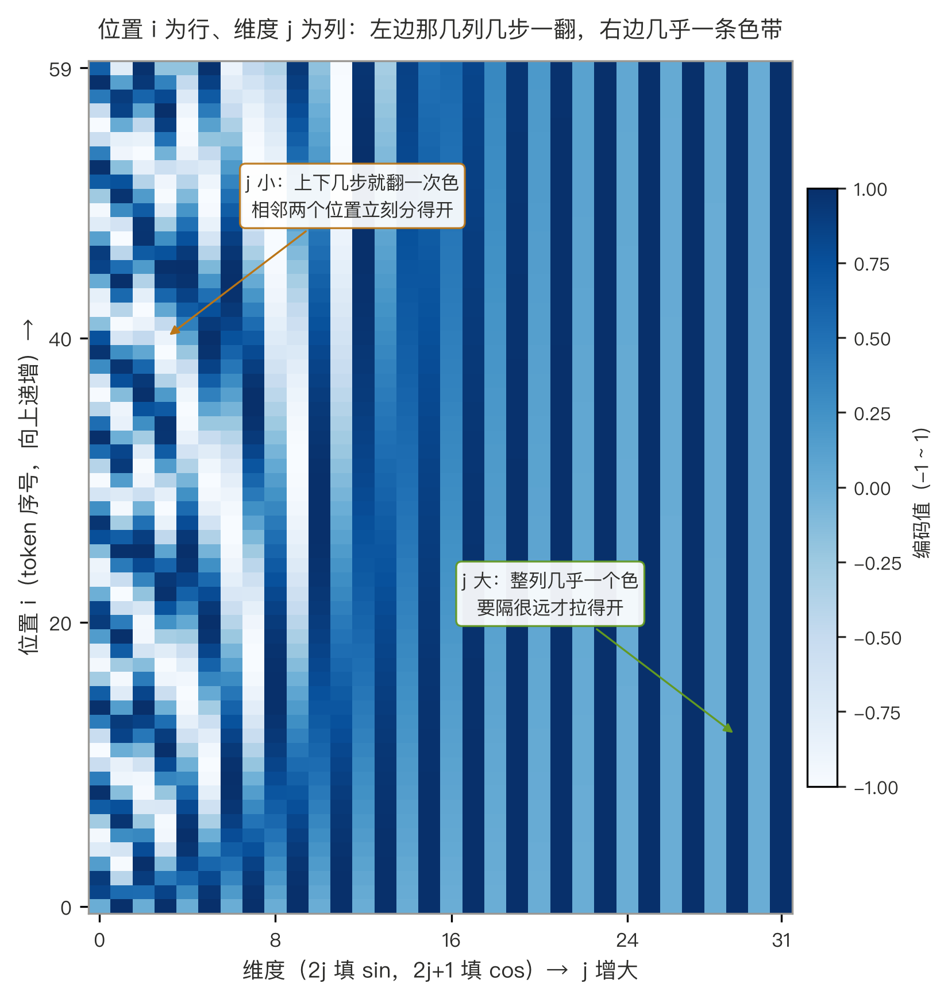
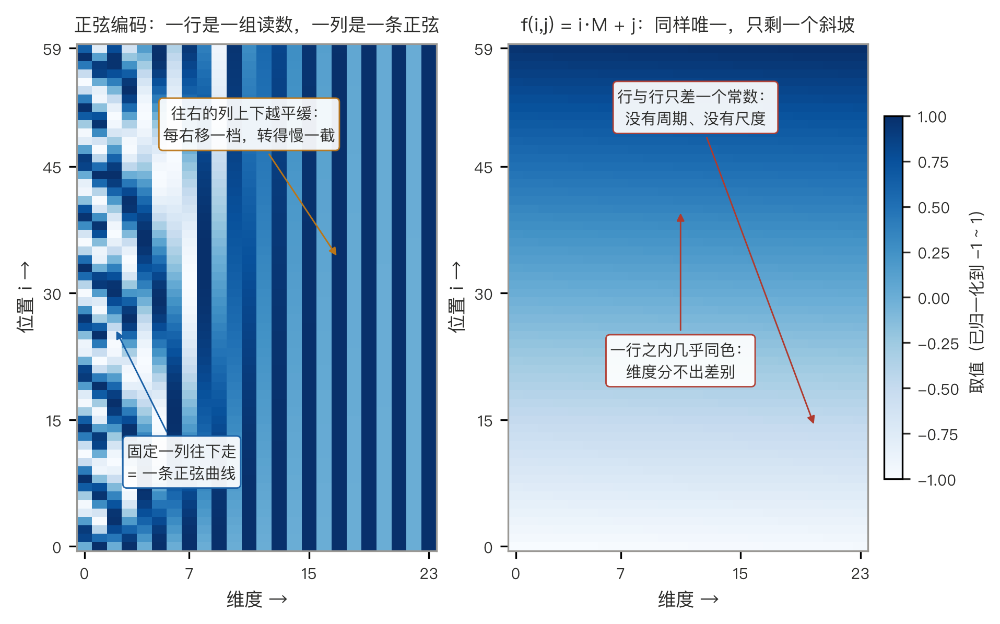
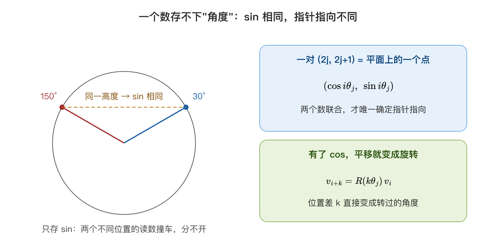
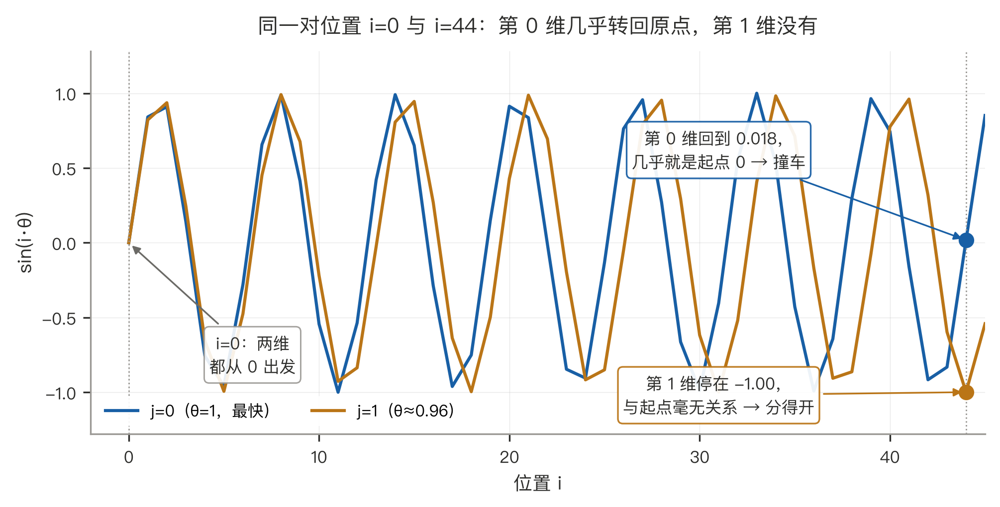
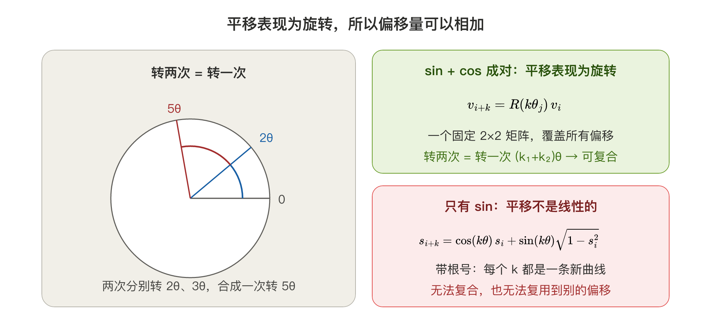
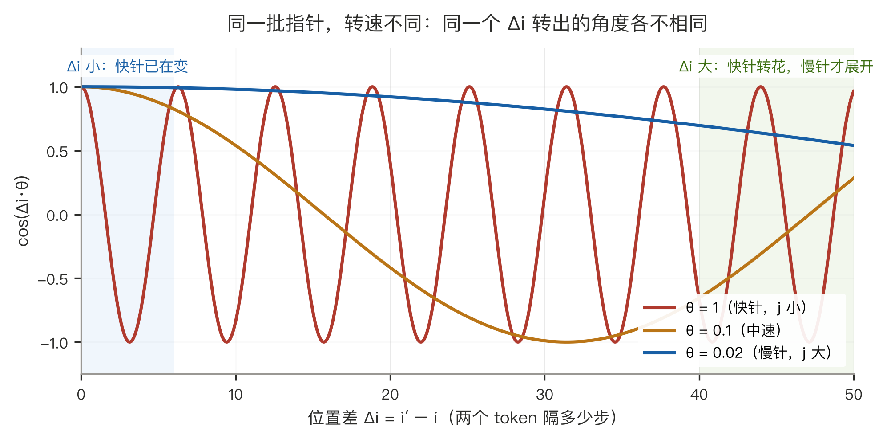
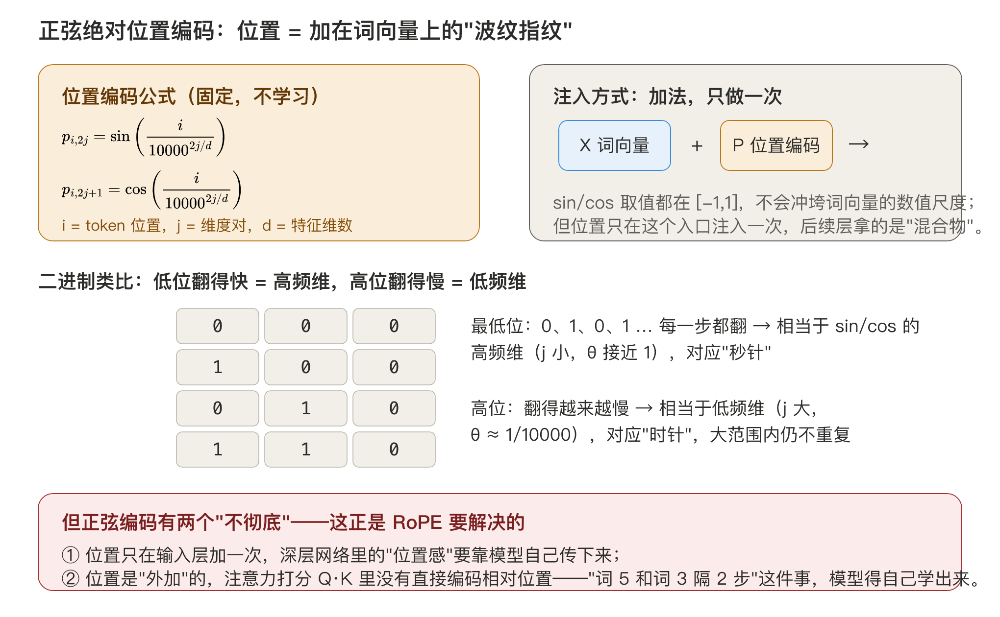
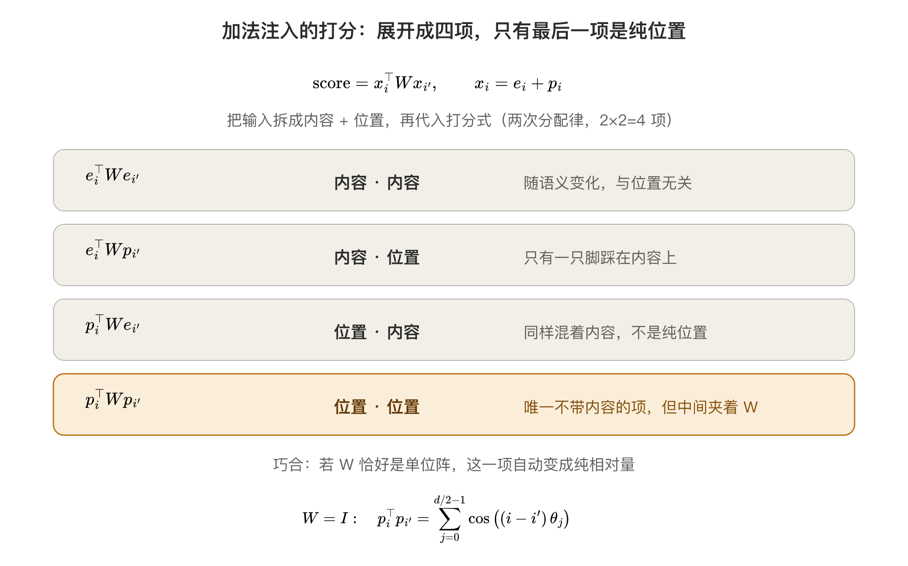

# 绝对位置编码：从正弦编码说起

> 学习笔记 · 2026-11-03
> 关键词：位置编码、正弦编码、正余弦、位置指纹、平移、唯一性、相对位置

---

## 一句话总结

> **正弦编码给每个位置一组转速不同的正余弦读数，直接加在词向量上：每个位置因此有了独一无二的"指纹"，绝对位置存住了；但这份位置信息一旦进入注意力打分，就会被 $W$ 搅散，相对关系仍要模型自己学。**

本篇只讲第一个方案。它为什么能存位置、又为什么存不住相对性，正好是下一篇 RoPE 的起点。

> 符号约定（本篇统一）：位置记作 $i$（行索引，token 在序列里的序号），两个 token 的位置记作 $i$ 与 $i'$，相对位置差记作 $\Delta i = i' - i$；维度对记作 $j$（列索引，第 $j$ 对占第 $2j$、$2j+1$ 维）。凡位置与频率相乘一律显式写乘号，如 $\Delta i\cdot\theta_j$。RoFormer 原论文用 $m$、$n$ 表示两个位置（对应关系 $m \leftrightarrow i$、$n \leftrightarrow i'$），读原文时可自行换算；复数视角中的虚数单位用正体 $\mathrm{i}$，与斜体的位置 $i$ 区分。

---

## 0. 这篇笔记的路线

按"发现问题 → 第一个方案 → 方案的裂缝"三步走：

1. **问题**（第 1 章）：注意力本身对顺序无感，得额外喂位置；
2. **第一个方案**（第 2 章）：正弦编码，把位置变成一组转速不同的数，**加**在词向量上；
3. **方案的裂缝**（2.8）：加法注入的位置项会被打分矩阵 $W$ 打散，相对性保不住。

其中 2.5 单独回答了一个更基本的问题——为什么位置想"学得动"，就必须以旋转的形式存在。这条结论下一篇要直接拿去做 RoPE 的骨架，所以它不是闲笔。

裂缝怎么补，是下一篇《旋转位置编码（RoPE）》的事。

---

## 1. 问题：注意力天生看不见顺序

### 1.1 点积只认向量内容，不认它是第几个进来的

自注意力的核心动作只有一句：拿第 $i$ 个 token 的 query，和每个 token 的 key 做点积，得到一个分数。点积只认向量之间的夹角和长度，**不认这些向量是第几个被塞进来的**：

$$
\text{score}(i,i')=\langle q_i,\ k_{i'}\rangle
$$

把"我打你"和"你打我"这两句话送进去——每个词的向量一模一样，只是位置换了一下——如果不做任何处理，两句话里同一对词的分数完全相同。**模型看不出主语和宾语被调了包。**

### 1.2 两种位置需求，别混为一谈

- **绝对位置**：这个词坐在第几号椅子上。需要"指纹"——每个位置有一组别人没有的读数；
- **相对位置**：这两个词隔了几把椅子。语言里真正有用的多是这个：修饰语和中心语的距离、代词和先行词的距离，跟句子从第几个字开始写没关系。

好的位置编码最好两样都给：**存的是绝对位置，用出来是相对关系**。第 2 章的正弦编码只做到了前半句，RoPE 把后半句也做到了。

---

## 2. 正弦编码：把位置变成一组数

### 2.1 公式与两个索引

先搭好舞台：词向量 $e_i$ 的特征维度是 $d$（如 512），后续的位置编码要和它**逐元素相加**，所以位置向量 $p_i$ 的维度也是 $d$——这就是公式里 $d$ 的来历。$p_i$ 由两族函数生成，token 的位置 $i$、每个 token 的维度对 $j$：

$$
p_{i,2j} = \sin\left(\frac{i}{10000^{2j/d}}\right), \quad p_{i,2j+1} = \cos\left(\frac{i}{10000^{2j/d}}\right)
$$

公式里两个下标是两个完全不同的角色：

- **位置 $i$（行索引）——输入**：token 在序列里的位置（0, 1, 2, …, L−1，L 是序列长度）。如果同一个词出现在第 2 个位置和第 10 个位置，它们的词向量相同，位置编码不同——$i$ 就是公式的**自变量**；
- **维度对 $j$（列索引）——输出的第几对维**：假设每个 token 的位置向量是 512 维，正余弦编码把它**两两配对**成 256 对，第 $j$ 对占用第 $2j$、$2j+1$ 维（一对里的两个维度分别填 sin、cos）。公式里出现 $j\times 2$ 就是从这里来的：$j$ 数的是"第几对"，一对占两个维度，换算成具体维号自然是 $2j$ 与 $2j+1$。每对有专属频率 $\theta_j = 10000^{-2j/d}$：$j$ 小转速快，$j$ 大转速慢。

**代入数字看一遍**（d = 512，位置 $i=5$ 的 token，只列三对维度）：

| 位置（行） | 维度对（列）             | 转速 $\theta_j=10000^{-2j/512}$ | 转角 $i\cdot\theta_j$ | 填进第 $2j$ 维（sin） | 填进第 $2j+1$ 维（cos） |
| ----- | ------------------ | ----------------------------- | ------------------- | --------------- | ----------------- |
| 5     | $j=0$ → 第 0、1 维    | 1.000 弧度/步                    | 5.00 弧度（≈287°）      | −0.959          | 0.284             |
| 5     | $j=3$ → 第 6、7 维    | 0.898 弧度/步                    | 4.49 弧度（≈257°）      | −0.975          | −0.222            |
| 5     | $j=31$ → 第 62、63 维 | 0.328 弧度/步                    | 1.64 弧度（≈94°）       | 0.998           | −0.068            |

这张表的读法值得说透：**固定某一对维度，公式就退化成一条曲线**。把 $j$ 定住，$p_{i,2j}=\sin(i\cdot\theta_j)$ 不再是"一个数"，而是"位置 $i$ 在一条正弦曲线上的取值"——$j$ 不同，$\theta_j$ 不同，曲线的疏密就不同：

- **$j=0$**：$\theta_0=10000^{0}=1$，位置每 +1 相位就 +1 弧度，约 6.3 步转完一圈。所以 $i=5$ 时已走了 5 弧度（约 287°），接近一整圈，$\sin$ 为负、$\cos$ 为小幅正值；
- **$j=3$**：$\theta_3=10000^{-6/512}\approx0.898$，同样 5 步走了 4.49 弧度（约 257°），转过了四分之三圈，$\sin$、$\cos$ 都是负值；
- **$j=31$**：$\theta_{31}=10000^{-62/512}\approx0.328$，5 步只走 1.64 弧度（约 94°），刚过四分之一圈，$\sin$ 接近最大、$\cos$ 略小于 0。

三行只是 256 对里的三个抽样点（$d=512$ 时 $j$ 从 0 排到 255，转速一路从 1 平滑降到约 $10^{-4}$）。于是"位置编码"可以读成一句很具体的话：**对每个token的位置 $i$，在 256 条疏密不同的正弦曲线和 256 条余弦曲线上各取一个值，拼成一个 512 维向量**。后面所有性质——唯一性、相对性、外推——都是这句话的推论。

还有一个容易走偏的地方要掰正：**模型不需要从编码倒推位置**。$i$ 是输入，编码只是 $i$ 的函数；真正要保证的是"不同 $i$ 得到不同编码"。而单独一对维度做不到：$\sin(i\theta_j)$ 每隔 $2\pi/\theta_j$ 步就会"转回差不多的角度"（$j=0$ 时仅 6.3 步，2.4 有具体算例）。要靠 256 对转速互不相同的读数**组合**起来，才在整个序列长度内不重复。

沿不同方向读矩阵 P（形状 (L, 512)）会得到两种图景：

- **沿一行读**（固定 $i$）：固定"哪一号座位"，读出此刻全部 256 根指针的指向——第 $i$ 个 token 的完整位置"指纹"；
- **沿一列读**（固定 $j$）：固定"哪一根指针"，看它的读数如何随位置变化——就是下一节画出的正弦/余弦曲线。

一句话：**$i$ 是座位号（输入，第几行），$j$ 标出的是这个 token 向量里不同位置上的那一对维——第 $j$ 对，占第 $2j$、$2j+1$ 维**。$i$ 决定"转多少"，$j$ 决定"用哪档转速、写进哪两维"。

再往紧里说一层：**整行编码就是从同一个起点转过去的结果**。记整行编码为 $\phi(i)=p_i\in\mathbb{R}^d$，$i=0$ 时每一对是 $(\sin 0,\ \cos 0)=(0,1)$——256 根针指着同一个方向。于是

$$
\phi(i)=R(-i\theta)\,\phi(0),\qquad \phi(0)=(0,\ 1,\ 0,\ 1,\ \ldots)
$$

（$\sin$ 写在前、$\cos$ 写在后，所以转动方向是顺时针；这是符号顺序，不影响任何只依赖 $\vert\Delta i\vert$ 的结论。）这句话在 2.5 会派上用场：起点固定，意味着"第几个位置"和"离起点走了多远"是同一个数——绝对的编码能顺手给出相对量，根就在这里。

### 2.2 画出来看：为什么这套读数能当地址

"$j$ 小转速快、$j$ 大转速慢"不必停留在公式上——把矩阵 P 真的画出来。

先**固定几根指针**（固定几个 $j$），看每根的读数如何随位置 $i$ 变化（图按 $d=32$ 画、只挑 5 对，便于看清疏密差别；$d=512$ 时共 256 对，规律完全相同）：

- **j = 0, 1, 2（最小的一批）**：60 步内分别转了约 9 个、5 个、3 个周期——位置每 +1，相位立刻挪一大步，是最灵敏的一批指针；
- **j = 4**：约 63 步转一圈，60 步刚好走完一个完整周期——负责中等尺度上的"远近感"；
- **j = 7**：要 353 步才转一圈，60 步只走了约六分之一，曲线看起来近乎一条缓慢爬升的直线——对相邻几步的变化几乎无感，要隔很远读数才拉开差距；
- sin 与 cos 相位差 90°，同一对里的两条曲线形状相同、只错开四分之一个周期——这就是每个维度对要同时存 sin 和 cos 两个数的原因（2.3 会看到：这两个数正好构成旋转的 cos 与 sin 分量）。

再**看整张矩阵**（60 个位置 × 32 维；方向与 2.1 的矩阵 P 一致：**行 = 位置 $i$，列 = 维度**）：

这张图要读两遍，各得一个结论：

- **把一列竖着往下读（位置 $i$ 每加 1）**：左边缘那几列几乎每行都换色，越往右换得越慢，最右边整列走完 60 步才转了 0.6°——同样是"位置在走"，快针一步一翻、慢针几乎不动；
- **把一行横着往右读（位置固定）**：一个 token 的全部读数。相邻两行的差别集中在左半边（快针已经转到不同相位），右半边几乎一样（慢针还没动）——"隔一两步"由左半边分辨，"隔很远"由右半边记录。

这里要把两个角色分清：**$i$ 是"数到几"，$j$ 是"第几根针"**。进位的动作由 $i$ 触发（位置往前走一格），哪一位翻得快由 $j$ 决定——所以"列"是针、"行"是时刻，竖着读才是"时间在走"。

对照里程表：位置每加 1，所有针各前进一步，但 $j=0$ 那根一步转 1 弧度（几乎换了个方向），$j=15$ 那根 60 步才挪 0.6°。**快针转完好几圈，慢针才挪一小段——慢针的相位恰好记着快针转了几圈，这就是进位**。只有一点不同：里程表满 10 清零、向高位进一，这里的相位一直累加、永不归零（2.4 会说清这个差别）。

"每个位置的读数各不相同"这件事本身并不稀罕——随便造一个单射都做得到，比如

$$
f(i,j)=i\cdot M+j\qquad(M\ge d)
$$

位置和维度一起塞进一个整数，任意两对 $(i,j)$ 都不撞号，可它当不了位置编码。所以"唯一"只是入场券，真正要问的是下面三条。

**第一条：位置一动，必须是"同一个动作"。**"第 5 个和第 9 个隔 4 步"与"第 105 个和第 109 个隔 4 步"，在位置这件事上是同一种关系。编码想反映它，就必须满足：位置从 $i$ 挪到 $i+k$，编码的变化**只由 $k$ 决定、与 $i$ 无关**。写成式子：存在一族操作 $T_k$，使得

$$
\phi(i+k)=T_k\,\phi(i),\qquad T_k\ \text{与起点}\ i\ \text{无关}
$$

这叫同态：编码把"位置的加法"翻译成"编码上的固定操作"。$f(i,j)=iM+j$ 在这条上露馅——$f(i+k,j)-f(i,j)=kM$ 确实只跟 $k$ 有关，但它是**加法**；而注意力打分用的是**乘法**（点积）。加法结构一进点积就被 $W$ 打散，位置和内容搅在一起分不开（第 3 章会看到旋转为什么分得开）。

**第二条：固定一个维度（固定 $j$），读数随位置必须是正弦——这是第一条逼出来的唯一解。**只看一个平面（一对 sin/cos），把两条约束加在 $T_k$ 上：

- 先走 $k_1$ 再走 $k_2$ 等于一次走 $k_1+k_2$，所以 $T_{k_1+k_2}=T_{k_1}T_{k_2}$（连续可乘族）；
- 编码值要能直接加到词向量上、不能随位置爆掉，所以 $T_k$ 有界。

连续可乘族一定是指数族 $T_k=e^{kA}$，看 $A$ 的特征值：为实数，则随位置指数增长或衰减到 0——增长会撑爆数值，衰减会让远处指针全部归零、位置信息丢失；两条路都堵死，只剩特征值为纯虚数的一支：**旋转** $T_k=R(k\theta)$。

于是 $\phi(i)=T_i\,\phi(0)=\big(r\cos(i\theta+\alpha),\ r\sin(i\theta+\alpha)\big)$——匀速圆周运动，外加一个固定的半径与初始角。**在一维上，既要"平移变成与起点无关的固定动作"、又要数值不爆、还不丢失信息，唯一的连续实现就是匀速圆周运动。**线性爬升、抛物线、指数曲线全都过不了这三关。所以"读数随位置呈正弦"不是设计者的口味，是被逼出来的；2.3 要成对也是同一个原因——圆周运动需要两个坐标才写得下。

**第三条：固定一个位置（固定 $i$），读数沿 $j$ 必须"按比例"递减——这是"位数"。**

一根针的职责由两个数概括：**步长** $\theta_j$（每走一步转多少）和**周期** $T_j=2\pi/\theta_j$（转一圈要多少步）。两者互为倒数，此消彼长：

|                 | $j=0$（最低位）     | $j=255$（$d=512$ 时最高位）   |
| --------------- | -------------- | ----------------------- |
| 步长 $\theta_j$   | 1 rad          | $1.04\times10^{-4}$ rad |
| 周期 $T_j$        | 6.3 步          | 60400 步                 |
| 精度（相邻步分得开吗）     | 一步差 1 rad，一眼可见 | 一步差万分之一 rad，淹没在数值噪声里    |
| 量程（多久转回一圈、开始混叠） | 6.3 步          | 6 万步                    |

**一根针不可能同时量程大、精度高**——$\theta_j$ 大则每步差异明显但很快转满一圈；$\theta_j$ 小则量程大但相邻步几乎无差别。要覆盖 2048 步、还要每一步都分得开，只能分工：**低位管精度，高位管量程**。

分工怎么排？两种排法差别巨大：

- **等差铺**（$\theta_j$ 每档减同一个量）：把 256 档从 1 匀速降到 $10^{-4}$，每档只减 $4\times10^{-6}$——前 250 档的周期全是 6.3 步左右，**250 个维度在干同一件事**，真正管远距离的慢针只剩个位数；
- **等比铺**（$\theta_j=\theta_0\,r^{\,j}$，每档乘同一个 $r=10000^{-2/d}\approx0.9647$）：每往右一档，周期就乘 1.037，**每个"十倍尺度"里恰好有 64 根针**，从 6 步到 6 万步，每个量程段都有人负责。

等比不是为了好看，而是因为**只有等比能让量程随针数指数增长**：256 根针攒出 $1.037^{255}\approx9600$ 倍；换成等差，256 根只能攒出 256 倍。"多一位数字，量程乘一个固定倍数"——这正是进位制里"位"的定义，所以这一条叫"位数"。

$10000^{-2j/d}$ 就是 $r=10000^{-2/d}$ 的等比数列，把总跨度定在 $10^4$ 倍：最快的 6.3 步一圈、最慢的 6 万步一圈。这个常数是两头夹出来的：

- **再大**（base $=10^6$）：最慢针周期 630 万步，相邻两步相位差 $10^{-6}$ rad，float32 里算出来是同一个数——这些维度白占；
- **再小**（base $=10^2$）：最慢针只覆盖 630 步，2048 的序列后半段没有高位可用。

所以 10000 是"量程够用"与"数值还分得清"的折中，不是理论最优——LongRoPE、NTK、YaRN 那批外推工作调的就是这个 base。

**最后说清这条类比的边界**：它不是二进制那种进位制。二进制每一位只有 $b$ 个状态，表示 2048 要 11 位；正弦每一位是连续相位，**一位就能表示任意长的序列**（只要精度够）。256 对维度不是为了"位数够"，而是让各种距离都有合适的针。准确的说法是：**把位置 $i$ 在对数尺度轴上投影成 256 个相位**，像一把对数刻度尺，相邻刻度只差 3.7%。

**三条合起来，才是"能存位置"的完整含义：**

| 要求  | 正弦族的答案                                                                      | 少了会怎样         |
| --- | --------------------------------------------------------------------------- | ------------- |
| 可区分 | 最快针管精度、最慢针管量程，读数组合够用（2.4）                                                   | 位置撞号          |
| 可搬运 | 平移表现为旋转 $R(k\theta)$，与起点无关                                                  | 每个距离都得单独学一条规则 |
| 可运算 | $\langle R(i\theta)u,\ R(i'\theta)v\rangle=u^\top R\big((i'-i)\theta\big)v$ | 位置只能当标签，进不了打分 |

把几种方案摆在一起，差别就现形了：

| 方案                   | 唯一                    | 平移表现为固定动作     | 与点积相容 | 能用吗            |
| -------------------- | --------------------- | ------------- | ----- | -------------- |
| $f(i,j)=iM+j$        | ✓                     | 只有加法，与乘性打分不同构 | ✗     | 只能当 ID         |
| 单频正弦 $\sin(i\theta)$ | ✗ 每 $2\pi/\theta$ 步重复 | ✓             | ✓     | 只覆盖一个周期        |
| 256 个随机频率            | 多半 ✓                  | ✓             | ✓     | 勉强：尺度有空档、外推无规律 |
| 等比多频 sin/cos         | ✓                     | ✓             | ✓     | ✓              |

这套设计到 RoPE 会被原样拿走：同一套 $j\to\theta_j$ 的转速分配（下一篇 2.1），只把"刻在数值上"换成"刻在旋转速度上"。

### 2.3 为什么必须成对：一个数存不下一个"角度"

sin 和 cos 总是成对出现（占相邻的 $2j$、$2j+1$ 两维）——不是冗余，是三个层次的要求：

**① 一个数存不下"角度"。** sin 只是圆上的"高度"。因为 $\sin(\phi)=\sin(\pi-\phi)$（关于 90° 对称），$\sin 30° = \sin 150° = 0.5$——两个不同的相位共用同一个读数。只存 sin，相位 $i\theta_j$ 和 $\pi-i\theta_j$ 无法区分，必然撞车。而 $(\cos i\theta_j,\ \sin i\theta_j)$ 两个数合起来是平面上的一个点，唯一确定"第 $j$ 根指针此刻指向哪里"——**每一对存的不是数值，是指向**。

**② 有了 cos，"平移"才能变成"旋转"。** 由 $\sin(a+b)=\sin a\cos b+\cos a\sin b$：

- 只有 sin：$\sin\big((i+k)\theta\big)=\cos(k\theta)\sin(i\theta)+\sin(k\theta)\sqrt{1-\sin^2(i\theta)}$ —— 带根号，每个 $k$ 是一条形状不同的非线性曲线，模型得为每个偏移各拟合一条；
- sin+cos 成对：$v_{i+k}=R(k\theta)\,v_i$ —— 一个固定的 2×2 矩阵，**所有偏移共用同一形式，只有角度不同**。

**③ 为 RoPE 铺路。** 下一篇 1.1 的旋转矩阵 $R(i\theta)$ 的四个元素恰好由 cos 与 sin 构成——旋转消费的正是这一对数；相邻配对让同一对天然属于同一个平面。

### 2.4 一根针会"撞车"，唯一性从哪来

2.1 说"不同 $i$ 要得到不同编码"，但把热图的某一列竖着往下看，颜色隔一段就"回来"了——同一根针，不同位置的读数可以非常接近。这会不会破坏唯一性？

算一个真实的例子。取 $d=512$ 的第 0 维（$\theta_0=1$），比 $i=0$ 和 $i=44$：

| 位置     | 相位 $i\theta_0$ | 折回一圈后                      | $(\sin,\ \cos)$   |
| ------ | -------------- | -------------------------- | ----------------- |
| $i=0$  | 0              | 0                          | $(0.000,\ 1.000)$ |
| $i=44$ | 44 rad         | $44-7\times2\pi=0.018$ rad | $(0.018,\ 1.000)$ |

44 rad 里装了整整 7 圈（$7\times6.283=43.98$），只剩 0.018 rad 的零头。第 0 维分不开这两个位置。

这叫**相位混叠**：一根针每隔 $T_j=2\pi/\theta_j$ 步就"差不多转回来一次"（$j=0$ 每 6.3 步一圈）。但第 1 维不同意：$44\times\theta_1=42.45$ rad，折回一圈后停在 $4.75$ rad（272°），与 $i=0$ 的 $0$ 相差将近 90°——一眼分开。**唯一性不是"每一维都不重复"，而是"不可能所有维同时重复"**：要让 256 根针同时混叠，$\Delta i$ 必须同时是 256 个周期的近似整数倍，而各周期之比 $10^{-(j-k)/64}$ 不是有理数，这种巧合在序列长度内不会发生。这与"中国剩余定理"是同一个思想：单独一个余数会骗人，多个余数联合就不会。

顺带说清一个容易混的点：**单维混叠不是 bug，是设计的一部分**。一根针只负责报告"自己转到了哪个角度"，本来就不该知道"转了几圈"——圈数由更慢的针记录。这正是 2.2 表盘的读法：看低位轮只知道"第几格"，看高位轮才知道"走了几万公里"。

**它和"位置差相同就旋转相同"矛盾吗？不矛盾**，这是两件事：

- **唯一性**：不同位置不撞车（$\phi(i)\ne\phi(i')$）；
- **同态**：同一种关系用同一个操作（$\phi(i+k)=T_k\,\phi(i)$）。

而且 $T_k$ 是旋转——旋转可逆（双射），不会把两个不同的点压成一个点。所以"关系一致"不但不破坏唯一性，反而保证它在整体平移下不变：$i$ 与 $i'$ 分得开，$i+k$ 与 $i'+k$ 也分得开。

最后一个细节值得量化：**单维不是"数学上撞"，是"在浮点里撞"**。精确重合要求相位差是 $2\pi$ 的整数倍，而 $2\pi$ 是无理数、位置是整数，永远踩不中——数学上严格不重复。但在 2048 的长度里，总有几对位置近到机器分不出来（$d=512$）：

| 只看            | 最接近的一对（$i\le2047$） | 读数差                | float32 分得出吗    |
| ------------- | ------------------ | ------------------ | --------------- |
| 第 0 维（$\sin$） | $i=11$ 与 $i=344$   | $1.3\times10^{-7}$ | 恰好卡在分辨率上，等于没有差别 |
| 第 1 维（$\cos$） | $i=0$ 与 $i=710$    | $1.8\times10^{-9}$ | 差两个数量级，完全认不出    |

float32 在 1 附近只能分辨约 $10^{-7}$。所以单针的短板是**分辨率**，不是逻辑——这正是上面"多针联合"要解决的问题。

### 2.5 为什么平移必须在编码里表现为旋转

位置从 $i$ 挪到 $i+k$，编码不是被"加上"一个与 $i$ 有关的量，而是被**转**了一个只由 $k$ 决定的角度：

$$
\phi(i+k)=R(k\theta)\,\phi(i)
$$

等号两边在两个空间里——左边是位置轴上的平移，右边是编码空间里的旋转，这个"="是"翻译"，不是"等同"。为什么说"必须"而不是"可以"？把 2.3 的 ② 展开成一张对照表——"能存位置"和"学得动位置"是两回事：

| 层次       | 要求            | 只有 sin                     | sin + cos 成对 |
| -------- | ------------- | -------------------------- | ------------ |
| 可表示（能存）  | 不同 $i$ 得到不同编码 | 不满足（每 $2\pi/\theta_j$ 步重复） | 满足           |
| 可学（好训练）  | 位置平移表现为固定线性算子 | 不满足                        | 满足           |
| 可组合（能外推） | 偏移量能相加        | 不满足                        | 满足           |

成对之后，$i \mapsto R(i\theta)$ 是一个**同态**：位置的加法 ↔ 旋转的复合，$R(k_1\theta)R(k_2\theta)=R\big((k_1+k_2)\theta\big)$。只取 sin 相当于只记下旋转矩阵第一列里的一个数——群结构丢了，不能复合、不能求逆。这个性质好在三处：

- **参数/样本效率**：模型学的是"怎么比较"（一份规则），偏移由已知旋转承担，不为每个 $k$ 存一条规则。换个说法：若位置只是一组任意函数，模型面对的是"每一个可能的偏移各有一条独立变换"，那是无穷多条规则；成对之后，所有偏移共用同一个 2×2 矩阵、只是角度不同——**从"学一个任意函数"退化成"套一个参数固定的线性算子"**，需要学的只剩内容怎么比。（注意 $R(k\theta)$ 里的 $k$ 是偏移了几步，不是待学参数。）
- **可组合**：没直接见过的偏移，可以由见过的偏移拼出来；
- **能与点积配合**：旋转能"穿过"注意力打分——下一篇 1.1 的恒等式由此成立。

**现在把"区分"这件事拆开——问的是绝对位置，还是距离？**

**问题一：两个绝对位置 $i$ 与 $i'$ 不同，靠什么区分？** 假设 $\phi(i)=\phi(i')$，则每一对都满足 $i\theta_j\equiv i'\theta_j\pmod{2\pi}$，即 $\Delta i\cdot\theta_j\in2\pi\mathbb{Z}$ 对全部 $j$ 成立。只取 $j=0$：$\Delta i=2\pi n$。左边整数、右边无理数倍，只有 $\Delta i=0$。**数学上，最快那根针一根就够区分所有绝对位置**（浮点上不够，2.4 已量化）。

**问题二：两个距离 $\Delta i$ 与 $\Delta i'$ 不同，靠什么区分？** 位置只以 $\Delta i$ 的形式进入打分，所以"距离不同"必须由读数不同来体现。看那 256 对 $(\cos(\Delta i\cdot\theta_j),\ \sin(\Delta i\cdot\theta_j))$——**必须成对**：单看 $\cos$ 是偶函数，$\Delta i$ 与 $-\Delta i$ 会给出同一组值，只有 $\sin$ 的符号能把方向分开。若两组成对读数相同，取 $j=0$ 得 $\Delta i\equiv\Delta i'\pmod{2\pi}$，即 $\Delta i-\Delta i'=2\pi n$，只有 $\Delta i=\Delta i'$。所以这组成对读数也是单射。

两个证明的骨架是同一句话：$\theta_0=1$ 与 $2\pi$ 不可公度，整数步永远踩不中整圈。

**而这两个问题其实是同一个问题**，因为 $\phi(i)=R(-i\theta)\phi(0)$（2.1）：起点固定，"我是第几个"和"我离起点走了多远"就是同一个数。绝对位置编码能顺手给出相对量，根在这里。

转速快（$\theta$ 大）的指针在 $\Delta i$ 稍大时就"转花"了——快速振荡、平均趋近 0；转速慢的指针要 $\Delta i$ 很大才展开读数。**多转速组合保证：训练范围内的每个 $\Delta i$ 都有唯一的读数组合作指纹。**

**但模型不读指纹，它只算一个标量。** 上面那 256 个数是"要把 $\Delta i$ 解出来"所需的全部信息；模型不做这件事，它算的是 $q^\top k=\sum_j\big[\cos(\Delta i\cdot\theta_j)\,s_j+\sin(\Delta i\cdot\theta_j)\,c_j\big]$——**256 个数在求和那一步被压成一个 logit**。取 $W=I$、$d=512$ 实测：$\Delta i=1629$ 与 $\Delta i=1816$ 这两组读数，逐维最大差 **1.98**（几乎处处相反），可它们的和只差 **$2.2\times10^{-5}$**（33.093927 与 33.093949）。

指纹在求和时被吃掉了。这正是 2.8 那句"相对性在编码层存在、却在打分层被 $W$ 打散"的具体样子：单个标量不足以保证不同距离给出不同分数，得靠 $W_Q,W_K$ 从数据里学。下一篇把旋转搬到 $W$ 外面，就是为了让相对性不再取决于 $W$ 长什么样。

### 2.6 j 的两个身份：转速编号与维度对的位置

$j$ 同时扮演两个角色，分量不同：

- **转速编号（主身份）**：$j \to \theta_j = 10000^{-2j/d}$，设计固定、不参与学习；
- **维度对的位置**：不同位置的维度对——$j$ 决定这一对落在第 $2j$、$2j+1$ 维。这个身份在两种编码里分量不同：
  - **绝对位置编码**：把 256 对任意重排，等价于给维度重新编号——后续线性层 $W$ 的列跟着重排即可吸收，配对顺序本身不携带信息；
  - **RoPE**：旋转矩阵是分块对角的，块必须和坐标布局严格对齐——`view` 要求同一对的两维在内存里相邻，否则要换成 GPT-NeoX 的前后半配对约定（见下一篇 5.1）。**训练用哪种布局，推理必须用哪种。**

**"各维等价"要分两句话说**：内容维度上等价（可置换、$W$ 吸收）；位置维度上不等价（$\theta_j$ 各不相同——若所有对同速，256 对就退化成 256 份重复信息，指纹立刻塌掉）。判据是"互换后结果是否改变"：换配对顺序不变 ✓，换转速立刻变 ✗。

### 2.7 两条直觉（收拢）

把 2.1–2.6 收拢成两条设计意图，**后面会原封不动地迁移到 RoPE**：

- **多转速 ≈ 里程表（类比，不是等价）**：二进制低位每步翻、高位隔很久才翻；正弦编码 $j$ 小转速快、$j$ 大转速慢，同一套"快慢分档"——但读数是连续相位而非 0/1，也不是"满 $b$ 进一"的离散进位（2.2 的进位类比与 2.4 的边界说明）；
- **取值 [-1, 1]**：和词向量相加不会冲垮数值尺度（这就是  `X + P` 直接加的原因）。

### 2.8 两个"不彻底"——现在能说清为什么了

1. **位置只在输入层加一次**。第 2 层、第 3 层……拿到的是被注意力反复改写过的"混合物"，位置感要靠网络自己传下来；
2. **加法注入与注意力打分解耦**。先看打分本身怎么写：

$$
\text{score}(i,i')=q_i^\top k_{i'}=(W_Qx_i)^\top(W_Kx_{i'})=x_i^\top Wx_{i'},\qquad W=W_Q^\top W_K
$$

（第一个等号是点积的矩阵写法；第二个等号用了 $(Av)^\top=v^\top A^\top$，把 $W_Q$ 的转置搬到最前面；偏置略去。）

把 $x_i=e_i+p_i$、$x_{i'}=e_{i'}+p_{i'}$ 代入。这一步没有任何新东西，就是**两次分配律**：$x^\top Wx_{i'}$ 对左边的因子是线性的，先拆它，得两项；每一项对右边的因子还是线性的，再各拆一次，$2\times2=4$ 项——和 $(a+b)(c+d)=ac+ad+bc+bd$ 完全同构：

$$
(e_i+p_i)^\top W(e_{i'}+p_{i'})
= e_i^\top W(e_{i'}+p_{i'}) + p_i^\top W(e_{i'}+p_{i'})
$$

$$
= \underbrace{e_i^\top We_{i'}}_{\text{内容·内容}} + \underbrace{e_i^\top Wp_{i'}}_{\text{内容·位置}} + \underbrace{p_i^\top We_{i'}}_{\text{位置·内容}} + \underbrace{p_i^\top Wp_{i'}}_{\text{位置·位置}}
$$

| 项 | 谁 × 谁 | 依赖什么 | 在打分里干什么 |
| --- | --- | --- | --- |
| $e_i^\top We_{i'}$ | 内容 × 内容 | 两个 token 的语义 | 没有位置编码时的原始打分 |
| $e_i^\top Wp_{i'}$ | query 内容 × key 位置 | $e_i$ 与绝对位置 $i'$ | key 位置向量投影后的量 $W_Kp_{i'}$，与 query 内容 $W_Qe_i$ 点积——得多少分看 query 内容 |
| $p_i^\top We_{i'}$ | query 位置 × key 内容 | 绝对位置 $i$ 与 $e_{i'}$ | query 位置向量投影后的量 $W_Qp_i$，与 key 内容 $W_Ke_{i'}$ 点积——得多少分看 key 内容 |
| $p_i^\top Wp_{i'}$ | 位置 × 位置 | $i$、$i'$ 与 $W$ | 唯一不带内容的项 |

前三项都有一只"脚"踩在内容上，位置的影响被摊进内容里、拆不出来。

**为什么盯着 $i-i'$ 不放？** 语言里"相隔 3 个词"这种关系，出现在句首和句尾是同一件事——模型学到的"远距离两个词怎么互相看"该照旧生效，不该因为挪到第 500 个位置就失灵。若打分要分别看 $i$、$i'$ 各是第几个，同一条规律就得每个位置各学一遍；长位置样本少，学不到的部分就成了"长文失忆"。反过来，只要位置这一侧的影响压成一个自变量、且进去的就是距离，一条规律就覆盖所有位置对，长度变了也不必重学（可外推）：

$$
\text{score}(i,i')=h\big(e_i,\ e_{i'},\ \Delta i\big),\qquad \Delta i=i'-i
$$

位置只从第三个入口进来，且进来的只能是 $\Delta i$。**这一行就是 RoPE 的设计目标**——下一篇要做的，是把它从愿望变成能算的公式。

想要"只依赖 $i-i'$ 的分数"，只能指望第四项。

**但第四项也指望不上——$W$ 会把它打散。**把求和写开（$a,b$ 是维号，0 到 $d-1$）：

$$
p_i^\top Wp_{i'}=\sum_{a=0}^{d-1}\sum_{b=0}^{d-1}W_{ab}\,p_{i,a}\,p_{i',b}
$$

每个乘积 $p_{i,a}\,p_{i',b}$ 都是两个三角函数相乘，可以积化和差，关键看**频率怎么配对**：

- **同一维度对内**（$a=2m,b=2m$ 或 $a=2m{+}1,b=2m{+}1$）：$\sin(i\theta_m)\sin(i'\theta_m)+\cos(i\theta_m)\cos(i'\theta_m)=\cos\big((i-i')\theta_m\big)$——$i$ 与 $i'$ 顺利相减；
- **跨维度对**（$m\ne l$）：得到 $\cos(i\theta_m-i'\theta_l)$ 之类的项——两个转速不同，$i$ 绑着 $\theta_m$、$i'$ 绑着 $\theta_l$，**怎么也合并不出 $i-i'$**。

$W$ 的每个元素决定"哪两维相乘"，而 $W=W_Q^\top W_K$ 是学出来的**满矩阵**：跨维度对的交叉项大量存在，相对性就被搅散了。只有当 $W$ 恰好把同频率的分量配对——最理想是 $W=I$——才只剩对角块上的 $\sin\cdot\sin+\cos\cdot\cos$：

$$
p_i^\top p_{i'}=\sum_{j=0}^{d/2-1}\cos\big((i-i')\theta_j\big)
$$

相对性自动出现。**可惜没有任何机制保证 $W$ 是单位阵**——相对性在编码层存在，却在打分层被 $W$ 打散，模型只能从数据里自己学。

RoPE 的答案：**别加了，转起来——把旋转搬到 $W$ 外面去**。

下一篇《旋转位置编码（RoPE）》就从这条裂缝出发：先看"转"为什么能让打分只剩角度差，再把它铺到整个头维度、装进每一层注意力。
