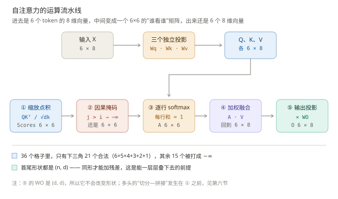
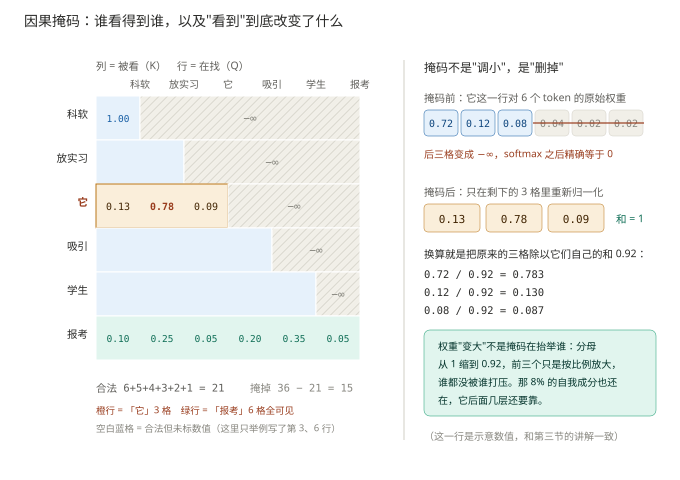
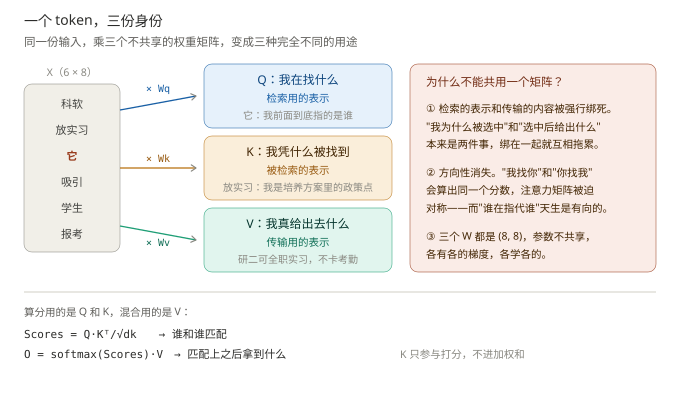
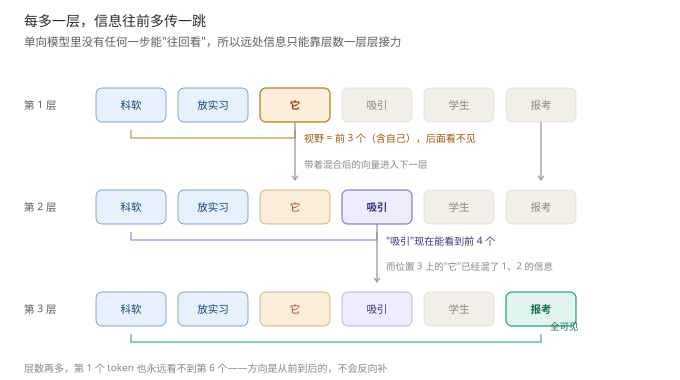
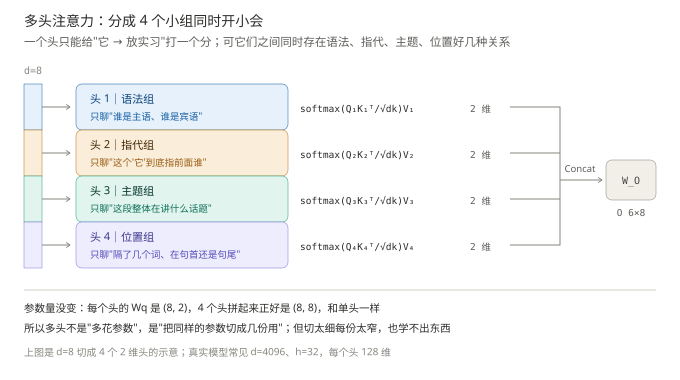
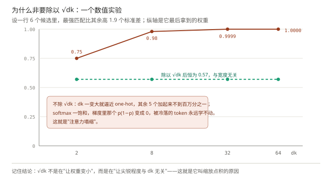

# 自注意力机制完整推导与讲解

### 用[科软, 放实习, 它, 吸引, 学生, 报考]这6个token举例

### 〇、注意力有两个版本，公式一模一样，只差一个掩码：

- **decoder-only（GPT / LLaMA / Qwen）**：每个 token 只能看**自己和前面**的 token。用来"接着往下写"。
- **encoder 双向（BERT）**：每个 token 能看**全部** token，包括后面的。用来"把空填上"。

这份笔记讲**第一种**，因为现在说"LLM"基本都是它。所以后面"它"这个代词只能往前找"科软""放实习"，看不到后面的"吸引""学生""报考"——这不是模型笨，是规则不许。  
如果是 BERT 那种，把公式总览第 3 步那个掩码整个删掉就行，其余一个字都不用改。这也是为什么说"自注意力本身只是个加权平均，双向还是单向是掩码决定的"。

---

## 一、核心运算公式总览

假设输入序列长度为 $n$，每个 token 的 embedding 维度为 $d$（这里先讲单头，多头在后面第六节补）：

1. **三个独立可学习投影**（$W_q$、$W_k$、$W_v$ 形状都是 $(d,d)$，不共享参数）

   $$Q = XW_q,\qquad K = XW_k,\qquad V = XW_v$$

   $X \in \mathbb{R}^{n\times d}$，所以 $Q,K,V \in \mathbb{R}^{n\times d}$，和输入维度完全对齐。

2. **算两两匹配分数，除以 $\sqrt{d_k}$ 防止 softmax 饱和**

   $$\text{Scores} = \frac{QK^\top}{\sqrt{d_k}} \in \mathbb{R}^{n\times n}$$

   $K^\top$ 是 $(d,n)$，所以 Scores 是 $(n,n)$ 方阵，第 $i$ 行第 $j$ 列 = 第 $i$ 个 token 对第 $j$ 个 token 的匹配分。

3. **加因果掩码：把"不许看"的格子打成 $-\infty$**

   $$\text{Scores}^{\text{masked}}_{ij} =
   \begin{cases}
   \dfrac{q_i^\top k_j}{\sqrt{d_k}}, & j \le i \\[6pt]
   -\infty, & j > i
   \end{cases}$$

   打完之后还是个 $(n,n)$ 矩阵，但只有下三角（含对角线）有值，上三角全是 $-\infty$。

4. **逐行 softmax，得到注意力权重**

   $$A = \operatorname{softmax}_{\text{row}}\left(\text{Scores}^{\text{masked}}\right),
   \qquad A_{ij} = \frac{\exp\!\left(s_{ij}\right)}{\sum_{j'\le i}\exp\!\left(s_{ij'}\right)},
   \qquad \sum_{j} A_{ij} = 1$$

   $A$ 还是 $(n,n)$，每一行的权重和严格为 1，但那一行里只有前 $i$ 个格子有权重。

5. **加权融合，再做一次输出投影**

   $$O = AVW_O \in \mathbb{R}^{n\times d}$$

   $AV$ 是 $(n,d)$，$W_O$ 也是 $(d,d)$，所以 $O$ 还是 $(n,d)$，和输入 $X$ 完全同形——**这一步很关键，不同形就没法加残差了**。

6. **一个 Block（pre-LN 版，现在的主流写法）**
   $$
   \begin{aligned}
   \text{pre-LN:}\quad
   & x_1 = x + \operatorname{MHA}\!\left(\operatorname{LN}(x)\right)\\
   & x_2 = x_1 + \operatorname{FFN}\!\left(\operatorname{LN}(x_1)\right)\\[8pt]
   \text{post-LN:}\quad
   & x_1 = \operatorname{LN}\!\left(x + \operatorname{Attn}(x)\right)\\
   & x_2 = \operatorname{LN}\!\left(x_1 + \operatorname{FFN}(x_1)\right)
   \end{aligned}
   $$
   差别只在 LN 站的位置，但后果很大：**post-LN 每层都会把残差流重新"格式化"一遍，所以深了必须靠 learning rate warmup 硬扛（原论文 warmup 了 4000 步）；pre-LN 的残差流从头到尾不过 LN，是一条干净的加法总线，所以能堆到 80 层、120 层。**

---

## 二、维度账：把每一步的形状写清楚

还是用那句话：$n = 6$、$d = 8$，句子是 `[科软, 放实习, 它, 吸引, 学生, 报考]`。

| 张量                | 形状        | 说明                                            |
| ----------------- | --------- | --------------------------------------------- |
| $X$               | $(6, 8)$  | 6 个 token，每个 8 维                              |
| $W_q / W_k / W_v$ | $(8, 8)$  | 单头时就是 $d\times d$；多头时每个头是 $(8, 8/h)$          |
| $Q / K / V$       | $(6, 8)$  | 和 $X$ 同形，所以后面能一路加残差                           |
| $QK^\top$         | $(6, 6)$  | 36 个格子，每格是一个 token 对                          |
| 掩码后               | $(6, 6)$  | 只剩 21 个合法格子（$6+5+4+3+2+1$），其余 15 个是 $-\infty$ |
| $A$               | $(6, 6)$  | 每行和为 1，但第 1 行只有 1 个非零                         |
| $O$               | $(6, 8)$  | 回到 $(n,d)$                                    |
| FFN 中间层           | $(6, 32)$ | $8 \to 32\;(\text{即 } 4d) \to 8$，这一步会临时变宽     |

这里有个容易被忽略的点：**$n\times n$ 的矩阵里有一半是浪费的**。因果掩码下只有下三角有用，所以真实计算里一半的格子算出来马上就扔了——这也是为什么后来会有人研究"只算下三角"的优化。

---

## 三、结合场景：六位同学准备宣讲材料

这六个 token 对应六位坐在一起准备科软招生宣讲材料的同学，身份和自己的内容绑定：科软同学讲学校基本情况，放实习同学讲培养方案里的全职实习政策，它同学刚写了个悬空的代词还没定指代谁，吸引同学讲政策的传播效果，学生同学讲想报考的这类人，报考同学讲最后的报名动作。

刚开始大家各自手里只有自己那部分草稿，互相还没交流。

---

### 第一步：投影生成 Q/K/V

用三个权重矩阵，分别把大家的初始草稿投影成三种角色：

- **$Q$ 矩阵**里每一行是对应同学的**信息需求**：它同学的需求最迫切——"我前面到底指的是谁？得找一下谁的内容和语境匹配"；放实习同学的需求是——"我讲的政策，前面那个主体是谁，我得对上"。
- **$K$ 矩阵**里每一行是对应同学给自己内容贴的**标签**：放实习同学标"我是培养方案里最吸引考生的政策点"，科软同学标"我是学校主体，是宣讲的开场"。
- **$V$ 矩阵**里每一行是对应同学真正要分享的**干货**：放实习同学写的是"研二可以全职出去实习，不卡考勤，实习经历和论文答辩衔接顺畅"；学生同学写的是"想考科软的同学，最看重实习机会和就业资源"。

**为什么非要三个矩阵、不能共用一个？** 因为这三件事本来就不该绑在一起：$Q$ 是"我在找什么"（检索用的表示），$K$ 是"我怎么被人找到"（被检索用的表示），$V$ 是"我真给出去什么"（传输用的表示）。如果共用一个投影，检索的表示和传输的内容就被强行绑死，而且"我找你"和"你找我"会算出同一个分数，模型就表达不出方向性了。

---

### 第二步：算匹配分数 Scores

按 $\text{Scores} = QK^\top/\sqrt{d_k}$ 算出一个 $6\times 6$ 的分数矩阵。重点看"它"这一行：和放实习同学的分数最高（刚好对上"我在找指代对象"的需求），和科软同学分数中等，和自己分数偏低，和后面三位……先别急着算，这里要先打掩码。

"它"是第 3 个 token，按规则它只能看第 1、2、3 个（科软、放实习、自己）。后面三位（吸引、学生、报考）在它后面，分数直接被打成 $-\infty$，softmax 之后就是 0。

所以它同学这一行的真实情况是：**它压根看不到后面三位同学的草稿，只能对着前两位和自己做判断**。这就是 decoder 的宿命——写第 3 个词的时候，第 4 个词还没被写出来呢。

顺便说一句，为什么分数要除以 $\sqrt{d_k}$：如果每个 $q$、$k$ 的分量都是独立、均值 0、方差 1，那它们点乘出来的方差是 $d_k$，标准差是 $\sqrt{d_k}$。$d_k$ 越大，分数就越容易跑到 $\pm 30$ 这种量级，softmax 一压就直接变成 one-hot（一个 1，其余全是 0），梯度跟着消失，参数学不动。除以 $\sqrt{d_k}$ 相当于把分数的标准差重新拉回 1 附近，不管 $d_k$ 是 8 还是 128，注意力的"尖锐程度"都稳定在同一个水平。后面第七节有张表，把这件事算给你看。

---

### 第三步：softmax 得到注意力权重

逐行做 softmax。它同学这一行（只有 3 个合法格子）是：

| 对象  | 权重       |
| --- | -------- |
| 放实习 | **0.78** |
| 科软  | 0.13     |
| 它自己 | 0.09     |

也就是说它同学把 78% 的注意力给了放实习同学。

**这三个数不是重新拍的，是从上一版的 0.72 / 0.12 / 0.08 换算出来的。** 上一版没打掩码时它这一行是 0.72、0.12、0.08、0.04、0.02、0.02（和正好是 1）。现在后三位被 $-\infty$ 干掉，softmax 只在前三位里归一化，等于把原来那 0.92 重新当成 1：

- $0.72 / 0.92 = 0.783$
- $0.12 / 0.92 = 0.130$
- $0.08 / 0.92 = 0.087$

加起来正好 1。**这就是掩码的真实作用：不是"降低"后面那些格子的权重，而是把它们从分母里彻底删掉，让剩下的按原比例放大。** 记住这一点，以后看到"为什么加了 mask 之后权重变了"就不会困惑了。

放实习同学那一行呢？它是第 2 个，只能看第 1、2 个。所以它只能参考科软和自己，看不到"吸引""学生""报考"——**它永远不知道自己的政策是卖点，这个结论是后面的人算出来的，不是它自己算出来的。**（这一点和上一版的说法不同，上一版说"放实习也会融合吸引、学生的内容"，在单向模型里物理上不可能，因为信息只能从前往后流。）

反过来，"报考"是第 6 个，它可以看全部 5 位前辈加自己，权重可以是：

| 对象 | 学生   | 放实习  | 吸引   | 科软   | 它    | 自己   |
| -- | ---- | ---- | ---- | ---- | ---- | ---- |
| 权重 | 0.35 | 0.25 | 0.20 | 0.10 | 0.05 | 0.05 |

核对一下：$0.35+0.25+0.20+0.10+0.05+0.05 = 1.00$。你看，**越靠后的 token 能看到的东西越多，越靠前的越"孤独"**。第一个 token 天生只能看自己，权重必然是 1.0。

---

### 第四步：加权融合得到输出 O

按 $O = AV$ 算，每个同学按自己定的比例，把别人的干货抄进自己的向量。它同学的新向量展开就是：

$$
O_{\text{它}} = 0.78\,V_{\text{放实习}} + 0.13\,V_{\text{科软}} + 0.09\,V_{\text{它}}
$$

算完之后，它同学的笔记已经不是那个悬空的代词了，而是"科软允许全职实习这个政策"的加权混合——**注意它是"混合"不是"替换"**，还剩 9% 是它自己，这个自我成分让"我是个代词"这件事没被完全冲掉，后面几层还要靠它。

这就是自注意力最反直觉的一点：**它不是"谁离得近就给谁权重"，而是靠学出来的投影判断谁在语义上匹配。** 第 3 个词和第 2 个词相邻，权重 0.78；和更远的第 1 个词，只有 0.13。位置近只是巧合，真正的依据是 $QK^\top$。

（补一句：$QK^\top$ 是学出来的双线性型，它跟"人类觉得这两个词意思像"没有必然关系。有时候它学的是语法依存，有时候学的是"这俩词经常一起出现"，别把它当成语义相似度。）

---

### 第五步：走完一个完整的 Transformer Block

$O$ 算出来不代表这一层结束，还要走完四件事。**这里按 pre-LN 讲，因为现在几乎所有 LLM 都是这么写的：**

$$
\begin{aligned}
x_1 &= x + \operatorname{MHA}\!\left(\operatorname{LN}(x)\right)\\
x_2 &= x_1 + \operatorname{FFN}\!\left(\operatorname{LN}(x_1)\right)
\end{aligned}
$$

1. **层归一化（先做）**：把每个 token 的 8 维向量各自拉成均值 0、方差 1，再乘一个可学的缩放和偏置。注意是**每个 token 自己管自己**，跨的是那 8 个特征维度，六个 token 之间一点都不交流——就像每个人把自己那张纸的字号、行距调统一，好让下一环节读起来不费劲，但六个人不会互相商量。它管的是"数值尺度稳定、优化好走"，**不是**"防止梯度消失"（那是残差的活）。
2. **多头注意力（再算）**：就是前面那四步，只不过同时开好几组（第六节细讲）。
3. **第一次残差：$x_1 = x + \operatorname{Attn}(\cdots)$**。**这是加法，不是拼接。** 维度没变，还是 8 维，只是把"注意力加工出来的增量"叠到原来的向量上。像什么？像每个人手里是一张**只增不改的透明胶片**，每过一层就往上叠一张新的。原始草稿永远压在最底下那一层，从来没有被涂改过——想读原始信息，往下翻就行。这才是"原始信息不会丢"的真正机制，也是为什么每一层只需要学"这次往上加什么增量"，而不用重新学"这个向量该长什么样"（学增量比学整体容易得多，这也是深网络能训起来的原因）。
4. **前馈网络 FFN**：$8 \to 32 \to 8$ 的两层线性 + 一个非线性激活。**这一步是唯一不跨 token 的操作**，每个 token 关起门来自己加工。比喻就是：抄完别人的笔记，自己回座位上把这段内容反刍、抽象成自己的话——"放实习""吸引""报考"三张零散的纸，最后被压成一句"科软全职实习是吸引考生报考的核心卖点"。

   两个细节：为什么中间要扩到 4 倍？因为要给非线性留出足够大的"工作空间"，宽度不够，ReLU 折出来的形状太少；为什么必须有激活函数？两个线性层直接叠起来还是线性的（$W_2(W_1x) = (W_2W_1)x$），等于白加一层。顺带一提，一个 Block 的参数大约 2/3 都在 FFN 里（$8d^2$ 对 $4d^2$），所以"模型的 knowledge 主要存在 FFN 里"这个说法不是瞎猜。
5. **第二次残差：$x_2 = x_1 + \operatorname{FFN}(\cdots)$**。再叠一张透明片。

到这里，一个 Block 跑完，输出还是 $(n, d)$——**形状从头到尾没变过，这是能一路叠下去的前提**。

---

### 第六步：堆 L 层，信息一层层往前推

现在的输出就是下一个 Block 的输入。就像六个人开完一轮会，各自往胶片上又叠了一层，接着开第二轮。

关键是理解**信息在单向模型里怎么流动**：第 3 个 token 在第 1 层只能看到 1、2、3 的内容；到第 2 层，因为它自己已经混合了 1、2 的信息，所以第 4 个 token 在第 2 层看它的时候，间接拿到了 1、2、3 的信息。**每多一层，信息就能往前多传一跳。**

所以：

- 第 1、2 层：基本在处理相邻词的搭配、局部短语（"放实习"是不是一个整体）。
- 中间层：开始确认指代——"它"和"放实习"的绑定关系在第 3、4 层左右被坐实（这是探测实验观察到的经验规律，不是定理）。
- 后面几层：把整句的语义关系（谁吸引谁、为什么报考）整合成能用于预测下一个词的状态。

最后一位 token 永远是"信息最全"的那个，所以 GPT 生成时只需要拿最后一个位置的输出接一个线性层去预测下一个词——**别的位置的输出在训练时用来做并行监督，推理时其实用不上**。

---

## 四、一个能用手算的最小例子（2 个 token，$d = 2$）

上面都是概念，这里真的算一遍，数字小到可以用计算器验。

设两个 token：A = 科软，B = 放实习，$d = 2$，所以 $d_k = 2$，$\sqrt{d_k} \approx 1.414$。

$$
X = \begin{pmatrix} 1 & 0 \\ 0 & 1 \end{pmatrix},\quad
W_q = \begin{pmatrix} 1 & 1 \\ 0 & 1 \end{pmatrix},\quad
W_k = \begin{pmatrix} 1 & 0 \\ 1 & 1 \end{pmatrix},\quad
W_v = \begin{pmatrix} 1 & 2 \\ 3 & 4 \end{pmatrix}
$$

**第一步 Q、K、V**

$$
Q = XW_q = \begin{pmatrix} 1 & 1 \\ 0 & 1 \end{pmatrix},\quad
K = XW_k = \begin{pmatrix} 1 & 0 \\ 1 & 1 \end{pmatrix},\quad
V = XW_v = \begin{pmatrix} 1 & 2 \\ 3 & 4 \end{pmatrix}
$$

**第二步 原始分数 $QK^\top$**

- 第 1 行（A 看 A、A 看 B）：$[1\times1+1\times0,\ 1\times1+1\times1] = [1,\,2]$
- 第 2 行（B 看 A、B 看 B）：$[0\times1+1\times0,\ 0\times1+1\times1] = [0,\,1]$

$$
\text{Scores} = QK^\top = \begin{pmatrix} 1 & 2 \\ 0 & 1 \end{pmatrix}
$$

**第三步 加掩码、除 $\sqrt{d_k}$**

A 是第 1 个，只能看自己，第 2 列打成 $-\infty$；B 是第 2 个，两列都合法。

$$
\text{masked} = \begin{pmatrix} 1 & -\infty \\ 0 & 1 \end{pmatrix},
\qquad
\text{scaled} = \begin{pmatrix} 0.707 & -\infty \\ 0 & 0.707 \end{pmatrix}
$$

**第四步 逐行 softmax**

- 第 1 行：只有一个合法格子，权重必为 1.0 → $A_{1:} = [1.0,\ 0.0]$
- 第 2 行：$e^{0} = 1$，$e^{0.707} = 2.028$，和 $= 3.028$ → $A_{2:} = [0.330,\ 0.670]$

**第五步 加权求和**

$$
O_A = 1.0 \times \begin{pmatrix} 1 & 2 \end{pmatrix} = \begin{pmatrix} 1.00 & 2.00 \end{pmatrix}
$$

$$
O_B = 0.330 \begin{pmatrix} 1 & 2 \end{pmatrix} + 0.670 \begin{pmatrix} 3 & 4 \end{pmatrix}
= \begin{pmatrix} 2.34 & 3.34 \end{pmatrix}
$$

看得见的东西：**B 的输出有 1/3 是 A 的内容、2/3 是自己的内容**，而 A 的输出完全是它自己（因为它无处可看）。这就是"注意力"三个字的全部含义——一个按权重混合别人向量的加权平均。

如果这个例子里不加掩码，第 1 行会变成 $\operatorname{softmax}([0.707,\ 1.414]) = [0.33,\ 0.67]$，A 就会去抄 B 了——**而这在"预测下一个词"的任务里等于作弊**，因为训练时 B 是标准答案的一部分。

---

## 五、上一版漏掉的三块拼图

### 1. 位置编码：没有它，自注意力连"谁在前"都不知道

自注意力对顺序是**置换等变**的：把六个 token 的顺序打乱，$Q$、$K$ 只是跟着换行，$QK^\top$ 只是行列同时重排，softmax 之后 $O$ 也只是换行。用置换矩阵 $P$ 写出来就是

$$
(PQ)(PK)^\top = P\,QK^\top P^\top \;\Longrightarrow\; O \mapsto PO
$$

**模型内部从头到尾没有任何一步依赖"第几个"这个信息。**

举个具体的："科软 放实习" 和 "放实习 科软" 这两句话，对纯注意力来说是同一个东西，它输出的两个向量只是顺序不同，内容完全一样。所以它根本无法判断"它"指的是前面那个还是后面那个，也无法判断"不"和"好"谁在前——"好不"和"不好"在它眼里等价。

解决办法就是**位置编码**，可以理解成给每个人的草稿右上角贴一个座位号：

- **正弦式（2017 原版）**：用不同频率的 $\sin/\cos$ 生成一个和 embedding 同维的向量，直接加到 $X$ 上。
- **可学习（BERT、GPT-2）**：把每个位置的向量当成参数学出来，长度固定，所以不能外推到比训练更长的序列。
- **RoPE（LLaMA、Qwen 等）**：不往 $X$ 上加，而是在每层把 $Q$、$K$ 按位置"旋转"一个角度。妙处在于旋转之后 $QK^\top$ 的结果只和**相对距离**有关，跟绝对位置无关——这既符合"语言里重要的是隔了几个词"这个直觉，也方便外推长上下文。

一句话记住：**注意力只管"内容匹配"，不管"远近"；远近是位置编码硬塞进去的。**

### 2. 多头：为什么不是一个头算到底

单头的问题是：一个 token 对另一个 token 只有**一个**分数。但"它"和"放实习"之间同时存在好几种关系——语法上它是代词、语义上它指代这个政策、位置上它隔了一个词。一个头只能表达其中一种。

多头的做法是：把 $d$ 维切成 $h$ 份，每份 $d/h$ 维，各自有一套独立的 $W_q/W_k/W_v$，各算各的注意力，最后拼起来再乘一个 $W_O$：

$$
\text{head}_i = \operatorname{softmax}\!\left(\frac{Q_iK_i^\top}{\sqrt{d_k}}\right)V_i,
\qquad
O = \operatorname{Concat}\!\left(\text{head}_1,\dots,\text{head}_h\right)W_O
$$

用六人开会的比喻：不是六个人开一场大会，而是**分成四个小组同时开小会**——语法组只聊"谁是主语"，指代组只聊"它指谁"，主题组只聊"这段在讲什么"，位置组只聊"隔了几个词"。8 维分给 4 个头，每个组只有 2 维，聊得很浅但很专。最后组长（$W_O$）把四份小组结论拼起来，合成一份完整纪要。

几个常见误解顺便清掉：

- **参数量没变**。每个头的 $W_q$ 是 $(d, d/h)$，$h$ 个头加起来正好是 $(d, d)$，和单头一样。多头不是"多花参数"，是"把同样的参数切成几份用"。
- **$h$ 不是越多越好**。原版 $h=8$、$d=512$，每个头 64 维；现在大模型常见 $h=32$、$64$，每个头 128 维。头太少表达不够，头太多每个头太窄，学不出东西。
- **不同头确实会分工**。可视化之后经常能看到"一个头盯前一个词""一个头盯句号""一个头盯主语"，但这种分工是训练自己长出来的，不是人设计的，也不能保证每个头都能解释。

### 3. 复杂度：为什么长上下文贵得离谱

Scores 是 $n\times n$ 的，所以：

- **时间** $O(n^2 d)$：每个 token 要和所有 token 算一次点积。
- **显存** $O(n^2 h)$：如果真把注意力矩阵存下来。

给个实数：$n = 8192$、$h = 32$、fp16 存，单层单条序列的注意力矩阵就是

$$
8192 \times 8192 \times 32 \times 2\ \text{字节} \approx 4.0\ \text{GB}
$$

一层 4 个 G，32 层就是 128 G，根本放不下。所以真实实现里没人这么干——**FlashAttention 的做法是分块计算、不落地整个矩阵**，把显存从 $O(n^2)$ 压回 $O(n)$，数学结果一点没变。这也是为什么"长上下文"这件事在 2022 年之后才突然变得可行。

另外两个相关的工程点：

- **KV cache**：生成第 $t$ 个词时，前 $t-1$ 个词的 $K$、$V$ 完全没变，可以缓存起来不用重算，每步只需要算 $1\times n$ 的注意力。代价是显存随长度线性涨：32 层、8192 长度、4096 维、fp16，光 KV cache 就是 $2\times32\times8192\times4096\times2 \approx 4.3\ \text{GB}$。
- **平方在这里，不在那里**：训练时贵在 $n^2$（要算完整注意力），推理时贵在 KV cache 的线性增长和每步的 $n$ 次读取。所以"长上下文"的训练和部署是完全两套优化。

---

## 六、几个真正容易踩的坑

| 常见说法 | 实际情况 |
| --- | --- |
| "残差是把新旧内容拼在一起" | 是**相加**，维度不变；拼接会变 $2d$，残差就加不上了 |
| "LN 把整份稿子的风格统一" | LN 是**每个 token 内部跨特征维**归一化，token 之间零交流，它不负责"对齐风格" |
| "LN 防止梯度消失" | 梯度能传回去主要靠残差；LN 管的是尺度稳定和条件数 |
| "注意力矩阵是对称的" | **不对称**。$A_{ij}$ 是"我关注你"，$A_{ji}$ 是"你关注我"，行 softmax 之后完全是两个数 |
| "两两相似度" | $QK^\top$ 是学出来的双线性型，不是余弦相似度，也不保证符合人类语义 |
| "堆 $n$ 层" | $n$ 已经被序列长度占用了，层数用 $L$ |
| "深了自然更强" | 单向模型里信息只能往前传，层数再多也不会让第 1 个 token 看到第 6 个 |

---

## 七、把 softmax 饱和算给你看

设一行有 6 个候选（就是我们的六个同学），其中最强匹配的分数比其余高 1.9 个标准差（1.9 这个数大概就是"6 个随机分数里的最大值"该有的水平），其余 5 个都设成 0。因为随机点积的标准差是 $\sqrt{d_k}$，所以原始分数 $= 1.9\sqrt{d_k}$。

| $d_k$ | 不除 $\sqrt{d_k}$ 的最大权重 | 除以 $\sqrt{d_k}$ 后 |
| --- | --- | --- |
| 2 | 0.75 | 0.57 |
| 8 | 0.98 | 0.57 |
| 32 | 0.9999 | 0.57 |
| 64 | 1.0000 | 0.57 |

**左边这一列是灾难**：$d_k$ 从 2 涨到 64，最大权重从 0.75 涨到 1.0000，其余五个加起来不到百万分之一。

softmax 一旦饱和，梯度里那个 $p(1-p)$ 就变成 0，被冷落的 token 永远学不到东西——这就是"注意力塌缩"。

**右边这一列说明 $\sqrt{d_k}$ 到底干了什么**：不是"让权重变小"，而是**让注意力的尖锐程度与 $d_k$ 无关**。不管你把头做多宽，分布的"软硬"都停在同一个水平。这就是它叫"缩放点积"而不是"点积"的原因。

---

## 八、顺带一提：attention sink

真实模型里有个怪现象——**第一个 token（或者 BOS）经常吸走一大片注意力，哪怕它语义上什么都不是**。原因是 softmax 的权重必须加满到 1，如果某个位置"谁都不该看"，模型就需要一个垃圾桶把多余的概率倒进去。第一个 token 因为对所有位置都可见（在因果掩码里它对谁都在前面），天然成了这个垃圾桶。

这不是 bug，是有功能的：把它删掉，模型会崩。理解这一点，看注意力热力图的时候就不会被"为什么句号权重这么高"骗了。

---

## 九、一页速查

$$
\begin{aligned}
X \in \mathbb{R}^{n\times d}
&\;\xrightarrow{\;W_q,\,W_k,\,W_v\;}\; Q,\,K,\,V \in \mathbb{R}^{n\times d} \\[4pt]
&\;\xrightarrow{\;QK^\top/\sqrt{d_k}\;}\; \text{Scores} \in \mathbb{R}^{n\times n} \\[4pt]
&\;\xrightarrow{\;\text{mask}:\ j>i \Rightarrow -\infty\;}\; \tilde{A} \\[4pt]
&\;\xrightarrow{\;\text{row-softmax}\;}\; A \in \mathbb{R}^{n\times n} \\[4pt]
&\;\xrightarrow{\;AVW_O\;}\; O \in \mathbb{R}^{n\times d}
\end{aligned}
$$

- 关键数字（$n=6,\ d=8$）：$(6,8) \to (6,6) \to (6,6) \to (6,8)$
- 合法格子：$6+5+4+3+2+1 = 21$ 个，其余 $36-21 = 15$ 个被掩掉
- "它"这一行：$0.78\,V_{\text{放实习}} + 0.13\,V_{\text{科软}} + 0.09\,V_{\text{它}}$
- 复杂度：时间 $O(n^2 d)$，显存 $O(n^2 h)$，FlashAttention 压到 $O(n)$

---

## 十、如果只记三句话

1. **自注意力就是一个加权平均**：每个 token 用一组学出来的权重，把别人的 $V$ 混进自己的向量里。剩下的 LN、残差、FFN 都是为了让这个平均能叠几十层还不坏。
2. **别把比喻当机制**：加法不是拼接，LN 是各人管各人，掩码是把分母删掉而不是把权重调小。比喻帮你记住方向，但细节一旦错了，后面全会歪。
3. **三个矩阵管三件事**：$Q$ 决定"我找谁"，$K$ 决定"谁能找到我"，$V$ 决定"找到我之后拿到什么"。多头就是把这三件事拆成几组并行做，最后合并。
