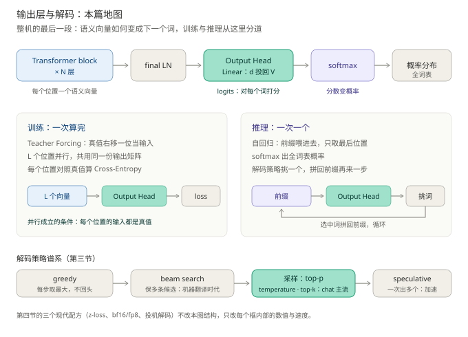
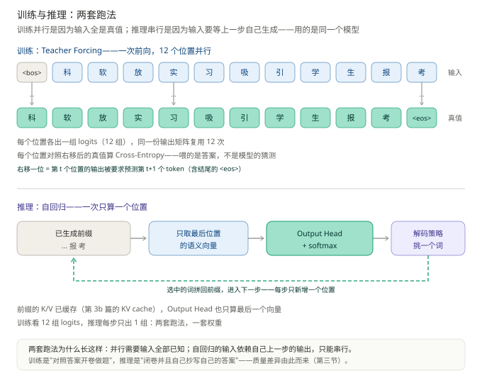
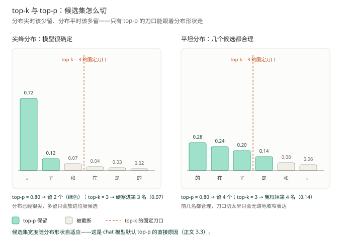
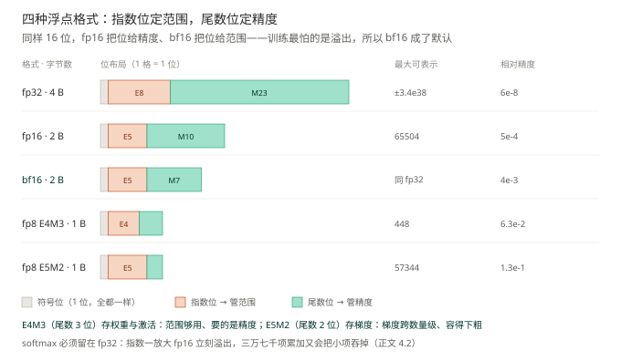
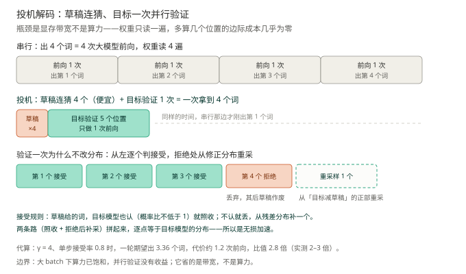
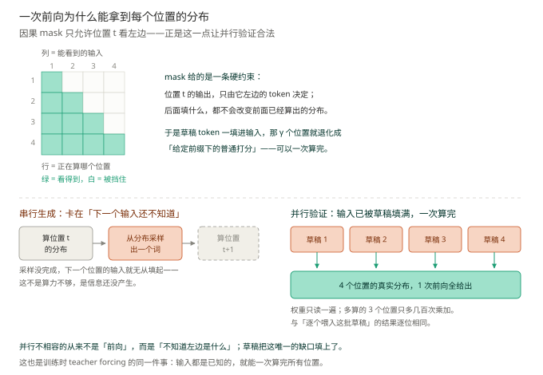
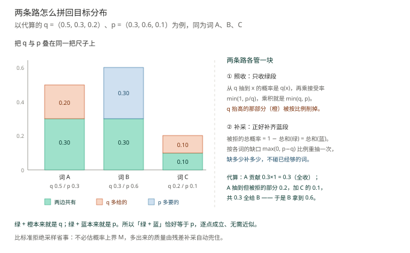

# 输出层与解码：从 logits 到下一个词

> **一句话结论**：输出头把整句理解的成果（一个 $d$ 维向量）重新投影回词表空间，softmax 把"选下一个词"从一次性决定变成对全词表的连续打分——语言模型到这里才算开口说话。**训练与推理也在这一层分道：训练一次并行算完所有位置，推理一次只吐一个 token**。
>
> - **看得懂，说不出**：$N$ 层 block 跑完，每个位置只有一个 $d$ 维语义向量，而词表里只有编号没有"意思"——不投影回去，模型永远说不出词
> - **训练能并行，靠的是输入全是真值**（Teacher Forcing，教师强制）；推理必须串行，因为下一个位置的输入是上一步自己生成的——同一套权重，两套跑法
> - **解码策略决定了"从分布里怎么挑"**：机器翻译时代的 beam search 在开放式生成中退场，今天的 chat 模型默认 top-p 采样；数值上 z-loss 钉住 logits 尺度、bf16/fp8 控制精度、Speculative Decoding（投机解码）让一次能出多个 token

| **前置阅读**：[《残差与归一化：100 层为什么还能训得动》](../残差与归一化/残差与归一化.md)　 | 　**需要先掌握**：softmax、交叉熵、条件概率 |
| ----------------------------------------------- | --------------------------- |

**图 1**：本篇地图。看图要点：上排是整机的最后一段——语义向量经输出头投回词表、softmax 变概率；中部是训练与推理的分岔（第二节），底部是解码策略的谱系（第三节）。第四节的现代配方不改动这张图的结构，只改每个框内部的数值与速度。

例句沿用全系列基线：`科软 放 实习 吸引 学生 报考`，11 个 token；形状按 $L = 11$、$d = 512$、$V = 37000$（2017 年 base 配置）算——今天主流词表已是 128k 量级，37000 只是为了好算好验证。

---

## 一、先看没有它会怎样：模型看得懂，却说不出

> 本节要回答的问题：$N$ 层 block 跑完，每个位置躺着一个 $d$ 维向量——离"说出下一个词"还差哪几步？

先破一个错误直觉：**输出层不是"最后一层普通 Linear"。**它有两点全网络独一份的特殊。

**第一，输出维度是 $V$ 而不是 $d$。**$d$ 维向量装的是"这个位置的意思"，可词表里没有"意思"只有编号。要回答"下一个词是谁"，必须先把语义投回词表空间，和 $V$ 个候选一一对号。

**第二，后面的 softmax 不是装饰。**拿掉它直接对分数取 argmax，有两个死结：argmax 不可导，"选词"这件事就断了梯度，整个网络无法端到端训练；分数本身无界，既不保证非负也不保证和为 1，连"概率"的资格都没有。第 3a 篇见过 softmax 的一次登场（让注意力可导），这里是它第二次干同一件事——把不可导的选择变成可导的分布，只是这次的对象是 37000 个词。

> **精髓句**：嵌入把 token 编号搬进 $d$ 维语义空间，输出头把语义空间投回词表编号——语言建模由此闭环：任何位置的理解成果，最后都要用"和全词表对齐的程度"来打分，softmax 再保证这个打分可导、可当概率。

## 二、原始设计（Vaswani et al., 2017）

### 2.1 输出头：把语义空间投回词表空间

> 本节要回答的问题：投影和 softmax 具体怎么算，参数账怎么算？

$$
z = h_{\text{final}}W_{\text{out}},\qquad
p_i = \frac{e^{z_i}}{\sum_{j=1}^{V}e^{z_j}}
$$

其中 $h_{\text{final}}\in\mathbb{R}^{d}$ 是最后一个位置的语义向量（推理时只用它，见 2.2），$W_{\text{out}}\in\mathbb{R}^{d\times V}$ 是输出矩阵，$z\in\mathbb{R}^{V}$ 叫 logits（未归一化分数），$p$ 是全词表概率。分数无界、概率有归，softmax 负责换算。

**换个视角看投影：它就是拿 $h$ 和每个词的嵌入向量做点积。**第 1 篇讲过嵌入查表是取 $E$ 的一行；当输出矩阵与嵌入共享（$W_{\text{out}} = E^{\top}$）时，$z_i = h\cdot E_i$——"下一个词是谁"被翻译成"哪个词的向量与当前语义最对齐"。绑定嵌入的参数账与三处共享在第 1 篇已算过，结论一句话：**共享后全模型少算一份 $d\times V$，两端被拉进同一个向量空间**，细节指回[《嵌入层》](../嵌入层/嵌入层.md)。

**参数账（base 配置）**：$512\times 37000 = 1894$ 万，约占总参数 65M 的三成——输出头是全网络最大的单件之一，却常常在架构图里只占一个无名小方块。

**代算**：模型读完 11 个 token，在"考"之后要出第 12 个词。设 top-3 logits 为"。" $=4.1$、"了" $=3.2$、"和" $=2.9$（演示值，真实要和全词表一起算），则 $e^{4.1}=60.3$、$e^{3.2}=24.5$、$e^{2.9}=18.2$，合计 103，概率约 **0.59 / 0.24 / 0.18**。训练时拿这个分布和真值算交叉熵，推理时从这个分布里挑词（第三节）。

### 2.2 训练一次算完：Teacher Forcing 与右移一位

> 本节要回答的问题：为什么训练一次能算完全句，推理却要一个一个蹦？

**图 2**：训练与推理的两套跑法。看图要点：训练的输入是真值右移一位，每个位置的输出对齐到下一个真值 token；推理的输入依赖自己上一步的输出，只能循环。

训练时，句子前面补一个 `<bos>`，输入 12 个位置；**目标就是输入整体右移一位**——"科"是 `<bos>` 位置的答案，"软"是"科"位置的答案，以此类推，`<eos>` 是"考"位置的答案。12 个位置**一次前向并行出 12 组 logits**，同一份 $W_{\text{out}}$ 复用 12 次，每个位置独立算交叉熵再平均：

$$
\mathcal{L} = -\frac{1}{L}\sum_{t=1}^{L}\log p_t\left(y_t^*\right)
$$

$p_t$ 是位置 $t$ 的全词表分布，$y_t^*$ 是该位置的真值 token。softmax 配交叉熵的梯度出奇地干净：$\partial\mathcal{L}_t/\partial z_i = p_i - \mathrm{onehot}_i(y_t^*)$——预测减真值，一步到位，没有连乘链。

**这就是 Teacher Forcing（教师强制）**：不管模型上一步猜了什么，每一步都喂正确答案。它成立的前提是训练语料本身完整——每个位置的"标准下一步"都写在数据里，所以 12 个位置可以同时出题、同时判卷。

推理没有这个奢侈品。生成第 13 个词之前，"第 12 个位置的输入"根本不存在——它要等第 11 步自己选出来。**输入依赖自己的输出，是自回归只能串行的全部原因**；训练并行与推理串行用的是同一套权重，没有第二套逻辑。好消息是前缀的 K/V 已缓存（第 3b 篇的 KV cache），每步只算新增的一个位置，输出头也只处理最后一个向量。

> **进阶（可跳过）**：训练永远见真值、推理要消化自己的错误输出，两者的分布并不相同——这叫 Exposure Bias（曝光偏差）。实践中影响比直觉小：强模型很少走出训练分布太远，且采样策略（3.3）本身在制造多样性，真正被它卡住的任务不多。

### 2.3 Label Smoothing：故意不给满分

> 本节要回答的问题：训练时把真值概率往 1 推，为什么反而要故意留一点给别的词？

Label Smoothing（标签平滑，Szegedy et al., 2016）把 one-hot 目标换成"正确词拿大头、其余词均分零头"：

$$
\mathcal{L} = -(1-\epsilon)\hspace{0.1667em}\log p(y^*) - \frac{\epsilon}{V-1}\sum_{i \ne y^*}\log p_i,\qquad \epsilon = 0.1
$$

$\epsilon$ 是漏给其余 $V-1$ 个词的概率质量（论文取 0.1）。效果是模型被要求把 $p(y^*)$ 训到 0.9 附近就停，不必逼到 1。

**代价与收益各占一头。**困惑度（perplexity，$\mathrm{PPL}=\exp(\mathcal{L})$）直接衡量对真值的确信度，而平滑后的目标人为封顶了确信度——所以 **PPL 必然变差**。但生成质量变好：不过度自信的模型在挑词时给次优候选留了活路，beam search 才有像样的候选可比；即便选错，也错在概率更近的近义词上而不是离谱词上。Vaswani et al. (2017) 的原话就是这个组合：**perplexity 变差、BLEU 与准确率变好**。一个指标退、一个指标进的根源是：PPL 度量"对单点的确信"，生成度量"整段分布的质量"，平滑只在后者上得分。

## 三、解码策略：训练优化局部，生成要的是全局

> 本节要回答的问题：拿到全词表概率之后，"挑哪个"有几种挑法？

训练优化的是逐位置的局部条件概率，用户要的是整句话的质量——**这个错位是所有解码策略存在的原因**。挑词方式按"信不信分布"分成三档：只信最大值（greedy）、搜索全局（beam）、按分布抽奖（采样）。

### 3.1 Greedy 与 Beam Search：搜索试图补上错位

Greedy Search（贪心搜索）每步取概率最大者。快，但第一个词贪错便满盘皆输，没有任何回头机制。

Beam Search（束搜索）保 $B$ 条候选并行推进：每步把每条候选向全词表扩展、按总得分保留全局最好的 $B$ 条，最后交出得分最高的一条。总得分用对数概率累加：

$$
\mathrm{score}(y) = \frac{1}{\lvert y\rvert^{\alpha}}\sum_{t}\log p\left(y_t \mid y_{\lt t}\right),\qquad B = 4,\ \alpha = 0.6
$$

论文配置 $B=4$；分母是长度惩罚（Wu et al., 2016，GNMT 提出）：对数概率每多一个 token 就多乘一个小于 1 的因子，**不算长度就会偏爱短句**，除以 $\lvert y\rvert^{\alpha}$ 把账拉平（GNMT 用 $\frac{5+\lvert y\rvert}{6}$ 的平滑版，此处给简化形）。

### 3.2 Beam 为什么在 chat 模型退场

Beam search 在机器翻译上至今是默认——任务有参考答案、输出收敛，搜索"更优"确实更优。**它在开放式生成中退场有两个原因，慢只是次要的那个。**

**第一，开放式生成没有唯一正确答案。**"解释一下这个概念"有一百种好的说法，搜索逼着模型交出"平均最优"的一种——千篇一律。

**第二，强模型走 beam 会退化成重复。**Holtzman et al. (2019) 给出著名实证：GPT-2 级别的模型在续写任务上，beam search 产出 "The few, the few, the few" 这类循环，而"人类文本"恰恰**不是**概率最高的路径——人是在低困惑度的高质量路径里随机行走，并不挑全局最优。按最大后验搜索，搜到的是模型的模式坍缩点。

所以现代 chat 模型全部转向采样：承认最优路径不可搜索，转而控制分布的形状。

### 3.3 采样：Temperature、top-k 与 top-p

**图 3**：top-k 与 top-p 的候选集切法。看图要点：同一把刀口，尖峰分布下 top-k 塞进垃圾候选、平坦分布下 top-k 又切得太早——只有 top-p 的宽度跟着分布形状走。

**Temperature（温度）**先给分布一个"锐度旋钮"：

$$
p = \mathrm{softmax}\left(z / T\right)
$$

$T \lt 1$ 放大分数差距、分布变尖，模型更确定；$T \gt 1$ 抹平差距、更多样。**除 $T$ 之所以是唯一的旋钮，是因为 logits 无界**——softmax 对整体平移不敏感、对整体缩放敏感，缩放因子正好是控制"自信程度"的自由度（数值安全另有专责，见 4.1）。

**top-k**（Fan et al., 2018）只保留概率最大的 $k$ 个、重归一化后采样。刀口位置固定是它的死穴：分布尖时 $k$ 个都嫌多（图 3 左，硬塞进 0.07 的垃圾候选），分布平时 $k$ 个又不够（图 3 右，0.14 的合理候选被切）。

**top-p**（Nucleus Sampling，核采样，Holtzman et al., 2019）改按**累积概率**切：保留累积达到 $p$ 的最小集合。分布尖时自动只留一两个，分布平时自动放宽到四五个——**刀口跟着形状走**。这就是 chat 模型默认 top-p 的直接原因：对话里有的位置必须确定（事实、代码），有的位置应当发散（措辞、语气），一个自适应的候选集同时照顾两头。

## 四、今天在用的配方

> 本节要回答的问题：结构定下来之后，数值和速度怎么管？三个卡点各挂一条配方——logits 的绝对尺度没有任何损失项管（4.1）、尺度失控在低精度下被指数放大（4.2）、逐 token 串行让算力空转（4.3）。

### 4.1 z-loss：把 logits 的尺度钉住

先问一个前面没问过的问题：**logits 有界吗？**没有。$z = h_{\text{final}}W_{\text{out}}$，$h$ 与 $W$ 都没有任何约束项管着，$z$ 想多大就多大。更麻烦的是，损失函数对它的"整体大小"**完全不设防**——分两种漂法看：

**整体平移漂，损失根本看不见。**所有 logits 加同一个常数 $c$，softmax 结果一字不变（第 3a 篇的平移不变性），交叉熵也一字不变。这是损失的一个零梯度方向，没有任何力把它拉回来。

**整体放大漂，损失不但不管，还在推。**单点交叉熵 $-\log p(y^*) = -z_{y^*} + \log Z$ 对正确词的 logit 是**线性**的：$z_{y^*}$ 每加 1，损失就降 1。只要模型对"下一个词是谁"的排序大体正确，把分布整体磨尖（放大差距）就一直在降损失——梯度下降没有理由在这个方向停手。两种漂法合起来，实测中 logits 的绝对值随训练一路爬升。

**漂了为什么是坏事？三个具体后果，全在低精度下发作：**

1. **指数直接溢出。**softmax 要算 $e^{z}$。fp16 上限 65504，$z \gt \ln 65504 = 11.09$ 就溢出成 inf，整步梯度作废——训练到中后期 logits 到 20、30 是常事。
2. **减最大值也救不了小项。**实现上都会先减最大值 $m$ 再算 $e^{z_i - m}$（防上溢）。可 logits 的**跨度**也被拉大后，$z_i - m$ 是很大的负数：fp16 的最小正规数是 $6.1\times10^{-5}$，$z_i - m \lt -9.7$ 时直接下溢成 0——这些 token 的概率变 0、**梯度也变 0**，等于被悄悄从词表里划掉。
3. **三万七千项累加吞掉小项。**$\log Z$ 要把 $V$ 个 $e^{z_i}$ 加起来。bf16 只有 8 位有效位（相对精度 $2^{-8}\approx0.4\%$），顺序累加时小项会被已经变大的部分和整个舍掉（swamping，大数吃小数）；fp32 有 24 位有效位（$6\times10^{-8}$），差约 6.5 万倍。$\log Z$ 一旦不准，$p$ 就不准——而交叉熵梯度恰好是 $p-\mathrm{onehot}$（2.2），误差直接进梯度。

**z-loss 的做法：只惩罚损失不管的那个方向。**PaLM（Chowdhery et al., 2022）在损失里加：

$$
\mathcal{L}_z = c\cdot\log^2 Z,\qquad \log Z = \log\sum_{i=1}^{V}e^{z_i},\qquad c = 10^{-4}
$$

选 $\log Z$ 这个量选得极准：它对整体平移**不是**不变的——所有 $z_i$ 加 $c$，$Z$ 就乘 $e^{c}$，$\log Z$ 恰好加上 $c$。**$\log Z$ 正是"softmax 看不见的那个自由度"的坐标**，惩罚它等于只给这一根轴装弹簧，分布形状一根汗毛都不动。

为什么是平方？求梯度：$\partial\mathcal{L}_z/\partial z_i = 2c\hspace{0.1667em}\log Z\hspace{0.1667em}p_i$——方向是 $p$（整体平移方向），大小正比于 $\log Z$：偏离越大拉力越大，回到 0 附近力也归零。这是一根**线性回复力的弹簧**，不像硬截断（clip）那样在边界上制造不连续、扭曲分布。

**代算：这根弹簧有多硬？**初始化时 logits 接近 0，$\log Z \approx \log V = 10.5$，$\mathcal{L}_z \approx 10^{-4}\times110 = 0.011$，只有交叉熵（$\approx 10.5$）的千分之一——绝不会干扰主任务；但它的梯度 $2c\hspace{0.1667em}\log Z \approx 2\times10^{-3}$ 不随训练衰减，是细水长流的持续拉力，正好按得住缓慢的漂移。

一个常被误解的点：$\mathcal{L}_z$ 的目标值是 0，但没人真指望 $\log Z$ 到 0（那要把所有 logits 压成大负数）。真正的平衡点是主损失"推大差距"与弹簧"压尺度"拉锯的结果——$c$ 只有 $10^{-4}$，平衡点落在"尺度有界、且不影响拟合"的位置。

### 4.2 数值精度：fp16、bf16 与 fp8

要讲清这条演化链，得先看清一个浮点数由什么组成：**符号位 + 指数位 + 尾数位**。指数位决定**范围**（能表示多大、多小），尾数位决定**精度**（两个数能分多细）。总位数固定，这两件事在抢同一块预算——这是整张演化表唯一的矛盾：

**图 4**：四种格式的位分配。看图要点：fp16 与 bf16 同为 16 位，区别只在指数与尾数的切法；fp8 连 8 位都不够分，索性拆成两个变体按用途分工。

**fp16 的困境：范围太窄。**10 位尾数给精度（$2^{-11}\approx5\times10^{-4}$，够用），指数只剩 5 位，上限 65504——4.1 算过，$z \gt 11$ 就溢出。梯度那边更糟：梯度值经常小到 $10^{-8}$，低于 fp16 的最小正规数 $6.1\times10^{-5}$ 就被舍成 0，**这批参数等于停止更新**。

**loss scaling（损失缩放）：一个补丁。**既然下溢是因为"数太小"，就在算损失前整体乘一个 $2^{k}$，链式法则把所有梯度同比例放大 $2^{k}$、落回可表示区间，更新前再除回去。麻烦在 $k$ 得动态调：出现 inf/nan 就减半并跳过这一步，连续多步正常再翻倍。**这套脚手架的存在本身，就是 fp16 范围不够的证据。**

**bf16：用精度换范围。**同样 16 位，把指数位从 5 恢复到 8（与 fp32 完全同范围），尾数剩 7 位，相对精度降到 $2^{-8}\approx0.4\%$。深度学习的数值恰好"范围要得急、精度能让"：权重与梯度跨十几个数量级，而单个数 0.4% 的误差比 SGD 本身的噪声还小。于是 bf16 不再需要 loss scaling，成了今天训练的默认。一句话记住分工：**fp16 精度好但会溢出，bf16 不溢出但粗——训练最怕的是溢出。**

**fp8：连 8 位都要省，只好分成两种。**8 位里 1 位符号，剩 7 位怎么切都不够，所以标准（OCP）直接给了两个变体（Micikevicius et al., 2022），按用途分工：**E4M3**（4 位指数 + 3 位尾数，上限 448、精度 6%）存**权重与激活**——范围可控、更需要精度；**E5M2**（5 位指数 + 2 位尾数，上限 57344、精度 12.5%）存**梯度**——范围跨数量级、对精度最宽容。（很多实现还配 per-tensor 缩放因子把数值搬进可用区间——本质是 loss scaling 的推广。）

**为什么 softmax 永远留在 fp32——这条守门规则值得单独记。**三个理由一条比一条硬：

1. $e^{z}$ 是指数放大，输入的微小误差直接被推到溢出边缘；
2. 求和跨 $V = 37000$ 项，低精度累加吞小项（4.1 后果 3）；
3. 最要命的一条：交叉熵梯度是 $p - \mathrm{onehot}$。收敛后 $p(y^*)\approx0.999$，真值梯度约 $-10^{-3}$；而 bf16 在 1 附近的绝对误差是 $\pm4\times10^{-3}$——**真实梯度比量化噪声还小**，更新方向接近随机。两个接近的数相减、相对误差被放大成绝对误差，这叫灾难性抵消（catastrophic cancellation）。

所以标准做法是：**矩阵乘用低精度，softmax 与 $\log Z$ 用 fp32 算完再转回去**。"混合精度"的"混"不是随便混，是按每一步的数值性质分工。

**再记一笔显存账。**logits 张量形状是 $[\text{token 数},\hspace{0.1667em}V]$：一次迭代 400 万 token、词表 12.8 万，bf16 下就是 $4\times10^{6}\times1.28\times10^{5}\times2\text{B} \approx 1\text{TB}$——根本存不下。所以现代实现不真的写出这个矩阵，而是分块算、边算边归约（fused linear cross-entropy，融合线性交叉熵）。输出头是参数大头（2.1），它的**激活**也是大头——这正是 fp8 优先用在这一层的原因。

### 4.3 Speculative Decoding：为什么可以并行验证，且不改分布

**先看瓶颈在哪。**出一个 token，要把全部权重从显存读一遍：70B 模型 fp16 是 140 GB，按 3 TB/s 的带宽读就要约 47 ms，而这些乘加本身用不到 1 ms——**九成时间在搬数据，算力在空转**。这意味着：只要能在同一次前向里多算几个位置，多算的部分几乎白送（权重只读一遍）。

但自回归的因果结构堵死了这条路：第 $t+1$ 个位置要等第 $t$ 个的结果。**Speculative Decoding（投机解码，Leviathan et al., 2023）的破局点：如果已经有人把后面几个词猜出来了，输入就是已知的，验证就可以并行**——$\gamma$ 个位置一次算完。

**先把两个模型、两个分布分清。**这里的"分布"就是对"下一个词是哪个"的打分表：词表里每个候选给一个概率，全部加起来是 1。**采样**就是从这张表里按概率抽一次——概率 0.6 的词，有六成机会被抽中。

- **目标模型（target model）**：最终要部署的那个大模型，它给出的打分表叫**目标分布 $p$**——这是我们真正想要的结果。
- **草稿模型（draft model）**：一个便宜的小模型（或大模型上加的轻量头），它给出的打分表叫**草稿分布 $q$**——便宜、大致跟得上，但不完全准。

拿固定例句说：已经生成到「科软 放 实习」，现在要出下一个词，「吸引」「学生」「报考」各有机会。大模型给这三者一套概率（$p$），小模型给同样这三者另一套概率（$q$）——**同一位置、同一前缀，只是打分方不同**，所以两套数字可以直接比较。

**为什么必须分清。**直接用 $q$ 采样，输出就是小模型的水平；每个词都用 $p$ 采样，就是普通解码（准确但慢，一次只出一个词）。投机解码要的是"$q$ 的速度 + $p$ 的分布"，于是每一步都必须回答一个问题：**$q$ 抽出来的词，$p$ 认不认、认多少？**这就是下面的接受规则。

**流程三步：**

1. 草稿模型自回归连猜 $\gamma$ 个 token——它便宜，猜 $\gamma$ 次的代价大约只有目标模型一次前向的二十分之一；
2. **目标模型把这 $\gamma$ 个位置一次前向**，拿到每个位置的目标分布 $p$（成本约等于一次单个位置的前向——瓶颈是读权重，不是算力）；
3. 从左到右逐个判接受/拒绝，收下最长的接受前缀；第一个拒绝处从修正分布重采一个词，回到第 1 步。

**图 5**：串行与投机的时间线对比，以及"接受/拒绝"的判法。看图要点：验证一次天然多拿一个词（目标模型在最后一个位置自己出的那个）；拒绝处之后的草稿全部作废——所以猜得越准越快，但猜错不损失正确性。

**第 2 步值得单独拆开：为什么一次前向就能拿到每个位置的分布？**答案藏在因果 mask 的硬约束里（图 6 左上）：位置 $t$ 的输出只由它左边的 token 决定，后面填什么都不改变它——$z_t$ 只是前缀的函数。串行生成之所以必须一步步来，**不是前向不能并行，而是下一个位置的输入还没产生**：$x_{t+1}$ 要从 $z_t$ 采样出来才存在，没采出来就没东西可填（图 6 左下）。而验证时这个缺口恰好被草稿填平：草稿 token 直接写进输入，$\gamma$ 个位置全部退化成"给定前缀下的普通打分"，一次前向同时算出 $z_t,\hspace{0.1667em}\ldots,\hspace{0.1667em}z_{t+\gamma}$（图 6 右下）——与串行地逐个喂入这批草稿**逐位相同**，不是近似。

成本也因此约等于一次单位置前向：读权重的时间与序列长度几乎无关，多算 $\gamma$ 个位置只多几百次乘加。这正是 2.2 里 Teacher Forcing 的同一件事——输入全是已知的，就能一次算完所有位置——只是输入从"真值"换成了"草稿"。

**图 6**：并行验证为什么合法。看图要点：mask 表保证位置 $t$ 只依赖前缀；串行的卡点是"采样没完成、下一个输入无从填起"；验证时草稿填满输入，依赖消失。代价也由此而来：拒绝处之后的分布是基于"草稿前缀"算的——前缀错了，那些位置必须作废重算。

**接受规则，以及"为什么无损"。**沿用上面的 $q$ 与 $p$。规则只有两条，各管一块概率质量（图 7）：

**第一步：从 $q$ 抽一个候选，按目标的满意度打折收下。**从 $q$ 抽到 $x$ 本身花了 $q(x)$ 的概率；草稿与目标在 $x$ 上的分歧用比值 $\frac{p(x)}{q(x)}$ 度量——目标比草稿更想要它（比值 $\gt 1$）就全收，草稿吹了过头（比值 $\lt 1$）就按比例打折。合起来就是**以概率 $\min\left(1,\hspace{0.1667em}\frac{p(x)}{q(x)}\right)$ 接受**。这一步的产出是

$$
q(x)\cdot\min\left(1,\hspace{0.1667em}\frac{p(x)}{q(x)}\right)=\min\left(q(x),\hspace{0.1667em}p(x)\right)
$$

——两个分布中**较小的**那个：q 抬高的部分被削掉（图 7 橙段），两边共有的部分原样保留（绿段）。

**第二步：被拒的概率去哪了？正好补到"目标更想要"的词上。**被拒的总概率是 $1-\sum_x\min\left(q(x),\hspace{0.1667em}p(x)\right)$，展开恰好等于 $\sum_x\max\left(0,\hspace{0.1667em}p(x)-q(x)\right)$——**正是"目标比草稿多出来的总量"**（图 7 蓝段）。所以被拒后按各词缺口的比例归一化重抽：

$$
r(x) = \frac{\max\left(0,\hspace{0.1667em}p(x)-q(x)\right)}{\sum_{x'}\max\left(0,\hspace{0.1667em}p(x')-q(x')\right)}
$$

分子"缺多少"，分母"总缺口"——只往 $p$ 比 $q$ 大的词里补，不碰已经够的词。

**两步合并，逐点等于 $p$：**

$$
\underbrace{q(x)\hspace{0.1667em}\min\left(1,\frac{p(x)}{q(x)}\right)}_{\text{第一步：照收}}
+\underbrace{P(\text{拒})\hspace{0.1667em}r(x)}_{\text{第二步：补采到 }x}
=\min\left(q(x),\hspace{0.1667em}p(x)\right)+\max\left(0,\hspace{0.1667em}p(x)-q(x)\right)=p(x)
$$

最后一个等号分两种情况各验一次，就是全部证明：$p(x)\ge q(x)$ 时两项是 $q(x)$ 与 $p(x)-q(x)$，和为 $p(x)$；$p(x)\lt q(x)$ 时两项是 $p(x)$ 与 $0$，还是 $p(x)$。没有任何近似——**输出分布逐点等于纯目标模型采样**，这就是"无损"两个字的全部含义。注意式子里没有 $\gamma$：逐位置的正确性不依赖接受率，接受率只影响速度——猜错只会慢，不会错。

**图 7**：两条路怎么拼回目标分布（用下方代算的数据画）。看图要点：绿 + 橙本来就是 $q$，绿 + 蓝本来就是 $p$；照收拿走绿、补采填上蓝，两者相加恰好是 $p$。比起标准拒绝采样（rejection sampling）还省一件事：不必估概率上界 $M$，多出来的质量由残差补采自动兜住。

**代算（跟着数字走一遍）**：某位置草稿说 $q=(0.5,\hspace{0.1667em}0.3,\hspace{0.1667em}0.2)$（词 A/B/C），目标说 $p=(0.3,\hspace{0.1667em}0.6,\hspace{0.1667em}0.1)$。

- 抽到 A（概率 0.5）：接受率 $\min(1,\hspace{0.1667em}0.3/0.5)=0.6$，贡献 $0.5\times0.6=0.3$；
- 抽到 B（0.3）：接受率 $\min(1,\hspace{0.1667em}0.6/0.3)=1$，必收，贡献 $0.3$；
- 抽到 C（0.2）：接受率 $\min(1,\hspace{0.1667em}0.1/0.2)=0.5$，贡献 $0.1$；
- 被拒的总概率 $=1-(0.3+0.3+0.1)=0.3$（A 的 0.2 加 C 的 0.1）；残差 $\max(0,\hspace{0.1667em}p-q)$ 只有 B 非 0，归一化后这 0.3 全部补采到 B；
- 核对：$P(A)=0.3$，$P(B)=0.3+0.3=0.6$，$P(C)=0.1$——逐项等于 $p$，两条路严丝合缝。

**加速账**：$\gamma=4$、单步接受率 $\alpha=0.8$ 时，一轮期望产出 $\frac{1-\alpha^{\gamma+1}}{1-\alpha}=\frac{1-0.8^5}{0.2}=3.36$ 个 token（含最后白送的一个），代价约 $1+4\times0.05=1.2$ 次目标前向（草稿成本按目标的二十分之一计），加速比 $3.36/1.2\approx2.8$——对上实测的 2–3 倍。

**两个边界必须记。**它省的是**带宽**不是算力——大 batch 下 GPU 已经算力饱和，并行验证反而添堵，所以它主要用在低 batch 的在线服务；接受率取决于草稿有多像目标——外挂小模型要能力相近，同源方案（目标模型自己加多 token 预测头，即 MTP，Multi-Token Prediction，如 DeepSeek-V3）接受率更高、也不用多部署一个模型。MTP 把这件事搬到训练阶段：训练时就要求一次预测多个未来位置，推理时那个头天然就是草稿——这里只记名字，机制留给装配篇。

**收束**：z-loss 管住损失看不见的自由度，精度分工保证每一步还算得准，投机解码把"串行"这个结构约束在调度层绕开——三者都不改结构，改的是**数值的边界**与**时间的用法**。前三节回答"结构为什么长这样"，这一节回答"同样的结构怎么才跑得动、跑得快"。

## 五、小结

| 机制 | 解决什么（缺了会怎样） | 精髓一句话 | 代价 |
| --- | --- | --- | --- |
| Output Head + softmax | 不投影永远说不出词；argmax 不可导训不动 | 把 $d$ 维语义投回词表、把"选谁"变成可导分布 | $d\times V$ 是参数大头；logits 无界 |
| Teacher Forcing | 没有它训练要串行 $L$ 次前向 | 输入全用真值，$L$ 个位置才得以并行 | 与推理分布有偏差（Exposure Bias） |
| Label Smoothing | 过度自信导致生成错得离谱 | 故意留概率质量给次优候选 | PPL 变差（与 BLEU 背离） |
| Beam Search | greedy 局部最优、无法回头 | 保多条候选全局权衡 + 长度惩罚拉平偏好 | 成本 $\times B$；开放式生成退化为重复 |
| top-p 采样 | 固定候选集不自适应 | 刀口跟着分布形状走 | 需与 temperature 配合 |
| z-loss | logits 尺度漂移放大低精度误差 | 压住 $\log\sum e^{z}$，形状不动、尺度不漂 | 多一个超参 |
| Speculative Decoding | 逐 token 受显存带宽限制 | 小模型起草、大模型并行验证 | 需要草稿模型；分布严格不变（无损） |

## 六、面试易错点

| 面试考点 | 常见答错 | 正确答法 | 面试官在考什么 |
| --- | --- | --- | --- |
| softmax 前为什么要除 temperature | "防止 softmax 数值溢出" | 温度是锐度旋钮：$z/T$ 整体缩放 logits，$T$ 小更确定、$T$ 大更多样；数值安全靠 fp32 和 z-loss | 是否分清"控制分布形状"与"数值稳定"两件事 |
| 训练为什么能并行、推理不能 | "因为 GPU 快 / batch 大" | Teacher Forcing：训练输入全是真值所以 $L$ 个位置并行；推理输入依赖上一步自己的输出，只能自回归 | 是否理解自回归的因果依赖，而不是背工程现象 |
| beam search 为什么现在少用 | "因为太慢" | 主因是开放式生成下 beam 产出重复文本、千篇一律（Holtzman et al., 2019）：人类文本本就不是概率最高路径；慢是次要的 | 是否读过退化证据、分得清任务差异 |
| 输出头和嵌入共享权重省多少 | "省一点吧" | $d\times V$ 一份：base 配置约 19M / 总 65M，近三成；还把输入端与输出端拉进同一向量空间 | 会不会算参数账、知不知道共享的第二个理由 |
| label smoothing 有什么副作用 | "没有副作用，全面更好" | PPL 明显变差——目标人为把 $p(y^*)$ 封顶在 $1-\epsilon$；换来生成质量与稳健性 | 是否知道两个指标可以背离、为什么背离 |
| top-k 和 top-p 的区别 | "都是截断，差不多" | top-k 固定候选个数、top-p 固定累积概率质量；分布形状变时只有 top-p 的候选集宽度自适应 | 能不能画出尖峰/平坦两种分布下的对比（图 3） |
| speculative decoding 为什么不改变输出 | "用小模型，肯定有损" | 接受/拒绝采样带修正项，输出分布与目标模型严格相同；这是无损加速，损的只是显存 | 是否理解"验证可以并行"与分布保持的机制 |

## 七、引用论文

1. Vaswani, A., et al. Attention Is All You Need. NeurIPS 2017. arXiv:1706.03762
2. Szegedy, C., et al. Rethinking the Inception Architecture for Computer Vision. CVPR 2016. arXiv:1512.00567（label smoothing）
3. Wu, Y., et al. Google's Neural Machine Translation System: Bridging the Gap between Human and Machine Translation. arXiv 2016. arXiv:1609.08144（beam 配置与长度惩罚）
4. Fan, A., Lewis, M., Dauphin, Y. Hierarchical Neural Story Generation. ACL 2018. arXiv:1805.04833（top-k 采样）
5. Holtzman, A., et al. The Curious Case of Neural Text Degeneration. ICLR 2020. arXiv:1904.09751（nucleus / top-p）
6. Chowdhery, A., et al. PaLM: Scaling Language Modeling with Pathways. JMLR 2023. arXiv:2204.02311（z-loss）
7. Micikevicius, P., et al. FP8 Formats for Deep Learning. arXiv 2022. arXiv:2209.05433
8. Leviathan, Y., Kalman, M., Matias, Y. Fast Inference from Transformers via Speculative Decoding. ICML 2023. arXiv:2211.17192
